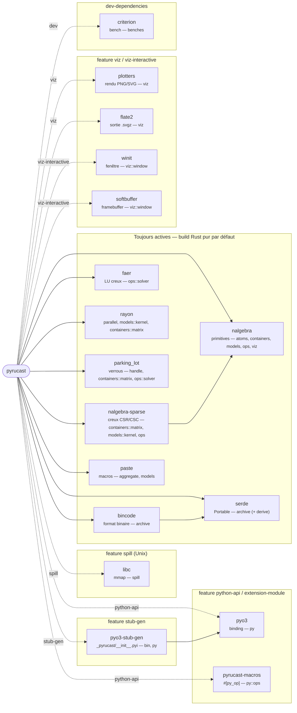

# Arborescence

La carte des sources : où vit chaque morceau. La règle d'or est la
**séparation conteneurs / opérateurs / binding** — les structures de données
(`containers/`) ne connaissent pas les opérateurs (`ops/`), et le binding
Python (`py/`) est un miroir 1:1 qui n'ajoute aucune logique.

Deux découpages secondaires en découlent, et l'arborescence les rend
visibles : les types indivisibles vivent dans `atoms/` (seul un conteneur
peut être le sujet d'un opérateur), et chaque module d'`ops/` porte le nom
du **conteneur qu'il produit**.

Le dépôt tient **deux paquets**. À côté de la bibliothèque, `macros/` porte la
macro procédurale `#[py_op]`, qui dérive d'un opérateur libre la méthode de son
sujet (voir [Macros Rust](macros-rust.md)). Cette séparation n'est pas un choix
de rangement : une crate `proc-macro` ne peut rien exporter d'autre que des
macros, et une crate ordinaire ne peut pas en contenir.

```text
macros/
└── src/lib.rs          # `#[py_op]` : receveur déduit du sujet, signature pyo3
                        #   amputée de son entrée de tête, `#[doc]` et
                        #   `#[allow]` recopiés sur la méthode
```

```text
src/
├── lib.rs              # racine de la crate + #[pymodule] (enregistrement Python)
│
├── handle.rs           # Handle<T> : Arc<RwLock<T>>, guards possédés, identité
├── error.rs            # PyrucastError + Result (l'unique type d'erreur)
├── dump.rs             # trait Dump (3ᵉ niveau d'affichage : contenu intégral)
├── aggregate.rs        # trait Aggregate + macros (len/[i]/union, méthodes Python)
├── named.rs            # trait Named + macro named_enum! (une valeur ↔ son nom)
├── parallel.rs         # prelude rayon + politique de grain (MIN_PARALLEL_LEN)
├── interrupt.rs        # trait Cancel + jetons (NoCancel, AtomicBool, Deadline)
├── spill.rs            # allocations placées dans des fichiers (feature `spill`)
│
├── coords.rs           # LE MAGASIN : Coords (jeux de coordonnées, compteur par nœud)
│
├── archive/            # SAUVEGARDE ET RELECTURE d'un graphe d'objets
│   ├── mod.rs              # save / load, trait Archivable, enum Root
│   ├── portable.rs         # trait Portable (serde + bincode), format portable
│   ├── registry.rs         # la table « étiquette du fichier → type »
│   └── scope.rs            # un Handle devient un numéro, et inversement
│
├── atoms/              # LES INSÉCABLES (jamais sujet d'un opérateur)
│   ├── mod.rs
│   ├── node.rs         # Node (accesseur RAII) + NodeId
│   ├── cell.rs         # Cell (désigne une maille d'un SubMesh)
│   ├── element.rs      # Element (désigne un élément d'un SubFiniteElementSpace)
│   ├── element_type.rs # enum ElementType (stockage, sérialisation, ALL, nom)
│   ├── element_kind/   # UN FICHIER PAR ÉLÉMENT + le trait qui les lie
│   │   ├── mod.rs          # trait ElementKind, Facet, ElementType::as_kind()
│   │   ├── interpolation.rs# enum Interpolation (le degré de Lagrange d'un élément)
│   │   ├── quadrature.rs   # enum QuadratureRule (règles et briques partagées)
│   │   ├── hermite.rs      # base d'Hermite cubique sur le segment (poutres)
│   │   └── poi1.rs, seg2.rs, tri3.rs, …, hex27.rs  # un par type d'élément
│   ├── point.rs        # Point2 / Point3 / Vector2 / Vector3 (nalgebra)
│   ├── band.rs         # Band (bande de valeurs ge/gt/le/lt — mask, select)
│   └── color.rs        # RgbColor (couleur de face, viz)
│
├── containers/         # LES DIVISIBLES (structures de données, aucune dépendance à ops/)
│   ├── mod.rs
│   ├── mesh.rs         # Mesh, SubMesh
│   ├── finite_element_space/
│   │   └── mod.rs          # FiniteElementSpace, SubFiniteElementSpace
│   ├── field.rs        # traits Field / SubField (contrat commun des champs)
│   ├── node_field.rs   # NodeField / SubNodeField
│   ├── element_field.rs# ElementField / SubElementField
│   ├── model.rs        # Model / SubModel (enum de stockage + as_kind)
│   ├── matrix.rs       # Matrix / SubMatrix (matrice creuse)
│   └── evolution.rs    # Evolution / SubEvolution (valeur tabulée, interpolée)
│
├── models/             # LES PHYSIQUES (une struct + impl SubModelKind par fichier)
│   ├── mod.rs              # traits SubModelKind / Domain / Behavior / Constraint,
│   │                       #   MatrixKind, macro physics_operator!
│   ├── kernel.rs           # LES DRIVERS parallèles au-dessus des noyaux purs
│   ├── tensor.rs           # notation de Voigt, hypothèse cinématique (Kinematics)
│   ├── symmetry.rs         # symétrie matériau (isotrope, orthotrope, anisotrope)
│   ├── heat_conduction.rs
│   ├── fick.rs             # diffusion (loi de Fick)
│   ├── radiation.rs        # rayonnement vers l'infini (Stefan-Boltzmann)
│   ├── boundary_transfer.rs# échange de surface avec une ambiante (Robin / film)
│   ├── interface_transfer.rs # échange à travers une interface entre deux maillages
│   ├── transfer.rs         # la loi d'échange h(a − b), partagée par les deux échanges
│   ├── flux.rs             # charge répartie ∫ φ N
│   ├── continuum/          # LA MODÉLISATION continue, partagée par les trois
│   │   │                   #   familles mécaniques — pas une physique
│   │   ├── mod.rs          #     Continuum + les noyaux K, M, Kg, Kt
│   │   ├── voigt.rs        #     nomenclature ε / σ / D_alg, lecture par indice
│   │   ├── elastic.rs      #     l'opérateur élastique (D, λ, μ) — prédicteur
│   │   │                   #     de la plasticité, module sain de l'endommagement
│   │   ├── material.rs     #     MatRead : la ligne matériau lue par position
│   │   ├── finite_strain.rs#     transport des mesures de contrainte (grandes transformations)
│   │   └── internal_force.rs #   Bᵀσ, aussi appelé sans sous-modèle
│   ├── truss.rs
│   ├── elasticity.rs       # LA physique élastique, pour toute loi sans état
│   ├── elasticity/
│   │   ├── law.rs          #     ElasticLaw (identité) + StatelessLawKind
│   │   └── linear.rs       #     σ = D:ε
│   ├── plasticity.rs       # LA physique élastoplastique, pour toute loi
│   ├── plasticity/
│   │   ├── law.rs          #     PlasticLaw (identité) + ReturnMapLawKind
│   │   └── von_mises.rs, drucker_prager.rs, ottosen.rs, viscous.rs, gurson.rs
│   ├── damage.rs           # LA physique d'endommagement, pour toute loi
│   ├── damage/
│   │   ├── law.rs          #     DamageLaw (identité) + DirectUpdateLawKind
│   │   └── mazars.rs, damage_tc.rs, sic_sic.rs
│   ├── beam.rs             # ce que partagent les deux théories de poutre
│   ├── bernoulli.rs        # poutre d'Euler-Bernoulli
│   ├── timoshenko.rs       # poutre de Timoshenko
│   ├── frame.rs            #   ses noyaux en configuration plane (portique)
│   ├── frame3d.rs          #   ses noyaux en configuration spatiale
│   ├── shell.rs            # LA physique de coque, pour toute formulation
│   ├── shell/
│   │   └── thick.rs, kirchhoff.rs   # Reissner-Mindlin ; Kirchhoff discret
│   ├── dirichlet.rs        # contrainte (multiplicateurs de Lagrange)
│   ├── mpc.rs              # relation multi-points
│   ├── embedded.rs         # baignage (nœuds immergés dans un hôte)
│   └── contact.rs          # contact nœud-surface (unilatéral)
│
├── ops/                # LES OPÉRATEURS — un module par conteneur produit
│   ├── mod.rs
│   ├── mesh/           # → Mesh : mailleurs, transformations, select, lecture gmsh
│   │   ├── triangulation.rs, triangulation/  # briques 2D : découpage par oreilles,
│   │   │                   #   Delaunay contraint (Bowyer-Watson), raffinement de Ruppert
│   │   ├── tetrahedralization/  # Delaunay 3D (prédicats exacts, récupération de la peau, …)
│   │   ├── paving/         # front avançant 2D (pave_surface, grid_surface)
│   │   ├── plaster/        # front avançant 3D (pave_volume)
│   │   └── improve/        # regularize, cleanup, merge_triangles
│   ├── finite_element_space/ # → FiniteElementSpace : restrict
│   ├── node_field/     # → NodeField : positions, divergence, restrict, project,
│   │                   #   forces internes et externes, …
│   ├── element_field/  # → ElementField : gradient, deformation, strain,
│   │   │               #   material_field, tensor_dot, tensor_ddot, …
│   │   └── behavior.rs     # intégration de la loi de comportement
│   ├── model/          # → Model : les déclarations de physique. Les formes
│   │                   #   courantes sont déclarées dans models/<nom>.rs et
│   │                   #   seulement ré-exportées ici ; les contraintes, le
│   │                   #   transfert d'interface et les deux lois génériques
│   │                   #   gardent leur fichier
│   ├── matrix.rs       # → Matrix : stiffness, mass, geometric, tangent, lump
│   ├── evolution/      # → Evolution : along
│   ├── coords.rs       # écrit dans le magasin : set, displace, displace_from ;
│   │                   #   calcule dans une configuration : in_config
│   ├── measure/        # → un nombre : integral
│   ├── geom/           # → une position : locate_points, project_points (internes)
│   ├── field/          # opérateurs génériques champ → même type : psca, abs, sqrt, …
│   ├── solver/         # → NodeField (l'exception nommée) : solve et ses variantes
│   ├── export/         # effets de bord : export VTK, to_arrays
│   ├── coloring.rs     # coloriage des mailles pour l'assemblage parallèle (pas un opérateur)
│   └── scatter.rs      # dispersion dans un motif creux CSR (pas un opérateur)
│
├── py/                 # BINDING PyO3 (miroir 1:1 de containers/ + ops/)
│   ├── mod.rs
│   ├── coords.rs, node.rs, cell.rs, mesh.rs, …   # un wrapper Py<Foo> par objet
│   ├── field_macros.rs, field_methods.rs, field_slots.rs  # ce que les champs partagent
│   ├── archive.rs      # save / load côté Python
│   ├── arrays.rs       # lecture d'un tableau Python sans copie (classe Array)
│   ├── spill.rs        # spill_stats
│   ├── signals.rs      # jeton PySignals (Ctrl+C via Python::check_signals)
│   └── ops/            # un wrapper par module d'opérateurs
│
├── viz/                # VISUALISATION (feature `viz` / `viz-interactive`)
│   ├── mod.rs, drawable.rs, mesh_draw.rs, camera.rs, field_color.rs,
│   │                     axes.rs, curve.rs, overlay.rs, revolve.rs
│   ├── subdivide.rs    # rendu interpolé (découpe des faces)
│   └── window.rs       # fenêtre interactive (feature `viz-interactive`)
│
└── bin/
    ├── stub_gen.rs     # génère le stub .pyi (feature `stub-gen`)
    ├── scaling.rs      # mesure de montée en charge (parallélisme)
    └── solve_peak.rs   # mesure de la mémoire d'une résolution directe
```

Le **paquet Python** est à côté des sources Rust : le projet est un *mixed
layout* maturin, et l'extension compilée est le sous-module **privé**
`_pyrucast`, plat. La couche Python pure ne fait que le ranger — c'est elle qui
donne à l'API sa forme publique (`pyrucast.<module>.<verbe>`).

```text
python/pyrucast/
├── __init__.py        # conteneurs + atomes au top-level (Mesh, Coords, …)
├── mesh.py            # un module par module d'ops/ : ré-exporte _pyrucast
├── node_field.py      #   en rendant leur vrai nom aux homonymes
├── element_field.py   #   (`consolidate_mesh as consolidate`, …)
├── matrix.py, model.py, field.py, measure.py, export.py, solver.py, coords.py,
│   evolution.py, finite_element_space.py
├── _gmsh.py           # échange avec une session gmsh vivante (from_gmsh, to_gmsh)
├── _med.py            # échange avec medcoupling (from_medcoupling, to_medcoupling)
├── stepping/          # couche Python pure : le calcul pas à pas
├── py.typed
└── _pyrucast/
    └── __init__.pyi   # stub typé, généré par stub_gen, versionné
```

À la racine du dépôt :

```text
Cargo.toml          # les deux paquets (workspace), features, dépendances approuvées
pyproject.toml      # côté maturin (python-source = python, module-name)
CONVENTIONS.md      # règles de code (source de la page Conventions)
script/check_all.sh # enchaîne les vérifications (check_*.sh isolément)
tests/              # tests d'intégration Rust (*.rs) + tests Python (python/)
examples/           # scripts complets (thermique, treillis, poutres…)
tutoriel/           # scripts du tutoriel débutant
benches/            # bancs criterion (parallel.rs, geom.rs, mesh.rs)
book/               # cette documentation (mdbook)
```

## Graphe des dépendances externes

Les crates tierces (`Cargo.toml`) et, pour chacune, le module où elle est
**confinée** — une des règles du projet est qu'une dépendance ne fuit pas hors
de son étage. Les arêtes pleines sont toujours liées ; les arêtes pointillées
ne le sont que si la **feature** correspondante est activée. Le `cargo build`
par défaut est **Rust pur** : rien de pointillé n'est compilé.



Les implications de features (`Cargo.toml`) :

| Feature | Active |
|---|---|
| `python-api` | `pyo3`, `pyrucast-macros` |
| `extension-module` | `python-api`, `spill`, et demande à `pyo3` de **ne pas** lier `libpython` — l'interpréteur hôte le fournit |
| `spill` | `libc` (Unix seulement) |
| `viz` | `plotters`, `flate2` |
| `viz-interactive` | `viz`, `winit`, `softbuffer` |
| `stub-gen` | `python-api`, `viz`, `pyo3-stub-gen` |
| `abi3` | `pyo3/abi3-py311` (API stable de Python ≥ 3.11) |

Le confinement annoté ci-dessus est la raison pour laquelle le cœur de calcul
reste compilable et testable sans aucune de ces crates optionnelles.

## Les trois couches, et pourquoi

| Couche | Rôle | Ne dépend pas de |
|---|---|---|
| `containers/` | structures de données + règles de cohérence | `ops/`, `py/` |
| `ops/` | opérateurs croisant des conteneurs | `py/` |
| `py/` | exposition Python (PyO3), miroir 1:1 | — |
| `python/pyrucast/` | rangement du module plat `_pyrucast` en sous-modules | — |

Cette stratification garde le cœur de calcul **testable sans Python** (`cargo
test`) et **réutilisable** en pure crate Rust. Le `models/` est à part : ce
sont les physiques, branchées sur les conteneurs (`Model`/`SubModel`) via le
trait `SubModelKind` — voir [Ajouter une physique](../ajouter-une-physique.md).

## Où ajouter quoi ?

| Pour ajouter… | Toucher principalement |
|---|---|
| un type d'élément | `atoms/element_kind/<nom>.rs` + `mod <nom>;` et un bras de `as_kind()` dans `atoms/element_kind/mod.rs` + dans `atoms/element_type.rs` la variante, son entrée dans `ALL` et un bras dans `nodes_per_cell`, `topological_dim`, `name`, `reversal_permutation` et le test `all_lists_every_variant_exactly_once` ([guide](ajouter-un-element-fini.md)) |
| une physique | `models/<nom>.rs` (physique, tests **et** opérateur via `physics_operator!`) + une variante et un bras de `as_kind()` dans `containers/model.rs` + `pub mod` dans `models/mod.rs`, `pub use` dans `ops/model/mod.rs`, `add_function` dans `lib.rs`, l'import dans `python/pyrucast/model.py` ([guide](../ajouter-une-physique.md)) |
| un opérateur | `ops/<conteneur produit>/<nom>.rs` + son wrapper `py/ops/<même module>.rs` + son `add_function` dans `lib.rs` + son ré-export dans `python/pyrucast/<même module>.py` |
| un objet conteneur | `containers/<nom>.rs` + `py/<nom>.rs` + son `add_class` dans `lib.rs` + son ré-export dans `python/pyrucast/__init__.py` + l'archive (variantes de `Root`, une ligne dans `shared!` / `inline!`, `accessors!` / `take_accessors!`, `inline_roots!`, et la conversion de `py/archive.rs`) + un chapitre de doc |

> **Le dernier site est facile à oublier.** Une fonction libre exposée par
> PyO3 atterrit dans le module **plat** `_pyrucast` ; tant qu'elle n'est pas
> ré-exportée dans `python/pyrucast/<module>.py`, elle n'existe pas dans l'API
> publique. Les homonymes y reprennent au passage leur vrai nom
> (`consolidate_mesh as consolidate`) — voir
> [Conventions & philosophie](../conventions.md#le-miroir-python).
