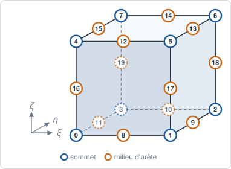
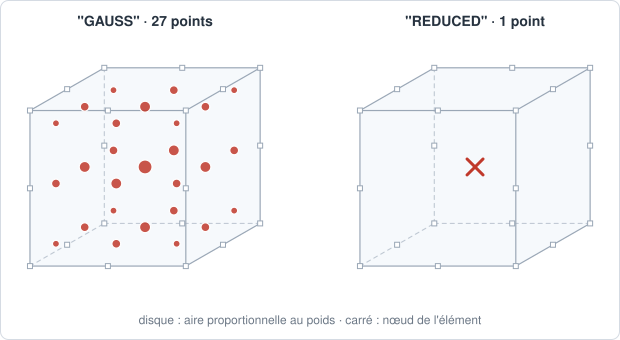

# HEX20 — hexaèdre sérendipité

## En bref

L'hexaèdre à vingt nœuds : les huit sommets et les milieux des douze arêtes,
sans nœud de face ni de centre. Sept nœuds de moins que le [HEX27](hex27.md),
pour un polynôme incomplet, sans les termes comme \\( \xi^2\eta^2\zeta^2 \\).

| | |
|---|---|
| nom | `"HEX20"` |
| nœuds | 20 : les sommets, puis les milieux des arêtes |
| interpolation | `"LAGRANGE2"` : sérendipité |
| dimension | 3 ; dans des `Coords` 3-D |
| bord | 6 `QUA8` |
| quadrature | `"GAUSS"` : 3×3×3 points, degré 5 par direction ; `"REDUCED"` : 1 point |
| parent linéaire | [HEX8](hex8.md) |
| obtenu par | `to_quadratic` d'un `HEX8` |

## Élément de référence

Le cube \\( [-1, +1]^3 \\). Un milieu d'arête a exactement une coordonnée nulle.

| Nœud | \\( (\xi, \eta, \zeta) \\) | rôle |
|---:|:---:|---|
| 0 | \\( (-1,-1,-1) \\) | sommet |
| 1 | \\( (+1,-1,-1) \\) | sommet |
| 2 | \\( (+1,+1,-1) \\) | sommet |
| 3 | \\( (-1,+1,-1) \\) | sommet |
| 4 | \\( (-1,-1,+1) \\) | sommet |
| 5 | \\( (+1,-1,+1) \\) | sommet |
| 6 | \\( (+1,+1,+1) \\) | sommet |
| 7 | \\( (-1,+1,+1) \\) | sommet |
| 8 | \\( (0,-1,-1) \\) | milieu de \\( (0,1) \\) |
| 9 | \\( (+1,0,-1) \\) | milieu de \\( (1,2) \\) |
| 10 | \\( (0,+1,-1) \\) | milieu de \\( (2,3) \\) |
| 11 | \\( (-1,0,-1) \\) | milieu de \\( (3,0) \\) |
| 12 | \\( (0,-1,+1) \\) | milieu de \\( (4,5) \\) |
| 13 | \\( (+1,0,+1) \\) | milieu de \\( (5,6) \\) |
| 14 | \\( (0,+1,+1) \\) | milieu de \\( (6,7) \\) |
| 15 | \\( (-1,0,+1) \\) | milieu de \\( (7,4) \\) |
| 16 | \\( (-1,-1,0) \\) | milieu de \\( (0,4) \\) |
| 17 | \\( (+1,-1,0) \\) | milieu de \\( (1,5) \\) |
| 18 | \\( (+1,+1,0) \\) | milieu de \\( (2,6) \\) |
| 19 | \\( (-1,+1,0) \\) | milieu de \\( (3,7) \\) |



## Fonctions de forme

Pour un nœud de coordonnées \\( (p, q, r) \\).

Aux sommets (\\( p, q, r = \pm1 \\)), noter le \\( -2 \\) :

\\[
N_i = \tfrac18\\,(1 + p\xi)(1 + q\eta)(1 + r\zeta)\\,(p\xi + q\eta + r\zeta - 2).
\\]

Aux milieux, selon la coordonnée nulle :

\\[
\begin{aligned}
p = 0 :&\quad N = \tfrac14(1 - \xi^2)(1 + q\eta)(1 + r\zeta), \\\\
q = 0 :&\quad N = \tfrac14(1 + p\xi)(1 - \eta^2)(1 + r\zeta), \\\\
r = 0 :&\quad N = \tfrac14(1 + p\xi)(1 + q\eta)(1 - \zeta^2).
\end{aligned}
\\]

Au centre, les sommets valent \\( -\tfrac14 \\) et les milieux \\( \tfrac14 \\).

## Dérivées de référence

En dérivant ces expressions.

## Degrés de liberté

| physique | inconnues par nœud | par maille |
|---|---|---:|
| conduction, diffusion | `T` | 20 |
| élasticité 3-D | `u_x`, `u_y`, `u_z` | 60 |

## Quadrature

`"GAUSS"` : produit 3×3×3 de Gauss-Legendre, 27 points, exact au degré 5 par
direction ; le point 13 est le centre ; \\( \sum_g w_g = 8 \\). La masse, de
degré 4 par direction, est exacte sur un parallélépipède à arêtes droites.

`"REDUCED"` : un point au centre, de poids 8.



## Exemple

```python
{{#include ../../../tests/python/test_doc_elements.py:hex20}}
```

## Côté Rust

`Hex20` (`src/atoms/element_kind/hex20.rs`) implémente `ElementKind`.
