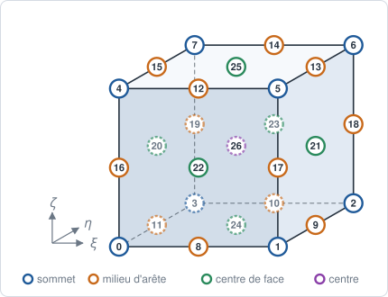
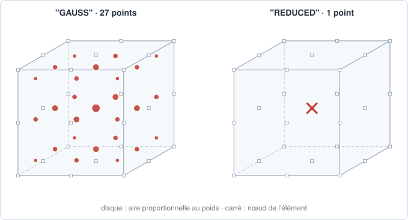

# HEX27 — hexaèdre triquadratique

## En bref

L'hexaèdre à vingt-sept nœuds : sommets, milieux des arêtes, centres des faces
et centre. Son interpolation est le produit de trois paraboles, polynôme de
degré 2 complet dans chaque direction. Aucun mailleur de pyrucast ne le
produit : il vient d'un fichier gmsh ou de `from_arrays`.

| | |
|---|---|
| nom | `"HEX27"` |
| nœuds | 27 : sommets, milieux des arêtes, centres des faces, centre |
| interpolation | `"LAGRANGE2"` : complète |
| dimension | 3 ; dans des `Coords` 3-D |
| bord | 6 `QUA9` |
| quadrature | `"GAUSS"` : 3×3×3 points, degré 5 par direction ; `"REDUCED"` : 1 point |
| parent linéaire | [HEX8](hex8.md) |
| obtenu par | lecture : `read_gmsh`, `from_arrays` |

## Élément de référence

Le cube \\( [-1, +1]^3 \\).

| Nœud | \\( (\xi, \eta, \zeta) \\) | rôle |
|---:|:---:|---|
| 0 | \\( (-1,-1,-1) \\) | sommet |
| 1 | \\( (+1,-1,-1) \\) | sommet |
| 2 | \\( (+1,+1,-1) \\) | sommet |
| 3 | \\( (-1,+1,-1) \\) | sommet |
| 4 | \\( (-1,-1,+1) \\) | sommet |
| 5 | \\( (+1,-1,+1) \\) | sommet |
| 6 | \\( (+1,+1,+1) \\) | sommet |
| 7 | \\( (-1,+1,+1) \\) | sommet |
| 8 | \\( (0,-1,-1) \\) | milieu de \\( (0,1) \\) |
| 9 | \\( (+1,0,-1) \\) | milieu de \\( (1,2) \\) |
| 10 | \\( (0,+1,-1) \\) | milieu de \\( (2,3) \\) |
| 11 | \\( (-1,0,-1) \\) | milieu de \\( (3,0) \\) |
| 12 | \\( (0,-1,+1) \\) | milieu de \\( (4,5) \\) |
| 13 | \\( (+1,0,+1) \\) | milieu de \\( (5,6) \\) |
| 14 | \\( (0,+1,+1) \\) | milieu de \\( (6,7) \\) |
| 15 | \\( (-1,0,+1) \\) | milieu de \\( (7,4) \\) |
| 16 | \\( (-1,-1,0) \\) | milieu de \\( (0,4) \\) |
| 17 | \\( (+1,-1,0) \\) | milieu de \\( (1,5) \\) |
| 18 | \\( (+1,+1,0) \\) | milieu de \\( (2,6) \\) |
| 19 | \\( (-1,+1,0) \\) | milieu de \\( (3,7) \\) |
| 20 | \\( (-1,0,0) \\) | centre de la face \\( \xi = -1 \\) |
| 21 | \\( (+1,0,0) \\) | centre de la face \\( \xi = +1 \\) |
| 22 | \\( (0,-1,0) \\) | centre de la face \\( \eta = -1 \\) |
| 23 | \\( (0,+1,0) \\) | centre de la face \\( \eta = +1 \\) |
| 24 | \\( (0,0,-1) \\) | centre de la face \\( \zeta = -1 \\) |
| 25 | \\( (0,0,+1) \\) | centre de la face \\( \zeta = +1 \\) |
| 26 | \\( (0,0,0) \\) | centre |



## Fonctions de forme

Le produit des trois fonctions de Lagrange quadratiques d'un segment, sur les
positions \\( -1, 0, +1 \\) :

\\[
\ell_{-}(t) = \tfrac12 t(t-1), \qquad
\ell_{0}(t) = 1 - t^2, \qquad
\ell_{+}(t) = \tfrac12 t(t+1),
\\]

et \\( N_i(\xi, \eta, \zeta) = \ell_a(\xi)\\,\ell_b(\eta)\\,\ell_c(\zeta) \\),
où \\( a, b, c \\) sont les positions du nœud dans chaque direction. Le centre
a \\( N_{26} = (1-\xi^2)(1-\eta^2)(1-\zeta^2) \\).

## Dérivées de référence

\\[
\frac{\partial N_i}{\partial \xi} = \ell_a\'(\xi)\\,\ell_b(\eta)\\,\ell_c(\zeta),
\\]

et de même en \\( \eta \\) et \\( \zeta \\), avec
\\( \ell_{-}\'(t) = t - \tfrac12 \\), \\( \ell_0\'(t) = -2t \\),
\\( \ell_{+}\'(t) = t + \tfrac12 \\).

## Degrés de liberté

| physique | inconnues par nœud | par maille |
|---|---|---:|
| conduction, diffusion | `T` | 27 |
| élasticité 3-D | `u_x`, `u_y`, `u_z` | 81 |

## Quadrature

`"GAUSS"` : produit 3×3×3 de Gauss-Legendre, 27 points, exact au degré 5 par
direction ; \\( \sum_g w_g = 8 \\). La masse, de degré 4 par direction, est
exacte sur un parallélépipède à arêtes droites.

`"REDUCED"` : un point au centre, de poids 8.



## Exemple

```python
{{#include ../../../tests/python/test_doc_elements.py:hex27}}
```

## Côté Rust

`Hex27` (`src/atoms/element_kind/hex27.rs`) implémente `ElementKind`.
