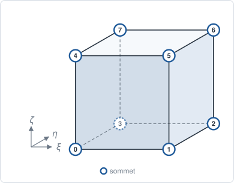
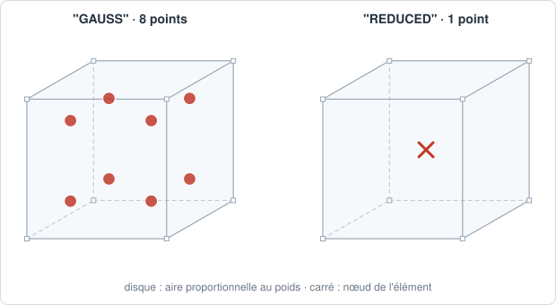

# HEX8 — hexaèdre trilinéaire

## En bref

L'hexaèdre à huit nœuds, pendant 3-D du [QUA4](qua4.md). Son interpolation
trilinéaire le rend bien meilleur en flexion qu'un `TET4`, mais il demande un
maillage structuré, par extrusion ou par couches.

| | |
|---|---|
| nom | `"HEX8"` |
| nœuds | 8, aux sommets |
| interpolation | `"LAGRANGE1"` : trilinéaire |
| dimension | 3 ; dans des `Coords` 3-D |
| bord | 6 `QUA4` |
| quadrature | `"GAUSS"` : 2×2×2 points, degré 3 par direction ; `"REDUCED"` : 1 point |
| versions quadratiques | [HEX20](hex20.md) (sérendipité), [HEX27](hex27.md) (complet) |
| obtenu par | `extrude`, `revolve` d'un `QUA4` ; `sweep_solid` ; `pave_volume` |

## Élément de référence

Le cube \\( \xi, \eta, \zeta \in [-1, +1]^3 \\) : la face du bas (nœuds 0 à 3)
puis celle du haut (nœuds 4 à 7), chacune dans le sens trigonométrique.

| Nœud | \\( (\xi_i, \eta_i, \zeta_i) \\) | | Nœud | \\( (\xi_i, \eta_i, \zeta_i) \\) |
|---:|:---:|---|---:|:---:|
| 0 | \\( (-1,-1,-1) \\) | | 4 | \\( (-1,-1,+1) \\) |
| 1 | \\( (+1,-1,-1) \\) | | 5 | \\( (+1,-1,+1) \\) |
| 2 | \\( (+1,+1,-1) \\) | | 6 | \\( (+1,+1,+1) \\) |
| 3 | \\( (-1,+1,-1) \\) | | 7 | \\( (-1,+1,+1) \\) |



## Fonctions de forme

Pour le nœud \\( i \\) de coordonnées \\( (\xi_i, \eta_i, \zeta_i) \\) :

\\[
N_i(\xi, \eta, \zeta) = \tfrac{1}{8}\\,(1 + \xi_i\\,\xi)\\,(1 + \eta_i\\,\eta)\\,(1 + \zeta_i\\,\zeta).
\\]

## Dérivées de référence

\\[
\frac{\partial N_i}{\partial \xi} = \tfrac18\\,\xi_i\\,(1 + \eta_i\\,\eta)(1 + \zeta_i\\,\zeta),
\\]

et de même en \\( \eta \\) et \\( \zeta \\).

## Degrés de liberté

| physique | inconnues par nœud | par maille |
|---|---|---:|
| conduction, diffusion | `T` | 8 |
| élasticité 3-D | `u_x`, `u_y`, `u_z` | 24 |

## Quadrature

`"GAUSS"` : produit 2×2×2 de Gauss-Legendre, exact au degré 3 par direction.

\\[
\xi_g = \left(\pm\tfrac{1}{\sqrt 3}, \pm\tfrac{1}{\sqrt 3}, \pm\tfrac{1}{\sqrt 3}\right), \qquad
w_g = 1, \qquad \sum_g w_g = 8.
\\]

La masse et la raideur d'un parallélépipède sont exactes ; celles d'un
hexaèdre déformé, comme pour le `QUA4`, ne le sont plus.

`"REDUCED"` : un point au centre, de poids 8.



## Exemple

```python
{{#include ../../../tests/python/test_doc_elements.py:hex8}}
```

## Côté Rust

`Hex8` (`src/atoms/element_kind/hex8.rs`) implémente `ElementKind`.
