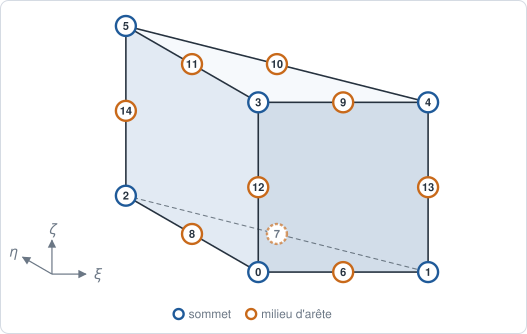
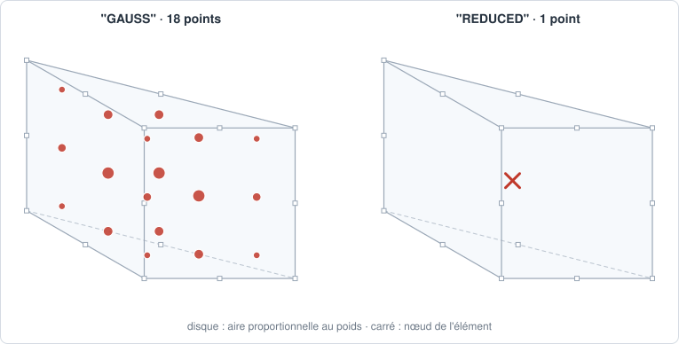

# PENTA15 — prisme sérendipité

## En bref

Le prisme à quinze nœuds : les six sommets et les milieux des neuf arêtes,
sans nœud de face ni de centre. L'interpolation est quadratique dans le
triangle et en hauteur. C'est l'extrusion quadratique du [TRI6](tri6.md).

| | |
|---|---|
| nom | `"PENTA15"` |
| nœuds | 15 : les sommets, puis les milieux des arêtes |
| interpolation | `"LAGRANGE2"` : sérendipité |
| dimension | 3 ; dans des `Coords` 3-D |
| bord | 2 `TRI6`, 3 `QUA8` |
| quadrature | `"GAUSS"` : 6 × 3 = 18 points ; `"REDUCED"` : 1 point |
| parent linéaire | [PENTA6](penta6.md) |
| obtenu par | `to_quadratic` d'un `PENTA6` |

## Élément de référence

Le triangle \\( \xi, \eta \ge 0 \\), \\( \xi + \eta \le 1 \\), étiré sur
\\( t = \zeta \in [0, 1] \\), avec les coordonnées barycentriques
\\( L_1 = 1-\xi-\eta \\), \\( L_2 = \xi \\), \\( L_3 = \eta \\).

| Nœud | \\( (\xi, \eta, \zeta) \\) | rôle |
|---:|:---:|---|
| 0 | \\( (0, 0, 0) \\) | sommet du bas |
| 1 | \\( (1, 0, 0) \\) | sommet du bas |
| 2 | \\( (0, 1, 0) \\) | sommet du bas |
| 3 | \\( (0, 0, 1) \\) | sommet du haut |
| 4 | \\( (1, 0, 1) \\) | sommet du haut |
| 5 | \\( (0, 1, 1) \\) | sommet du haut |
| 6 | \\( (\tfrac12, 0, 0) \\) | milieu de \\( (0,1) \\) |
| 7 | \\( (\tfrac12, \tfrac12, 0) \\) | milieu de \\( (1,2) \\) |
| 8 | \\( (0, \tfrac12, 0) \\) | milieu de \\( (2,0) \\) |
| 9 | \\( (\tfrac12, 0, 1) \\) | milieu de \\( (3,4) \\) |
| 10 | \\( (\tfrac12, \tfrac12, 1) \\) | milieu de \\( (4,5) \\) |
| 11 | \\( (0, \tfrac12, 1) \\) | milieu de \\( (5,3) \\) |
| 12 | \\( (0, 0, \tfrac12) \\) | milieu de \\( (0,3) \\) |
| 13 | \\( (1, 0, \tfrac12) \\) | milieu de \\( (1,4) \\) |
| 14 | \\( (0, 1, \tfrac12) \\) | milieu de \\( (2,5) \\) |



## Fonctions de forme

Avec \\( L_1 = 1-\xi-\eta \\), \\( L_2 = \xi \\), \\( L_3 = \eta \\) et
\\( t = \zeta \\).

Aux sommets, la fonction du `TRI6` en hauteur, moins une correction qui
s'annule aux deux faces :

\\[
\begin{aligned}
N^{\text{bas}}_i &= L_i(2L_i-1)(1-t) - 2 L_i\\,t(1-t), \\\\
N^{\text{haut}}_i &= L_i(2L_i-1)\\,t - 2 L_i\\,t(1-t).
\end{aligned}
\\]

Aux milieux des côtés du triangle, en bas puis en haut :

\\[
N = 4 L_a L_b\\,(1-t), \qquad N = 4 L_a L_b\\,t .
\\]

Aux milieux des arêtes verticales :

\\[
N = 4 L_i\\,t(1 - t).
\\]

## Dérivées de référence

En dérivant ces expressions : les dérivées des \\( L_i \\) sont constantes, et
celle en \\( t \\) vient des facteurs \\( (1-t) \\), \\( t \\) et \\( t(1-t) \\).

## Degrés de liberté

| physique | inconnues par nœud | par maille |
|---|---|---:|
| conduction, diffusion | `T` | 15 |
| élasticité 3-D | `u_x`, `u_y`, `u_z` | 45 |

## Quadrature

`"GAUSS"` : le produit de la règle du [TRI6](tri6.md#quadrature) (6 points) et
de Gauss-Legendre à 3 points sur \\( [0, 1] \\), soit 18 points, exact au
degré 4 dans le triangle et 5 en hauteur ; \\( \sum_g w_g = \tfrac12 \\). La
masse, de degré 4 dans chaque sens, est exacte sur un prisme à arêtes droites
dont le triangle du haut est celui du bas déplacé.

`"REDUCED"` : un point en \\( (\tfrac13, \tfrac13, \tfrac12) \\), de poids
\\( \tfrac12 \\).



## Exemple

```python
{{#include ../../../tests/python/test_doc_elements.py:penta15}}
```

## Côté Rust

`Penta15` (`src/atoms/element_kind/penta15.rs`) implémente `ElementKind`, avec
la règle `tri6_gauss` du `TRI6` et `gauss3_1d`, partagées dans
`src/atoms/element_kind/quadrature.rs`.
