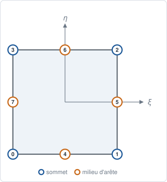
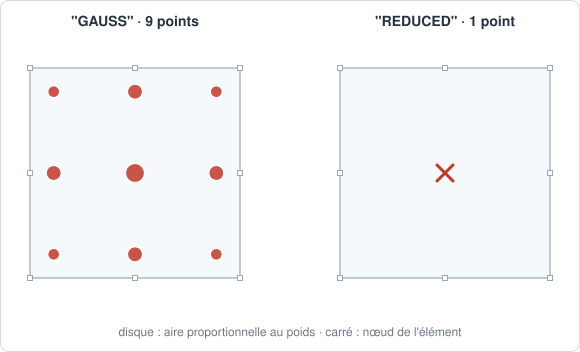

# QUA8 — quadrangle sérendipité

## En bref

Le quadrangle à huit nœuds : les sommets et les milieux des côtés, sans nœud
central. Une inconnue de moins par champ que le [QUA9](qua9.md), pour un
polynôme incomplet : il lui manque le terme \\( \xi^2\eta^2 \\).

| | |
|---|---|
| nom | `"QUA8"` |
| nœuds | 8 : les sommets, puis les milieux des côtés |
| interpolation | `"LAGRANGE2"` : sérendipité |
| dimension | 2 ; dans des `Coords` 2-D ou 3-D |
| bord | 4 `SEG3` |
| quadrature | `"GAUSS"` : 3×3 points, degré 5 par direction ; `"REDUCED"` : 1 point |
| parent linéaire | [QUA4](qua4.md) |
| obtenu par | `sweep`, `transfinite`, `pave_surface`, `grid_surface` ; `to_quadratic` d'un `QUA4` ; `skin` d'un `HEX20` ou `PENTA15` |

## Élément de référence

Le carré \\( [-1, +1]^2 \\) : les sommets 0 à 3, puis les milieux 4 à 7.

| Nœud | \\( (\xi, \eta) \\) | rôle |
|---:|:---:|---|
| 0 | \\( (-1, -1) \\) | sommet |
| 1 | \\( (+1, -1) \\) | sommet |
| 2 | \\( (+1, +1) \\) | sommet |
| 3 | \\( (-1, +1) \\) | sommet |
| 4 | \\( (0, -1) \\) | milieu de \\( (0,1) \\) |
| 5 | \\( (+1, 0) \\) | milieu de \\( (1,2) \\) |
| 6 | \\( (0, +1) \\) | milieu de \\( (2,3) \\) |
| 7 | \\( (-1, 0) \\) | milieu de \\( (3,0) \\) |



## Fonctions de forme

Aux sommets, de coordonnées \\( (\xi_i, \eta_i) \\) :

\\[
N_i = \tfrac14\\,(1 + \xi_i\xi)(1 + \eta_i\eta)\\,(\xi_i\xi + \eta_i\eta - 1).
\\]

Aux milieux :

\\[
\begin{aligned}
N_4 &= \tfrac12(1 - \xi^2)(1 - \eta), & N_5 &= \tfrac12(1 + \xi)(1 - \eta^2), \\\\
N_6 &= \tfrac12(1 - \xi^2)(1 + \eta), & N_7 &= \tfrac12(1 - \xi)(1 - \eta^2).
\end{aligned}
\\]

Au centre, les sommets valent \\( -\tfrac14 \\) et les milieux \\( \tfrac12 \\).

## Dérivées de référence

En dérivant ces expressions. Pour le milieu 4 :
\\( \partial_\xi N_4 = -\xi(1-\eta) \\), \\( \partial_\eta N_4 = -\tfrac12(1-\xi^2) \\).

## Degrés de liberté

| physique | inconnues par nœud | par maille |
|---|---|---:|
| conduction, diffusion | `T` | 8 |
| élasticité plane ou axisymétrique | `u_x`, `u_y` | 16 |
| échanges, rayonnement, sur la face d'un volume quadratique | `T` | 8 |

## Quadrature

`"GAUSS"` : produit 3×3 de Gauss-Legendre, 9 points, exact au degré 5 par
direction. Le point 4 est le centre, de poids \\( \tfrac{64}{81} \\) ;
\\( \sum_g w_g = 4 \\). La masse, de degré 4 par direction, est exacte sur un
parallélogramme à côtés droits.

`"REDUCED"` : un point au centre, de poids 4.



## Exemple

```python
{{#include ../../../tests/python/test_doc_elements.py:qua8}}
```

## Côté Rust

`Qua8` (`src/atoms/element_kind/qua8.rs`) implémente `ElementKind`.
