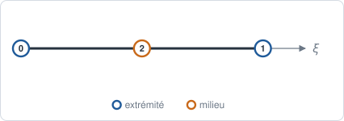
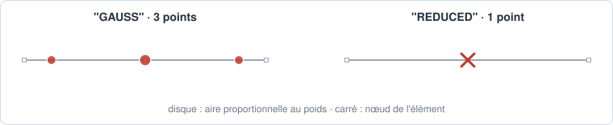

# SEG3 — segment quadratique

## En bref

Le segment à trois nœuds, un au milieu : l'interpolation est parabolique, et le
segment peut être courbe. C'est le bord d'une surface quadratique.

| | |
|---|---|
| nom | `"SEG3"` |
| nœuds | 3 : les extrémités, puis le milieu |
| interpolation | `"LAGRANGE2"` : quadratique |
| dimension | 1 ; dans des `Coords` 1-D, 2-D ou 3-D |
| bord | ses deux extrémités |
| quadrature | `"GAUSS"` : 3 points, degré 5 ; `"REDUCED"` : 1 point |
| parent linéaire | [SEG2](seg2.md) |
| obtenu par | `line`, `arc`, `circle` avec `element_type="SEG3"` ; `to_quadratic` |

## Élément de référence

\\( \xi \in [-1, +1] \\), le nœud milieu en \\( \xi = 0 \\).

| Nœud | \\( \xi \\) | rôle |
|---:|:---:|---|
| 0 | \\( -1 \\) | extrémité |
| 1 | \\( +1 \\) | extrémité |
| 2 | \\( 0 \\) | milieu de \\( (0,1) \\) |



## Fonctions de forme

\\[
N_0 = \tfrac12\\,\xi(\xi - 1), \qquad
N_1 = \tfrac12\\,\xi(\xi + 1), \qquad
N_2 = 1 - \xi^2.
\\]

La géométrie s'interpole de même : un nœud milieu hors de la corde courbe le
segment en arc de parabole.

## Dérivées de référence

\\[
\frac{\partial N_0}{\partial \xi} = \xi - \tfrac12, \qquad
\frac{\partial N_1}{\partial \xi} = \xi + \tfrac12, \qquad
\frac{\partial N_2}{\partial \xi} = -2\xi.
\\]

## Degrés de liberté

| physique | inconnues par nœud | par maille |
|---|---|---:|
| conduction, diffusion | `T` | 3 |
| échanges, rayonnement, sur le bord d'une surface quadratique | `T` | 3 |

## Quadrature

`"GAUSS"` : Gauss-Legendre à 3 points, exacte au degré 5.

\\[
\xi_g = \left(-\sqrt{\tfrac35},\ 0,\ +\sqrt{\tfrac35}\right), \qquad
w_g = \left(\tfrac59,\ \tfrac89,\ \tfrac59\right), \qquad \sum_g w_g = 2.
\\]

La masse, de degré 4, est exacte sur un segment droit dont le nœud milieu est
au milieu.

`"REDUCED"` : un point en \\( \xi = 0 \\), de poids 2.



## Exemple

```python
{{#include ../../../tests/python/test_doc_elements.py:seg3}}
```

## Côté Rust

`Seg3` (`src/atoms/element_kind/seg3.rs`) implémente `ElementKind`.
