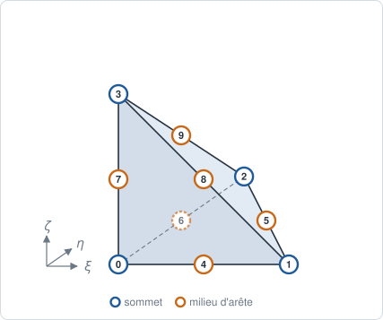
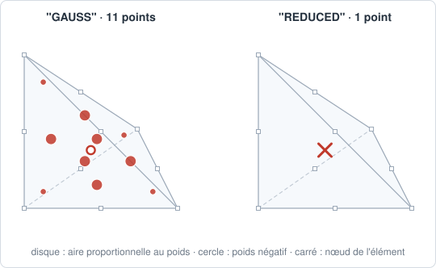

# TET10 — tétraèdre quadratique

## En bref

Le tétraèdre à dix nœuds, quatre aux sommets et six aux milieux des arêtes.
La déformation y varie linéairement, et les faces peuvent être courbes : il
garde la souplesse de maillage du `TET4` sans sa raideur en flexion.

| | |
|---|---|
| nom | `"TET10"` |
| nœuds | 10 : les sommets, puis les milieux des arêtes |
| interpolation | `"LAGRANGE2"` : quadratique complète |
| dimension | 3 ; dans des `Coords` 3-D |
| bord | 4 `TRI6` |
| quadrature | `"GAUSS"` : 11 points, degré 4 ; `"REDUCED"` : 1 point |
| parent linéaire | [TET4](tet4.md) |
| obtenu par | `to_quadratic` d'un `TET4` |

## Élément de référence

Le tétraèdre du `TET4`, avec ses coordonnées barycentriques
\\( L_0 = 1-\xi-\eta-\zeta \\), \\( L_1 = \xi \\), \\( L_2 = \eta \\),
\\( L_3 = \zeta \\).

| Nœud | \\( (\xi, \eta, \zeta) \\) | | Nœud | arête | \\( (\xi, \eta, \zeta) \\) |
|---:|:---:|---|---:|:---:|:---:|
| 0 | \\( (0,0,0) \\) | | 4 | \\( (0,1) \\) | \\( (\tfrac12,0,0) \\) |
| 1 | \\( (1,0,0) \\) | | 5 | \\( (1,2) \\) | \\( (\tfrac12,\tfrac12,0) \\) |
| 2 | \\( (0,1,0) \\) | | 6 | \\( (2,0) \\) | \\( (0,\tfrac12,0) \\) |
| 3 | \\( (0,0,1) \\) | | 7 | \\( (0,3) \\) | \\( (0,0,\tfrac12) \\) |
| | | | 8 | \\( (1,3) \\) | \\( (\tfrac12,0,\tfrac12) \\) |
| | | | 9 | \\( (2,3) \\) | \\( (0,\tfrac12,\tfrac12) \\) |



## Fonctions de forme

\\( L_i(2L_i - 1) \\) aux sommets, \\( 4 L_a L_b \\) aux milieux :

\\[
\begin{aligned}
N_i &= L_i(2L_i-1) \quad (i = 0 \dots 3), \\\\
N_4 &= 4 L_0 L_1, \quad N_5 = 4 L_1 L_2, \quad N_6 = 4 L_2 L_0, \\\\
N_7 &= 4 L_0 L_3, \quad N_8 = 4 L_1 L_3, \quad N_9 = 4 L_2 L_3.
\end{aligned}
\\]

Au centre, où tous les \\( L_i \\) valent \\( \tfrac14 \\), les sommets valent
\\( -\tfrac18 \\) et les milieux \\( \tfrac14 \\).

## Dérivées de référence

Aux sommets \\( \nabla_\xi N_i = (4L_i - 1)\\,\nabla_\xi L_i \\), aux milieux
\\( \nabla_\xi N = 4(L_b\\,\nabla_\xi L_a + L_a\\,\nabla_\xi L_b) \\), avec
\\( \nabla_\xi L_0 = (-1,-1,-1) \\), \\( \nabla_\xi L_1 = (1,0,0) \\),
\\( \nabla_\xi L_2 = (0,1,0) \\), \\( \nabla_\xi L_3 = (0,0,1) \\).

## Degrés de liberté

| physique | inconnues par nœud | par maille |
|---|---|---:|
| conduction, diffusion | `T` | 10 |
| élasticité 3-D | `u_x`, `u_y`, `u_z` | 30 |

## Quadrature

`"GAUSS"` : règle de Keast à 11 points, exacte au degré 4 :

| famille | points | poids |
|---|---|---:|
| le centre | \\( (\tfrac14, \tfrac14, \tfrac14) \\) | \\( -\tfrac{74}{5625} \\) |
| vers les sommets | \\( (\tfrac1{14}, \tfrac1{14}, \tfrac1{14}) \\) et les permutations de \\( (\tfrac{11}{14}, \tfrac1{14}, \tfrac1{14}) \\) | \\( \tfrac{343}{45000} \\) |
| vers les milieux | les permutations de \\( (d, c, c) \\) et \\( (d, d, c) \\), \\( d \simeq 0{,}399404 \\), \\( c \simeq 0{,}100596 \\) | \\( \tfrac{56}{2250} \\) |

\\( \sum_g w_g = \tfrac16 \\). Le poids du centre est négatif ; la règle n'en
reste pas moins exacte. La masse, de degré 4, est exacte sur un tétraèdre à
arêtes droites.

`"REDUCED"` : un point au centre, de poids \\( \tfrac16 \\).



## Exemple

```python
{{#include ../../../tests/python/test_doc_elements.py:tet10}}
```

## Côté Rust

`Tet10` (`src/atoms/element_kind/tet10.rs`) implémente `ElementKind`.
`gauss_tet10_exact_up_to_degree_4` (`src/atoms/element_kind/quadrature.rs`)
intègre tous les monômes de degré au plus 4.
