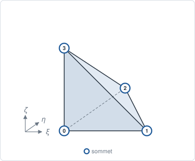
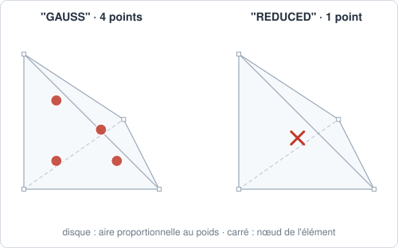

# TET4 — tétraèdre linéaire

## En bref

Le tétraèdre à quatre nœuds, pendant 3-D du [TRI3](tri3.md) : interpolation
affine, gradient constant dans la maille. Il remplit n'importe quel volume,
et c'est ce que produisent les mailleurs de volume. Une déformation constante
par maille le rend raide en flexion : il y faut des mailles fines, ou le
[TET10](tet10.md).

| | |
|---|---|
| nom | `"TET4"` |
| nœuds | 4, aux sommets |
| interpolation | `"LAGRANGE1"` : affine |
| dimension | 3 ; dans des `Coords` 3-D |
| bord | 4 `TRI3` |
| quadrature | `"GAUSS"` : 4 points, degré 2 ; `"REDUCED"` : 1 point |
| version quadratique | [TET10](tet10.md) |
| obtenu par | `triangulate_volume`, `pave_volume` ; `convert` d'un `HEX8` |

## Élément de référence

Le tétraèdre \\( \xi, \eta, \zeta \ge 0 \\), \\( \xi + \eta + \zeta \le 1 \\).
La face 0-1-2 tourne dans le sens trigonométrique vue depuis le nœud 3.

| Nœud | \\( (\xi, \eta, \zeta) \\) |
|---:|:---:|
| 0 | \\( (0, 0, 0) \\) |
| 1 | \\( (1, 0, 0) \\) |
| 2 | \\( (0, 1, 0) \\) |
| 3 | \\( (0, 0, 1) \\) |



## Fonctions de forme

Les coordonnées barycentriques :

\\[
N_0 = 1 - \xi - \eta - \zeta, \quad N_1 = \xi, \quad N_2 = \eta, \quad N_3 = \zeta.
\\]

## Dérivées de référence

Constantes :

\\[
\nabla_\xi N_0 = (-1,-1,-1), \quad
\nabla_\xi N_1 = (1,0,0), \quad
\nabla_\xi N_2 = (0,1,0), \quad
\nabla_\xi N_3 = (0,0,1).
\\]

## Degrés de liberté

| physique | inconnues par nœud | par maille |
|---|---|---:|
| conduction, diffusion | `T` | 4 |
| élasticité 3-D | `u_x`, `u_y`, `u_z` | 12 |

## Quadrature

`"GAUSS"` : règle de Hammer à 4 points, exacte au degré 2. Avec
\\( \alpha = \tfrac{5 - \sqrt5}{20} \\) et \\( \beta = \tfrac{5 + 3\sqrt5}{20} \\),
les points sont \\( (\alpha, \alpha, \alpha) \\) et les trois permutations de
\\( (\beta, \alpha, \alpha) \\) : chacun a la coordonnée barycentrique
\\( \beta \\) vers un sommet, \\( \alpha \\) vers les trois autres.

\\[
w_g = \tfrac{1}{24}, \qquad \sum_g w_g = \tfrac{1}{6}.
\\]

La masse, de degré 2, est exacte ; la raideur, de degré 0, aussi.

`"REDUCED"` : un point au centre de gravité \\( (\tfrac14, \tfrac14, \tfrac14) \\),
de poids \\( \tfrac16 \\).



## Exemple

```python
{{#include ../../../tests/python/test_doc_elements.py:tet4}}
```

## Côté Rust

`Tet4` (`src/atoms/element_kind/tet4.rs`) implémente `ElementKind`.
