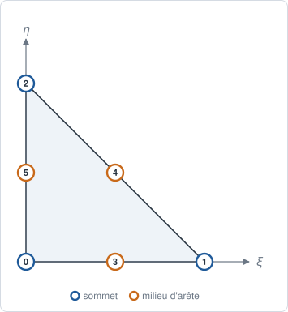
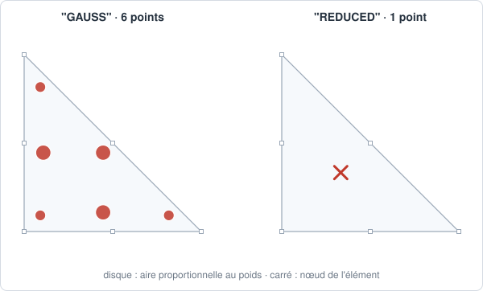

# TRI6 — triangle quadratique

## En bref

Le triangle à six nœuds, trois aux sommets et trois aux milieux des côtés.
L'interpolation est quadratique : la déformation varie linéairement dans la
maille, et les côtés peuvent être courbes. Bien plus précis qu'un `TRI3` en
flexion.

| | |
|---|---|
| nom | `"TRI6"` |
| nœuds | 6 : les sommets, puis les milieux des côtés |
| interpolation | `"LAGRANGE2"` : quadratique complète |
| dimension | 2 ; dans des `Coords` 2-D ou 3-D |
| bord | 3 `SEG3` |
| quadrature | `"GAUSS"` : 6 points, degré 4 ; `"REDUCED"` : 1 point |
| parent linéaire | [TRI3](tri3.md) |
| obtenu par | `sweep`, `transfinite` ; `to_quadratic` d'un `TRI3` ; `skin` d'un `TET10` ou `PENTA15` |

## Élément de référence

Le triangle du `TRI3`, avec ses coordonnées barycentriques
\\( L_1 = 1-\xi-\eta \\), \\( L_2 = \xi \\), \\( L_3 = \eta \\).

| Nœud | \\( (\xi, \eta) \\) | rôle |
|---:|:---:|---|
| 0 | \\( (0, 0) \\) | sommet |
| 1 | \\( (1, 0) \\) | sommet |
| 2 | \\( (0, 1) \\) | sommet |
| 3 | \\( (\tfrac12, 0) \\) | milieu de \\( (0,1) \\) |
| 4 | \\( (\tfrac12, \tfrac12) \\) | milieu de \\( (1,2) \\) |
| 5 | \\( (0, \tfrac12) \\) | milieu de \\( (2,0) \\) |



## Fonctions de forme

\\( L_i(2L_i - 1) \\) aux sommets, \\( 4 L_a L_b \\) aux milieux :

\\[
\begin{aligned}
N_0 &= L_1(2L_1 - 1), & N_1 &= L_2(2L_2 - 1), & N_2 &= L_3(2L_3 - 1), \\\\
N_3 &= 4 L_1 L_2, & N_4 &= 4 L_2 L_3, & N_5 &= 4 L_3 L_1.
\end{aligned}
\\]

Une fonction de sommet est négative entre les milieux : \\( N_0 = -\tfrac19 \\)
au centre de gravité.

## Dérivées de référence

Avec \\( \nabla_\xi L_1 = (-1,-1) \\), \\( \nabla_\xi L_2 = (1,0) \\),
\\( \nabla_\xi L_3 = (0,1) \\) : aux sommets
\\( \nabla_\xi N_i = (4L_i - 1)\\,\nabla_\xi L_i \\), aux milieux
\\( \nabla_\xi N = 4(L_b\\,\nabla_\xi L_a + L_a\\,\nabla_\xi L_b) \\). Par
exemple :

\\[
\nabla_\xi N_0 = \big(-(4L_1-1),\ -(4L_1-1)\big), \qquad
\nabla_\xi N_3 = \big(4(L_1 - L_2),\ -4L_2\big).
\\]

## Degrés de liberté

| physique | inconnues par nœud | par maille |
|---|---|---:|
| conduction, diffusion | `T` | 6 |
| élasticité plane ou axisymétrique | `u_x`, `u_y` | 12 |
| échanges, rayonnement, sur la face d'un volume quadratique | `T` | 6 |

## Quadrature

`"GAUSS"` : règle symétrique de Dunavant à 6 points, en deux familles de
trois, exacte au degré 4. Avec \\( b_1 \simeq 0{,}445948 \\) et
\\( b_2 \simeq 0{,}091576 \\), chaque famille réunit les points de coordonnées
barycentriques \\( (b, b, 1 - 2b) \\) et leurs permutations.

| famille | point type \\( (\xi, \eta) \\) | poids |
|---|---|---:|
| 1 | \\( (b_1, b_1) \\) | \\( 0{,}111691 \\) |
| 2 | \\( (b_2, b_2) \\) | \\( 0{,}054976 \\) |

\\( \sum_g w_g = \tfrac12 \\). La masse, de degré 4, est exacte sur un triangle
à côtés droits.

`"REDUCED"` : un point au centre de gravité \\( (\tfrac13, \tfrac13) \\), de
poids \\( \tfrac12 \\).



## Exemple

```python
{{#include ../../../tests/python/test_doc_elements.py:tri6}}
```

## Côté Rust

`Tri6` (`src/atoms/element_kind/tri6.rs`) implémente `ElementKind` ; sa règle,
`tri6_gauss`, est partagée avec le `PENTA15` (`src/atoms/element_kind/quadrature.rs`).
