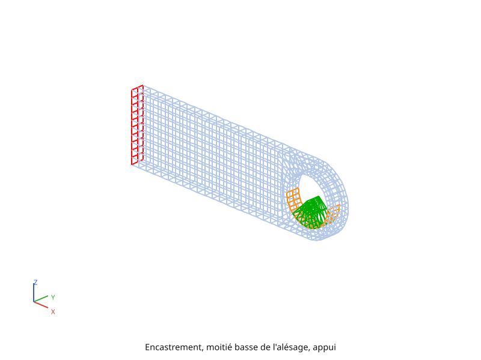
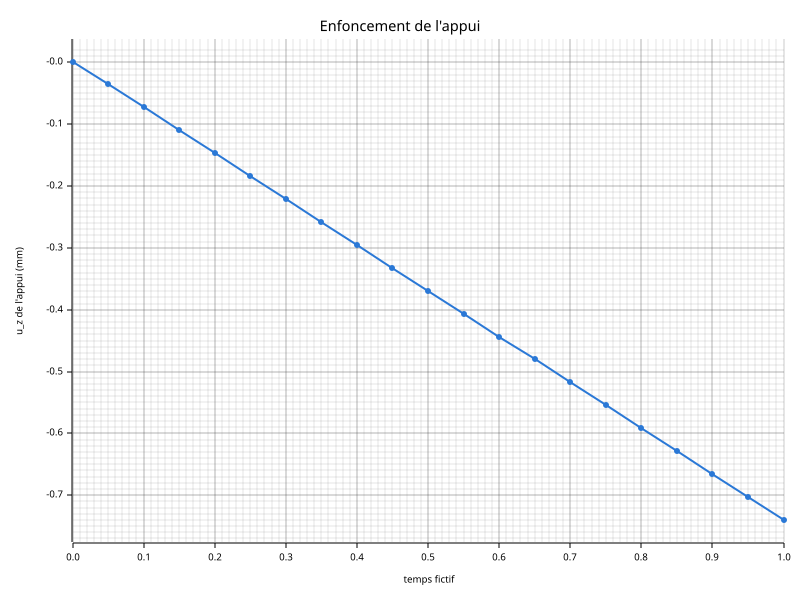
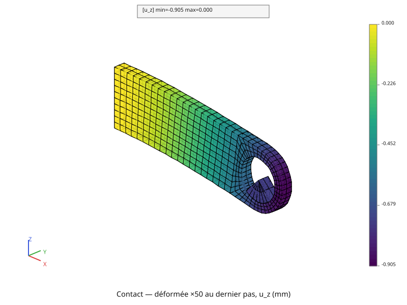

# Contact

Jusqu'ici, la masse était un effort posé sur l'alésage. Dans ce dernier
calcul, elle devient une **pièce** : un appui posé dans l'alésage, qui porte
le poids sur son axe. L'appui est un secteur de 90° du même rayon que le
trou, mille fois plus raide que la chape, et il ne peut que monter ou
descendre. Entre les deux pièces, un **contact** : l'appui ne traverse pas la
paroi de l'alésage, et il ne peut que la pousser, jamais la tirer. Où il
touche, et avec quel effort, c'est le calcul qui le trouve.

Le script complet est [`tutoriel/contact.py`](https://github.com/Pyrucast/pyrucast/blob/master/tutoriel/contact.py)
; tous les extraits ci-dessous en sont issus directement, dans l'ordre du
fichier.

## L'équation résolue

Deux pièces élastiques, la chape et l'appui, chacune avec sa rigidité. La
chape est encastrée ; l'appui a ses déplacements \\( u\_x \\) et
\\( u\_y \\) bloqués partout. Le poids \\( mg \\) est appliqué sur son axe.

Le contact s'écrit nœud par nœud. Chaque nœud \\( s \\) de la face de l'appui
est apparié au point le plus proche de la moitié basse de l'alésage. On y lit
la normale \\( n \\), tournée vers l'appui, le jeu de départ \\( g\_0 \\), et
les poids \\( N\_i \\) des nœuds de la face de l'alésage en ce point. Le jeu
pendant le calcul ne doit jamais devenir négatif :

\\[ g = g\_0 + n \cdot u(s) - \sum\_i N\_i\\, n \cdot u(\text{alésage}\_i) \ \ge\ 0 \\]

Chaque nœud de l'appui a son multiplicateur \\( \lambda \\), comme un
blocage. C'est l'effort de contact, qui ne peut que pousser :
\\( \lambda \le 0 \\). L'un des deux est toujours nul : un nœud qui touche a
un jeu nul, un nœud décollé n'a pas d'effort.

\\[ g \ge 0, \qquad \lambda \le 0, \qquad \lambda\\, g = 0 \\]

pyrucast résout cette alternative par **statuts**. Il suppose quels nœuds
touchent, et impose \\( g = 0 \\) à ceux-là seulement, comme des blocages.
Il résout, puis corrige : un nœud supposé touchant dont l'effort tirerait est
libéré, un nœud supposé libre qui traverserait est ajouté. Il recommence
jusqu'à ce que tout soit cohérent. Ce tri se fait à chaque résolution du pas à
pas de la page [Mécanique non linéaire](mecanique-non-lineaire.md), le poids
monté en 20 pas.

L'appariement est fait une fois, sur la géométrie de départ : les
déplacements restent petits devant l'alésage, et l'appui ne glisse pas d'une
face à l'autre.

## Les données du calcul

```python
{{#include ../../../tutoriel/contact.py:donnees}}
```

`E_APPUI`, mille fois le module de la chape, fait de l'appui une pièce presque
indéformable. Le temps fictif va de 0 à 1, en 20 pas.

## La chape

```python
{{#include ../../../tutoriel/contact.py:chape}}
```

Les régions de la page [Élasticité](mecanique-elastique.md) : l'encastrement
et la moitié basse de l'alésage, sur le maillage HEX20 importé.

## L'appui

```python
{{#include ../../../tutoriel/contact.py:appui}}
```

L'appui se construit comme une pièce de la page [Maillage](maillage.md), par
balayage :
1. un **rayon** du centre du trou vers le bas à gauche, à 45° de la
   verticale, en 2 segments ;
2. tourné de 90° autour de l'axe du trou en 7 secteurs, il balaie le
   **quart bas du disque**. Le nœud du centre est sur l'axe de rotation : il
   reste unique, et les mailles qui le touchent sont des triangles au lieu
   de quadrangles ;
3. **extrudé** dans l'épaisseur, en 2 couches.

Le script affiche 28 mailles, 14 HEX8 et 14 PENTA6, et 51 nœuds :
- 3 sur l'axe, où s'applique le poids ;
- 24 sur la face cylindrique, celle qui touche l'alésage.

L'appui est maillé en éléments linéaires, la chape en quadratiques : les deux
pièces n'ont aucun nœud en commun, et c'est le contact qui les relie.



## Le modèle

```python
{{#include ../../../tutoriel/contact.py:modele}}
```

Deux élasticités, une par pièce, réunies par `|` : c'est la cible du contact,
qui relie les déplacements des deux. `pc.model.contact(esclave, maître, cible,
variables)` prend :
- les nœuds **esclaves**, ceux de la face de l'appui ;
- la surface **maître**, les faces QUA8 de la moitié basse de l'alésage ;
- les composantes du déplacement que la normale relie, une par direction.

Chaque pièce a son matériau, et la réunion `|` des deux champs en fait un
seul.

**La surface maître reste courbe.** Elle se donne telle que le maillage la
porte : des faces QUA8, avec leurs nœuds milieux, qui suivent le cercle de
l'alésage. Découpée en triangles plats, elle passerait en corde à l'intérieur
du trou, et l'appui démarrerait enfoncé dans la chape. La page
[Contact](../contraintes/contact.md) du chapitre des contraintes l'explique.

## Le chargement et le calcul

```python
{{#include ../../../tutoriel/contact.py:chargement}}
```

Le poids est partagé à parts égales entre les 3 nœuds de l'axe de l'appui, et
il monte de 0 à 1 fois lui-même sur le temps fictif. `step_by_step` reçoit le
même genre de dictionnaire qu'à la page [Plasticité](plasticite.md), sans
température. Le script affiche 2 itérations à chaque pas, 40 en tout : les
deux matériaux restent élastiques, et peu de corrections suffisent à chaque
pas.

## L'enfoncement

```python
{{#include ../../../tutoriel/contact.py:enfoncement}}
```



L'appui descend de 0,0349 mm au premier pas et de 0,7396 mm au dernier. La
courbe est une droite. L'appui et l'alésage ont le même rayon : au départ, ils
se touchent sans jeu. Doubler le poids double alors tous les déplacements, et
l'enfoncement reste proportionnel au poids.

## Où l'appui porte

```python
{{#include ../../../tutoriel/contact.py:efforts}}
```

Les réactions du pas à pas sont les efforts que les liaisons exercent sur les
pièces. Les nœuds de l'alésage ne sont tenus que par le contact : leurs
réactions sont les **efforts de contact sur la chape**. Le script affiche :

| | \\( f\_x \\) | \\( f\_z \\) |
|---|---|---|
| contact sur la chape, en tout | −13 829,6 N | −24 525,0 N |
| côté encastrement | | −22 309,9 N |
| côté bout libre | | −2 215,1 N |
| réaction de l'encastrement | 13 829,6 N | 24 525,0 N |

Le contact transmet **exactement le poids**, et l'encastrement le rend. Mais
l'appui ne porte pas également des deux côtés : neuf dixièmes de l'effort
passent par la paroi côté encastrement. Cette paroi est adossée à toute la
pièce ; celle du côté du bout libre n'a derrière elle que l'anneau, plus
souple. L'appui ne peut que descendre, et c'est la paroi la plus raide qui le
porte.

**Un contact sans frottement pousse selon la normale.** La paroi côté
encastrement est inclinée : son effort a une part horizontale, qui pousse la
chape vers l'encastrement, 13 829,6 N. L'encastrement la retient par une
réaction égale et opposée, et les blocages horizontaux de l'appui tiennent
l'appui. Un effort horizontal de plus de la moitié du poids, pour une charge
toute verticale : c'est le contact qui le crée.

## La déformée

```python
{{#include ../../../tutoriel/contact.py:deformee}}
```



Les deux pièces, dans la configuration déformée, colorées par \\( u\_z \\).
L'appui, presque indéformable, descend d'un bloc ; la chape fléchit comme sous
la force surfacique de la page [Élasticité](mecanique-elastique.md).

## Script complet

```python
{{#include ../../../tutoriel/contact.py:script}}
```

Suite : [Compléments](complements.md).
