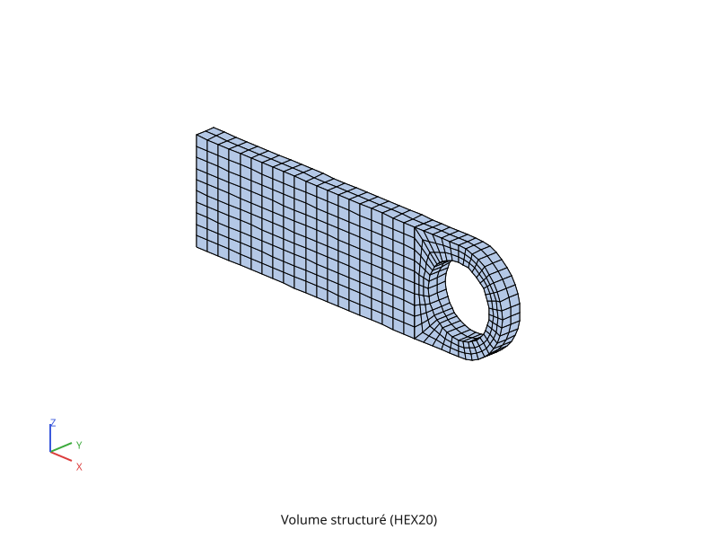
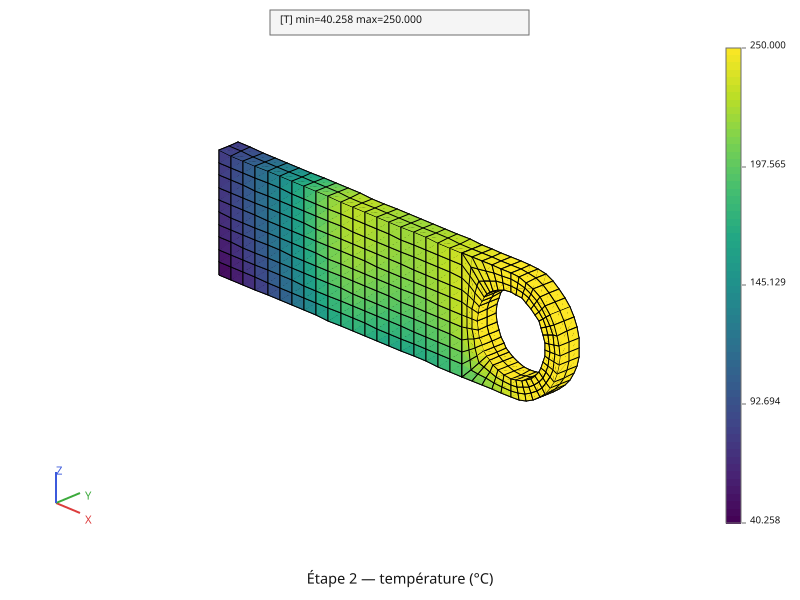
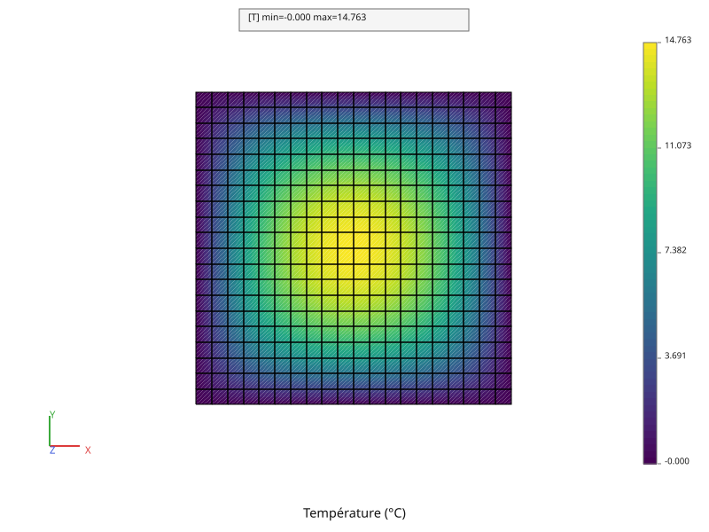

# Premiers pas

Ce tutoriel accompagne pas à pas un premier contact avec pyrucast : l'installer,
lancer un calcul, puis mailler une pièce et y résoudre un problème thermique,
en comprenant chaque ligne. Il suppose quelques notions sur la méthode des
éléments finis, mais **pas de pratique de Python** : la page
[Python & conventions pyrucast](langage-python.md) en donne tout ce qu'il faut.

Le fil rouge des pages [Maillage](maillage.md) et
[Thermique linéaire](thermique-lineaire.md) est une **chape percée** — une plaque terminée
par un demi-disque, trouée en son centre — que l'on maille, puis que l'on
chauffe :





## Installer pyrucast

pyrucast s'installe par `pip`, l'outil qui installe les paquets Python. Les
commandes de cette page se tapent dans un **terminal** : *PowerShell* sous
Windows, l'application *Terminal* sous macOS et Linux. Il faut **Python 3.11 ou
plus récent** ([python.org](https://www.python.org/downloads/)). Une seule
commande :

```bash
pip install pyrucast
```

Sous Linux et macOS, les commandes s'appellent souvent `python3` et `pip3` :
remplacez-les dans toute la suite si `python` est introuvable.

C'est tout : rien à compiler. Cette version, dite **précompilée**, contient le
calcul et la visualisation (fenêtre interactive et export d'images). Elle
existe pour Linux (processeurs x86_64), Windows 64 bits et macOS (Intel et
Apple Silicon) ; pour les autres cas, voir
[Installation et démarrage rapide](../installation.md).

Pour passer plus tard à une version plus récente :

```bash
pip install --upgrade pyrucast
```

> **Un environnement à part.** Pour garder pyrucast séparé des autres paquets
> Python de la machine, on peut l'installer dans un *environnement virtuel*,
> un dossier qui contient son propre Python :
>
> ```bash
> python -m venv .venv
> source .venv/bin/activate      # Linux, macOS
> .\.venv\Scripts\Activate.ps1   # Windows (PowerShell)
> pip install pyrucast
> ```
>
> Il faut alors réactiver l'environnement (deuxième ou troisième ligne) dans
> chaque nouveau terminal.

## Vérifier l'installation

```bash
python -c "import pyrucast; print(pyrucast.__version__)"
```

La commande affiche le numéro de la version installée. Un message
`ModuleNotFoundError: No module named 'pyrucast'` veut dire que pyrucast n'est
pas installé pour **ce** Python-là — par exemple parce que l'environnement
virtuel n'est pas activé.

## Un premier calcul

Le plus petit calcul complet : une plaque carrée d'acier de 10 cm de côté,
chauffée uniformément dans toute sa masse, dont le bord est tenu à 0 °C. Où
est-elle la plus chaude, et à quelle température ?

Le script tient en cinq gestes, les mêmes pour tout calcul. D'abord les
données :

```python
{{#include ../../../tutoriel/premier_calcul.py:donnees}}
```

**Mailler.** Une ligne de 20 segments, balayée sur la hauteur, donne une grille
de 20 × 20 quadrangles. Le bord est repris en nœuds, pour y imposer la
température :

```python
{{#include ../../../tutoriel/premier_calcul.py:maillage}}
```

**Déclarer la physique.** La conduction sur la plaque, le blocage du bord et la
source de chaleur sont trois termes d'un même modèle, réunis par `|` ; le
modèle réclame ensuite ses coefficients, la conductivité « k » et la densité de
source « phi_q » :

```python
{{#include ../../../tutoriel/premier_calcul.py:modele}}
```

**Résoudre.** Le second membre, la matrice, puis la solution :

```python
{{#include ../../../tutoriel/premier_calcul.py:resolution}}
```

**Tracer.**

```python
{{#include ../../../tutoriel/premier_calcul.py:trace}}
```



Le centre monte à **14,76 °C**. La solution exacte de ce problème est connue :
\\( T\_{\max} \approx 0{,}0737\\, q L^2 / k = 14{,}73 \\) °C. Le maillage de
20 × 20 éléments s'en approche à 0,2 % près.

### Le lancer

Enregistrez
[`premier_calcul.py`](https://github.com/Pyrucast/pyrucast/blob/master/tutoriel/premier_calcul.py)
(bouton *Download raw file* de la page) dans un dossier, ouvrez un terminal
dans ce dossier, et lancez :

```bash
python premier_calcul.py
```

Le terminal affiche `T max = 14.76 °C` et une fenêtre s'ouvre : la souris fait
tourner la vue, la molette zoome. Le script se termine quand on ferme la
fenêtre.

## Les scripts du tutoriel

Chaque page qui suit est construite sur un script complet, rangé dans le
dossier [`tutoriel/`](https://github.com/Pyrucast/pyrucast/tree/master/tutoriel)
du dépôt. Le code affiché dans les pages est **extrait directement de ces
scripts**, qui sont exécutés à chaque vérification du projet : ce que vous
lisez est ce qui tourne. Chaque page se termine par son script complet.

Pour suivre les pages [Maillage](maillage.md) et
[Calcul thermique](thermique.md), enregistrez `maillage.py` et `thermique.py`
dans **le même dossier** — le second reprend le maillage du premier — puis
lancez-les comme le premier calcul :

```bash
python maillage.py
python thermique.py
```

Chaque figure s'ouvre dans sa fenêtre ; fermez-la pour passer à la suivante.

## Le parcours

1. [Premiers pas](debutant.md) — cette page.
2. [Ce que fait pyrucast](presentation.md) — les étapes d'un calcul, les
   physiques disponibles, où trouver la documentation.
3. [Python & conventions pyrucast](langage-python.md) — le Python des
   scripts, les raccourcis de pyrucast, où chercher une fonction.
4. [Maillage](maillage.md) — mailler la chape, en non structuré
   (triangulation) puis en structuré (balayages).
5. [Calcul thermique](thermique.md) — conduction, flux imposé, convection et
   source, sur des régions repérées par leur géométrie.
6. [Calcul mécanique](mecanique.md) — déplacements et contraintes.
7. [Compléments](complements.md) — pour aller plus loin.
