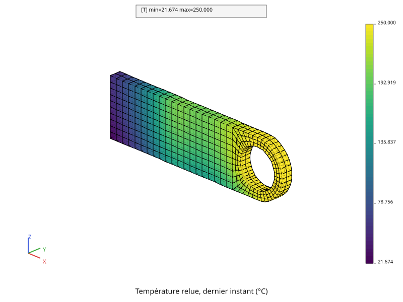
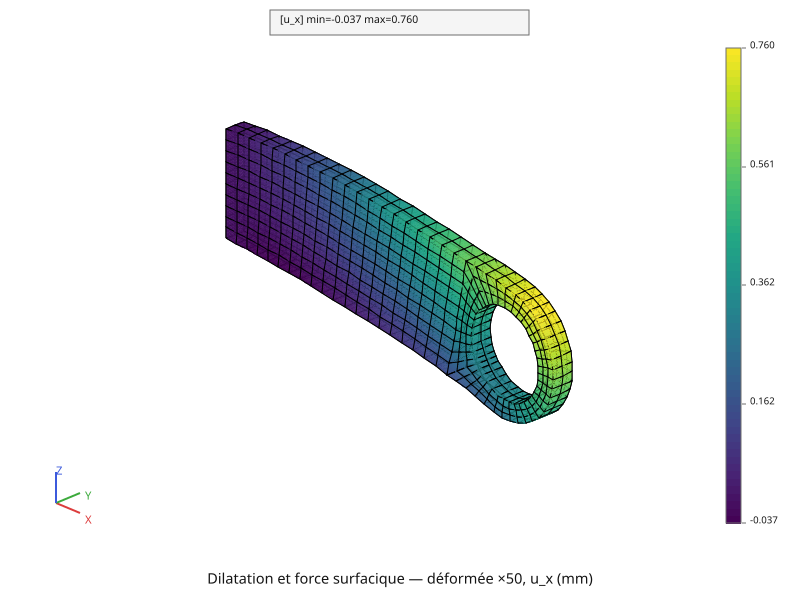
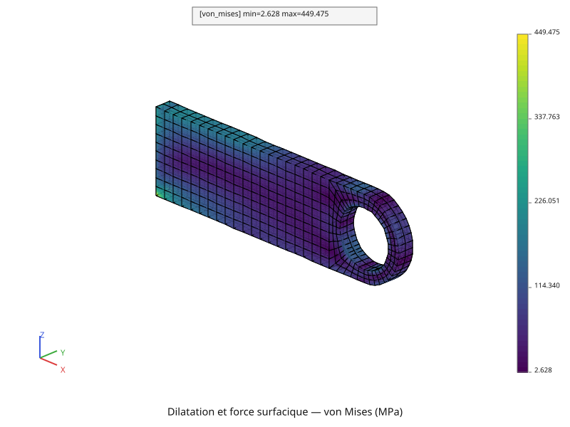

# Dilatation, matériau homogène

La chape de la page [Élasticité](mecanique-elastique.md), encastrée et chargée
par la force surfacique verticale, est maintenant **chaude** : 250 °C à
l'alésage, une vingtaine de degrés près de l'encastrement. C'est la
température du dernier instant du calcul de la page
[Thermique non linéaire](thermique-non-lineaire.md), relue dans le fichier
qu'il a écrit. La pièce se dilate, l'encastrement l'en empêche en partie, et
des contraintes naissent sans aucun effort de plus.

Le script complet est [`tutoriel/mecanique_dilatation.py`](https://github.com/Pyrucast/pyrucast/blob/master/tutoriel/mecanique_dilatation.py)
; tous les extraits ci-dessous en sont issus directement, dans l'ordre du
fichier. Il relit le fichier `thermique.pyr` qu'écrit
[`tutoriel/thermique_non_lineaire.py`](https://github.com/Pyrucast/pyrucast/blob/master/tutoriel/thermique_non_lineaire.py) :
ce script-là doit avoir tourné avant.

## L'équation résolue

Au système de la page [Élasticité](mecanique-elastique.md) s'ajoute le terme
de dilatation de la page [Mécanique linéaire](mecanique-lineaire.md) :

\\[ [K]\\{U\\} = \\{F\_s\\} + \\{F\_{\text{th}}\\} + \\{F\_{\text{reac}}\\},
\qquad \\{F\_{\text{th}}\\} = \int_V [B]^T [C]\\,\varepsilon\_{\text{th}} \\, dV,
\qquad \varepsilon\_{\text{th}} = \alpha\\,(T - T\_{\text{ref}})\\,I \\]

\\( [C]\\,\varepsilon\_{\text{th}} \\) est la contrainte qu'il faudrait pour
empêcher toute dilatation ; \\( \\{F\_{\text{th}}\\} \\) en sont les forces
nodales. Le système résolu est le même que pour l'élasticité, avec ce second
membre :

\\[ \begin{bmatrix} K & A^T \\\\ A & 0 \end{bmatrix}
   \begin{Bmatrix} U \\\\ \lambda \end{Bmatrix} =
   \begin{Bmatrix} F\_s + F\_{\text{th}} \\\\ 0 \end{Bmatrix} \\]

Seule la part de la déformation que la dilatation n'explique pas crée une
contrainte :

\\[ \sigma = [C] \left( [B]\\{U\\} - \varepsilon\_{\text{th}} \right) \\]

**La dilatation ne pousse pas la pièce dans son ensemble.** Les forces de
\\( \\{F\_{\text{th}}\\} \\) se compensent : leur somme est nulle, quelle que
soit la température. Une pièce libre se dilaterait sans bouger dans son
ensemble ; l'encastrement, lui, la retient, et ses réactions changent nœud par
nœud. Leur somme, elle, reste le poids.

Chaque terme correspond à un objet du script :

| Terme | pyrucast |
|---|---|
| \\( T \\) aux points de Gauss | `pc.element_field.interp_to_gauss(temperature, fes)` |
| \\( \varepsilon\_{\text{th}} = \alpha\\,(T - T\_{\text{ref}})\\,I \\) | `pc.element_field.thermal_strain(t_gauss, materiaux, fes, T_REF)`, qui lit `alpha` dans le champ matériau |
| \\( [C]\\,\varepsilon\_{\text{th}} \\) | `pc.element_field.elastic_stress(modele, eps_th, materiaux)` |
| \\( \int_V [B]^T [C]\\,\varepsilon\_{\text{th}} \\, dV \\) | `pc.node_field.divergence(sigma_th, "sigma")` |
| \\( \sigma = [C](\varepsilon - \varepsilon\_{\text{th}}) \\) | `pc.element_field.elastic_stress(modele, deformation - eps_th, materiaux)` |

## Les données du calcul

```python
{{#include ../../../tutoriel/mecanique_dilatation.py:donnees}}
```

Les données de la page [Élasticité](mecanique-elastique.md), plus le
coefficient de dilatation d'un acier, \\( \alpha = 10^{-5} \\) /K, et la
température \\( T\_{\text{ref}} = 0 \\) °C à laquelle la pièce n'est pas
dilatée. `FICHIER` est le chemin où
[`tutoriel/thermique_non_lineaire.py`](https://github.com/Pyrucast/pyrucast/blob/master/tutoriel/thermique_non_lineaire.py)
a écrit son calcul, dans le dossier temporaire du système.

## La température relue

```python
{{#include ../../../tutoriel/mecanique_dilatation.py:relecture}}
```

`pc.load` rend un dictionnaire, avec les clefs sous lesquelles `pc.save` a
écrit : le volume, et l'évolution des 101 champs de température.
`frames()` en donne les champs dans l'ordre du temps, et le dernier est celui
de 15 000 s. Le volume relu est celui du calcul thermique, avec ses propres
nœuds : tout ce qui suit se construit sur lui, et la température s'y lit sans
rien convertir.

**Une thermique et une mécanique se chaînent par un fichier.** Le calcul
thermique est fait une fois ; la mécanique le relit autant de fois qu'il le
faut, sans le refaire.



La température relue va de 21,67 à 250,00 °C : l'alésage à 250 °C, le coin
bas de l'encastrement le plus froid, refroidi à la fois par le flux qui sort
de la face gauche et par le film convectif du dessous.

## Les régions et le modèle

```python
{{#include ../../../tutoriel/mecanique_dilatation.py:regions}}
```

Les régions de la page [Élasticité](mecanique-elastique.md), retrouvées sur le
volume relu par les mêmes sélections géométriques.

```python
{{#include ../../../tutoriel/mecanique_dilatation.py:modele}}
```

Le modèle, l'encastrement et la force surfacique sont ceux de la page
[Élasticité](mecanique-elastique.md). Le champ matériau porte en plus
`alpha`, que la dilatation va lire. L'élasticité, elle, ne lit que `E` et
`nu` : `alpha` ne change pas \\( [K] \\).

## La dilatation

```python
{{#include ../../../tutoriel/mecanique_dilatation.py:dilatation}}
```

Quatre lignes, une par terme du tableau ci-dessus. La température vient d'un
calcul aux nœuds ; `interp_to_gauss` la porte aux points de Gauss, là où
`thermal_strain` calcule \\( \alpha\\,(T - T\_{\text{ref}}) \\).
`elastic_stress` en fait \\( [C]\\,\varepsilon\_{\text{th}} \\), et
`divergence` intègre \\( \int [B]^T \sigma \\, dV \\) sur toute la pièce.

`divergence` nomme ses composantes d'après celles du champ qu'elle reçoit :
`div_sigma_x`, `div_sigma_y`, `div_sigma_z`. Le second membre de l'élasticité
attend `f_x`, `f_y`, `f_z` : `rename_component` les renomme.

## Le second membre

```python
{{#include ../../../tutoriel/mecanique_dilatation.py:second_membre}}
```

Les deux chargements touchent les mêmes nœuds, ceux de la moitié basse de
l'alésage. Comme à la page [Régime stationnaire](thermique.md), leurs
contributions doivent s'y **additionner**, ce que `|` ne fait pas.
`restrict_like` ramène la force surfacique sur le support de la dilatation,
tous les nœuds de la pièce ; les deux champs ont alors le même support, et `+`
les somme nœud par nœud.

## Résolution

```python
{{#include ../../../tutoriel/mecanique_dilatation.py:resolution}}
```

Les réactions se lisent comme à la page [Élasticité](mecanique-elastique.md).
Le script affiche une somme des forces de la dilatation de l'ordre de
\\( 10^{-9} \\) N, zéro à l'arrondi près, et des réactions de 0, 0 et
24 525,0 N : **exactement le poids**, comme sans dilatation.

## La déformée

```python
{{#include ../../../tutoriel/mecanique_dilatation.py:deformee}}
```



La pièce **s'allonge** : le bout libre avance de 0,760 mm selon \\( x \\).
Chaque tranche s'allonge selon sa température, et les allongements
s'additionnent de l'encastrement jusqu'au bout libre. Elle descend
aussi davantage : le point le plus bas est à −1,280 mm, contre −0,978 mm sous
la seule force surfacique. Le dessous, refroidi par le film convectif, se
dilate moins que le dessus : la pièce se cintre vers le bas, dans le même sens
que la masse.

## Les contraintes

```python
{{#include ../../../tutoriel/mecanique_dilatation.py:contraintes}}
```



Aux points de Gauss, von Mises va de 3,92 à 379,19 MPa, contre 226,69 MPa au
plus sans dilatation. Le maximum est au coin bas de l'encastrement : la face
\\( x = 0 \\) ne peut pas se dilater, et le bas y est en plus comprimé par la
flexion.

**Un calcul élastique peut dépasser la limite du matériau.** 379 MPa, c'est
plus que les 250 MPa à partir desquels l'acier de la page
[Plasticité](plasticite.md) se déforme de façon permanente. Le calcul
élastique ne le sait pas : il prolonge la loi de Hooke aussi loin qu'il le
faut. Ce dépassement dit seulement que la pièce, en réalité, plastifierait.

## Script complet

```python
{{#include ../../../tutoriel/mecanique_dilatation.py:script}}
```

Suite : [Dilatation, matériau hétérogène](mecanique-heterogene.md).
