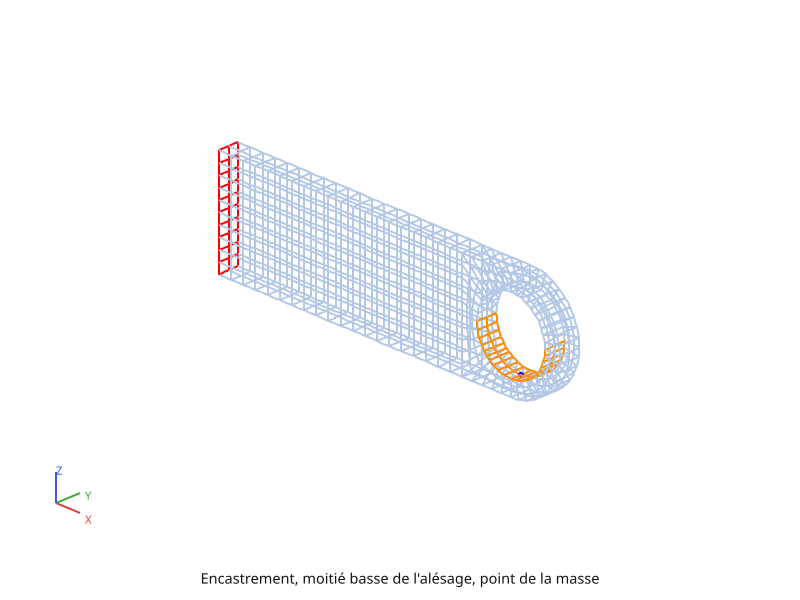
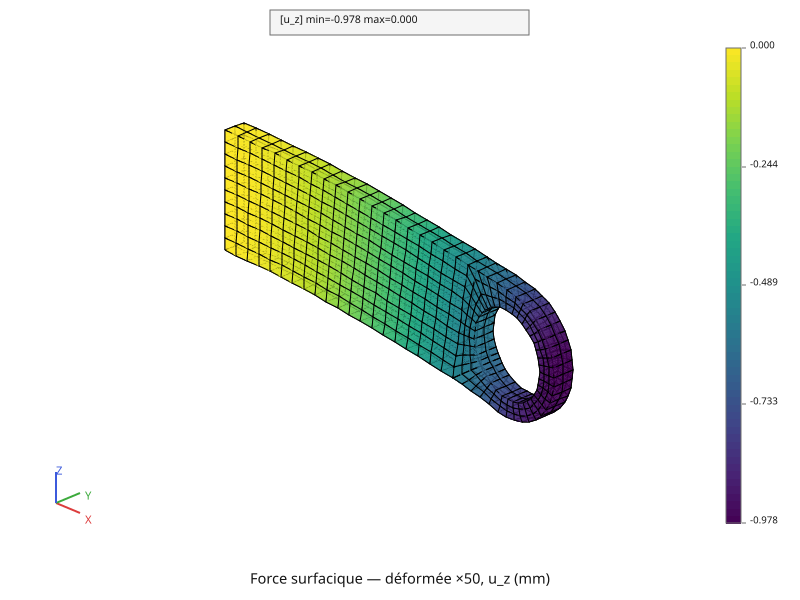
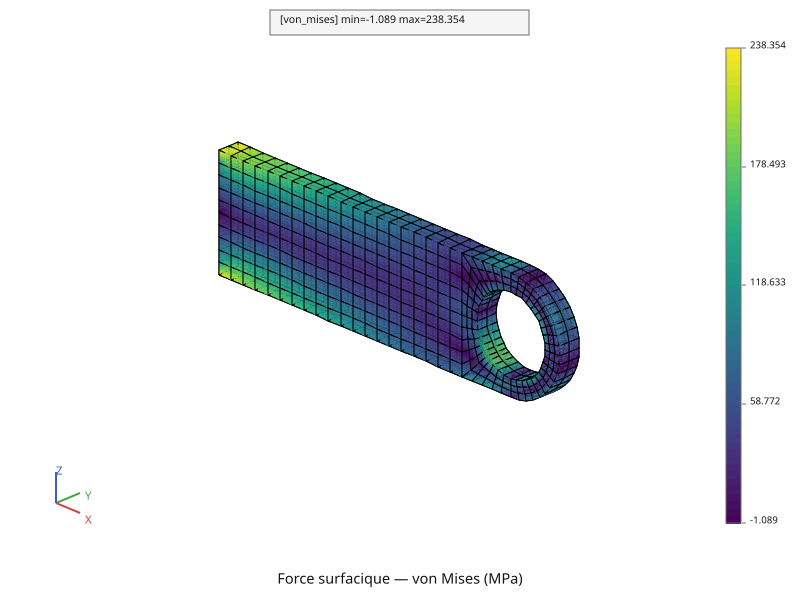
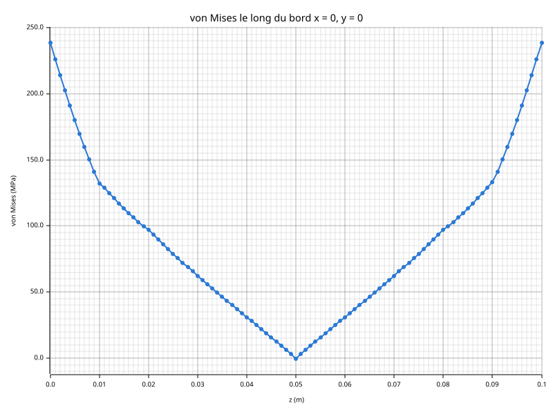
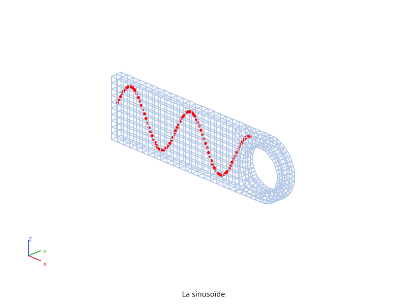
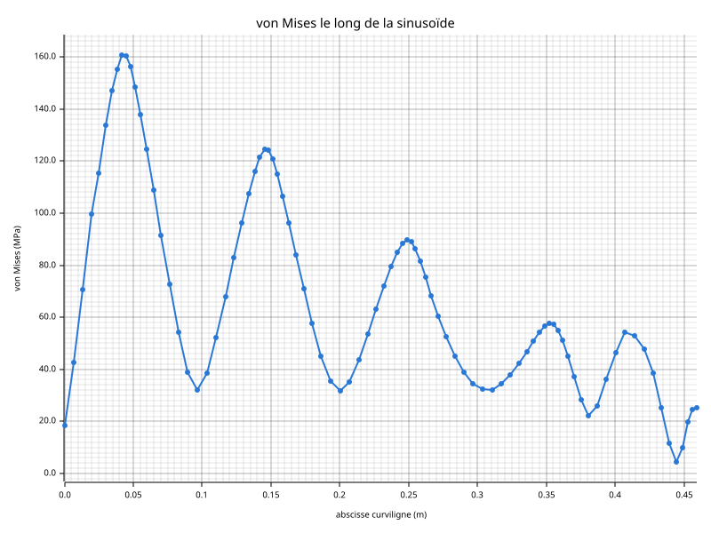

# Élasticité

La chape percée de la page [Maillage](maillage.md) est encastrée par sa face
gauche, et une masse de 2 500 kg est suspendue à son alésage. Ce premier
calcul de mécanique pose la masse de **trois façons** : une force en un point,
une pression, une force surfacique verticale. Il compare ce qu'elles donnent,
puis lit sur le dernier cas tout ce qu'un calcul élastique fournit : réactions,
déformée, déformations, contraintes, contrainte de von Mises, et valeurs le
long d'une ligne.

Le script complet est [`tutoriel/mecanique_elastique.py`](https://github.com/Pyrucast/pyrucast/blob/master/tutoriel/mecanique_elastique.py)
; tous les extraits ci-dessous en sont issus directement, dans l'ordre du
fichier.

## L'équation résolue

La page [Mécanique linéaire](mecanique-lineaire.md) a posé l'équilibre et sa
forme discrétisée. Ici, pas de dilatation ni de force volumique : il reste la
rigidité, les forces de surface et la réaction de l'encastrement,

\\[ [K]\\{U\\} = \\{F\_s\\} + \\{F\_{\text{reac}}\\}, \qquad
[K] = \int_V [B]^T [C] [B] \\, dV, \qquad
\\{F\_s\\} = \int_{\partial V\_t} [N]^T t\_{\text{imp}} \\, dS \\]

L'encastrement bloque les trois composantes du déplacement sur la face
\\( x = 0 \\). Chacune passe par ses multiplicateurs de Lagrange, et le
système que pyrucast résout est

\\[ \begin{bmatrix} K & A^T \\\\ A & 0 \end{bmatrix}
   \begin{Bmatrix} U \\\\ \lambda \end{Bmatrix} =
   \begin{Bmatrix} F\_s \\\\ 0 \end{Bmatrix} \\]

La réaction est \\( -[A]^T\\{\lambda\\} \\). Les trois façons de poser la
masse ne changent que \\( \\{F\_s\\} \\) :

| Cas | Effort | \\( \\{F\_s\\} \\) |
|---|---|---|
| 1. force ponctuelle | \\( -mg \\) selon \\( z \\), au bas de l'alésage | une seule ligne non nulle |
| 2. pression | \\( p \\) sur la moitié basse de l'alésage, contre la normale | \\( \int [N]^T (-p\\,n) \\, dS \\) |
| 3. force surfacique verticale | \\( p \\) vers le bas, sur la même moitié | \\( \int [N]^T (0, 0, -p) \\, dS \\) |

Pour les cas 2 et 3, \\( p \\) est le poids divisé par l'aire de la moitié
basse de l'alésage, un demi-cylindre de rayon \\( r \\) et d'épaisseur
\\( e \\) : \\( p = mg / (\pi r e) \\).

Les contraintes se lisent ensuite **aux points de Gauss**, là où le calcul les
connaît : \\( \varepsilon = [B]\\{U\\} \\), \\( \sigma = [C]\\,\varepsilon \\).
Pour juger d'un état de contrainte d'un seul nombre, on calcule la
**contrainte équivalente de von Mises** :

\\[ \sigma\_{\text{VM}} = \sqrt{ \tfrac{1}{2} \left[ (\sigma\_{xx} - \sigma\_{yy})^2 +
(\sigma\_{yy} - \sigma\_{zz})^2 + (\sigma\_{zz} - \sigma\_{xx})^2 \right] +
3 \left( \sigma\_{xy}^2 + \sigma\_{yz}^2 + \sigma\_{xz}^2 \right) } \\]

Un acier commence à se déformer de façon permanente quand elle atteint sa
limite d'élasticité. Elle vaut 0 pour une pression égale dans toutes les
directions, qui ne déforme pas un acier de façon permanente.

## Les données du calcul

```python
{{#include ../../../tutoriel/mecanique_elastique.py:donnees}}
```

Un acier, \\( E = 200 \\) GPa et \\( \nu = 0{,}3 \\) ; une masse de 2 500 kg,
soit un poids de 24 525 N. `PRESSION` répartit ce poids sur la moitié basse
de l'alésage. `AMPLIFICATION` ne sert qu'à la figure de la déformée : les
déplacements réels, moins d'un millimètre, seraient invisibles à l'échelle de
la pièce.

## Le maillage

```python
{{#include ../../../tutoriel/mecanique_elastique.py:maillage}}
```

Le volume HEX20 structuré de la page [Maillage](maillage.md), importé tel
quel, comme dans les pages de thermique. La peau donne les faces sur
lesquelles s'intègrent les efforts répartis.

## Les régions

```python
{{#include ../../../tutoriel/mecanique_elastique.py:regions}}
```

Trois régions, toutes repérées par leur géométrie :
- **l'encastrement**, les 85 nœuds du plan \\( x = 0 \\), lus sur le volume ;
- **la moitié basse de l'alésage**, 40 faces QUA8, celles de la peau dont les
  nœuds sont sur le cylindre du trou et sous son centre ;
- **le point de la masse**, le nœud de l'alésage le plus proche de son point
  le plus bas, au milieu de l'épaisseur : \\( (0{,}3 ; 0{,}01 ; 0{,}015) \\).

**Un blocage demande des nœuds, un effort réparti des faces.** L'encastrement
se pose donc sur un maillage `POI1`, la pression sur des QUA8.
`nearest_node` rend un nœud du maillage, et `poi1_from_nodes` en fait un
maillage d'un seul point, le support de la force ponctuelle.

```python
{{#include ../../../tutoriel/mecanique_elastique.py:figure_regions}}
```



## Le modèle

```python
{{#include ../../../tutoriel/mecanique_elastique.py:modele}}
```

`pc.model.elasticity(fes, "full_3d")` est l'élasticité en trois dimensions :
ses inconnues sont `u_x`, `u_y`, `u_z`, et ses efforts `f_x`, `f_y`, `f_z`.
L'encastrement est trois blocages, un par composante, réunis au modèle par
`|`. Le champ matériau porte \\( E \\) et \\( \nu \\), et
`pc.matrix.stiffness` assemble \\( [K] \\) avec les lignes des blocages.

## Trois façons de poser la masse

### Une force ponctuelle

```python
{{#include ../../../tutoriel/mecanique_elastique.py:force_ponctuelle}}
```

Un champ aux nœuds sur le seul point de la masse, de composante `f_z` : tout
le poids sur un nœud. C'est l'effort le plus simple à écrire, et le plus
éloigné de la réalité : une masse ne s'appuie jamais sur un point.

### Une pression

```python
{{#include ../../../tutoriel/mecanique_elastique.py:pression}}
```

Un effort réparti est un terme du modèle, comme le flux imposé de la page
[Régime stationnaire](thermique.md) : `pc.model.flux` sur l'espace des faces
de la moitié basse. Sa composante `"n"` dit que la densité agit **le long de
la normale sortante**. La densité `phi_n` est donc négative : la pression
pousse contre la normale, dans la matière. `pc.node_field.external_forces`
intègre \\( \int [N]^T (-p\\,n) \\, dS \\).

### Une force surfacique verticale

```python
{{#include ../../../tutoriel/mecanique_elastique.py:force_surfacique}}
```

Le même opérateur, la même densité, mais sur la composante `"f_z"` : l'effort
est vertical en tout point de la moitié basse, quelle que soit l'orientation
de la face.

## Trois résolutions, une seule matrice

```python
{{#include ../../../tutoriel/mecanique_elastique.py:resolutions}}
```

**Un calcul linéaire se factorise une fois.** Le premier `solve` factorise
\\( [K] \\) et range la factorisation sur la matrice ; les deux suivants la
reprennent et ne font qu'une descente-remontée chacun.

## Les réactions

```python
{{#include ../../../tutoriel/mecanique_elastique.py:reactions}}
```

Chaque blocage a ses nœuds multiplicateurs, que `multiplier_mesh()` rend. La
composante `lambda` de la solution y porte les multiplicateurs ;
`restrict` les isole, `sum` les additionne, et le signe moins en fait la
réaction de l'encastrement sur la pièce. Le script affiche :

| Cas | Réaction verticale |
|---|---|
| force ponctuelle | 24 525,0 N |
| pression | 15 613,1 N |
| force surfacique | 24 525,0 N |

Les réactions horizontales sont nulles dans les trois cas.

**Une pression n'est pas un poids.** La force ponctuelle et la force
surfacique portent tout le poids, et l'encastrement le rend exactement. La
pression ne porte que 15 613,1 N, soit \\( 2mg/\pi \\). Elle est
perpendiculaire à la paroi : sur le demi-cylindre, ses parties horizontales
s'annulent d'un côté à l'autre, et sa partie verticale ne fait que
\\( 2 p r e \\), l'aire de la moitié basse **vue d'en dessous** fois
\\( p \\), au lieu de \\( \pi r e \\, p \\). Pour qu'une pression porte la
masse entière, il faudrait la prendre \\( \pi / 2 \\) fois plus forte.

## La déformée

```python
{{#include ../../../tutoriel/mecanique_elastique.py:deformee}}
```

Une **configuration** est un jeu complet de positions pour les mêmes nœuds.
`add_config` en ajoute une au `Coords` de la pièce, et
`pc.coords.displace_from` la pose en \\( X + 50\\,u \\) à partir de la
configuration 0, celle de référence. Les nœuds multiplicateurs de la solution
n'ont pas de déplacement : ils restent où ils sont.

Le bloc `with` est une construction Python : il rend la configuration
déformée active le temps du tracé, puis remet celle d'avant, même si le tracé
échoue. Le maillage n'est pas copié : ce sont les mêmes nœuds, lus à d'autres
positions.



La chape fléchit comme une poutre encastrée : rien ne bouge à gauche, et le
bout libre descend. Le point le plus bas descend de 0,978 mm sous la force
surfacique, de 0,970 mm sous la force ponctuelle et de 0,623 mm sous la
pression. Ce dernier rapport, 0,623 / 0,978, vaut à peu près \\( 2/\pi \\) :
c'est celui des efforts appliqués, et c'est ce qu'on attend d'un calcul
linéaire.

## Déformations, contraintes, von Mises

```python
{{#include ../../../tutoriel/mecanique_elastique.py:contraintes}}
```

`strain` calcule \\( \varepsilon = [B]\\{U\\} \\) aux points de Gauss,
`elastic_stress` \\( \sigma = [C]\\,\varepsilon \\), et `von_mises` la
contrainte équivalente. Ce sont des **champs par éléments** : chaque élément
garde ses propres valeurs, sans les partager avec ses voisins. Un champ se
multiplie par un nombre comme un nombre : `von_mises * 1e-6` le passe en MPa.

`von_mises` prend aussi six coefficients facultatifs, `coefficients=[F, G, H,
L, M, N]`. Ceux par défaut donnent von Mises ; d'autres donnent la contrainte
équivalente de Hill, pour un matériau qui ne résiste pas de la même façon dans
toutes les directions.



Aux points de Gauss, von Mises va de 3,44 à 226,69 MPa. Le maximum est au haut
et au bas de l'encastrement, là où la flexion tend et comprime le plus la
matière, et autour de l'alésage, là où la charge entre dans la pièce. Le
minimum est à mi-hauteur, sur la ligne où la flexion change de signe.

**La couleur d'un élément vient de ses propres points de Gauss.** Pour peindre
un élément, pyrucast ajuste au mieux une fonction de cet élément sur les
valeurs de ses points de Gauss, puis la lit aux nœuds. Lue au bord de
l'élément, cette fonction peut sortir un peu de la plage des points de Gauss :
la légende de la carte descend légèrement sous zéro, alors que von Mises est
positif en tout point de Gauss.

## Le long d'une ligne

### Le bord de l'encastrement

```python
{{#include ../../../tutoriel/mecanique_elastique.py:le_long_du_bord}}
```

Une ligne de tracé est un maillage `POI1` dont les points se suivent dans
l'ordre. Ici, 101 nœuds ajoutés au `Coords` de la pièce, du bas au haut du
bord \\( x = 0 \\), \\( y = 0 \\). Ils ne font partie d'aucune maille : ce
sont de simples points de lecture.

`pc.node_field.project` donne à chaque point la valeur de l'élément qui le
contient, tirée de ses seuls points de Gauss par le même ajustement que la
carte : **jamais de moyenne entre éléments voisins**. `along`, appelée comme
une méthode du champ obtenu, en fait une évolution : l'abscisse est la
distance parcourue sur la ligne, l'ordonnée la valeur en chaque point.



La courbe est un V : la flexion est la plus forte en haut et en bas, et
s'annule à mi-hauteur. Le long du bord, von Mises va de −0,30 à 238,35 MPa.
Ces deux valeurs sortent de la plage des points de Gauss, et pour la même
raison que les couleurs de la carte :
- le bord est une arête de la pièce, au-delà des points de Gauss de ses
  éléments, et la valeur y est prolongée ;
- dans le coin de l'encastrement, où les contraintes montent vite, le
  maximum dépasse un peu celui des points de Gauss ;
- à mi-hauteur, où von Mises passe par zéro en pointe, la fonction de
  l'élément arrondit la pointe et passe un peu sous zéro.

### Une ligne quelconque : la sinusoïde

```python
{{#include ../../../tutoriel/mecanique_elastique.py:le_long_de_la_sinusoide}}
```

La même démarche sur une ligne qui traverse la pièce : 90 points sur une
sinusoïde du plan médian \\( y = e/2 \\), de \\( x = 0{,}01\\,L \\) à
\\( 0{,}9\\,L \\). La ligne se trace comme un maillage, d'une couleur à elle.





Le long de la sinusoïde, von Mises va de 4,55 à 160,58 MPa. Chaque bosse de la
courbe est un passage de la ligne près du haut ou du bas de la pièce, là où la
flexion est forte, et chaque creux un passage à mi-hauteur. Les bosses
décroissent de gauche à droite : la flexion est la plus forte à
l'encastrement et diminue vers le bout libre. Un point prend la valeur de
l'élément qui le contient, si bien que la courbe peut sauter d'un élément au
suivant. Ici, les sauts restent petits.

## Script complet

```python
{{#include ../../../tutoriel/mecanique_elastique.py:script}}
```

Suite : [Dilatation, matériau homogène](mecanique-dilatation.md).
