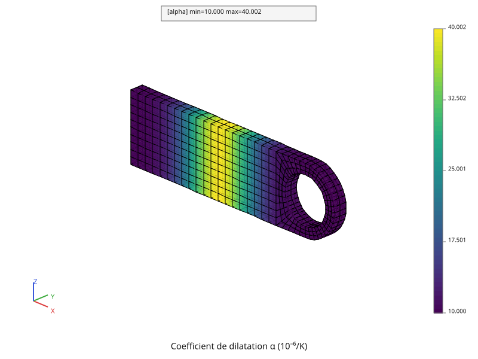
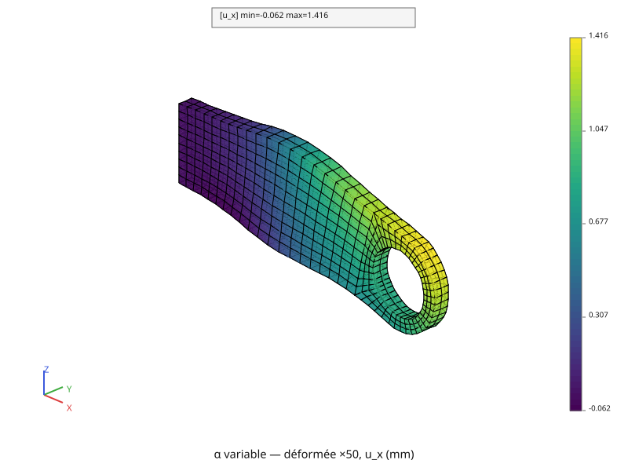
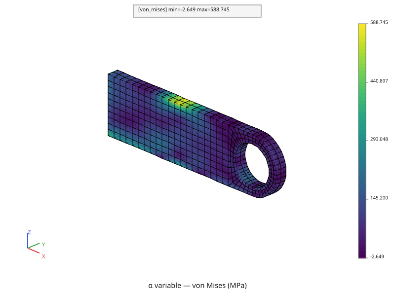

# Dilatation, matériau hétérogène

Le calcul de la page [Dilatation, matériau homogène](mecanique-dilatation.md),
avec un coefficient de dilatation qui **varie le long de la pièce**. Il est
quatre fois plus fort au milieu de la longueur qu'aux bouts, en forme de
cloche :

\\[ \alpha(x) = \alpha\_0 \left( 1 + 3\\,e^{-\left( \frac{x - \mu}{s} \right)^2} \right),
\qquad \mu = L/2, \qquad s = L/5 \\]

C'est l'image d'une pièce dont le matériau n'est pas le même partout, comme
une soudure au milieu d'une barre. Rien d'autre ne change : même température,
même encastrement, même masse.

Le script complet est [`tutoriel/mecanique_heterogene.py`](https://github.com/Pyrucast/pyrucast/blob/master/tutoriel/mecanique_heterogene.py)
; tous les extraits ci-dessous en sont issus directement, dans l'ordre du
fichier. Comme le précédent, il relit le fichier qu'écrit
[`tutoriel/thermique_non_lineaire.py`](https://github.com/Pyrucast/pyrucast/blob/master/tutoriel/thermique_non_lineaire.py).

## L'équation résolue

Celle de la page [Dilatation, matériau homogène](mecanique-dilatation.md),
avec \\( \alpha \\) qui dépend du point :

\\[ \varepsilon\_{\text{th}}(x) = \alpha(x)\\,(T - T\_{\text{ref}})\\,I,
\qquad \\{F\_{\text{th}}\\} = \int_V [B]^T [C]\\,\varepsilon\_{\text{th}} \\, dV \\]

L'intégrale se calcule aux points de Gauss : c'est là qu'il faut connaître
\\( \alpha \\). Le coefficient devient donc un **champ par éléments**, une
valeur par point de Gauss, au lieu d'un nombre.

## Les données du calcul

```python
{{#include ../../../tutoriel/mecanique_heterogene.py:donnees}}
```

`ALPHA_0` est le coefficient aux bouts de la pièce, celui de la page
précédente ; `MU` et `SIGMA`, le \\( \mu \\) et le \\( s \\) de la formule,
placent la cloche au milieu de la longueur et lui donnent sa largeur.

## Le même début, les mêmes régions

```python
{{#include ../../../tutoriel/mecanique_heterogene.py:relecture}}
```

```python
{{#include ../../../tutoriel/mecanique_heterogene.py:regions}}
```

La température relue et les régions de la page précédente, sans changement.

## α, un champ aux points de Gauss

```python
{{#include ../../../tutoriel/mecanique_heterogene.py:alpha}}
```

`pc.node_field.positions` donne la coordonnée \\( x \\) de chaque nœud, un
champ aux nœuds comme un autre ; `interp_to_gauss` la porte aux points de
Gauss. La formule s'écrit ensuite sur ce champ comme sur un nombre : `-`,
`/`, `**`, `*` et `+` agissent point de Gauss par point de Gauss, et
`pc.field.exp` est l'exponentielle d'un champ.

**Un calcul sur un champ garde le nom de sa composante.** Le résultat
s'appelle encore `X`, le nom de la composante de départ ; `rename_component`
le renomme `alpha`, le nom que la dilatation cherche dans le champ matériau.



Le script affiche un \\( \alpha \\) qui va de \\( 1{,}0000 \times 10^{-5} \\)
à \\( 3{,}9983 \times 10^{-5} \\) /K. Le maximum n'atteint pas tout à fait
\\( 4\\,\alpha\_0 \\), parce qu'aucun point de Gauss ne tombe exactement au
milieu de la longueur.

## Le modèle

```python
{{#include ../../../tutoriel/mecanique_heterogene.py:modele}}
```

Le champ matériau est la réunion de deux champs par `|` : `E` et `nu`,
uniformes, donnés par `material_field`, et `alpha`, le champ par éléments
qu'on vient de calculer. Chaque composante n'est que d'un côté, et le
résultat est un seul champ matériau à trois composantes.

## La dilatation et la résolution

```python
{{#include ../../../tutoriel/mecanique_heterogene.py:dilatation}}
```

Mot pour mot les lignes de la page précédente : `thermal_strain` lit `alpha`
dans le champ matériau, qu'il y soit uniforme ou qu'il varie d'un point de
Gauss à l'autre. Les forces de la dilatation se somment encore à zéro, à
l'arrondi près, et les réactions encore à 0, 0 et 24 525,0 N.

## Résultats

```python
{{#include ../../../tutoriel/mecanique_heterogene.py:resultats}}
```





| | α uniforme | α en cloche |
|---|---|---|
| allongement du bout libre, \\( u\_x \\) max | 0,760 mm | 1,416 mm |
| point le plus bas, \\( u\_z \\) min | −1,280 mm | −1,585 mm |
| von Mises max aux points de Gauss | 379,19 MPa | 534,70 MPa |

Le milieu de la pièce se dilate jusqu'à quatre fois plus : la pièce s'allonge
presque deux fois plus, et se cintre davantage. Le pic de von Mises n'est plus
à l'encastrement mais **au milieu de la longueur, en haut** : la tranche qui
veut le plus s'allonger est retenue par ses voisines, qui s'allongent moins.
C'est le cas d'une soudure dans une barre chauffée : les contraintes naissent
là où le matériau change.

## Script complet

```python
{{#include ../../../tutoriel/mecanique_heterogene.py:script}}
```

Suite : [Mécanique non linéaire](mecanique-non-lineaire.md).
