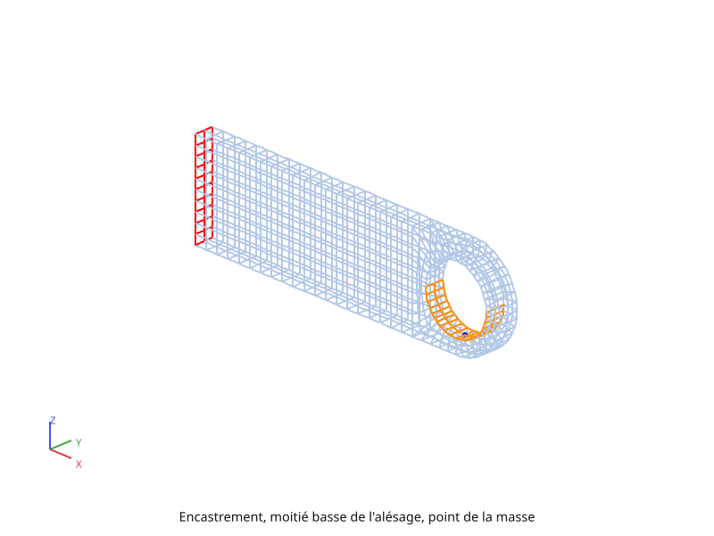

# Mécanique linéaire

Les trois pages de ce chapitre chargent la chape percée de la page
[Maillage](maillage.md). La pièce est encastrée par sa face gauche, et une
masse de 2 500 kg y est suspendue par l'alésage.
- La page [Élasticité](mecanique-elastique.md) pose cette masse de trois
  façons et lit les déplacements, les réactions et les contraintes.
- La page [Dilatation, matériau homogène](mecanique-dilatation.md) ajoute la
  dilatation due à la température calculée au chapitre précédent.
- La page [Dilatation, matériau hétérogène](mecanique-heterogene.md) la
  reprend avec un coefficient de dilatation qui varie le long de la pièce.

Cette page pose l'équation que les trois résolvent. Chacune la reprend ensuite
dans sa forme à elle, jusqu'au système que pyrucast résout vraiment.

## L'équilibre

En chaque point de la pièce, les efforts intérieurs équilibrent les efforts
appliqués :

\\[ \operatorname{div}(\sigma) + f = 0 \ \text{ dans } V \\]

| | |
|---|---|
| \\( \sigma \\) | le tenseur des contraintes, en Pa : les efforts intérieurs par unité de surface |
| \\( f \\) | les forces volumiques, en N/m³, comme le poids propre |
| \\( u \\) | le déplacement de chaque point, en m |

Sur le bord, deux sortes de conditions se partagent la surface. Sur
\\( \partial V\_u \\) le déplacement est imposé ; sur \\( \partial V\_t \\)
c'est l'effort appliqué par unité de surface qui est donné, avec \\( n \\) la
normale sortante :

\\[ u = u\_{\text{imp}} \ \text{ sur } \partial V\_u, \qquad
\sigma \cdot n = t\_{\text{imp}} \ \text{ sur } \partial V\_t \\]

Un encastrement est un déplacement imposé nul. Une pression \\( p \\) qui
appuie sur le bord est un effort \\( t\_{\text{imp}} = -p\\,n \\) : il pousse
contre la normale sortante, donc vers l'intérieur de la matière.

## Petites déformations et loi de Hooke

Tant que les déplacements restent petits devant la pièce, la déformation se
lit sur les dérivées du déplacement :

\\[ \varepsilon = \tfrac{1}{2} \left( \operatorname{grad}(u) +
\operatorname{grad}(u)^T \right) \\]

Un acier qui reste élastique suit la loi de Hooke : la contrainte est
proportionnelle à la déformation. La partie due à la température,
\\( \varepsilon\_{\text{th}} \\), ne crée aucune contrainte par elle-même ;
seule la différence entre la déformation totale et la dilatation en crée :

\\[ \sigma = [C] \left( \varepsilon - \varepsilon\_{\text{th}} \right),
\qquad \varepsilon\_{\text{th}} = \alpha\\,(T - T\_{\text{ref}})\\,I \\]

| | |
|---|---|
| \\( [C] \\) | la matrice d'élasticité, construite sur le module d'Young \\( E \\) et le coefficient de Poisson \\( \nu \\) |
| \\( \alpha \\) | le coefficient de dilatation, en 1/K |
| \\( T\_{\text{ref}} \\) | la température à laquelle la pièce n'est pas dilatée |
| \\( I \\) | l'identité : la dilatation est la même dans toutes les directions |

La page [Élasticité](mecanique-elastique.md) n'a pas de dilatation :
\\( \varepsilon\_{\text{th}} = 0 \\) et \\( \sigma = [C]\\,\varepsilon \\).

## La forme discrétisée

Sur les éléments finis, le déplacement s'interpole à partir de ses valeurs aux
nœuds, \\( u(x) = [N(x)]\\{U\\} \\), et la déformation aussi,
\\( \varepsilon(x) = [B(x)]\\{U\\} \\). L'équilibre écrit en travaux
virtuels devient un système linéaire :

\\[ [K]\\{U\\} = \\{F\_v\\} + \\{F\_s\\} + \\{F\_{\text{th}}\\} + \\{F\_{\text{reac}}\\} \\]

\\[ [K] = \int_V [B]^T [C] [B] \\, dV \qquad \text{la rigidité} \\]

\\[ \\{F\_v\\} = \int_V [N]^T f \\, dV \qquad \text{les forces volumiques} \\]

\\[ \\{F\_s\\} = \int_{\partial V\_t} [N]^T t\_{\text{imp}} \\, dS
\qquad \text{les forces de surface} \\]

\\[ \\{F\_{\text{th}}\\} = \int_V [B]^T [C]\\,\varepsilon\_{\text{th}} \\, dV
\qquad \text{la dilatation} \\]

Le dernier terme, \\( \\{F\_{\text{reac}}\\} \\), est l'effort que
l'encastrement exerce sur la pièce pour la tenir : la **réaction**. Elle n'est
pas connue d'avance, c'est le déplacement imposé qui l'est. pyrucast l'obtient
par des **multiplicateurs de Lagrange** \\( \\{\lambda\\} \\), un par
composante et par nœud bloqué. La relation
\\( [A]\\{U\\} = \\{U\_{\text{imp}}\\} \\), où chaque ligne de \\( [A] \\) lit
une composante du déplacement d'un nœud bloqué, s'ajoute au système :

\\[ \begin{bmatrix} K & A^T \\\\ A & 0 \end{bmatrix}
   \begin{Bmatrix} U \\\\ \lambda \end{Bmatrix} =
   \begin{Bmatrix} F \\\\ U\_{\text{imp}} \end{Bmatrix} \\]

Sur la première ligne, \\( [K]\\{U\\} = \\{F\\} - [A]^T\\{\lambda\\} \\) : la
réaction est \\( \\{F\_{\text{reac}}\\} = -[A]^T\\{\lambda\\} \\). Le
multiplicateur \\( \lambda \\) est l'effort que la pièce exerce sur le
blocage, la réaction son opposé.

**Linéaire veut dire : rien ne dépend du déplacement.** \\( [K] \\) se calcule
et se factorise une fois pour toutes, et chaque nouveau chargement ne coûte
qu'une résolution de plus. La page [Mécanique non linéaire](mecanique-non-lineaire.md)
lève cette hypothèse.

## La pièce et ses sollicitations

| Sollicitation | Où | Valeur |
|---|---|---|
| encastrement | la face gauche, \\( x = 0 \\) | \\( u = 0 \\) |
| masse suspendue | l'alésage | 2 500 kg, soit un poids \\( mg \\) de 24 525 N |
| dilatation (9.7.2 et 9.7.3) | toute la pièce | la température finale du calcul avec rayonnement |

Le matériau est un acier : \\( E = 200 \\) GPa, \\( \nu = 0{,}3 \\), et pour
la dilatation \\( \alpha = 10^{-5} \\) /K, avec \\( T\_{\text{ref}} = 0 \\) °C.

## Le parcours

1. [Élasticité](mecanique-elastique.md) : la masse posée de trois façons,
   trois résolutions sur la même matrice, puis les réactions, la déformée,
   les contraintes et la contrainte de von Mises le long de deux lignes.
2. [Dilatation, matériau homogène](mecanique-dilatation.md) : la température
   relue dans le fichier écrit par la page
   [Thermique non linéaire](thermique-non-lineaire.md), et la dilatation
   qu'elle produit.
3. [Dilatation, matériau hétérogène](mecanique-heterogene.md) : le même
   calcul, avec un coefficient de dilatation qui varie le long de la pièce.

Puis [Mécanique non linéaire](mecanique-non-lineaire.md) ajoute la plasticité
et le contact.

Suite : [Élasticité](mecanique-elastique.md).
