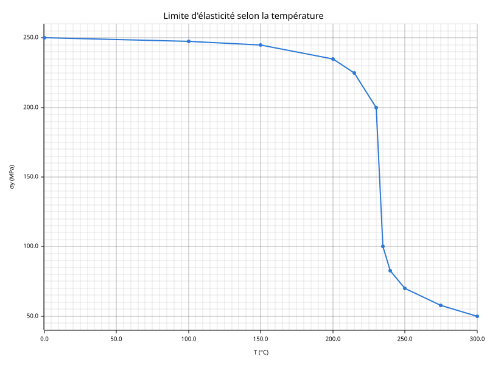
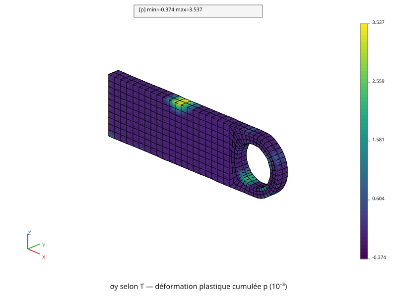
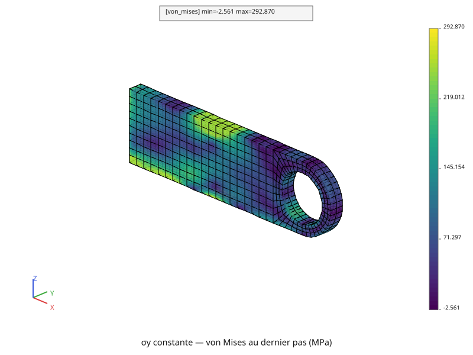
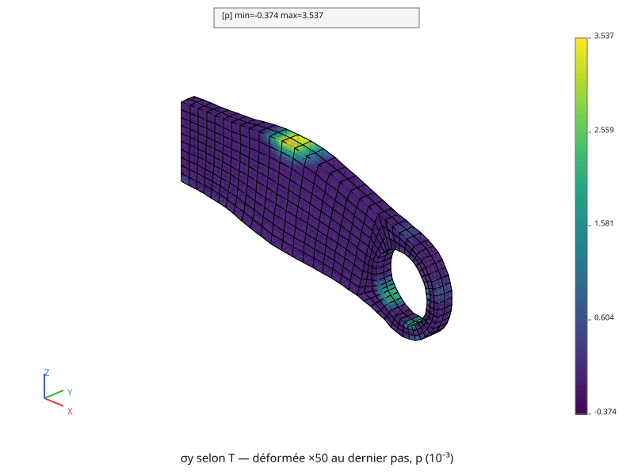

# Plasticité

La chape de la page [Dilatation, matériau hétérogène](mecanique-heterogene.md)
(encastrée, chargée par la force surfacique, chauffée, avec un coefficient de
dilatation en cloche) montait à 534,70 MPa en élasticité, plus du double de la
limite de son acier. Ce calcul lui donne une loi **plastique parfaite** : la
contrainte de von Mises ne dépasse jamais la limite d'élasticité
\\( \sigma\_y \\), et la matière se déforme de façon permanente là où elle
l'atteint. La force et la température montent ensemble, en 20 pas. Deux
calculs se suivent :
1. \\( \sigma\_y = 250 \\) MPa, la même à toute température ;
2. \\( \sigma\_y \\) qui baisse avec la température, lue dans une table.

Le script complet est [`tutoriel/plasticite.py`](https://github.com/Pyrucast/pyrucast/blob/master/tutoriel/plasticite.py)
; tous les extraits ci-dessous en sont issus directement, dans l'ordre du
fichier. Il relit le fichier qu'écrit
[`tutoriel/thermique_non_lineaire.py`](https://github.com/Pyrucast/pyrucast/blob/master/tutoriel/thermique_non_lineaire.py).

## L'équation résolue

À chaque pas, l'équilibre non linéaire de la page
[Mécanique non linéaire](mecanique-non-lineaire.md),

\\[ \\{F\_{\text{ext}}(t)\\} - \int_V [B]^T \sigma \\, dV = 0,
\qquad \\{F\_{\text{ext}}(t)\\} = \frac{t}{100}\\,\\{F\_s\\} \\]

avec la force surfacique \\( \\{F\_s\\} \\) de la page
[Élasticité](mecanique-elastique.md), et une température qui va de celle du
premier instant thermique, 0 °C, à celle du dernier :

\\[ T(t) = T\_{\text{début}} + \frac{t}{100} \left( T\_{\text{fin}} - T\_{\text{début}} \right) \\]

La contrainte suit la **loi plastique parfaite** de von Mises. On sépare la
déformation en trois parts : la dilatation, une part élastique, et une part
plastique \\( \varepsilon\_p \\), permanente :

\\[ \sigma = [C] \left( \varepsilon - \varepsilon\_{\text{th}} - \varepsilon\_p \right),
\qquad \sigma\_{\text{VM}} \le \sigma\_y \\]

Tant que \\( \sigma\_{\text{VM}} < \sigma\_y \\), \\( \varepsilon\_p \\) ne
change pas : c'est l'élasticité. Quand \\( \sigma\_{\text{VM}} \\) atteint
\\( \sigma\_y \\), la matière s'écoule : \\( \varepsilon\_p \\) grandit, et la
contrainte reste sur la limite. La **déformation plastique cumulée**
\\( p \\) compte tout l'écoulement subi par un point. Elle ne fait que
croître, et vaut 0 là où la matière n'a jamais plastifié.

## Les données du calcul

```python
{{#include ../../../tutoriel/plasticite.py:donnees}}
```

Les données de la page [Dilatation, matériau hétérogène](mecanique-heterogene.md),
plus :
- `SIGMA_Y`, la limite d'élasticité à froid, 250 MPa ;
- `T_FINAL` et `N_PAS`, le temps fictif de 0 à 100, en 20 pas de 5 ;
- `TABLE_SIGMA_Y`, la limite d'élasticité rapportée à sa valeur à froid, en
  11 points de 0 à 300 °C. L'acier perd peu jusqu'à 200 °C, puis s'effondre
  entre 230 et 240 °C.

## La température, les régions, le modèle

```python
{{#include ../../../tutoriel/plasticite.py:relecture}}
```

Le premier et le dernier champ de l'évolution relue : la pièce à 0 °C, puis
la pièce au dernier instant thermique.

```python
{{#include ../../../tutoriel/plasticite.py:regions}}
```

```python
{{#include ../../../tutoriel/plasticite.py:modele}}
```

`pc.model.plasticity_perfect(fes, "full_3d")` remplace l'élasticité. Ses
inconnues sont les mêmes, `u_x`, `u_y`, `u_z`. Il porte en plus, en chaque
point de Gauss, une **variable interne**, `p`. L'encastrement s'écrit comme
avant, et le coefficient de dilatation en cloche aussi. Le champ matériau
porte en plus `sigma_y`.

## Des chargements qui évoluent

```python
{{#include ../../../tutoriel/plasticite.py:chargements}}
```

Un chargement qui change au cours du calcul est une **évolution** : une suite
de couples (instant, champ), interpolée linéairement entre eux. Deux couples
suffisent ici : la force nulle à \\( t = 0 \\), la force entière à
\\( t = 100 \\) ; la température du début à \\( t = 0 \\), celle de la fin à
\\( t = 100 \\). `instants` liste les 21 instants où l'on veut un résultat :
0, 5, …, 100.

## Premier calcul : σy constante

```python
{{#include ../../../tutoriel/plasticite.py:calcul_1}}
```

`pc.stepping.step_by_step` reçoit un dictionnaire : le modèle, les instants,
les matériaux, les chargements, la température et sa référence. Il déroule
les pas et range dans `resultats["results"]` un état par instant : le temps,
le déplacement, les contraintes et variables internes (`"behaviour"`), les
réactions et le nombre d'itérations.

**Un dictionnaire porte les données et les résultats.** Le second calcul
reprend celui-ci en ne changeant qu'une clef ; les résultats s'y ajoutent sous
`"results"`.

## Une limite d'élasticité qui dépend de la température

```python
{{#include ../../../tutoriel/plasticite.py:table}}
```

La table, d'abord tracée en MPa :



Puis rangée dans une évolution d'un autre genre : en abscisse, la
température `"T"` ; en ordonnée, la valeur `"sigma_y"`. Entre deux points de
la table, la valeur est interpolée ; au-delà, `out_of_range="clamp"` garde
celle du bord.

```python
{{#include ../../../tutoriel/plasticite.py:calcul_2}}
```

`dict(sigma_y_constante, material_laws=lois)` copie le dictionnaire du premier
calcul et y ajoute une clef. `material_laws` dit au pas à pas de remplacer, à
chaque pas et en chaque point de Gauss, `sigma_y` par la valeur de la table à
la température du point.

## Ce que les calculs donnent

Le script affiche, pour chaque calcul, les itérations de chaque pas et l'état
du dernier :

| | σy constante | σy selon T |
|---|---|---|
| itérations par pas | 2 jusqu'à \\( t = 45 \\), puis de 4 à 8 | 2 jusqu'à \\( t = 45 \\), puis de 4 à 18 |
| itérations en tout | 83 | 98 |
| \\( p \\) max au dernier pas | \\( 2{,}8321 \times 10^{-3} \\) | \\( 3{,}2316 \times 10^{-3} \\) |
| von Mises max au dernier pas | 250,00 MPa | 249,42 MPa |
| point le plus bas | −1,672 mm | −1,759 mm |
| réaction verticale | 24 525,0 N | 24 525,0 N |

La première plastification arrive à \\( t = 50 \\) dans le premier calcul.
C'est ce qu'annonçait l'élasticité : avec des chargements proportionnels à
\\( t \\), les 534,70 MPa du calcul élastique atteignent 250 MPa un peu avant
la moitié du chemin. Jusque-là, deux itérations suffisent par pas ; ensuite
il en faut davantage, à mesure que la zone plastique s'étend.

**von Mises ne dépasse pas σy aux points de Gauss.** Dans le premier calcul,
le maximum vaut exactement 250,00 MPa : là où la matière s'écoule, la
contrainte reste sur la limite. Dans le second, chaque point bute sur sa
propre limite, plus basse là où il fait chaud. Le maximum, 249,42 MPa, est la
limite d'un point resté froid, une vingtaine de degrés, près de
l'encastrement. Ailleurs, la limite a baissé : la chape plastifie davantage et
descend plus bas. La réaction, elle, est toujours le poids.

## Les champs, pas après pas

```python
{{#include ../../../tutoriel/plasticite.py:evolutions}}
```

Les 21 états de \\( p \\) du second calcul, rangés dans une évolution, se
tracent d'un seul appel, comme les températures de la page
[Thermique non linéaire](thermique-non-lineaire.md) : dans la fenêtre, un
curseur parcourt les pas. L'image ci-dessous est le dernier.



La matière plastifie surtout à deux endroits. En haut, au milieu de la
longueur, c'est là que la dilatation en cloche concentrait les contraintes.
Autour de l'alésage, c'est la zone la plus chaude, où la limite d'élasticité a
baissé.



La carte de von Mises du premier calcul montre, en haut au milieu, la zone où
la contrainte bute sur 250 MPa. Sa légende monte pourtant au-dessus de
250 MPa : comme à la page [Élasticité](mecanique-elastique.md), la couleur
d'un élément vient d'un ajustement de ses points de Gauss, lu jusqu'à ses
nœuds, et cet ajustement déborde un peu. Aux points de Gauss, là où la loi est
intégrée, la limite est tenue.

## La déformée

```python
{{#include ../../../tutoriel/plasticite.py:deformee}}
```



La déformée du second calcul, colorée par \\( p \\). La flexion de la masse et
le cintrage de la dilatation s'ajoutent, comme en élasticité ; la
plastification les accentue.

## Script complet

```python
{{#include ../../../tutoriel/plasticite.py:script}}
```

Suite : [Contact](contact.md).
