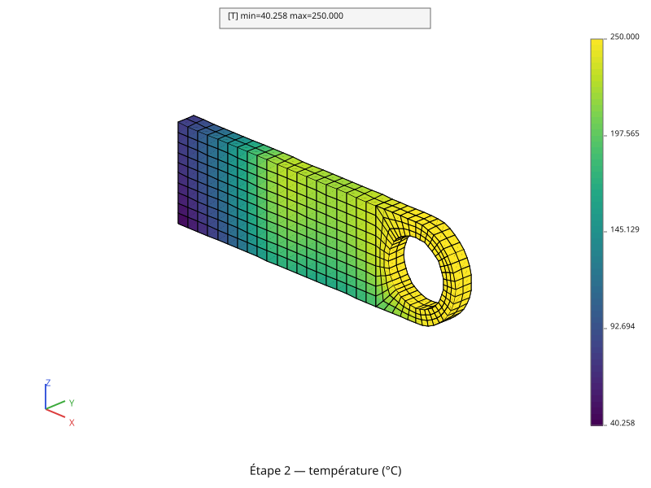

# Thermique linéaire

Les deux pages de ce chapitre font chauffer la chape percée de la page
[Maillage](maillage.md), sous les mêmes sollicitations : l'alésage tenu à
250 °C, un flux qui sort par la face gauche, un film convectif sous la pièce
et une tranche chauffée dans la masse. La page
[Régime stationnaire](thermique.md) cherche l'état où la pièce s'est
installée ; la page [Régime transitoire](thermique-transitoire.md) la suit
depuis 0 °C, pendant que les sollicitations s'établissent.

Cette page pose l'équation que les deux résolvent ; chacune la reprend ensuite
dans sa forme à elle, jusqu'au système que pyrucast résout vraiment.

## L'équation de la chaleur

Le bilan d'énergie sur un volume \\( V \\) s'écrit, avec \\( \phi \\) la
densité de flux de chaleur et \\( q \\) une source volumique :

\\[ \rho c\_p \frac{\partial T}{\partial t} + \operatorname{div}(\phi) = q,
\qquad \phi = -\lambda \operatorname{grad}(T) \\]

| | |
|---|---|
| \\( T \\) | la température |
| \\( \phi \\) | la densité de flux de chaleur (loi de Fourier : la chaleur va du chaud vers le froid) |
| \\( q \\) | la source de chaleur volumique |
| \\( \lambda \\) | la conductivité thermique |
| \\( \rho \\), \\( c\_p \\) | la masse volumique et la capacité thermique massique |

Sur le bord, deux sortes de conditions se partagent la surface. Sur
\\( \partial V\_T \\) la température est imposée ; sur
\\( \partial V\_\phi \\) c'est la chaleur **reçue** par le bord qui est donnée
(\\( n \\) la normale sortante) :

\\[ T = T\_{\text{imp}} \ \text{ sur } \partial V\_T, \qquad
-\phi \cdot n = \phi\_{\text{imp}}
              + \underbrace{h\\,(T\_f - T)}\_{\text{convection}}
              + \underbrace{\varepsilon \sigma\\,(T\_\infty^4 - T^4)}\_{\text{rayonnement}}
\ \text{ sur } \partial V\_\phi \\]

Un \\( \phi\_{\text{imp}} \\) positif apporte de la chaleur, un négatif en
retire. La **convection** échange avec un fluide à \\( T\_f \\), en proportion
de l'écart de température ; le **rayonnement** échange avec un environnement
lointain à \\( T\_\infty \\), en puissance quatrième de la température. Ce
chapitre-ci laisse le rayonnement de côté : il a sa propre page,
[Thermique non linéaire](thermique-non-lineaire.md).

## La forme discrétisée

Sur les éléments finis, la température s'interpole à partir de ses valeurs aux
nœuds, \\( T(x) = [N(x)]\\{T\\} \\), et son gradient aussi,
\\( \operatorname{grad}(T) = [B(x)]\\{T\\} \\). L'équation devient un système
d'équations différentielles en temps :

\\[ [C]\\{\dot{T}\\} + [K]\\{T\\} = \\{P\\} \\]

\\[ [C] = \int_V \rho c\_p\\,[N]^T [N] \\, dV \qquad \text{la capacité} \\]

\\[ [K] = \int_V [B]^T \lambda [B] \\, dV
      + \int_{\partial V\_\phi} h\\,[N]^T [N] \\, dS
      \qquad \text{la conductivité} \\]

\\[ \\{P\\} = \int_V [N]^T q \\, dV
      + \int_{\partial V\_\phi} [N]^T (\phi\_{\text{imp}} + h\\,T\_f) \\, dS
      \qquad \text{le chargement} \\]

La convection se partage entre deux membres : sa part en \\( T \\) entre dans
\\( [K] \\), sa part en \\( T\_f \\) dans \\( \\{P\\} \\). La température
imposée, elle, n'entre dans aucun des trois : elle s'ajoute au système par des
**multiplicateurs de Lagrange**, comme le détaille la page
[Régime stationnaire](thermique.md).

**Linéaire veut dire : rien ne dépend de la température.** Les coefficients
\\( \lambda \\), \\( \rho \\), \\( c\_p \\), \\( h \\) sont des constantes, si
bien que \\( [C] \\), \\( [K] \\) et \\( \\{P\\} \\) se calculent une fois pour
toutes. Le rayonnement casse cette propriété — son terme en \\( T^4 \\) fait
dépendre le chargement de l'inconnue —, d'où sa page à part.

## La pièce et ses sollicitations

| Sollicitation | Où | Valeur |
|---|---|---|
| température imposée | l'alésage | 250 °C |
| flux imposé | la face gauche, \\( x = 0 \\) | −40 kW/m² (il sort) |
| convection | la face du dessous, \\( z = 0 \\) | \\( h = 240 \\) W/m²/K, \\( T\_f = -80 \\) °C |
| source volumique | la tranche \\( 0{,}33\\,L \le x \le 0{,}51\\,L \\) | 2 600 kW/m³ |

Le matériau est un acier : \\( \lambda = 50 \\) W/m/K, et pour le transitoire
\\( \rho = 7\\,800 \\) kg/m³, \\( c\_p = 420 \\) J/kg/K, une pièce à 0 °C au
départ. Voici ce que donne le régime établi :

## Le parcours

1. [Régime stationnaire](thermique.md) — \\( [C]\\{\dot{T}\\} \\) disparaît :
   un seul système, résolu deux fois, la conduction seule puis toutes les
   sollicitations.
2. [Régime transitoire](thermique-transitoire.md) — les sollicitations
   s'établissent au fil du temps, et la pièce les suit pas de temps par pas
   de temps ; le flux de chaleur se calcule ensuite sur le dernier instant.

Puis [Thermique non linéaire](thermique-non-lineaire.md) ajoute le
rayonnement.

Suite : [Régime stationnaire](thermique.md).
