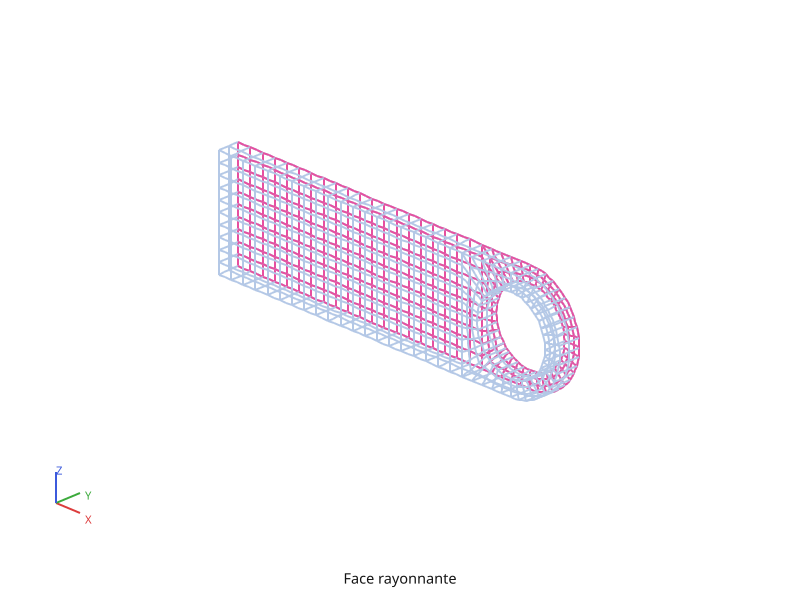
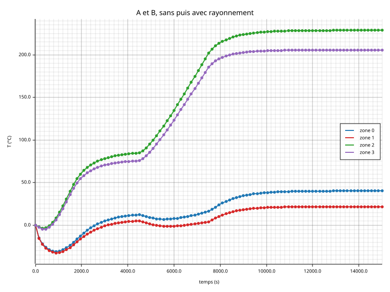
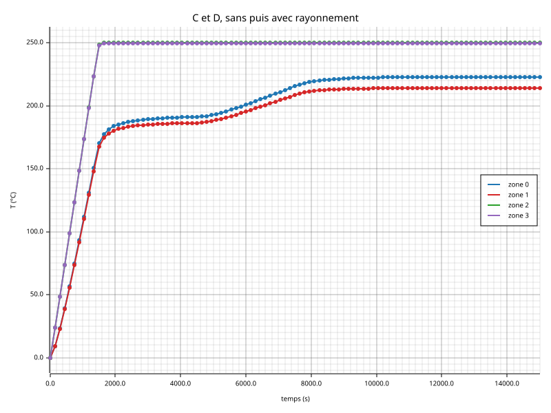
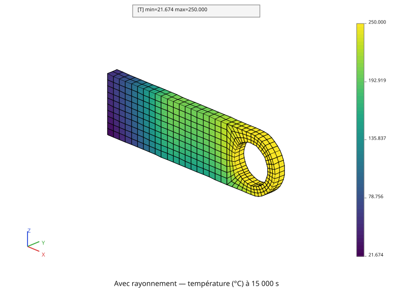

# Thermique non linéaire

Reprend le calcul de la page [Régime transitoire](thermique-transitoire.md) — la chape
percée à 0 °C, les mêmes sollicitations, les mêmes rampes — et ajoute un
échange par **rayonnement** : la grande face arrière de la pièce rayonne vers
un environnement lointain à −140 °C. Le calcul est mené deux fois, l'un après
l'autre, **sans** puis **avec** le rayonnement, pour lire ce qu'il change en
quatre points de la pièce.

Le script complet est [`tutoriel/thermique_non_lineaire.py`](https://github.com/Pyrucast/pyrucast/blob/master/tutoriel/thermique_non_lineaire.py)
; tous les extraits ci-dessous en sont issus directement, dans l'ordre du
fichier.

## L'équation résolue

Sur la face rayonnante \\( \partial V\_r \\), la pièce perd par rayonnement
le flux

\\[ \phi\_r = \varepsilon \sigma\\,(T^4 - T\_\infty^4) \\]

où \\( \varepsilon \\) est l'émissivité de la face, \\( T\_\infty \\) la
température de l'environnement et \\( \sigma \\) la constante de
Stefan-Boltzmann. Ce flux entre dans le bilan comme la convection, mais il
dépend de \\( T^4 \\) : il ne se range ni dans une matrice constante ni dans
un second membre constant. Le système de la page
[Thermique linéaire](thermique-lineaire.md) devient

\\[ [C]\\{\dot{T}\\} + [K]\\{T\\} + \\{R(T)\\} = \\{P(t)\\},
\qquad \\{R(T)\\} = \int\_{\partial V\_r} [N]^T\\, \varepsilon \sigma\\,
(T^4 - T\_\infty^4) \\, dS \\]

**Un terme non linéaire, c'est un résidu qu'on annule par itérations.** À
chaque pas, avec \\( \theta = 1 \\) comme au transitoire, le calcul pas à pas
cherche la température \\( \\{T\\} \\) qui annule

\\[ \\{r(T)\\} = \\{P(t\_{n+1})\\} - [K]\\{T\\} - \\{R(T)\\}
              - \frac{[C]}{\Delta t}\big(\\{T\\} - \\{T\_n\\}\big) \\]

en partant de \\( \\{T\_n\\} \\) et en corrigeant pas à pas :

\\[ \Big( \frac{[C]}{\Delta t} + [K] + [K\_r(T\_n)] \Big)\\, \\{\delta T\\}
    = \\{r(T)\\},
\qquad [K\_r(T\_n)] = \int\_{\partial V\_r} 4 \varepsilon \sigma\\,
T\_n^3\\, [N]^T [N] \\, dS \\]

\\( [K\_r] \\) est la **tangente** du rayonnement — la dérivée de
\\( \\{R\\} \\) —, calculée une fois au début du pas, à
\\( T\_n \\). Le résidu, lui, est recalculé exactement à chaque itération,
avec \\( T^4 \\). Le calcul s'arrête quand la correction tombe sous
\\( 10^{-4} \\) fois la température. La température imposée garde ses
multiplicateurs, comme au transitoire.

Chaque terme nouveau correspond à un objet du script :

| Terme | pyrucast |
|---|---|
| \\( \\{R(T)\\} \\), \\( [K\_r] \\) | `pc.model.radiation(fes, modele)` sur la face rayonnante |
| \\( \varepsilon \\), \\( T\_\infty \\) | les coefficients « emis » et « T_inf » du champ matériau |
| \\( \sigma \\) | la constante SI, \\( 5{,}670374419 \cdot 10^{-8} \\) W/m²/K⁴, par défaut |
| les itérations | `pc.stepping.step_by_step`, le même appel qu'au transitoire |

## Les données du calcul

```python
{{#include ../../../tutoriel/thermique_non_lineaire.py:donnees}}
```

Les données du stationnaire et du transitoire sont importées de leurs
scripts ; le rayonnement ajoute son émissivité, 0,9, et la température
lointaine, −140 °C.

**Une puissance quatrième ne déplace pas son origine.** La conduction et la
convection ne voient que des écarts de température : on peut les écrire en
degrés Celsius ou en kelvins, c'est le même calcul décalé de 273,15. Le
rayonnement, lui, lit \\( T^4 \\), et
\\( (T + 273{,}15)^4 \\) n'est pas \\( T^4 \\) plus une constante :
`pc.model.radiation` attend une température **absolue**, en kelvins. Le
script décale donc **toutes** ses températures de `ZERO_ABSOLU` — la
température imposée, celle du fluide, celle de l'environnement, l'état
initial — et retranche ce décalage pour tracer.

## On reprend la pièce

```python
{{#include ../../../tutoriel/thermique_non_lineaire.py:maillage}}
```

```python
{{#include ../../../tutoriel/thermique_non_lineaire.py:regions}}
```

Le maillage et les régions sont ceux du transitoire, redécoupés à l'identique.

### La face rayonnante

```python
{{#include ../../../tutoriel/thermique_non_lineaire.py:face_rayonnante}}
```

La face arrière se repère comme la face basse, **par coordonnée** : les nœuds
de la peau où \\( y \\) vaut l'épaisseur, dans une bande de `TOL`, puis les
`QUA8` qu'ils portent entièrement — 320, toute la face.



## Le modèle et son matériau

```python
{{#include ../../../tutoriel/thermique_non_lineaire.py:modele}}
```

**Le rayonnement se pose comme la convection.** `pc.model.radiation` prend
l'espace éléments finis de la face et la conduction qu'il refroidit ; il
partage ses degrés de liberté « T » et « q ». Le modèle du transitoire reste
tel quel : le rayonnement n'est qu'un terme de plus, réuni par `|` au moment
du calcul.

```python
{{#include ../../../tutoriel/thermique_non_lineaire.py:materiaux}}
```

Les deux champs matériau du transitoire, en kelvins, reçoivent un quatrième
morceau : celui du rayonnement, avec « emis » et « T_inf ». Il ne varie pas
dans le temps, mais il fait partie des deux champs, si bien que l'évolution
interpole comme avant.

```python
{{#include ../../../tutoriel/thermique_non_lineaire.py:temperature_imposee}}
```

## Deux calculs, sans puis avec rayonnement

```python
{{#include ../../../tutoriel/thermique_non_lineaire.py:calculs}}
```

Les deux dictionnaires ne diffèrent que par leur modèle. Le champ matériau
porte les coefficients du rayonnement dans les deux : sans le terme
`rayonnement`, aucun modèle ne les lit, et le premier calcul est exactement le
transitoire de la page précédente, en kelvins.

**Le non linéaire ne coûte ici presque rien de plus.** Le calcul avec
rayonnement prend, comme l'autre, **2 itérations au plus par pas** (175 en
tout, contre 179 sans) : la tangente calculée au début du pas suit d'assez
près \\( T^3 \\) pour qu'une correction suffise à la précision demandée.

## Les résultats

```python
{{#include ../../../tutoriel/thermique_non_lineaire.py:courbes}}
```

Chaque figure montre deux points, chacun sans puis avec rayonnement : zone 0
et zone 1 pour le premier point, zone 2 et zone 3 pour le second.





**Le rayonnement refroidit toute la pièce**, d'autant plus que le point est
loin de l'alésage qui le tient. Au dernier instant :

| point | sans rayonnement | avec rayonnement | écart |
|---|---:|---:|---:|
| A, coin bas gauche | 40,25 °C | 21,73 °C | −18,52 °C |
| B, bord du haut | 228,69 °C | 205,52 °C | −23,17 °C |
| C, avant le trou | 222,98 °C | 214,07 °C | −8,91 °C |
| D, la pointe | 249,99 °C | 249,57 °C | −0,42 °C |

D, à 1,5 cm de l'alésage tenu à 250 °C, ne bouge presque pas ; B, loin de
lui et au-dessus de la tranche chauffée, perd le plus : la face arrière, à
plus de 200 °C, y rayonne vers −140 °C. Au tout début, les courbes se
confondent : le flux rayonné croît comme \\( T^4 \\) en kelvins, et une face
à 0 °C rayonne près de dix fois moins qu'à 200 °C.

```python
{{#include ../../../tutoriel/thermique_non_lineaire.py:champ_final}}
```



Au dernier instant, le point le plus froid est à 21,67 °C au lieu de
40,25 °C sans rayonnement ; l'alésage reste à 250 °C, tenu par son blocage.

## Script complet

Une fois les explications retirées, tout tient en un script — du maillage
importé à la comparaison des deux calculs :

```python
{{#include ../../../tutoriel/thermique_non_lineaire.py:script}}
```

Suite : [Calcul mécanique](mecanique.md).
