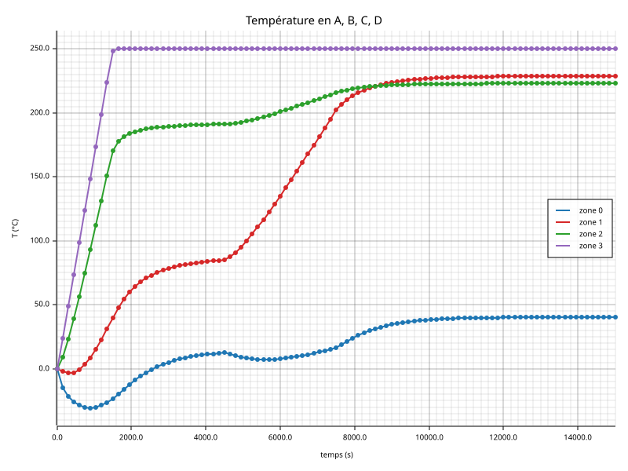
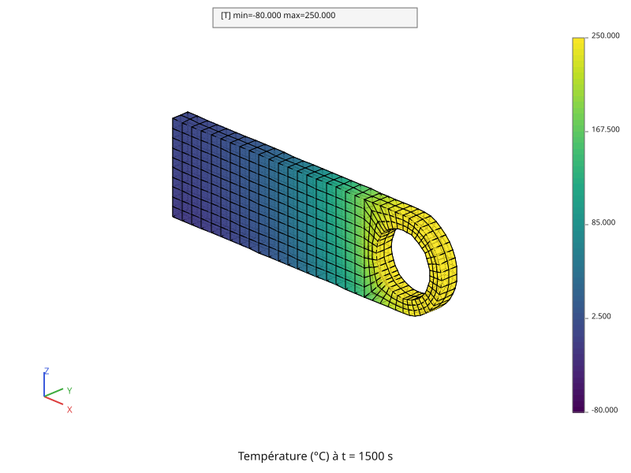
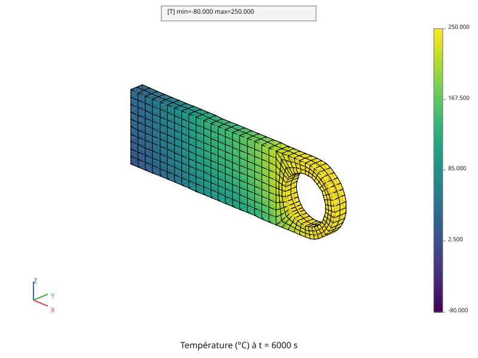
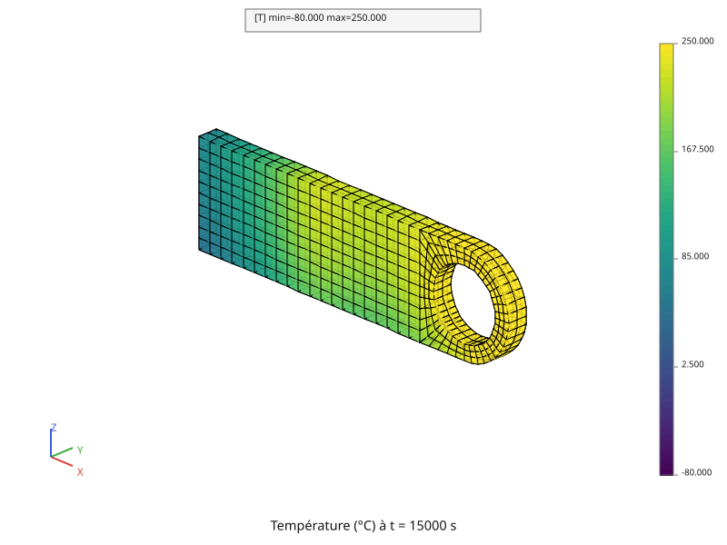
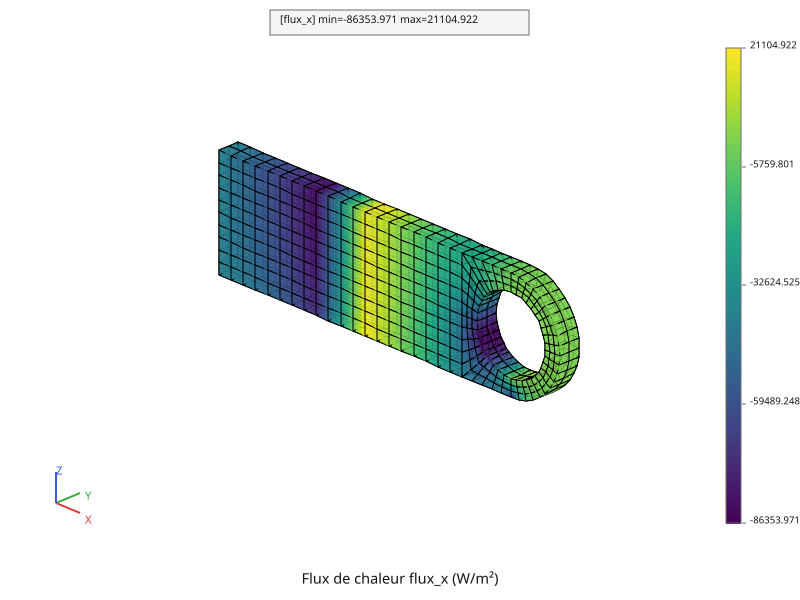
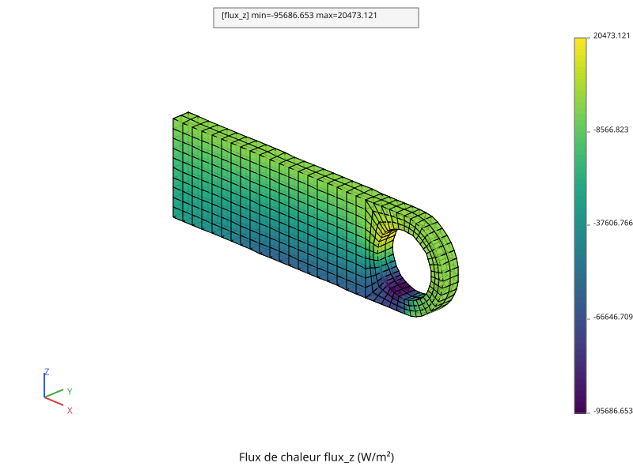

# Régime transitoire

Reprend la chape percée et les sollicitations de la page
[Régime stationnaire](thermique.md), mais sur une pièce **à 0 °C au départ**,
et avec des sollicitations qui **s'établissent au fil du temps** : l'alésage
monte à 250 °C pendant les 1 500 premières secondes, le flux de la face gauche
et la source s'installent entre 4 500 s et 7 500 s, la convection agit dès le
début. Le calcul suit la pièce sur 15 000 s, en 100 pas de temps, puis
calcule le flux de chaleur au dernier instant.

Le script complet est [`tutoriel/thermique_transitoire.py`](https://github.com/Pyrucast/pyrucast/blob/master/tutoriel/thermique_transitoire.py)
; tous les extraits ci-dessous en sont issus directement, dans l'ordre du
fichier.

## L'équation résolue

La page [Thermique linéaire](thermique-lineaire.md) a posé la forme
discrétisée de l'équation de la chaleur. En transitoire, le terme de capacité
reste : on résout le système d'équations différentielles

\\[ [C]\\{\dot{T}\\} + [K]\\{T\\} = \\{P(t)\\},
\qquad \\{T(0)\\} = \\{T\_0\\} \\]

\\[ [C] = \int_V \rho c\_p\\,[N]^T [N] \\, dV \\]

où \\( [K] \\) est celle du stationnaire — conduction et film convectif — et
où le second membre suit les rampes :

\\[ \\{P(t)\\} = r(t)\\,\big(\\{P\_{\text{flux}}\\} + \\{P\_{\text{source}}\\}\big)
              + \\{P\_{\text{convection}}\\},
\qquad T\_{\text{imp}}(t) = s(t) \times 250\ \text{°C} \\]

\\( r \\) et \\( s \\) vont de 0 à 1 ; \\( \\{P\_{\text{convection}}\\} \\),
la part en \\( h\\,T\_f \\), ne dépend pas du temps.

**Le temps avance pas à pas.** Entre deux instants \\( t\_n \\) et
\\( t\_{n+1} = t\_n + \Delta t \\), `pyrucast.stepping` remplace
\\( \\{\dot{T}\\} \\) par \\( (\\{T\_{n+1}\\} - \\{T\_n\\}) / \Delta t \\) et
écrit l'équilibre à la fin du pas (le schéma θ avec \\( \theta = 1 \\), son
réglage par défaut). Avec les multiplicateurs \\( \\{\mu\\} \\) de la
température imposée, c'est à chaque pas le système

\\[ \begin{bmatrix} \frac{C}{\Delta t} + K & A^T \\\\ A & 0 \end{bmatrix}
   \begin{Bmatrix} T\_{n+1} \\\\ \mu \end{Bmatrix} =
   \begin{Bmatrix} \frac{C}{\Delta t} T\_n + P(t\_{n+1}) \\\\
                   T\_{\text{imp}}(t\_{n+1}) \end{Bmatrix} \\]

que le calcul pas à pas résout. Il le fait en corrections successives, comme
il le ferait pour un problème non linéaire : il part de \\( T\_n \\), calcule le
résidu \\( \\{P(t\_{n+1})\\} - [K]\\{T\\} - \frac{[C]}{\Delta t}(\\{T\\} -
\\{T\_n\\}) \\), résout la correction avec la matrice
\\( \frac{C}{\Delta t} + K \\), et s'arrête quand la correction tombe sous
\\( 10^{-4} \\) fois la température. Ici tout est linéaire : la première
correction donne la solution, la seconde est nulle — **2 itérations par pas**,
pas une de plus.

Chaque terme correspond à un objet du script :

| Terme | pyrucast |
|---|---|
| \\( [K] \\) | `pc.model.heat_conduction` et `pc.model.boundary_transfer`, comme au stationnaire |
| \\( [C] \\) | les coefficients « rho » et « cp » du champ matériau, que `pyrucast.matrix.mass` assemble |
| \\( r(t)\\,\\{P\_{\text{flux}} + P\_{\text{source}}\\} \\) | deux termes `pc.model.flux`, dont la densité « phi_q » suit une `pc.Evolution` de champs matériau |
| \\( T\_{\text{imp}}(t) \\) | `pc.model.dirichlet` et une `pc.Evolution` de la température imposée |
| \\( \\{T\_0\\} \\) | le champ initial donné au calcul |
| le pas de temps | `pc.stepping.step_by_step`, sur la liste des instants |

## Les données du calcul

```python
{{#include ../../../tutoriel/thermique_transitoire.py:donnees}}
```

Les données du stationnaire — conductivité, flux, convection, source,
température de l'alésage — sont **importées** de `tutoriel/thermique.py`, et
ne sont donc écrites qu'une fois. Le transitoire n'ajoute que ce qui lui est
propre : la capacité de l'acier (\\( \rho = 7\\,800 \\) kg/m³,
\\( c\_p = 420 \\) J/kg/K), la température de départ, la durée et le nombre de
pas, les instants des rampes, et les quatre points dont on suivra la
température. Avec 100 pas sur 15 000 s, \\( \Delta t = 150 \\) s.

## On reprend la pièce

```python
{{#include ../../../tutoriel/thermique_transitoire.py:maillage}}
```

Le maillage est celui de la page [Maillage](maillage.md), importé comme au
stationnaire : 640 `HEX20`.

```python
{{#include ../../../tutoriel/thermique_transitoire.py:regions}}
```

**Les régions se redécoupent à l'identique.** Ce sont les mêmes lignes que
dans `tutoriel/thermique.py` — l'alésage par forme, la face gauche par plan,
la face basse et la tranche par coordonnée —, et elles retrouvent les mêmes
nœuds et les mêmes mailles : le maillage est le même objet, importé de la même
fonction. Les recopier garde ce script lisible d'un bout à l'autre, sans aller
chercher ailleurs ce qu'il calcule.

```python
{{#include ../../../tutoriel/thermique_transitoire.py:modele}}
```

Le modèle réunit d'un coup ce que le stationnaire construisait en deux temps :
conduction, film convectif, blocage de l'alésage, flux de la face gauche et
source. `flux_gauche` et `source` restent nommés à part, parce que leur
densité « phi_q » n'est pas la même : chacun reçoit son champ matériau.

## Les chargements dans le temps

Les sollicitations suivent deux rampes :

```text
  T imposée (alésage)              flux de la face gauche et source
  250 °C ┤      ┌──────────        pleins ┤              ┌──────────
         │     ╱                          │             ╱
         │    ╱                           │            ╱
    0 °C ┼───┘                    éteints ┼───────────┘
         0   1 500     15 000 s           0    4 500  7 500   15 000 s
```

### Les matériaux

```python
{{#include ../../../tutoriel/thermique_transitoire.py:materiaux}}
```

**Un chargement qui varie, c'est un champ matériau qui varie.** Le flux et la
source sont des termes du modèle dont la densité « phi_q » est un coefficient
du champ matériau : pour les faire monter, il suffit de donner au calcul
**une évolution de champs matériau**. Les deux champs `eteint` et `plein` sont
construits de la même façon, ne diffèrent que par « phi_q », et
`pc.Evolution` les range dans le temps ; entre deux instants donnés, elle
interpole linéairement. Comme le second membre est proportionnel à
« phi_q », il suit la rampe \\( r(t) \\).

Les deux champs portent aussi « rho » et « cp » : c'est ce qui fait de ce
calcul un transitoire. Sans capacité, le calcul pas à pas résoudrait un
stationnaire à chaque instant.

### La température imposée

```python
{{#include ../../../tutoriel/thermique_transitoire.py:temperature_imposee}}
```

Comme au stationnaire, la température imposée se pose sur le maillage des
**multiplicateurs** que la contrainte a créés, `modele.multiplier_mesh()`.
Deux champs, 0 °C et 250 °C, et une évolution entre eux : c'est la rampe
\\( s(t) \\). La pièce part à 0 °C, l'alésage aussi.

## Le calcul pas à pas

```python
{{#include ../../../tutoriel/thermique_transitoire.py:calcul}}
```

**Un dictionnaire décrit le calcul.** `pc.stepping.step_by_step` le lit : le
modèle, les instants à calculer, les matériaux, les chargements et l'état
initial. Le modèle est le modèle complet, flux compris : le calcul pas à pas
intègre lui-même, à chaque instant, les chargements que le modèle porte, avec
les matériaux de l'instant. `loads` ne reçoit donc que la température
imposée.

Les résultats sont rangés dans `data["results"]`, **un enregistrement par
instant**, l'état initial compris : 101 enregistrements, dont chacun porte
son instant (`"time"`), le champ de température (`"temperature"`) et le nombre
d'itérations du pas (`"iterations"`, 2 au plus, comme annoncé).

## Les résultats

### Quatre points suivis dans le temps

```python
{{#include ../../../tutoriel/thermique_transitoire.py:courbes}}
```

`nearest_node` donne le nœud du volume le plus proche d'un point ; on y lit la
température à chaque instant, et chaque point donne une liste de couples
`(temps, température)`. Une `pc.SubEvolution` en fait une courbe, et `|` les
réunit : tracée, l'évolution montre une ligne par courbe. La légende les
numérote dans l'ordre de l'union — zone 0 pour A, zone 1 pour B, zone 2 pour
C, zone 3 pour D.



Chaque courbe raconte un chargement :

- **D**, la pointe, est à deux pas de l'alésage : elle suit sa rampe et
  touche presque 250 °C dès 1 500 s ;
- **C**, juste avant le trou, monte presque aussi vite, plafonne vers 190 °C,
  puis gagne encore une trentaine de degrés quand la source s'allume ;
- **B**, sur le bord du haut au-dessus de la tranche chauffée, monte une
  première fois avec l'alésage, puis une seconde quand la source s'allume,
  entre 4 500 s et 7 500 s ;
- **A**, le coin bas gauche, **descend d'abord sous 0 °C** — jusqu'à
  −30,68 °C vers 900 s : le film convectif à −80 °C le refroidit avant que la
  chaleur de l'alésage n'arrive. Il remonte ensuite ; le flux sortant de la
  face gauche, qui s'installe à partir de 4 500 s, le fait redescendre de
  quelques degrés, avant que la source ne l'emporte.

Au dernier instant, A vaut 40,25 °C, B 228,69 °C, C 222,98 °C et D
249,99 °C.

### Le champ au fil du temps

```python
{{#include ../../../tutoriel/thermique_transitoire.py:champ_temps}}
```

**Une évolution peut tabuler des champs.** Les 101 champs de température,
rangés avec leurs instants, forment une `pc.Evolution` de champs ; tracée dans
une fenêtre, elle montre le maillage avec un **curseur** qui passe d'un
instant à l'autre. Pour ce livre, `frame` en fixe trois, sur une même échelle :
de la température du fluide, −80 °C, à celle de l'alésage, 250 °C.



À 1 500 s, l'alésage vient d'atteindre 250 °C, et la chaleur n'a gagné que
la moitié droite de la pièce : le reste est encore proche de 0 °C, et le bas
du côté gauche est passé en dessous (−23,36 °C au plus froid).



À 6 000 s, la chaleur de l'alésage a gagné toute la pièce (7,63 °C au plus
froid), et la source, à moitié allumée, commence à réchauffer la tranche.



À 15 000 s, les sollicitations sont pleines depuis 7 500 s, et la pièce
**s'est presque établie** : 40,25 °C au plus froid, contre 40,26 °C pour
l'étape 2 de la page [Régime stationnaire](thermique.md).

## Le flux de chaleur

**La température est un champ aux nœuds ; son gradient, un champ aux points
de Gauss.** La température a une valeur par nœud, et elle est continue d'un
élément à l'autre : deux éléments voisins lisent les mêmes nœuds. Son gradient
se calcule **dans** chaque élément, à partir des valeurs nodales et des
fonctions de forme : il vit aux points de Gauss, comme les coefficients du
champ matériau, et il n'a aucune raison d'être continu d'un élément à l'autre.
Le flux \\( \phi = -\lambda \operatorname{grad} T \\) aussi.

```python
{{#include ../../../tutoriel/thermique_transitoire.py:flux}}
```

`pyrucast.element_field.strain` calcule ce que le modèle de conduction lit :
le gradient, composantes « grad_T_x », « grad_T_y », « grad_T_z ».
`pyrucast.element_field.integrate_behavior` passe ce gradient à la loi de
conduction, qui rend \\( \lambda \operatorname{grad} T \\) sous les noms
« flux_x », « flux_y », « flux_z » — le flux de la forme faible. Le flux de
Fourier, qui va du chaud vers le froid, en est l'opposé : d'où le `-` devant.
`initial_state` donne l'état de départ que toute loi reçoit ; celle de la
conduction n'en a pas, mais l'appel est le même pour toutes.



Selon X, le flux est **négatif à gauche de la tranche chauffée** : la chaleur
y part vers la face gauche, qui l'évacue. Il est **positif entre la tranche
et le trou** : la source chauffe assez pour que la chaleur y aille vers la
droite. Au plus fort, −84 300 W/m² et +20 200 W/m² aux points de Gauss.



Selon Z, le flux va surtout **vers le bas** (négatif) : le film convectif,
sous la pièce, aspire la chaleur. Il est le plus fort sous le trou, où la
chaleur de l'alésage descend vers la face basse : jusqu'à −93 900 W/m².

Le tracé colore chaque élément avec ses propres valeurs : à la frontière entre
deux éléments, la couleur peut sauter, et c'est voulu — ce saut est la
discontinuité du flux d'un élément à l'autre, qu'un lissage effacerait.

## Script complet

Une fois les explications retirées, tout tient en un script — du maillage
importé au flux du dernier instant :

```python
{{#include ../../../tutoriel/thermique_transitoire.py:script}}
```

Suite : [Thermique non linéaire](thermique-non-lineaire.md).
