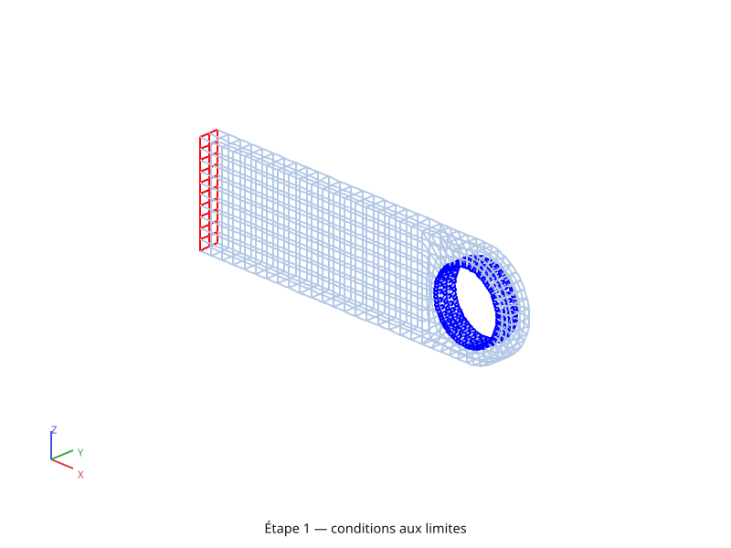
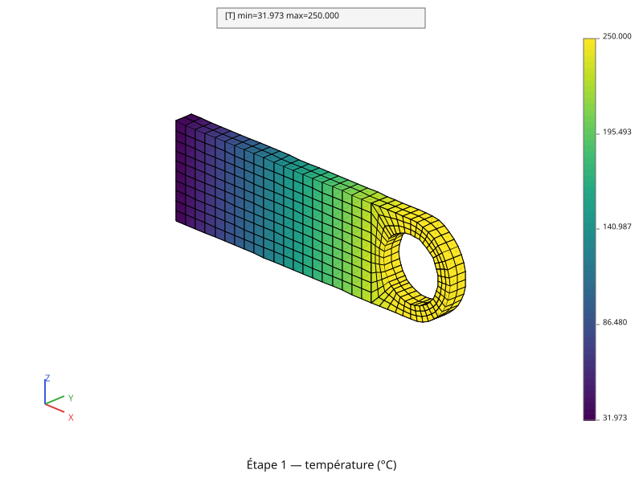
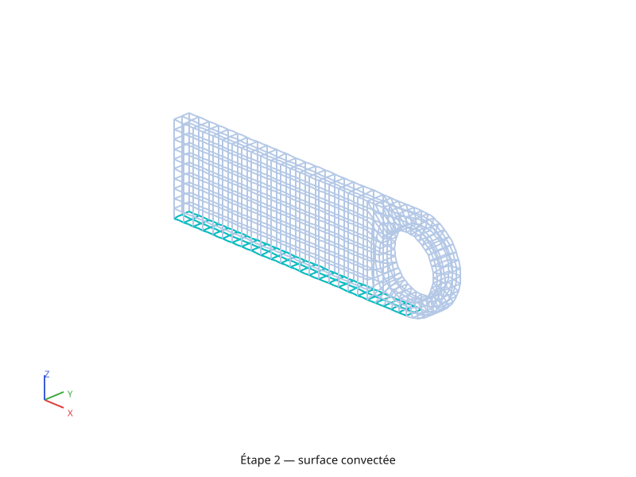
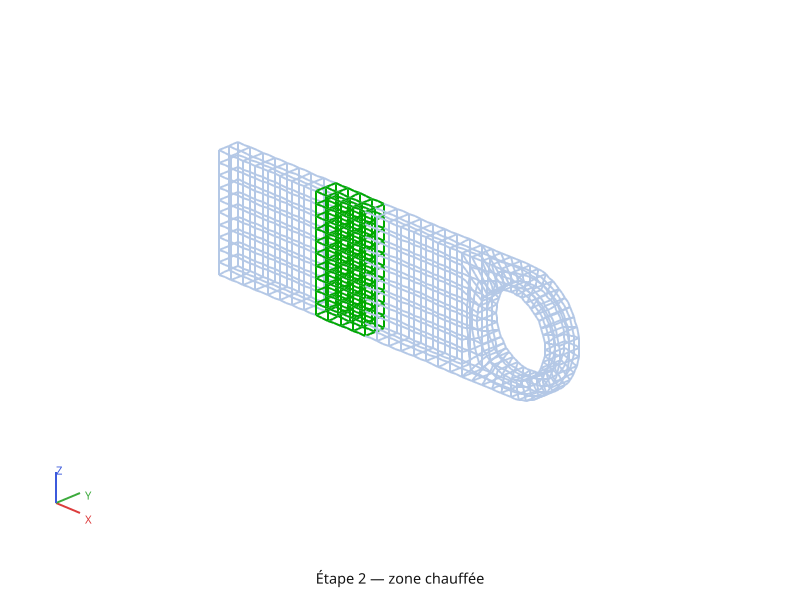
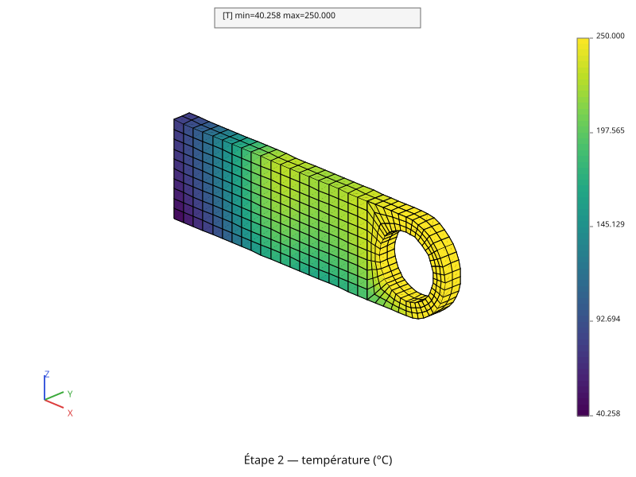

# Régime stationnaire

Reprend la chape percée de la page [Maillage](maillage.md) pour un calcul de
**conduction thermique stationnaire**, mené en deux temps : d'abord la
conduction seule (température imposée, flux imposé), puis le même problème
enrichi d'un film convectif et d'une source volumique. Chaque étape est
**tracée avant d'être résolue** — les régions chargées d'abord, le champ de
température ensuite.

Le script complet est [`tutoriel/thermique.py`](https://github.com/Pyrucast/pyrucast/blob/master/tutoriel/thermique.py)
; tous les extraits ci-dessous en sont issus directement, dans l'ordre du
fichier.

## L'équation résolue

La page [Thermique linéaire](thermique-lineaire.md) a posé l'équation de la
chaleur et sa forme discrétisée,
\\( [C]\\{\dot{T}\\} + [K]\\{T\\} = \\{P\\} \\). En **régime stationnaire**
la température ne varie plus : le terme de capacité disparaît, et il reste
l'équilibre entre la conduction et les sollicitations,

\\[ \operatorname{div}(-\lambda \operatorname{grad} T) = q \ \text{ dans } V,
\qquad T = T\_{\text{imp}} \ \text{ sur } \partial V\_T, \qquad
-\phi \cdot n = \phi\_{\text{imp}} + h\\,(T\_f - T) \ \text{ sur }
\partial V\_\phi \\]

— la troisième équation compte la chaleur **reçue** par le bord (\\( n \\) la
normale sortante) : un \\( \phi\_{\text{imp}} \\) positif en apporte, les
−40 kW/m² de la face gauche en retirent. Le terme en \\( h \\) est la
**convection** (loi de Newton) : un échange avec un fluide à \\( T\_f \\),
proportionnel à l'écart de température. Il dépend de l'inconnue, donc il ne
se range pas entièrement au second membre — on y revient plus bas.

Discrétisée sur les éléments finis, avec
\\( T(x) = [N(x)]\\{T\\} \\) et
\\( \operatorname{grad}(T) = [B(x)]\\{T\\} \\), l'équation devient un système
linéaire :

\\[ [K]\\{T\\} = \\{P\\} \\]

\\[ [K] = \int_V [B]^T \lambda [B] \\, dV
      + \int_{\partial V\_\phi} h\\,[N]^T [N] \\, dS \\]

\\[ \\{P\\} = \int_V [N]^T q \\, dV
      + \int_{\partial V\_\phi} [N]^T (\phi\_{\text{imp}} + h\\,T\_f) \\, dS \\]

La température imposée n'entre pas dans \\( [K] \\) : elle passe par des
**multiplicateurs de Lagrange** \\( \\{\mu\\} \\), un par nœud bloqué. La
relation \\( [A]\\{T\\} = \\{T\_{\text{imp}}\\} \\) — chaque ligne de
\\( [A] \\) lit la température d'un nœud de l'alésage — s'ajoute au système,
et c'est celui-ci que pyrucast résout :

\\[ \begin{bmatrix} K & A^T \\\\ A & 0 \end{bmatrix}
   \begin{Bmatrix} T \\\\ \mu \end{Bmatrix} =
   \begin{Bmatrix} P \\\\ T\_{\text{imp}} \end{Bmatrix} \\]

Les \\( \\{\mu\\} \\) sont les **multiplicateurs**, et leur opposé est la
**réaction** : \\( -[A]^T\\{\mu\\} \\), les flux qu'il faut injecter aux nœuds
bloqués pour les tenir à 250 °C.

**Le second membre se vérifie par sa somme.** Les fonctions de forme valent 1
à elles toutes en chaque point, si bien que la somme des lignes de
\\( \\{P\\} \\) est la puissance que les sollicitations apportent à la pièce :

\\[ \sum\_i P\_i = \int_V q \\, dV
      + \int_{\partial V\_\phi} (\phi\_{\text{imp}} + h\\,T\_f) \\, dS \\]

— le contrôle que l'on fait plus bas sur le second membre de l'étape 2.

Chaque terme correspond à un objet du script :

| Terme | pyrucast |
|---|---|
| \\( \int_V [B]^T \lambda [B] \\, dV \\) | `pc.model.heat_conduction(fes)`, assemblé par `pc.matrix.stiffness` |
| \\( \int_{\partial V\_\phi} h [N]^T [N] \\, dS \\) | `pc.model.boundary_transfer(fes, conduction, ["T"])`, **dans la même matrice** |
| \\( [A]\\{T\\} = \\{T\_{\text{imp}}\\} \\) | `pc.model.dirichlet(alesage, modele, "T")`, dont les multiplicateurs \\( \\{\mu\\} \\) sont la composante « lambda » de la solution |
| \\( \int_{\partial V\_\phi} [N]^T \phi\_{\text{imp}} \\, dS \\) | `pc.model.flux(fes, modele, "q")` sur des `QUA8`, densité `phi_q`, lu par `pc.node_field.external_forces` |
| \\( \int_{\partial V\_\phi} [N]^T h\\,T\_f \\, dS \\) | porté par le même `pc.model.boundary_transfer`, ambiant `a_ext_T`, lu par `pc.node_field.external_forces` |
| \\( \int_V [N]^T q \\, dV \\) | `pc.model.flux(fes, modele, "q")` sur des `HEX20`, densité `phi_q`, lu par `pc.node_field.external_forces` |

Les trois dernières lignes disent deux choses. D'abord, **un chargement est un
terme du modèle** : on le réunit au modèle, sa densité entre dans le champ
matériau, et `pc.node_field.external_forces` calcule le second membre de tous
les termes à la fois. Ensuite, **`flux` est l'unique opérateur de charge
répartie** (première et dernière de ces lignes), quelle que soit la dimension
du sous-espace éléments finis sur lequel on l'applique — une face `QUA8`
intègre une densité surfacique, un `HEX20` une densité volumique. Flux
surfacique, pression et source volumique passent donc tous par le même
opérateur.

## Les données du calcul

```python
{{#include ../../../tutoriel/thermique.py:donnees}}
```

Toutes les valeurs physiques sont groupées en tête de fichier, en unités SI :
un acier (\\( \lambda = 50 \\) W/m/K), un flux **sortant** de −40 kW/m² sur la
face gauche, un film convectif assez vif (\\( h = 240 \\) W/m²/K vers un fluide
à −80 °C), une source de 2,6 MW/m³ dans la tranche chauffée (environ 260 W au
total) et l'alésage tenu à 250 °C.

`TOL` mérite un mot : les nœuds d'une face plane valent zéro **à l'arrondi
machine près**, jamais exactement zéro. Une sélection par coordonnée se fait
donc toujours sur une **bande**, `[-TOL, TOL]`, et la tolérance est ici
explicite plutôt que cachée dans le mailleur.

## On ne remaille pas : on importe

Le script ne redonne **aucune cote**. Il importe `structured_mesh` de
[`tutoriel/maillage.py`](https://github.com/Pyrucast/pyrucast/blob/master/tutoriel/maillage.py)
et calcule sur le volume **HEX20 structuré** de la page précédente — 640
hexaèdres.

```python
{{#include ../../../tutoriel/thermique.py:maillage}}
```

C'est la bonne façon d'enchaîner deux calculs sur une même pièce : un
maillage reconstruit à l'identique dans deux scripts donnerait deux jeux de
nœuds **distincts**, et toute condition posée sur l'un serait sans effet sur
l'autre. `plot=False` demande seulement de ne pas retracer les figures de la
page Maillage.

La deuxième ligne prépare la suite. Les chargements **répartis** s'intègrent
sur des faces et non sur des nœuds — c'est le \\( [N]^T \\) des intégrales
ci-dessus : il leur faut de vraies mailles de bord, que
`pyrucast.mesh.skin` extrait du volume d'hexaèdres. `pyrucast.mesh.consolidate`
ramène cette peau à un **seul** sous-maillage, pour que les sélections qui
suivent en renvoient un seul elles aussi.

## Étape 1 — conduction seule

Le premier problème n'a que deux conditions aux limites : l'alésage tenu à
250 °C, et un flux sortant de −40 kW/m² sur la face gauche. Aucun numéro de
nœud n'apparaît dans le script : les régions sont découpées
**géométriquement**, ici par **forme**, avec la famille
[`pyrucast.mesh.points_*`](../operateurs/maillage.md).

### L'alésage, sur un cylindre

```python
{{#include ../../../tutoriel/thermique.py:alesage}}
```

L'axe du trou se donne par deux points, débordant de part et d'autre de la
pièce : la normale du plan de la pièce (\\( Y \\)), passant par le centre du
demi-disque. `points_on_cylinder` retient alors les nœuds **sur** le cylindre
de rayon `HOLE_RADIUS` — les disques d'extrémité sont laissés de côté, ce sont
des faces planes et `points_on_plane` est là pour celles-là. Ce qui revient est
donc exactement la paroi du trou, 320 nœuds : 120 sommets et 200 nœuds
milieux, puisque le volume est quadratique.

**Un blocage ne demande que des nœuds.** La sélection se lit donc directement
sur le **volume**, sans en extraire la peau : les nœuds de la paroi du trou
sont des nœuds de bord par définition, et `points_on_cylinder` y trouve les
mêmes 320 nœuds que sur la peau.

**Un `points_*` renvoie déjà un maillage `POI1`.** Le résultat est utilisable
tel quel comme support d'un `pc.model.dirichlet`, sans passer par
`pyrucast.mesh.to_poi1`. Seul `mesh.consolidate` reste nécessaire, pour écarter le
sous-maillage **vide** que laisse la partie du volume qui ne touche pas le trou
(le volume en compte deux : la grille et la couronne).

### La face gauche, sur un plan

```python
{{#include ../../../tutoriel/thermique.py:face_gauche}}
```

Même principe, mais un flux s'intègre sur une **surface** : les nœuds ne
suffisent pas. `pyrucast.mesh.elements_on(..., strict=True)` remonte des
nœuds sélectionnés aux mailles dont **tous** les sommets sont retenus — ici les
20 `QUA8` de la face gauche. Le plan donné à `points_on_plane` est infini, mais
il ne coupe la peau qu'à cet endroit.

### La figure des conditions aux limites

```python
{{#include ../../../tutoriel/thermique.py:figure_conduction}}
```



**Une couleur par région, et la figure devient le schéma.** `face_color` se
pose sur le sous-maillage (`unit()` le désigne quand il n'y en a qu'un), la
peau est tracée en fil de fer autour (`wireframe=True`) : la figure ci-dessus
se lit comme le croquis des conditions aux limites, sans annotation manuelle.

### Le modèle et son matériau

```python
{{#include ../../../tutoriel/thermique.py:modele_conduction}}
```

`pc.model.heat_conduction` déclare le couple de degrés de liberté « T » (primal)
et « q » (dual) sur tout le volume et porte le terme
\\( \int_V [B]^T \lambda [B] \\, dV \\) ; `pc.matrix.stiffness` l'intègre
réellement, avec le \\( \lambda \\) lu dans le champ matériau sous le nom
« k ».

La température imposée, c'est la relation \\( [A]\\{T\\} = \\{T\_{\text{imp}}\\} \\)
du système par blocs posé plus haut. `pc.model.dirichlet` ne reçoit qu'un
maillage `POI1` : le support bloqué (l'alésage, tel que `points_on_cylinder`
l'a renvoyé). Les inconnues \\( \\{\mu\\} \\), elles, ont besoin de leurs
propres nœuds : la contrainte les **crée elle-même**, un par nœud bloqué et à
la même position, et `blocage_T.multiplier_mesh()` rend le maillage qui les
porte. Deux jeux de nœuds distincts, donc deux jeux d'inconnues : la solution
renvoyée contient les deux, la température « T » et les multiplicateurs
« lambda », dont l'opposé est la **réaction**.

Le flux imposé, lui, est un **terme du modèle** : `pc.model.flux` le déclare sur
l'espace éléments finis de la face gauche, et `|` le réunit au reste.

Le champ matériau se construit **à partir du modèle** : `material_field` sait
quels coefficients celui-ci réclame — « k » pour la conduction, et la densité
« phi_q » pour le flux.

### Les deux chargements

```python
{{#include ../../../tutoriel/thermique.py:charges_conduction}}
```

Le flux imposé ne touche que le second membre : `pc.node_field.external_forces`
intègre \\( \int [N]^T \phi\_{\text{imp}} \\, dS \\) sur les 20 `QUA8` de la
face gauche, avec la densité « phi_q » lue dans le champ matériau, et rend un
champ nodal.

La température imposée, elle, se pose sur le maillage des **multiplicateurs**
et non sur l'alésage lui-même : c'est le \\( T\_{\text{imp}} \\) du second bloc
du système par blocs, en face des inconnues \\( \\{\mu\\} \\).

### Résolution

```python
{{#include ../../../tutoriel/thermique.py:resolution_conduction}}
```

`pc.matrix.stiffness` intègre la matrice, `|` réunit les deux chargements —
ils vivent sur des maillages disjoints, il n'y a donc rien à sommer — et
`pyrucast.solver.solve` factorise la matrice creuse (LU parallèle) en mettant
la factorisation en cache : deux résolutions sur la même matrice ne la
factorisent qu'une fois.



Le résultat est le gradient attendu : 250 °C tenus à l'alésage, 32 °C sur la
face gauche d'où la chaleur s'échappe.

## Étape 2 — convection et source volumique

On ajoute maintenant les deux sollicitations restantes, sans rien retoucher
aux précédentes : un film convectif sous la pièce, sur la face
\\( z = 0 \\), et une tranche chauffée entre \\( 0{,}33\\,L \\) et
\\( 0{,}51\\,L \\). Ces deux régions n'ont pas de forme simple à nommer : elles
sont repérées par **coordonnée**, la seconde façon de découper une région.

### La surface convectée, par coordonnée

```python
{{#include ../../../tutoriel/thermique.py:face_basse}}
```



**Une coordonnée est un champ nodal comme un autre.**
`pyrucast.node_field.positions(peau, ["Z"])` rend la coordonnée Z des nœuds de la
peau sous forme de `NodeField`, et `pyrucast.mesh.select` garde ceux dont la
valeur tombe dans une **bande** — `ge=-TOL, le=TOL` pour « z = 0 ». Le résultat
est un maillage `POI1`, exactement comme celui d'un `points_*` : la suite ne
change pas, `elements_on(..., strict=True)` remonte aux `QUA8` que ces nœuds
portent entièrement.

### La zone chauffée, en bande

```python
{{#include ../../../tutoriel/thermique.py:zone_source}}
```



Même démarche, mais sur X et sur le **volume** : une bande de valeurs au lieu
d'une égalité, et des `HEX20` au lieu de `QUA8`. Comme pour l'alésage,
`mesh.consolidate` écarte le sous-maillage vide laissé par la partie du volume qui
ne rencontre pas la bande.

**`strict=True` approche la région par un escalier.** La bande en X coupe le
maillage entre deux abscisses quelconques, mais ce qui est retenu est le
paquet des 80 hexaèdres dont **tous** les nœuds sont dedans : la tranche
s'arrête donc aux frontières des éléments, bien visible sur la figure. C'est
le prix à payer pour que la région chargée soit un sous-maillage conforme.

### Le modèle complet

```python
{{#include ../../../tutoriel/thermique.py:modele_complet}}
```

La convection est la seule des quatre sollicitations à toucher **les deux**
membres du système, parce que \\( \phi \cdot n = h\\,(T - T\_f) \\) dépend de
l'inconnue. Sa part en \\( T \\) donne \\( \int h\\,[N]^T[N] \\, dS \\), qui
s'ajoute **dans** la matrice : ce n'est pas un système séparé, d'où le
`pc.model.boundary_transfer(basse_fes, conduction, ["T"])`, construit contre
la conduction puis réuni à elle par `|`, sur les
mêmes degrés de liberté « T » et « q ». Le blocage de l'étape 1, `blocage_T`,
est repris tel quel, avec ses multiplicateurs : la température imposée posée
sur eux à l'étape 1 reste donc valable.

Un seul `material_field` couvre le tout — « k » est réclamé par la conduction,
« h_T » (le coefficient d'échange) et « a_ext_T » (la température du fluide)
par la convection.

### Les deux nouveaux chargements

```python
{{#include ../../../tutoriel/thermique.py:charges_complet}}
```

La part en \\( T\_f \\) de la convection donne
\\( \int h\\,T\_f\\,[N]^T \\, dS \\), un second membre ordinaire : le terme
`boundary_transfer` le porte déjà, et le même appel
`pc.node_field.external_forces` que pour le flux imposé le calcule, avec
« h_T » et « a_ext_T » lus dans le champ matériau.

La source volumique, elle, est le terme \\( \int_V [N]^T q \\, dV \\) : encore
`flux`, mais appliqué à des `HEX20`. La dimension de l'intégrale est celle des
éléments qu'on lui donne, donc une densité **volumique** ici. Un chargement ne
contribue à aucune matrice : il forme ici un modèle à lui seul, `source`, avec
son propre champ matériau, parce que sa densité « phi_q » n'est pas celle du
flux de la face gauche.

### Trois chargements qui se touchent : le second membre se **somme**

Le bas de la face gauche est sur \\( z = 0 \\), et la tranche chauffée
débouche elle aussi sous la pièce : les trois chargements répartis partagent
des nœuds. Leurs contributions doivent donc **s'additionner** là — et c'est
précisément ce que l'union `|` ne fait pas.

> **Piège : deux régions chargées adjacentes.** Leurs contributions nodales
> ne sont **pas** sommées automatiquement à l'assemblage : chaque
> chargement est assemblé sur **son propre support**, et l'union (`|`)
> juxtapose ces supports sans les additionner. À un nœud partagé, le solveur
> lit le second membre zone par zone et retient la valeur de la **première**
> qui définit le couple `(nœud, composante)` — l'autre contribution est
> perdue. L'union ne lève une erreur que si les deux valeurs **diffèrent** ;
> quand elles coïncident, elle passe sans rien dire.
>
> Sommer les champs (`+`) ne suffit pas non plus tel quel : l'arithmétique de
> champs apparie elle aussi les zones **par support**. Deux supports distincts
> ne sont jamais additionnés : chaque zone passe telle quelle, et quand deux
> zones donneraient deux valeurs différentes à un nœud partagé, l'opération
> s'arrête sur une erreur qui renvoie vers `restrict_like`. Il faut d'abord
> **ramener les champs sur un support commun** — `pyrucast.node_field.restrict`
> sur un même maillage retombe sur le support `POI1` canonique de ce maillage,
> donc `restrict(a, m) + restrict(b, m)` est bien une somme nœud à nœud (la page
> [Champ](../field.md) détaille cette algèbre ; la page
> [Dilatation, matériau homogène](mecanique-dilatation.md) en donne un exemple avec `restrict_like`).

```python
{{#include ../../../tutoriel/thermique.py:second_membre}}
```

D'où ces quelques lignes : le maillage `POI1` de tous les nœuds chargés
(`to_poi1` puis `mesh.consolidate`, pour n'avoir qu'un seul sous-maillage donc un
seul support), les trois champs restreints dessus, et leur somme par `+`. La
vérification est immédiate — la puissance totale du second membre, 64,8 W, vaut
la somme des trois puissances prises séparément (−80 W de flux sortant,
−115,2 W de convection, 260 W de source). L'union, elle, n'irait pas jusque-là :
aux nœuds partagés les valeurs diffèrent, et elle s'arrêterait sur une erreur.

La température imposée, elle, vit sur le maillage des **multiplicateurs**,
dont les nœuds, créés par la contrainte, n'appartiennent à aucun autre
maillage : elle se réunit au reste par `|` sans rien avoir à sommer.

### Résolution

```python
{{#include ../../../tutoriel/thermique.py:resolution_complet}}
```

Rien de nouveau par rapport à l'étape 1 : la même paire
`stiffness` / `solve`, sur une matrice qui porte en plus le terme convectif.



La lecture du résultat suit les quatre chargements : l'alésage est toujours
tenu à 250 °C par le blocage et la face gauche reste le point froid sous le
flux sortant, mais les isothermes, rectilignes à l'étape 1, s'infléchissent
maintenant autour de la tranche chauffée. Les deux nouvelles sollicitations
jouent en sens contraire — la source réchauffe la moitié gauche (le minimum
remonte de 32 à 40 °C), le film convectif pompe la chaleur sous la pièce — et
avec les cotes de la page Maillage c'est la convection qui l'emporte : rien ne passe
au-dessus de la température de l'alésage.

Ce régime établi est celui que la pièce atteint quand les sollicitations
durent : la page [Régime transitoire](thermique-transitoire.md) part d'une
pièce à 0 °C, installe les mêmes chargements au fil du temps, et s'approche
de ce champ au dernier instant.

## Script complet

Une fois les explications retirées, tout tient en une page — c'est le déroulé
complet, du maillage importé aux deux résolutions :

```python
{{#include ../../../tutoriel/thermique.py:script}}
```

Suite : [Régime transitoire](thermique-transitoire.md).
