# Annotated testing files — pyrucast edition

<!-- Generated by validation/make_document.py: do not edit by hand. -->

This document follows, chapter by chapter and case by case, the collection
*Annotated Testing Files* (E. Le Fichoux, ENSTA, 2011, Cast3M documentation).
Each case keeps the original description sheet, cites the same source and
compares with the same reference value. Four values are shown side by side:

- **Reference**: the analytical or benchmark value of the original document
  (or of the Cast3M `.dgibi` file when the document prints none);
- **Cast3M 2011**: the value printed in the 2011 document, as printed;
- **Cast3M 2026**: the value obtained by running the case's `.dgibi` file shipped with
  Cast3M 2026 (`dgibi/<case>.dgibi`), unmodified apart from the lines that
  print the compared quantities;
- **pyrucast**: the value computed by the case's `run.py`.

A case that pyrucast cannot compute yet keeps its sheet and its reference
values; its pyrucast column names the missing features.

Each case lives in its own folder, `<chapter>/<case>/`: `case.toml` (sheet and
reference values), `run.py` (pyrucast script), `results.json` and
`castem2026.json` (computed values), and the figures written by `run.py`.

Regenerating:

```text
python validation/run_pyrucast.py     # pyrucast values and figures
python validation/run_castem.py       # Cast3M 2026 values (needs Cast3M 2026)
python validation/make_document.py    # this document
```

## Summary

86 cases: 24 computed by pyrucast, 62 not computable yet, 0 pending.

| Chapter | Case | Status | Largest gap to the reference | Largest gap pyrucast / Cast3M 2026 |
|---|---|---|---|---|
| Elasticity | [elas1](#elas1) | gap | missing: axisymmetric shell element (COQ2) | |
| Elasticity | [elas2](#elas2) | run, OUTSIDE tolerance | 0.0827 %; Δ = 0 | 3.2e-04 |
| Elasticity | [elas3](#elas3) | run, within tolerance | 0.018 % | 1.2e-04 |
| Elasticity | [elas4](#elas4) | run, within tolerance | 0.363 % | 3.9e-02 |
| Elasticity | [elas7](#elas7) | gap | missing: axisymmetric shell element (COQ2) | |
| Elasticity | [elas8](#elas8) | run, within tolerance | 0.841 % | 7.2e-04 |
| Elasticity | [elas11](#elas11) | run, within tolerance | 1.59 % | 1.0e-03 |
| Elasticity | [elas13](#elas13) | run, within tolerance | 3.53 % | 5.9e-14 |
| Elasticity | [stru2](#stru2) | run, within tolerance | 0.789 % | 2.3e-14 |
| Elasticity | [stru4](#stru4) | gap | missing: pipe element (TUYA) | |
| Elasticity | [elas20](#elas20) | gap | missing: pipe element (TUYA) | |
| Elasticity | [testICQ4](#testicq4) | gap | missing: incompatible-mode element (ICQ4) | |
| Elasticity | [vsur1](#vsur1) | gap | missing: axisymmetric shell element (COQ2); surface vector operator (VSUR) | |
| Buckling | [flam1](#flam1) | gap | missing: eigenvalue solver; axisymmetric shell element (COQ2) | |
| Buckling | [four1](#four1) | gap | missing: Fourier harmonic analysis; eigenvalue solver; axisymmetric shell element (COQ2) | |
| Plasticity | [plas1](#plas1) | run, within tolerance | 1.03 % | 4.7e-10 |
| Plasticity | [plas2](#plas2) | run, within tolerance | 3.16 % | 9.7e-16 |
| Plasticity | [plas4](#plas4) | run, within tolerance | 0.402 % | 2.0e-15 |
| Plasticity | [plas5](#plas5) | run, OUTSIDE tolerance | 15.2 % | 1.5e-01 |
| Plasticity | [plas6](#plas6) | run, within tolerance | 0.13 % | 1.8e-03 |
| Plasticity | [plas7](#plas7) | run, OUTSIDE tolerance | 83.4 % | 8.2e-01 |
| Plasticity | [plas8](#plas8) | gap | missing: plasticity in plate elements | |
| Plasticity | [plas9](#plas9) | run, OUTSIDE tolerance | Δ = 0.68 |  |
| Plasticity | [plas10](#plas10) | gap | missing: Cam-Clay law | |
| Plasticity | [plas11](#plas11) | gap | missing: generalized plane strain; axisymmetric shell element (COQ2) | |
| Plasticity | [plas12](#plas12) | gap | missing: pipe element (TUYA) | |
| Plasticity | [plas13](#plas13) | gap | missing: beam plasticity (global law) | |
| Plasticity | [plas14](#plas14) | gap | missing: multi-fibre beam sections | |
| Behaviour laws | [norton_cis1](#norton_cis1) | gap | missing: Norton creep with a time-hardening exponent (Cast3M AF3) | |
| Behaviour laws | [chaboche2](#chaboche2) | run, OUTSIDE tolerance | 1.07 % | 1.1e-02 |
| Behaviour laws | [ohno2](#ohno2) | gap | missing: Ohno viscoplastic law | |
| Behaviour laws | [guionnet_tra](#guionnet_tra) | gap | missing: Guionnet viscoplastic law | |
| Behaviour laws | [zeril1](#zeril1) | gap | missing: Zerilli-Armstrong law | |
| Behaviour laws | [preston1](#preston1) | gap | missing: Preston-Tonks-Wallace law | |
| Damage elastoplastic models | [endocp1](#endocp1) | gap | missing: elastoplastic damage law (ENDOMMAGEABLE) | |
| Damage elastoplastic models | [endoaxi1](#endoaxi1) | gap | missing: elastoplastic damage law (ENDOMMAGEABLE) | |
| Damage elastoplastic models | [endoaxi2](#endoaxi2) | gap | missing: elastoplastic damage law (ENDOMMAGEABLE) | |
| Damage elastoplastic models | [endoaxi3](#endoaxi3) | gap | missing: elastoplastic damage law (ENDOMMAGEABLE) | |
| Damage elastoplastic models | [ddi](#ddi) | gap | missing: two-inelastic-strain damage law (DDI) | |
| Fracture mechanics | [rupt1](#rupt1) | gap | missing: stress intensity factors (G-theta) | |
| Fracture mechanics | [rupt2](#rupt2) | gap | missing: stress intensity factors (G-theta) | |
| Fracture mechanics | [rupt3](#rupt3) | gap | missing: stress intensity factors (G-theta) | |
| Fracture mechanics | [rupt4](#rupt4) | gap | missing: stress intensity factors (G-theta) | |
| Fracture mechanics | [rupt5](#rupt5) | gap | missing: stress intensity factors (G-theta) | |
| Fracture mechanics | [rupt6](#rupt6) | gap | missing: stress intensity factors (G-theta) | |
| Fracture mechanics | [rupt7](#rupt7) | gap | missing: stress intensity factors (G-theta) | |
| Fracture mechanics | [rupt8](#rupt8) | gap | missing: stress intensity factors (G-theta); layered shells (offset layers) | |
| Fracture mechanics | [rupt9](#rupt9) | gap | missing: stress intensity factors (G-theta) | |
| Composite | [comp1](#comp1) | gap | missing: layered orthotropic shells (offset layers) | |
| Composite | [comp2](#comp2) | gap | missing: layered orthotropic shells (offset layers) | |
| Concrete | [beton](#beton) | gap | missing: concrete plasticity law (BETON) | |
| Concrete | [precont1](#precont1) | gap | missing: prestressing cables (KABL, PREC) | |
| Concrete | [precont2](#precont2) | gap | missing: prestressing cables (KABL, PREC) | |
| Concrete | [precont3](#precont3) | gap | missing: prestressing cables (KABL, PREC) | |
| Porosity | [pore1](#pore1) | gap | missing: porous media elements (QUAP) | |
| Porosity | [pore2](#pore2) | gap | missing: porous media elements (QUAP) | |
| Porosity | [pore3](#pore3) | gap | missing: porous media elements (QUAP) | |
| Metallurgy of powders | [poudre1](#poudre1) | gap | missing: Abouaf powder law | |
| Joint | [joi22](#joi22) | gap | missing: joint element on its own, with normal and shear stiffnesses in its own frame (JOI2, JOI4) | |
| Joint | [joi41](#joi41) | run, within tolerance | 0.00125 % | 1.3e-11 |
| Joint | [joi44](#joi44) | gap | missing: joint elements with thermal expansion | |
| Joint | [joi45](#joi45) | gap | missing: orthotropic joint with material axes | |
| Dynamics | [dyna6](#dyna6) | run, within tolerance | 0.246 % | 5.2e-12 |
| Dynamics | [dyna7](#dyna7) | gap | missing: Fourier harmonic analysis; acoustic fluid elements with free surface; eigenvalue solver | |
| Dynamics | [fsi4](#fsi4) | gap | missing: fluid-structure interaction; Fourier harmonic analysis; eigenvalue solver; axisymmetric shell element (COQ2) | |
| Dynamics | [dyna5](#dyna5) | gap | missing: eigenvalue solver; modal sub-structuring | |
| Dynamics | [vibr6](#vibr6) | gap | missing: complex eigenmodes under axial flow; pipe element (TUYA) | |
| Dynamics | [vibr10](#vibr10) | run, within tolerance | 1.4e-13 % | 1.3e-15 |
| Dynamics | [dyna12](#dyna12) | run, within tolerance | 3.78 % | 3.1e-13 |
| Dynamics | [dyna11](#dyna11) | run, within tolerance | 3.46 % | 2.5e-13 |
| Dynamics | [dy_devo5](#dy_devo5) | gap | missing: eigenvalue solver; modal-basis transient dynamics with linkages (DYNE) | |
| Dynamics | [dy_devo6](#dy_devo6) | gap | missing: modal-basis transient dynamics with linkages (DYNE) | |
| Dynamics | [dy_devo3](#dy_devo3) | gap | missing: modal-basis transient dynamics with linkages (DYNE) | |
| Dynamics | [dy_devo4](#dy_devo4) | gap | missing: modal-basis transient dynamics with linkages (DYNE) | |
| Dynamics | [dy_devo8](#dy_devo8) | gap | missing: modal-basis transient dynamics with linkages (DYNE) | |
| Dynamics | [dyne01](#dyne01) | gap | missing: modal-basis transient dynamics with linkages (DYNE) | |
| Dynamics | [vibr2](#vibr2) | run, within tolerance | 1.65 % | 7.1e-05 |
| Non linear dynamics | [dyna_nl1](#dyna_nl1) | gap | missing: constant added mass in `step_by_step` (Cast3M `MASSE_CONSTANTE`) | |
| Non linear dynamics | [dyna_nl3](#dyna_nl3) | gap | missing: large-displacement beam and shell dynamics | |
| Thermal analysis | [ther2](#ther2) | run, within tolerance | 0.267 % | 1.1e-03 |
| Thermal analysis | [ther7or](#ther7or) | gap | missing: thermal shell elements | |
| Thermal analysis | [ther-perm](#ther-perm) | run, within tolerance | 1.97e-08 %; Δ = 5.3e-10 | 1.7e-07 |
| Thermo-mechanics | [thme1](#thme1) | run, within tolerance | 1.79 % | 2.5e-15 |
| Thermo-mechanics | [thpl1](#thpl1) | gap | missing: rate-independent kinematic hardening | |
| Magneto-static | [Ac2d93](#ac2d93) | gap | missing: magnetostatics | |
| Magneto-static | [Ac3d93](#ac3d93) | gap | missing: magnetostatics | |

## Missing features

Features pyrucast lacks for the cases it cannot compute yet, by number of cases blocked.

| Point | Cases | Count |
|---|---|---|
| stress intensity factors (G-theta) | [rupt1](#rupt1), [rupt2](#rupt2), [rupt3](#rupt3), [rupt4](#rupt4), [rupt5](#rupt5), [rupt6](#rupt6), [rupt7](#rupt7), [rupt8](#rupt8), [rupt9](#rupt9) | 9 |
| axisymmetric shell element (COQ2) | [elas1](#elas1), [elas7](#elas7), [vsur1](#vsur1), [flam1](#flam1), [four1](#four1), [plas11](#plas11), [fsi4](#fsi4) | 7 |
| eigenvalue solver | [flam1](#flam1), [four1](#four1), [dyna7](#dyna7), [fsi4](#fsi4), [dyna5](#dyna5), [dy_devo5](#dy_devo5) | 6 |
| modal-basis transient dynamics with linkages (DYNE) | [dy_devo5](#dy_devo5), [dy_devo6](#dy_devo6), [dy_devo3](#dy_devo3), [dy_devo4](#dy_devo4), [dy_devo8](#dy_devo8), [dyne01](#dyne01) | 6 |
| elastoplastic damage law (ENDOMMAGEABLE) | [endocp1](#endocp1), [endoaxi1](#endoaxi1), [endoaxi2](#endoaxi2), [endoaxi3](#endoaxi3) | 4 |
| pipe element (TUYA) | [stru4](#stru4), [elas20](#elas20), [plas12](#plas12), [vibr6](#vibr6) | 4 |
| Fourier harmonic analysis | [four1](#four1), [dyna7](#dyna7), [fsi4](#fsi4) | 3 |
| porous media elements (QUAP) | [pore1](#pore1), [pore2](#pore2), [pore3](#pore3) | 3 |
| prestressing cables (KABL, PREC) | [precont1](#precont1), [precont2](#precont2), [precont3](#precont3) | 3 |
| layered orthotropic shells (offset layers) | [comp1](#comp1), [comp2](#comp2) | 2 |
| magnetostatics | [Ac2d93](#ac2d93), [Ac3d93](#ac3d93) | 2 |
| Abouaf powder law | [poudre1](#poudre1) | 1 |
| Cam-Clay law | [plas10](#plas10) | 1 |
| Guionnet viscoplastic law | [guionnet_tra](#guionnet_tra) | 1 |
| Norton creep with a time-hardening exponent (Cast3M AF3) | [norton_cis1](#norton_cis1) | 1 |
| Ohno viscoplastic law | [ohno2](#ohno2) | 1 |
| Preston-Tonks-Wallace law | [preston1](#preston1) | 1 |
| Zerilli-Armstrong law | [zeril1](#zeril1) | 1 |
| acoustic fluid elements with free surface | [dyna7](#dyna7) | 1 |
| beam plasticity (global law) | [plas13](#plas13) | 1 |
| complex eigenmodes under axial flow | [vibr6](#vibr6) | 1 |
| concrete plasticity law (BETON) | [beton](#beton) | 1 |
| constant added mass in `step_by_step` (Cast3M `MASSE_CONSTANTE`) | [dyna_nl1](#dyna_nl1) | 1 |
| fluid-structure interaction | [fsi4](#fsi4) | 1 |
| generalized plane strain | [plas11](#plas11) | 1 |
| incompatible-mode element (ICQ4) | [testICQ4](#testicq4) | 1 |
| joint element on its own, with normal and shear stiffnesses in its own frame (JOI2, JOI4) | [joi22](#joi22) | 1 |
| joint elements with thermal expansion | [joi44](#joi44) | 1 |
| large-displacement beam and shell dynamics | [dyna_nl3](#dyna_nl3) | 1 |
| layered shells (offset layers) | [rupt8](#rupt8) | 1 |
| modal sub-structuring | [dyna5](#dyna5) | 1 |
| multi-fibre beam sections | [plas14](#plas14) | 1 |
| orthotropic joint with material axes | [joi45](#joi45) | 1 |
| plasticity in plate elements | [plas8](#plas8) | 1 |
| rate-independent kinematic hardening | [thpl1](#thpl1) | 1 |
| surface vector operator (VSUR) | [vsur1](#vsur1) | 1 |
| thermal shell elements | [ther7or](#ther7or) | 1 |
| two-inelastic-strain damage law (DDI) | [ddi](#ddi) | 1 |

## Improvement points

What writing the computed cases showed: an operator or an option pyrucast lacks to state the case as the `.dgibi` file does, or a difference with Cast3M to look into. The scripts use pyrucast as it is; each point is detailed in the case's notes.

| Point | Cases | Count |
|---|---|---|
| B-bar (selective integration) against the volumetric locking of QUA4/QUA8 in incompressible plastic flow | [plas7](#plas7), [chaboche2](#chaboche2) | 2 |
| Drucker-Prager with two surfaces: pyrucast's interpolation driven by H·p departs from Cast3M when K_L < K, or when K_L = K with H ≠ 0 | [plas5](#plas5), [plas9](#plas9) | 2 |
| `dirichlet`: a node blocked twice for the same unknown (two supports meeting) makes the matrix singular, and the LU error does not name the cause | [elas2](#elas2), [elas3](#elas3) | 2 |
| graded lines and extrusions (Cast3M `DINI`/`DFIN`, mesh density) | [elas3](#elas3), [ther-perm](#ther-perm) | 2 |
| DKT shell: u_z(P3) 3.2e-4 away from Cast3M's DKT on the same mesh (issue #26) | [elas2](#elas2) | 1 |
| Kirchhoff quadrangle shell (DKQ): 4 % stiffer than Cast3M's COQ4 on elas4, to look into (GitHub issue #26) | [elas4](#elas4) | 1 |
| `mpc`: one coefficient per term for every relation; relations whose coefficients differ need one `mpc` each | [plas1](#plas1) | 1 |
| an ellipse, or the projection of a line onto a plane (Cast3M `PROJ`) | [elas8](#elas8) | 1 |
| an integration rule of its own for the mass, richer in axisymmetry (issue #28) | [vibr2](#vibr2) | 1 |
| local sub-stepping of rate-dependent laws at the Gauss points (stiff Norton exponents) | [chaboche2](#chaboche2) | 1 |
| nodal stresses at a node of a single QUA8 cell: Cast3M's extrapolation (`CHAN NOEUD`) and pyrucast's least-squares fit (`to_nodes`) differ, to look into | [elas8](#elas8) | 1 |
| σ_xx at the corner A, a node of a single cell: the `.dgibi` file's `CHAN 'CHPO'` on the Gauss stresses gives 547.2 MPa, which neither pyrucast's fit (`to_nodes`, 996.7) nor the cell mean (557.7) reproduces, to look into | [plas7](#plas7) | 1 |

## Elasticity

### elas1

#### Description sheet

| | |
|---|---|
| Test name | elas1 |
| Calculation type | MECHANICS ELASTICITY 2D AXI |
| Finite element type (Cast3M) | COQ2 |
| pyrucast model | not available — missing: axisymmetric shell element (COQ2) |
| Reference | Test NAFEMS : ME1 : Modélisation des structures élastiques dans CASTEM 2000. |
| Cast3M version of the 2011 document | 97' customer version |
| Cast3M 2026 `.dgibi` file | `dgibi/elas1.dgibi` |
| Folder | [`01_elasticity/elas1/`](01_elasticity/elas1/) |

**Topic.** A hemispherical cap is loaded by an internal pressure, by its own weight and
by a radial line load on its free edge. The three loads are turned into
equivalent nodal forces and summed before a single solve (superposition).

**Goal.** Find the radial displacement of the edge point B (1, 1).

**Model description.**

Axisymmetric, meridian plane (r, z). The cap is the arc of centre O (0, 1)
from the pole A (0, 0) to the edge B (1, 1): radius 1 m, 100 COQ2 elements,
thickness 0.02 m.

| Data | Value |
|---|---|
| E | 2.1e11 Pa |
| ν | 0.3 |
| ρ | 7.85e4 |

- Boundary conditions: u_z = 0 at B, u_r = 0 at A.
- Loads: internal pressure 1e4 Pa; own weight under an acceleration of
  1 m/s² along −z; radial line load of 1000 N/m on the edge B (nodal force
  2π × 1000 N).

**Notes.** The 2011 document gives ν = 0.28; the Cast3M 2026 `.dgibi` file uses ν = 0.3.

#### Results

| Quantity | Reference | Cast3M 2011 | Cast3M 2026 | pyrucast | pyrucast / reference |
|---|---|---|---|---|---|
| u_r at B (µm) | 4.677 | 4.6685 (-0.182 %) | 4.66854 (-0.181 %) | not available |  |

Acceptance: criterion of the `.dgibi` file, |u_r − 4.677| / 4.677 < 5 %.

### elas2

#### Description sheet

| | |
|---|---|
| Test name | elas2 |
| Calculation type | MECHANICS ELASTICITY 3D |
| Finite element type (Cast3M) | DKT |
| pyrucast model | `model.shell(fes, "kirchhoff")` (DKT), TRI3 |
| Reference | Test NAFEMS : ME6 : Modélisation des structures élastiques dans CASTEM 2000. |
| Cast3M version of the 2011 document | 97' customer version |
| Cast3M 2026 `.dgibi` file | `dgibi/elas2.dgibi` |
| Folder | [`01_elasticity/elas2/`](01_elasticity/elas2/) |

**Topic.** A thin cylinder is clamped at one end and pinched by two diametrically
opposite point loads at its mid-length. By symmetry one eighth of it is
modelled (a quarter of the circumference over half of the length), with
symmetry conditions on the three cut edges.

**Goal.** Find the displacement u_x at the point P1 (7, 0, 0) of the clamped end and the
displacement u_z of the loaded point P3.

**Model description.**

Quarter cylinder of radius 7 and half-length 70 (axis y), thickness 0.1:
the arc from P1 (7, 0, 0) to (0, 0, 7) (6 elements) is translated by 70 along
y (30 elements), giving 360 DKT triangles.

| Data | Value |
|---|---|
| E | 3e7 |
| ν | 0.3 |
| thickness | 0.1 |

- Boundary conditions: the arc at y = 0 is clamped (displacements and
  rotations); symmetry about z = 0 (u_z = θ_x = θ_y = 0), about x = 0
  (u_x = θ_y = θ_z = 0) and about the mid-length plane y = 70
  (u_y = θ_x = θ_z = 0).
- Load: F_z = −2500 at P3 (0, 70, 7), the top of the mid-length section
  (a quarter of the pinching load).

**Notes.** The mesh is the `.dgibi` file's: `extrude` into TRI3 alternates the diagonal of
the triangles from one quadrangle to the next along the arc, as its translation
does. On this same mesh pyrucast's DKT gives u_z(P3) = −1.139058 and Cast3M's
−1.139427, 3.2e-4 apart: pyrucast is 0.083 % from the reference, Cast3M 0.050 %,
under a criterion of 6e-4 the `.dgibi` file set on its own result. The difference
between the two DKT elements is followed by issue #26, with the comparison of
the quadrangle shells on elas4.

**Improvement points.**

- DKT shell: u_z(P3) 3.2e-4 away from Cast3M's DKT on the same mesh (issue #26)
- `dirichlet`: a node blocked twice for the same unknown (two supports meeting) makes the matrix singular, and the LU error does not name the cause

#### Results

| Quantity | Reference | Cast3M 2011 | Cast3M 2026 | pyrucast | pyrucast / reference |
|---|---|---|---|---|---|
| u_x at P1 (cm) | 0 | -2.1247e-19 (Δ = -2.1e-19) | 0 (Δ = 0) | 0 | Δ = 0 |
| u_z at P3 (cm) | -1.14 | -1.1394 (+0.0526 %) | -1.13943 (+0.0503 %) | -1.13906 | +0.0827 % |

Acceptance: criteria of the `.dgibi` file, |u_z(P3) + 1.14| / 1.14 ≤ 6e-4 and |u_x(P1)| ≤ 1e-18.

pyrucast OUTSIDE tolerance: uz_P3: -1.139057676908149 vs -1.14, beyond 0.0006

#### pyrucast figures

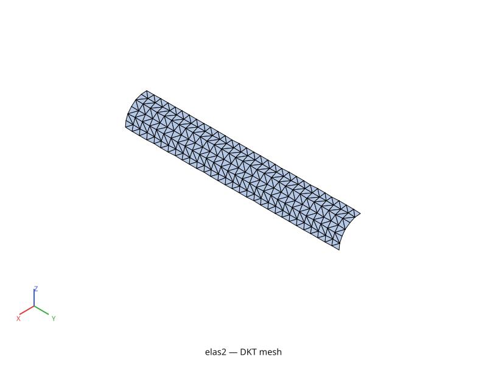

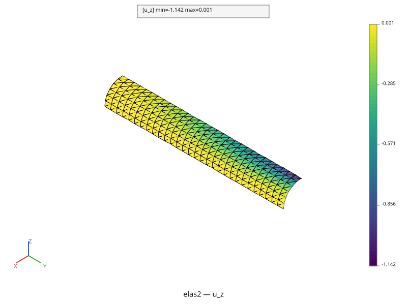

#### pyrucast listing

<details><summary><code>run.py</code></summary>

```python
"""elas2 — pinched cylinder with a clamped end (NAFEMS ME6), DKT shell.

Problem: a thin cylinder of radius 7, clamped at one end, is pinched at its
mid-length by two opposite point loads. One eighth is modelled: a quarter of
the circumference over half the length, with symmetry conditions on the cut
edges. Reference: u_z = −1.14 under the load, u_x = 0 at the clamped point P1.

Mesh: the `.dgibi` file's, the quarter arc (6 elements, every 15°) extruded by
70 along y in 30 layers straight into TRI3: each quadrangle is cut into two
triangles, the diagonal alternating from one quadrangle to the next along the
arc, as the `.dgibi` file's translation in TRI3 does.

Running::

    python validation/01_elasticity/elas2/run.py
"""

import os

import pyrucast as pc

E, NU, THICKNESS = 3e7, 0.3, 0.1
RADIUS, HALF_LENGTH = 7.0, 70.0
N_ARC, N_LENGTH = 6, 30
FORCE = -2500.0  # F_z at the loaded point, a quarter of the pinching load


def main(out: str | None = None) -> dict[str, float]:
    coords = pc.Coords(3)
    centre = coords.add_node([0.0, 0.0, 0.0])
    p1 = coords.add_node([RADIUS, 0.0, 0.0])
    p2 = coords.add_node([0.0, 0.0, RADIUS])
    arc = pc.mesh.arc(p1, centre, p2, N_ARC)
    surface = pc.mesh.extrude(arc, [0.0, HALF_LENGTH, 0.0], N_LENGTH, "TRI3")
    p3 = surface.nearest_node([0.0, HALF_LENGTH, RADIUS])

    clamped = pc.mesh.points_on_plane(surface, [0.0, 0.0, 0.0], [0.0, 1.0, 0.0])
    plane_z0 = pc.mesh.points_on_plane(surface, [0.0, 0.0, 0.0], [0.0, 0.0, 1.0])
    plane_x0 = pc.mesh.points_on_plane(surface, [0.0, 0.0, 0.0], [1.0, 0.0, 0.0])
    mid_length = pc.mesh.points_on_plane(
        surface, [0.0, HALF_LENGTH, 0.0], [0.0, 1.0, 0.0]
    )

    # The blocked nodes of each unknown: clamped end, then the symmetry planes
    # z = 0 (u_z, r_x, r_y), x = 0 (u_x, r_y, r_z) and y = 70 (u_y, r_x, r_z).
    # A node on two of these sets is blocked once (`consolidate`).
    blocked = {
        "u_x": clamped | plane_x0,
        "u_y": clamped | mid_length,
        "u_z": clamped | plane_z0,
        "r_x": clamped | plane_z0 | mid_length,
        "r_y": clamped | plane_z0 | plane_x0,
        "r_z": clamped | plane_x0 | mid_length,
    }
    shell = pc.model.shell(pc.FiniteElementSpace(surface), "kirchhoff")
    model = shell
    for variable, nodes in blocked.items():
        model = model | pc.model.dirichlet(pc.mesh.consolidate(nodes), shell, variable)
    materials = pc.element_field.material_field(
        model, [("E", E), ("nu", NU), ("h", THICKNESS)]
    )
    load = pc.NodeField(pc.mesh.poi1_from_nodes([p3]), ["f_z"])
    load[0].set_value(p3, "f_z", FORCE)
    u = pc.solver.solve(pc.matrix.stiffness(model, materials), load)

    if out:
        surface.plot(title="elas2 — DKT mesh", save=os.path.join(out, "mesh.svg"))
        surface.plot(
            title="elas2 — u_z",
            field=u,
            component="u_z",
            cmap="viridis",
            save=os.path.join(out, "u_z.svg"),
        )
    return {"ux_P1": u.value(p1, "u_x"), "uz_P3": u.value(p3, "u_z")}


if __name__ == "__main__":
    print(main("."))
```

</details>

### elas3

#### Description sheet

| | |
|---|---|
| Test name | elas3 |
| Calculation type | MECHANICS ELASTICITY 3D |
| Finite element type (Cast3M) | TRI3 |
| pyrucast model | `model.shell(fes, "kirchhoff")` (DKT), TRI3 |
| Reference | Test NAFEMS : ME7 : Modélisation des structures élastiques dans CASTEM 2000. |
| Cast3M version of the 2011 document | 97' customer version |
| Cast3M 2026 `.dgibi` file | `dgibi/elas3.dgibi` |
| Folder | [`01_elasticity/elas3/`](01_elasticity/elas3/) |

**Topic.** The pinched cylinder of elas2 with free ends instead of a clamped one (and a
different geometry). One eighth of the cylinder is modelled, with symmetry
conditions on the cut edges, and loaded by a diametrical point load.

**Goal.** Find the deflection u_z of the loaded point P3.

**Model description.**

Quarter cylinder of radius 4.953 and half-length 5.175 (axis y), thickness
0.094, meshed with DKT triangles at a mesh density of 0.75: the arc from
(4.953, 0, 0) to (0, 0, 4.953) is translated by 5.175 along y.

| Data | Value |
|---|---|
| E | 10.5e6 |
| ν | 0.3125 |
| thickness | 0.094 |

- Boundary conditions: the arc at y = 0 is a free end; symmetry about z = 0
  (u_z = θ_x = θ_y = 0), about x = 0 (u_x = θ_y = θ_z = 0) and about the
  mid-length plane y = 5.175 (u_y = θ_x = θ_z = 0).
- Load: F_z = −100 at P3 (0, 5.175, 4.953), the top of the mid-length
  section.

**Notes.** The `.dgibi` file places its 7 layers by its mesh density, slightly closer towards the
loaded section, where pyrucast's layers are even; both alternate the diagonal
of the triangles from one quadrangle to the next along the arc.

**Improvement points.**

- graded lines and extrusions (Cast3M `DINI`/`DFIN`, mesh density)
- `dirichlet`: a node blocked twice for the same unknown (two supports meeting) makes the matrix singular, and the LU error does not name the cause

#### Results

| Quantity | Reference | Cast3M 2011 | Cast3M 2026 | pyrucast | pyrucast / reference |
|---|---|---|---|---|---|
| u_z at P3 (cm) | -0.452 | -0.45214 (-0.031 %) | -0.452137 (-0.0303 %) | -0.452081 | -0.018 % |

Acceptance: criterion of the `.dgibi` file, |u_z(P3) + 0.452| / 0.452 ≤ 4e-4.

pyrucast: the 1 checked quantities are within tolerance.

#### pyrucast figures

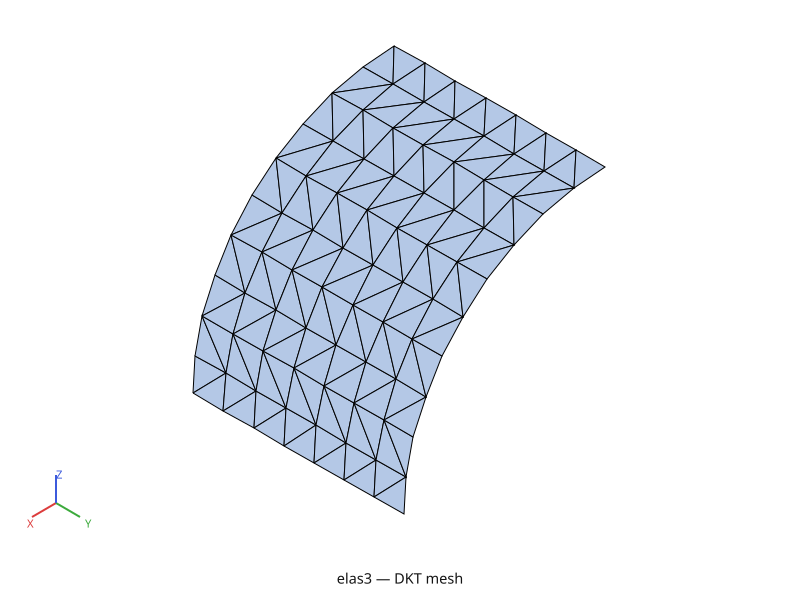

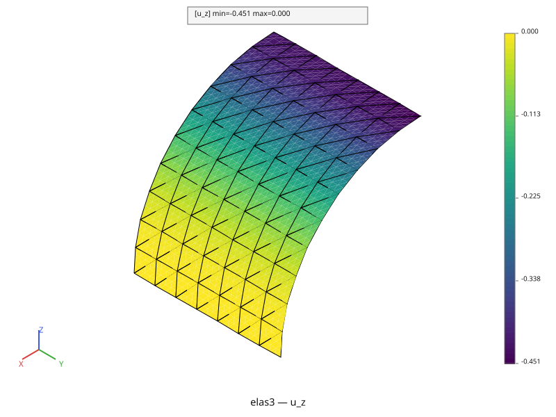

#### pyrucast listing

<details><summary><code>run.py</code></summary>

```python
"""elas3 — pinched cylinder with free ends (NAFEMS ME7), DKT shell.

Problem: a thin cylinder of radius 4.953 and length 2 × 5.175, free at its
ends, is pinched at its mid-length by two opposite point loads. One eighth is
modelled: a quarter of the circumference over half the length, with symmetry
conditions on the cut edges. Reference: u_z = −0.452 under the load.

Mesh: the quarter arc (10 elements, every 9°) extruded along y in 7
layers straight into TRI3, the diagonal of the triangles alternating from one
quadrangle to the next along the arc, as in the `.dgibi` file, with one
difference: the `.dgibi` file lets its mesh density (0.75) place the layers,
slightly closer towards the loaded section, where `extrude` spaces them
evenly.

Running::

    python validation/01_elasticity/elas3/run.py
"""

import os

import pyrucast as pc

E, NU, THICKNESS = 10.5e6, 0.3125, 0.094
RADIUS = 4.953
N_ARC = 10
HALF_LENGTH, N_LAYERS = 5.175, 7
FORCE = -100.0  # F_z at the loaded point


def main(out: str | None = None) -> dict[str, float]:
    coords = pc.Coords(3)
    centre = coords.add_node([0.0, 0.0, 0.0])
    p1 = coords.add_node([RADIUS, 0.0, 0.0])
    p2 = coords.add_node([0.0, 0.0, RADIUS])
    arc = pc.mesh.arc(p1, centre, p2, N_ARC)
    surface = pc.mesh.extrude(arc, [0.0, HALF_LENGTH, 0.0], N_LAYERS, "TRI3")
    p3 = surface.nearest_node([0.0, HALF_LENGTH, RADIUS])

    plane_z0 = pc.mesh.points_on_plane(surface, [0.0, 0.0, 0.0], [0.0, 0.0, 1.0])
    plane_x0 = pc.mesh.points_on_plane(surface, [0.0, 0.0, 0.0], [1.0, 0.0, 0.0])
    mid_length = pc.mesh.points_on_plane(
        surface, [0.0, HALF_LENGTH, 0.0], [0.0, 1.0, 0.0]
    )

    # The blocked nodes of each unknown on the symmetry planes z = 0
    # (u_z, r_x, r_y), x = 0 (u_x, r_y, r_z) and y = 5.175 (u_y, r_x, r_z).
    # A node on two of these sets is blocked once (`consolidate`).
    blocked = {
        "u_x": plane_x0,
        "u_y": mid_length,
        "u_z": plane_z0,
        "r_x": plane_z0 | mid_length,
        "r_y": plane_z0 | plane_x0,
        "r_z": plane_x0 | mid_length,
    }
    shell = pc.model.shell(pc.FiniteElementSpace(surface), "kirchhoff")
    model = shell
    for variable, nodes in blocked.items():
        model = model | pc.model.dirichlet(pc.mesh.consolidate(nodes), shell, variable)
    materials = pc.element_field.material_field(
        model, [("E", E), ("nu", NU), ("h", THICKNESS)]
    )
    load = pc.NodeField(pc.mesh.poi1_from_nodes([p3]), ["f_z"])
    load[0].set_value(p3, "f_z", FORCE)
    u = pc.solver.solve(pc.matrix.stiffness(model, materials), load)

    if out:
        surface.plot(title="elas3 — DKT mesh", save=os.path.join(out, "mesh.svg"))
        surface.plot(
            title="elas3 — u_z",
            field=u,
            component="u_z",
            cmap="viridis",
            save=os.path.join(out, "u_z.svg"),
        )
    return {"uz_P3": u.value(p3, "u_z")}


if __name__ == "__main__":
    print(main("."))
```

</details>

### elas4

#### Description sheet

| | |
|---|---|
| Test name | elas4 |
| Calculation type | MECHANICS ELASTICITY 3D |
| Finite element type (Cast3M) | COQ4 |
| pyrucast model | `model.shell(fes, "kirchhoff")` (DKQ), QUA4 |
| Reference | Test NAFEMS : ME8 : Modélisation des structures élastique dans CASTEM 2000. |
| Cast3M version of the 2011 document | 97' customer version |
| Cast3M 2026 `.dgibi` file | `dgibi/elas4.dgibi` |
| Folder | [`01_elasticity/elas4/`](01_elasticity/elas4/) |

**Topic.** A cantilever with a Z-shaped cross-section (NAFEMS LE5) is loaded in torsion
at its free end: a torque of 1.2 MN·m made of two opposite forces of
600 kN, each spread over one flange.

**Goal.** Find the axial stress on the mid-surface at the point A (2.5, 0, 0). The
analytical value is σ_xx = −108 MPa.

**Model description.**

Length 10 m along x. Cross-section in the plane x = 0: a lower flange from
(0, 0, 0) to (0, 0, 1), a web from (0, 0, 1) to (0, 2, 1) and an upper flange
from (0, 2, 1) to (0, 2, 2), 2 elements each; 16 elements along x, i.e. 96
COQ4 quadrilaterals.

| Data | Value |
|---|---|
| E | 210e9 Pa |
| ν | 0.3 |
| thickness | 0.1 m |

- Boundary condition: the section x = 0 has its displacements blocked.
- Loads at x = 10: on the lower flange F_z = −150 kN at its two ends and
  −300 kN at its middle; on the upper flange the opposite.

**Notes.** The 2011 document gives the torque as 1200 mN and the loads as 600 N; the
`.dgibi` file applies 1.2 MN·m with 600 kN per flange. The `.dgibi` file reads the axial
stress as the SMYY component of the shell stresses averaged through the
thickness (CALP 'MOYEN'), extrapolated to the nodes and averaged between the
two cells that share A; pyrucast does the same with N_yy / h (`to_nodes`). On the same
mesh, the tip deflection u_z, compared with no reference, is 4 % smaller in
pyrucast's DKQ than in Cast3M's COQ4.

**Improvement points.**

- Kirchhoff quadrangle shell (DKQ): 4 % stiffer than Cast3M's COQ4 on elas4, to look into (GitHub issue #26)

#### Results

| Quantity | Reference | Cast3M 2011 | Cast3M 2026 | pyrucast | pyrucast / reference |
|---|---|---|---|---|---|
| σ_xx at A, mid-surface (MPa) | -108 | -112.73 (-4.38 %) | -112.727 (-4.38 %) | -108.392 | -0.363 % |
| u_z at the tip (10, 0, 0), no reference (m) | — | — | -0.0316979 | -0.0304768 |  |

Acceptance: criterion of the `.dgibi` file, |σ_xx(A) + 108| / 108 ≤ 5 %.

pyrucast: the 1 checked quantities are within tolerance.

#### pyrucast figures

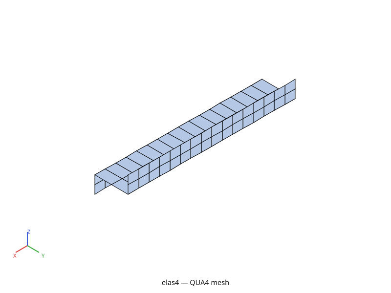

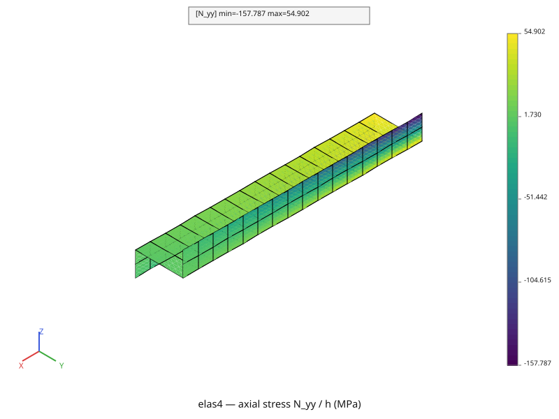

#### pyrucast listing

<details><summary><code>run.py</code></summary>

```python
"""elas4 — Z-section cantilever in torsion (NAFEMS LE5), Kirchhoff shell on QUA4.

Problem: a cantilever 10 m long whose cross-section is a Z (two flanges of
1 m joined by a web of 2 m), clamped at x = 0, is twisted at x = 10 by two
opposite forces of 600 kN spread over the flanges (1.2 MN·m). Reference: the
axial stress on the mid-surface at A (2.5, 0, 0) is σ_xx = −108 MPa.

The mesh is the Cast3M `.dgibi` file's: the section line (2 elements per segment)
extruded along x in 16 layers, 96 QUA4. Each cell's first edge runs along
the section line, so the local y axis of the shell is the beam's axis and
the axial stress on the mid-surface is N_yy / h, as the `.dgibi` file reads SMYY. A
lies on the edge of the first flange, between two cells; `to_nodes` gives it
the mean of what the Gauss points of the two cells give there, as the
`.dgibi` file reads it.

Running::

    python validation/01_elasticity/elas4/run.py
"""

import os

import pyrucast as pc

E, NU, THICKNESS = 210e9, 0.3, 0.1
LENGTH, N_LENGTH = 10.0, 16
# F_z at x = 10: −600 kN on the first flange, +600 kN on the second.
END_FORCES = [
    ((0.0, 0.0), -150e3),
    ((0.0, 0.5), -300e3),
    ((0.0, 1.0), -150e3),
    ((2.0, 1.0), 150e3),
    ((2.0, 1.5), 300e3),
    ((2.0, 2.0), 150e3),
]  # ((y, z), F_z)
X_A = 2.5


def main(out: str | None = None) -> dict[str, float]:
    coords = pc.Coords(3)
    p1 = coords.add_node([0.0, 0.0, 0.0])
    p2 = coords.add_node([0.0, 0.0, 1.0])
    p3 = coords.add_node([0.0, 2.0, 1.0])
    p4 = coords.add_node([0.0, 2.0, 2.0])
    section = pc.mesh.consolidate(
        pc.mesh.line(p1, p2, 2) | pc.mesh.line(p2, p3, 2) | pc.mesh.line(p3, p4, 2)
    )
    surface = pc.mesh.extrude(section, [LENGTH, 0.0, 0.0], N_LENGTH)
    clamped = pc.mesh.points_on_plane(surface, [0.0, 0.0, 0.0], [1.0, 0.0, 0.0])
    loaded = [surface.nearest_node([LENGTH, y, z]) for (y, z), _ in END_FORCES]
    point_a = surface.nearest_node([X_A, 0.0, 0.0])
    tip = loaded[0]

    shell = pc.model.shell(pc.FiniteElementSpace(surface), "kirchhoff")
    model = shell
    for variable in ("u_x", "u_y", "u_z"):  # displacements only, as the `.dgibi` file
        model = model | pc.model.dirichlet(clamped, shell, variable)
    materials = pc.element_field.material_field(
        model, [("E", E), ("nu", NU), ("h", THICKNESS)]
    )
    load = pc.NodeField(pc.mesh.poi1_from_nodes(loaded), ["f_z"])
    for node, (_, force) in zip(loaded, END_FORCES):
        load[0].set_value(node, "f_z", force)
    u = pc.solver.solve(pc.matrix.stiffness(model, materials), load)

    strain = pc.element_field.strain(model, u, materials)
    forces = pc.element_field.integrate_behavior(
        model, strain, materials, pc.element_field.initial_state(model, materials)
    )
    at_a = pc.node_field.to_nodes(forces)

    if out:
        surface.plot(title="elas4 — QUA4 mesh", save=os.path.join(out, "mesh.svg"))
        surface.plot(
            title="elas4 — axial stress N_yy / h (MPa)",
            field=forces * (1e-6 / THICKNESS),
            component="N_yy",
            cmap="viridis",
            save=os.path.join(out, "sigma_axial.svg"),
        )
    return {
        "sxx_A": at_a.value(point_a, "N_yy") / THICKNESS / 1e6,
        "uz_tip": u.value(tip, "u_z"),
    }


if __name__ == "__main__":
    print(main("."))
```

</details>

### elas7

#### Description sheet

| | |
|---|---|
| Test name | elas7 |
| Calculation type | MECHANICS ELASTICITY 2D AXI |
| Finite element type (Cast3M) | COQ2 |
| pyrucast model | not available — missing: axisymmetric shell element (COQ2) |
| Reference | Test NAFEMS : ME11 : Modélisation des structures élastiques dans CASTEM 2000. |
| Cast3M version of the 2011 document | 97' customer releas |
| Cast3M 2026 `.dgibi` file | `dgibi/elas7.dgibi` |
| Folder | [`01_elasticity/elas7/`](01_elasticity/elas7/) |

**Topic.** A branched shell of revolution under an internal pressure of 1 MPa (NAFEMS
LE9): a cylinder carries, at its mid-height, a spherical dome closing it.
The problem is axisymmetric.

**Goal.** Find the axial stress on the outer surface of the upper cylinder at the point
C (0.70, 1). The analytical value is σ_zz = −319.9 MPa.

**Model description.**

Meridian plane (r, z). A cylinder of radius √2/2 m runs from A (√2/2, 0) to
D (√2/2, 2); a spherical dome of radius 1 m, centred on the axis at
(0, 1 + √2/2), joins it at C (√2/2, 1) and closes at its pole B (0, √2/2).
COQ2 elements, 4 per segment on the cylinder near C, 4 and 5 on the dome.

| Data | Value |
|---|---|
| E | 210e9 Pa |
| ν | 0.3 |
| thickness | 0.01 m |

- Boundary condition: A clamped.
- Load: internal pressure 1e6 Pa on the three parts.

#### Results

| Quantity | Reference | Cast3M 2011 | Cast3M 2026 | pyrucast | pyrucast / reference |
|---|---|---|---|---|---|
| σ_zz at C, outer surface (MPa) | -319.9 | -312.29 (+2.38 %) | -312.208 (+2.4 %) | not available |  |

Acceptance: criterion of the `.dgibi` file, |σ_zz(C) + 319.9| / 319.9 ≤ 2.5 %.

### elas8

#### Description sheet

| | |
|---|---|
| Test name | elas8 |
| Calculation type | MECHANICS ELASTICITY 2D PLANE STRESS |
| Finite element type (Cast3M) | QUA8 |
| pyrucast model | `model.elasticity(fes, "plane_stress")`, QUA8 |
| Reference | Test NAFEMS : ME12 : Modélisation des structures élastiques dans CASTEM 2000. |
| Cast3M version of the 2011 document | 97' customer releas |
| Cast3M 2026 `.dgibi` file | `dgibi/elas8.dgibi` |
| Folder | [`01_elasticity/elas8/`](01_elasticity/elas8/) |

**Topic.** An elliptic membrane (NAFEMS LE1) is loaded by a uniform outward pressure on
its outer edge. By symmetry, one quarter is modelled in plane stress.

**Goal.** Find the stress σ_yy at the point D (2, 0). The analytical value is
σ_yy = 92.7 MPa.

**Model description.**

Quarter of the region between the inner ellipse x²/2² + y²/1² = 1 and the
outer ellipse x²/3.25² + y²/2.75² = 1, meshed with 24 QUA8: each elliptic
edge is the plane projection of a circular arc cut into 6 elements, each
straight edge has 4 elements.

| Data | Value |
|---|---|
| E | 210e9 Pa |
| ν | 0.3 |

- Boundary conditions: symmetry about x = 0 (u_x = 0) and y = 0 (u_y = 0).
- Load: outward pressure of 10 MPa on the outer elliptic edge.

**Notes.** The boundary nodes are the `.dgibi` file's, the mid-nodes of the ellipses included.
Inside, `transfinite` places the nodes as the `.dgibi` file's mesher does: the corners
by the transfinite interpolation, the mid-nodes at the middle of their chords.
The two codes give the same displacements to round-off (u_y(B) agrees to 7
digits). Cast3M reads the stress at a node differently: it extrapolates the
Gauss values of the cell to its nodes, pyrucast evaluates their least-squares
fit (`to_nodes`); D belongs to a single cell, so no average between cells
enters. σ_yy(D) is 0.841 % from the reference for pyrucast, 0.914 % for Cast3M.

**Improvement points.**

- an ellipse, or the projection of a line onto a plane (Cast3M `PROJ`)
- nodal stresses at a node of a single QUA8 cell: Cast3M's extrapolation (`CHAN NOEUD`) and pyrucast's least-squares fit (`to_nodes`) differ, to look into

#### Results

| Quantity | Reference | Cast3M 2011 | Cast3M 2026 | pyrucast | pyrucast / reference |
|---|---|---|---|---|---|
| σ_yy at D (MPa) | 92.7 | 93.548 (+0.915 %) | 93.5476 (+0.914 %) | 93.48 | +0.841 % |
| u_y at B (0, 2.75), no reference (m) | — | — | 0.000545846 | 0.000545846 |  |

Acceptance: criterion of the `.dgibi` file, |σ_yy(D) − 92.7| / 92.7 ≤ 1 %.

pyrucast: the 1 checked quantities are within tolerance.

#### pyrucast figures

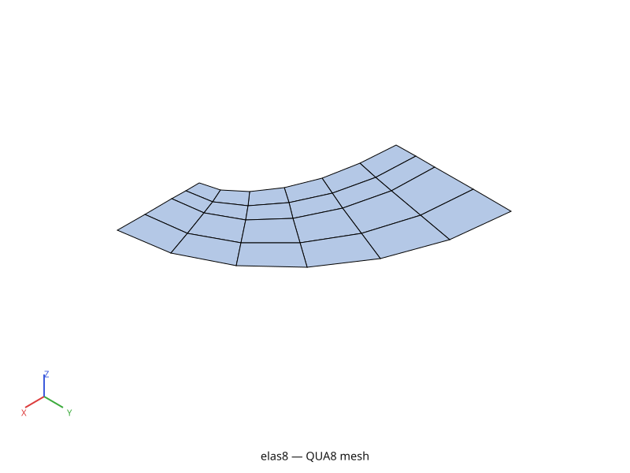

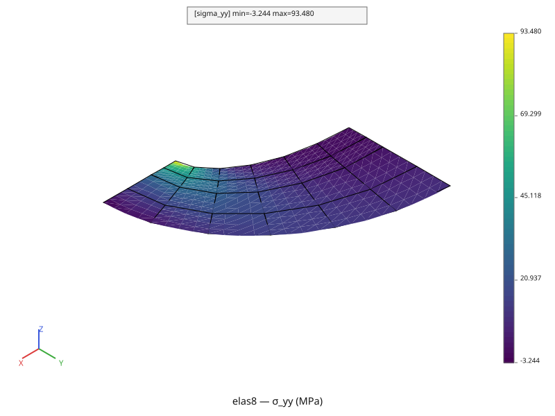

#### pyrucast listing

<details><summary><code>run.py</code></summary>

```python
"""elas8 — elliptic membrane under an outward pressure (NAFEMS LE1), plane stress.

Problem: a quarter of the membrane between the ellipses x²/2² + y²/1² = 1 and
x²/3.25² + y²/2.75² = 1, symmetric about x = 0 and y = 0, is pulled by a
uniform outward pressure of 10 MPa on its outer edge. Reference:
σ_yy = 92.7 MPa at the point D (2, 0).

The QUA8 mesh has the `.dgibi` file's boundary lines: 6 SEG3 elements along each
ellipse (a corner at every 15° of the ellipse's parameter, a mid-node halfway,
on the ellipse), 4 across, the straight sides cut at 1.583 on x = 0 and at
2.417 on y = 0, filled by `transfinite` as the `.dgibi` file's mesher does: the
mid-nodes of the ellipses are the lines' own, those inside sit at the middle
of their chords. pyrucast has no ellipse, nor the projection of a circle onto a
plane that the `.dgibi` file uses to draw one: the nodes of the two elliptic lines
are placed here. The pressure acts on the outer elliptic line itself, whose
nodes the patch shares.

σ_yy at D is what `to_nodes` gives there: D belongs to a single cell, whose
Gauss values are fitted over its nodes.

Running::

    python validation/01_elasticity/elas8/run.py
"""

import math
import os

import pyrucast as pc

E, NU = 210e9, 0.3  # Pa, —
PRESSURE = 10e6  # outward pressure on the outer edge, Pa
A_IN, B_IN = 2.0, 1.0  # semi-axes of the inner ellipse, m
A_OUT, B_OUT = 3.25, 2.75  # semi-axes of the outer ellipse, m
N_ARC = 6  # elements along each ellipse
Y_CUT, X_CUT = 1.583, 2.417  # where the straight sides change their line


def main(out: str | None = None) -> dict[str, float]:
    coords = pc.Coords(2)
    # The two elliptic lines, counter-clockwise around the membrane: the outer
    # one from y = 0 to x = 0, the inner one from x = 0 to y = 0. A node at
    # every half step of the parameter: the corners at the even ones, the
    # mid-nodes at the odd ones.
    outer_nodes, inner_nodes = [], []
    for k in range(2 * N_ARC + 1):
        phi = math.pi / 2.0 * k / (2 * N_ARC)
        outer_nodes.append(
            coords.add_node([A_OUT * math.cos(phi), B_OUT * math.sin(phi)])
        )
        inner_nodes.append(
            coords.add_node([A_IN * math.sin(phi), B_IN * math.cos(phi)])
        )
    outer = pc.Mesh(coords, "SEG3")
    inner = pc.Mesh(coords, "SEG3")
    for k in range(0, 2 * N_ARC, 2):
        outer.unit().add_cell([outer_nodes[k], outer_nodes[k + 2], outer_nodes[k + 1]])
        inner.unit().add_cell([inner_nodes[k], inner_nodes[k + 2], inner_nodes[k + 1]])
    pc_, pb = outer_nodes[0], outer_nodes[-1]
    pa, pd = inner_nodes[0], inner_nodes[-1]
    cut_y0 = coords.add_node([X_CUT, 0.0])
    cut_x0 = coords.add_node([0.0, Y_CUT])
    side_y0 = pc.mesh.consolidate(
        pc.mesh.line(pd, cut_y0, 2, "SEG3") | pc.mesh.line(cut_y0, pc_, 2, "SEG3")
    )
    side_x0 = pc.mesh.consolidate(
        pc.mesh.line(pb, cut_x0, 2, "SEG3") | pc.mesh.line(cut_x0, pa, 2, "SEG3")
    )
    membrane = pc.mesh.transfinite(side_y0, outer, side_x0, inner)
    outer_edge = outer

    fes = pc.FiniteElementSpace(membrane)
    elasticity = pc.model.elasticity(fes, "plane_stress")
    model = (
        elasticity
        | pc.model.dirichlet(
            pc.mesh.points_on_line(membrane, [0.0, 0.0], [0.0, 1.0]), elasticity, "u_x"
        )
        | pc.model.dirichlet(
            pc.mesh.points_on_line(membrane, [0.0, 0.0], [1.0, 0.0]), elasticity, "u_y"
        )
    )
    # An outward pressure on a counter-clockwise contour: φ_n = +p.
    traction = pc.model.flux(pc.FiniteElementSpace(outer_edge), elasticity, "n")
    model = model | traction
    materials = pc.element_field.material_field(
        model, [("E", E), ("nu", NU), ("phi_n", PRESSURE)]
    )
    forces = pc.node_field.external_forces(model, materials)
    u = pc.solver.solve(pc.matrix.stiffness(model, materials), forces)

    strain = pc.element_field.strain(model, u, materials)
    stress = pc.element_field.elastic_stress(model, strain, materials)
    at_d = pc.node_field.to_nodes(stress)

    if out:
        membrane.plot(title="elas8 — QUA8 mesh", save=os.path.join(out, "mesh.svg"))
        membrane.plot(
            title="elas8 — σ_yy (MPa)",
            field=stress * 1e-6,
            component="sigma_yy",
            cmap="viridis",
            save=os.path.join(out, "sigma_yy.svg"),
        )
    return {
        "syy_D": at_d.value(pd, "sigma_yy") / 1e6,
        "uy_B": u.value(pb, "u_y"),
    }


if __name__ == "__main__":
    print(main("."))
```

</details>

### elas11

#### Description sheet

| | |
|---|---|
| Test name | elas11 |
| Calculation type | MECHANICS ELASTICITY 2D AXI |
| Finite element type (Cast3M) | QUA8 |
| pyrucast model | `model.elasticity(fes, "axisymmetric")` with a thermal strain, QUA8 |
| Reference | Test NAFEMS : LE11 : Modélisation des structures élastiques dans CASTEM 2000. |
| Cast3M version of the 2011 document | 97' customer releas |
| Cast3M 2026 `.dgibi` file | `dgibi/elas11.dgibi` |
| Folder | [`01_elasticity/elas11/`](01_elasticity/elas11/) |

**Topic.** A thick solid of revolution made of a cylinder, a cone and a sphere (NAFEMS
LE11) is loaded by a temperature field that grows linearly with the radius
and the height, T = r + z. The problem is axisymmetric.

**Goal.** Find the axial stress at the point A (1, 0). The analytical value is
σ_zz = −105 MPa.

**Model description.**

Meridian plane (r, z), QUA8 elements (fine mesh of the `.dgibi` file, K = 2).

| Data | Value |
|---|---|
| E | 210e9 Pa |
| ν | 0.3 |
| α | 2.3e-4 /°C |
| reference temperature | 0 °C |

- Load: temperature T = r + z (°C).

**Notes.** The 2011 document gives the goal as σ_zz(A) = 105 MPa and the result table as
σ_yy(A) = −105 MPa; the `.dgibi` file compares σ_zz with −105 MPa.

The mesh is the `.dgibi` file's, the mid-nodes of the arcs on the arcs. Cast3M's
thermal stress operator replaces the temperature of a mid-node of a quadratic
cell by the mean of its edge's corners, which differs from r + z on the arcs'
mid-nodes; pyrucast heats every node to r + z, which a QUA8 reproduces
exactly. With the averaged temperatures, pyrucast gives Cast3M's u_r(B) to
round-off and its σ_zz(A) to 0.012 % (the rest is the reading at the node A):
the 0.10 point between the two codes on σ_zz(A), 1.592 % from the reference
for pyrucast and 1.490 % for Cast3M, is the temperature's.

Both are about 1.5 % from −105 MPa because the mesh is coarse. Refined, with
the exact geometry and temperature, pyrucast's σ_zz(A) goes from +1.592 %
(2 × 10 QUA8) to +0.395 % (4 × 20) and −0.182 % (8 × 40): the error of
discretisation, divided by 4 at the first refinement, towards about
−105.2 MPa — the NAFEMS target of −105 MPa is itself rounded. Mid-nodes on
the chords give −0.097 % on the 2 × 10 mesh, a compensation of errors that
refining undoes (−0.078 %, then −0.314 %).

#### Results

| Quantity | Reference | Cast3M 2011 | Cast3M 2026 | pyrucast | pyrucast / reference |
|---|---|---|---|---|---|
| σ_zz at A (MPa) | -105 | -103.34 (+1.58 %) | -103.436 (+1.49 %) | -103.328 | +1.59 % |
| u_r at B (1.4, 0), no reference (m) | — | — | 0.000766758 | 0.000767139 |  |

Acceptance: criterion of the `.dgibi` file, |σ_zz(A) + 105| / 105 ≤ 2 %.

pyrucast: the 1 checked quantities are within tolerance.

#### pyrucast figures

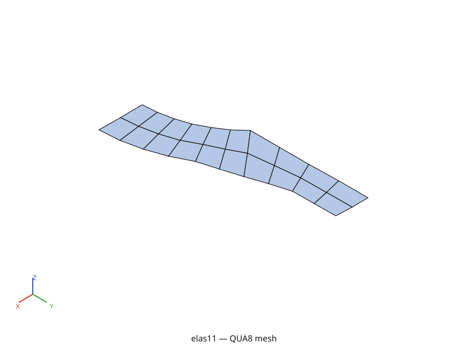

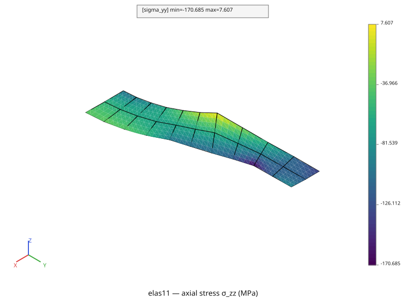

#### pyrucast listing

<details><summary><code>run.py</code></summary>

```python
"""elas11 — thick cylinder-cone-sphere under a linear temperature (NAFEMS LE11).

Problem: an axisymmetric thick solid — a spherical part (radii 1 and 1.4),
a conical part and a cylindrical part — is heated to T = r + z (°C), with
α = 2.3e-4 /°C and the reference temperature 0; u_z = 0 on its two flat
faces. Reference: the axial stress at A (1, 0) is σ_zz = −105 MPa.

The QUA8 mesh has the `.dgibi` file's boundary lines, SEG3: 2 elements across and 10
along the meridian (4 on the arcs of 30°, 2 on the arc from 30° to 45°, 4 on
the cone and on the inner straight part, 2 on the outer cylinder), filled by
`transfinite` as the `.dgibi` file's mesher does: the mid-nodes of the arcs are on
the arcs, those inside at the middle of their chords. The temperature is
r + z at every node, mid-nodes included.

In pyrucast's axisymmetric coordinates x is r and y is z: the axial stress
is `sigma_yy`. `to_nodes` gives it at A, which belongs to a single cell.

Running::

    python validation/01_elasticity/elas11/run.py
"""

import math
import os

import pyrucast as pc

E, NU, ALPHA = 210e9, 0.3, 2.3e-4  # Pa, —, /°C
T_REF = 0.0  # °C
COS30, SIN30 = math.cos(math.radians(30.0)), math.sin(math.radians(30.0))
COS45 = math.cos(math.radians(45.0))


def main(out: str | None = None) -> dict[str, float]:
    coords = pc.Coords.axisymmetric()
    origin = coords.add_node([0.0, 0.0])
    pa = coords.add_node([1.0, 0.0])
    pb = coords.add_node([1.4, 0.0])
    pc_ = coords.add_node([COS30, SIN30])
    pd = coords.add_node([1.4 * COS30, 0.7])
    pe = coords.add_node([COS45, COS45])
    pg = coords.add_node([1.0, 1.39])
    ph = coords.add_node([0.7071, 1.79])
    pi = coords.add_node([1.0, 1.79])
    # The four sides, counter-clockwise, as in the `.dgibi` file.
    bottom = pc.mesh.line(pa, pb, 2, "SEG3")
    outer = pc.mesh.consolidate(
        pc.mesh.arc(pb, origin, pd, 4, "SEG3")
        | pc.mesh.line(pd, pg, 4, "SEG3")
        | pc.mesh.line(pg, pi, 2, "SEG3")
    )
    top = pc.mesh.line(pi, ph, 2, "SEG3")
    inner = pc.mesh.consolidate(
        pc.mesh.line(ph, pe, 4, "SEG3")
        | pc.mesh.arc(pe, origin, pc_, 2, "SEG3")
        | pc.mesh.arc(pc_, origin, pa, 4, "SEG3")
    )
    solid = pc.mesh.transfinite(bottom, outer, top, inner)
    flat_faces = pc.mesh.consolidate(
        pc.mesh.points_on_line(solid, [1.0, 0.0], [1.4, 0.0])
        | pc.mesh.points_on_line(solid, [0.7071, 1.79], [1.0, 1.79])
    )

    fes = pc.FiniteElementSpace(solid)
    elasticity = pc.model.elasticity(fes, "axisymmetric")
    model = elasticity | pc.model.dirichlet(flat_faces, elasticity, "u_y")
    materials = pc.element_field.material_field(
        model, [("E", E), ("nu", NU), ("alpha", ALPHA)]
    )
    # T = r + z at the nodes: x is r, y is z.
    temperature = pc.node_field.positions(solid, ["X"]).rename_component(
        "X", "T"
    ) + pc.node_field.positions(solid, ["Y"]).rename_component("Y", "T")
    eps_th = pc.element_field.thermal_strain(
        model, pc.element_field.interp_to_gauss(temperature, fes), materials, T_REF
    )
    sigma_th = pc.element_field.elastic_stress(model, eps_th, materials)
    forces = (
        pc.node_field.divergence(sigma_th, "sigma")
        .rename_component("div_sigma_x", "f_x")
        .rename_component("div_sigma_y", "f_y")
    )
    u = pc.solver.solve(pc.matrix.stiffness(model, materials), forces)

    strain = pc.element_field.strain(model, u, materials)
    stress = pc.element_field.elastic_stress(model, strain, materials) - sigma_th
    at_a = pc.node_field.to_nodes(stress)

    if out:
        solid.plot(title="elas11 — QUA8 mesh", save=os.path.join(out, "mesh.svg"))
        solid.plot(
            title="elas11 — axial stress σ_zz (MPa)",
            field=stress * 1e-6,
            component="sigma_yy",
            cmap="viridis",
            save=os.path.join(out, "sigma_zz.svg"),
        )
    return {
        "szz_A": at_a.value(pa, "sigma_yy") / 1e6,
        "ur_B": u.value(pb, "u_x"),
    }


if __name__ == "__main__":
    print(main("."))
```

</details>

### elas13

#### Description sheet

| | |
|---|---|
| Test name | elas13 |
| Calculation type | MECHANICS ELASTICITY 3D AXI |
| Finite element type (Cast3M) | POUT |
| pyrucast model | `model.bernoulli(fes)` on a foundation `model.boundary_transfer` whose stiffness is lumped, SEG2 |
| Reference | Test VPCS : SSLL16/89 : Modélisation des structures élastiques dans CASTEM 2000. M. Courtand P. Lebelle Formulaire du béton armé T.2 Paris Eyrolles 1976. |
| Cast3M version of the 2011 document | 97' customer releas |
| Cast3M 2026 `.dgibi` file | `dgibi/elas13.dgibi` |
| Folder | [`01_elasticity/elas13/`](01_elasticity/elas13/) |

**Topic.** A beam with pinned ends rests on an elastic foundation and carries a point
load at mid-span, a distributed load along its length and opposite moments
at its ends.

**Goal.** Find the rotation and the reaction at the end A (−2.48, 0, 0), and the
deflection and the bending moment at the centre D (0, 0, 0).

**Model description.**

Beam along x from A (−L/2, 0, 0) to B (L/2, 0, 0), L = π·√10 / 2 ≈ 4.967 m,
8 POUT elements, on a foundation of stiffness K = 840 000 N/m per metre. The
`.dgibi` file spreads the foundation on nodal springs (`APPUI`) of K·L/16 at
both ends of each element.

| Data | Value |
|---|---|
| E | 2e11 Pa |
| ν | 0.3 |
| section | 1000 |
| I_y = I_z | 1e-4 |
| torsion constant | 1000 |

- Boundary conditions: u_x = u_y = 0 at A and B; u_z = θ_x = 0 everywhere.
- Loads: F_y = −10 kN at D; −5000 N/m along the beam, as nodal forces of
  −5000·L/16 at both ends of each element; M_z = −15 000 N·m at A and
  +15 000 N·m at B.

**Notes.** The 2011 document prints the deflection reference as −4.233E3 m and the
Cast3M value as −4.38085E3 m (exponent sign lost); the reference used here is
the `.dgibi` file's −4.23326e-3 m, the 2011 value is kept as printed.

pyrucast models the foundation as a stiffness distributed along the beam
(`boundary_transfer`, `h_u_y = K`) and lumps it on the diagonal, which gives
the `.dgibi` file's nodal springs: the four values are Cast3M 2026's to
round-off. Without lumping, the distributed foundation gives
θ_z(A) = −3.1675e-3 rad, F_y(A) = 11 528 N, u_y(D) = −4.4044e-3 m and
M(D) = 33 595 N·m, within the same 5 % of the reference.

#### Results

| Quantity | Reference | Cast3M 2011 | Cast3M 2026 | pyrucast | pyrucast / reference |
|---|---|---|---|---|---|
| rotation θ_z at A (rad) | -0.003045 | -0.0031525 (-3.53 %) | -0.0031525 (-3.53 %) | -0.0031525 | -3.53 % |
| reaction F_y at A (N) | 11674 | 11559 (-0.985 %) | 11558.9 (-0.986 %) | 11558.9 | -0.986 % |
| deflection u_y at D (m) | -0.00423326 | -4380.85 (-1.03e+08 %) | -0.00438085 (-3.49 %) | -0.00438085 | -3.49 % |
| bending moment at D (N·m) | 33840 | 33407 (-1.28 %) | 33407.2 (-1.28 %) | 33407.2 | -1.28 % |

Acceptance: criterion of the `.dgibi` file, largest relative gap of the four values ≤ 5 %.

pyrucast: the 4 checked quantities are within tolerance.

#### pyrucast listing

<details><summary><code>run.py</code></summary>

```python
"""elas13 — pinned beam on an elastic foundation, Bernoulli beam on SEG2.

Problem: a beam along x from A (−L/2, 0) to B (L/2, 0), L = π·√10 / 2,
E = 2e11, A = 1000, I = 1e-4, pinned at A and B (u_x = u_y = 0), rests on a
Winkler foundation of stiffness K = 840 000 N/m per metre. It carries
−10 kN at the centre D, −5000 N/m along its length, and the end moments
M_z = −15 000 N·m at A and +15 000 N·m at B. Reference: the rotation and
the reaction at A, the deflection and the bending moment at D.

The `.dgibi` file turns the foundation into nodal springs K·L/(2·n) at both
ends of each of its n cells (`APPUI`), and the distributed load into nodal
forces the same way. Here the foundation is `model.boundary_transfer` on
the beam's line, `h_u_y = K`, whose stiffness `lump` gathers on the
diagonal: the same nodal springs. The loads are the same nodal forces.

Running::

    python validation/01_elasticity/elas13/run.py
"""

import math

import pyrucast as pc

E, AREA, INERTIA = 2e11, 1000.0, 1e-4
K = 840_000.0  # foundation stiffness, N/m per metre
LENGTH = math.pi * math.sqrt(10.0) / 2.0
N_CELLS = 8
F_D = -10_000.0  # point load at D
Q = -5000.0  # distributed load, N/m
M_END = 15_000.0  # end moments, −M_END at A, +M_END at B


def main(out: str | None = None) -> dict[str, float]:
    coords = pc.Coords(2)
    a = coords.add_node([-LENGTH / 2.0, 0.0])
    b = coords.add_node([LENGTH / 2.0, 0.0])
    line = pc.mesh.line(a, b, N_CELLS)
    d = line.nearest_node([0.0, 0.0])

    beam = pc.model.bernoulli(pc.FiniteElementSpace(line, interpolation="HERMITE3"))
    foundation = pc.model.boundary_transfer(pc.FiniteElementSpace(line), beam, ["u_y"])
    pins = pc.mesh.poi1_from_nodes([a, b])
    supports = pc.model.dirichlet(pins, beam, "u_x") | pc.model.dirichlet(
        pins, beam, "u_y"
    )
    materials = pc.element_field.material_field(
        beam | foundation | supports,
        [("E", E), ("A", AREA), ("I", INERTIA), ("h_u_y", K), ("a_ext_u_y", 0.0)],
    )
    stiffness = (
        pc.matrix.stiffness(beam | supports, materials)
        + pc.matrix.stiffness(foundation, materials).lump()
    )

    # The `.dgibi` file's loads: Q·L/(2n) at both ends of each cell.
    nodal = Q * LENGTH / (2.0 * N_CELLS)
    load = pc.NodeField(line, ["f_y", "m_z"])
    for i in range(line.cell_count):
        for k in range(2):
            node = line.node(0, i, k)
            load[0].set_value(node, "f_y", load.value(node, "f_y") + nodal)
    load[0].set_value(d, "f_y", load.value(d, "f_y") + F_D)
    load[0].set_value(a, "m_z", -M_END)
    load[0].set_value(b, "m_z", M_END)

    u = pc.solver.solve(stiffness, load)
    reactions = -pc.node_field.internal_forces(
        supports, pc.element_field.initial_state(supports, materials), u, materials
    )
    strain = pc.element_field.strain(beam, u, materials)
    forces = pc.element_field.integrate_behavior(
        beam, strain, materials, pc.element_field.initial_state(beam, materials)
    )
    at_d = pc.node_field.project(forces, line, pc.mesh.poi1_from_nodes([d]))

    return {
        "rz_A": u.value(a, "r_z"),
        "fy_A": reactions.value(a, "f_y"),
        "uy_D": u.value(d, "u_y"),
        "mz_D": at_d.value(d, "M"),
    }


if __name__ == "__main__":
    print(main("."))
```

</details>

### stru2

#### Description sheet

| | |
|---|---|
| Test name | stru2 |
| Calculation type | ELASTIC MECHANIC 2D, PLAN STRESS |
| Finite element type (Cast3M) | QUA4 |
| pyrucast model | `model.elasticity(fes, "plane_stress", symmetry="orthotropic")`, QUA4 |
| Reference | Comparison with six others finite element codes. |
| Cast3M version of the 2011 document | 97' customer release |
| Cast3M 2026 `.dgibi` file | `dgibi/stru2.dgibi` |
| Folder | [`01_elasticity/stru2/`](01_elasticity/stru2/) |

**Topic.** An orthotropic square plate, in plane stress, is clamped on one side and
loaded by a force on the opposite side.

**Goal.** Find the horizontal and vertical displacements at the centre of the plate
(point E) and at the two free corners (points A and D).

**Model description.**

Square plate, QUA4 elements, orthotropic material whose axes are given by a
direction in the plane.

| Data | Value |
|---|---|
| E_1 | 2.5737e10 Pa |
| E_2 = E_3 | 7.377e9 Pa |
| ν_12 = ν_23 = ν_13 | 0.31 |
| G_12 | 2.319e9 Pa |

- Boundary condition: one side clamped.
- Load: total force 1e6 N on the opposite side.

**Notes.** The 2011 document gives E_1 = 2.15737e10 Pa; the `.dgibi` file uses 2.5737e10 Pa.

#### Results

| Quantity | Reference | Cast3M 2011 | Cast3M 2026 | pyrucast | pyrucast / reference |
|---|---|---|---|---|---|
| u_x at A (1e-4 m) | 1.098 | 1.09961 (+0.147 %) | 1.09961 (+0.146 %) | 1.09961 | +0.146 % |
| u_y at A (1e-4 m) | -1.309 | -1.31276 (-0.287 %) | -1.31276 (-0.288 %) | -1.31276 | -0.288 % |
| u_x at D (1e-4 m) | 1.003 | 0.99508 (-0.79 %) | 0.995082 (-0.789 %) | 0.995082 | -0.789 % |
| u_y at D (1e-4 m) | -0.7134 | -0.71706 (-0.513 %) | -0.717064 (-0.514 %) | -0.717064 | -0.514 % |
| u_x at E (1e-4 m) | 0.4768 | 0.47668 (-0.0252 %) | 0.47668 (-0.0252 %) | 0.47668 | -0.0252 % |
| u_y at E (1e-4 m) | -0.4965 | -0.49812 (-0.326 %) | -0.498122 (-0.327 %) | -0.498122 | -0.327 % |

Acceptance: criterion of the `.dgibi` file, largest relative gap ≤ 5 % over u_x(A), u_x(D), u_x(E), u_y(A), u_y(D) (the `.dgibi` file lists u_y(D) twice and leaves u_y(E) out).

pyrucast: the 6 checked quantities are within tolerance.

#### pyrucast figures

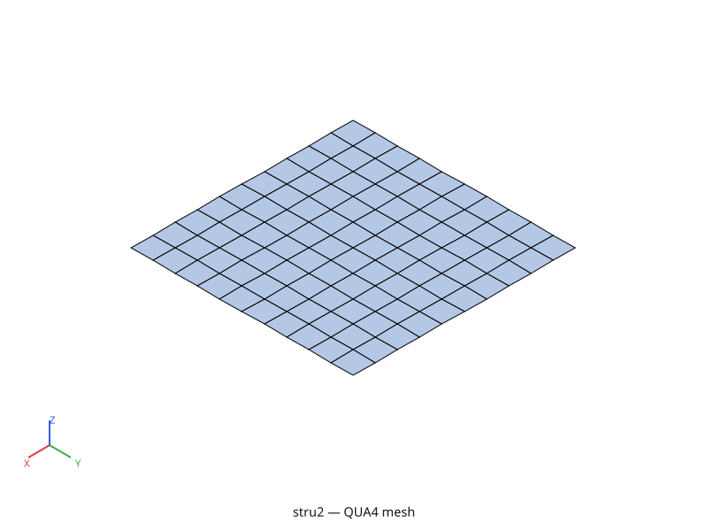

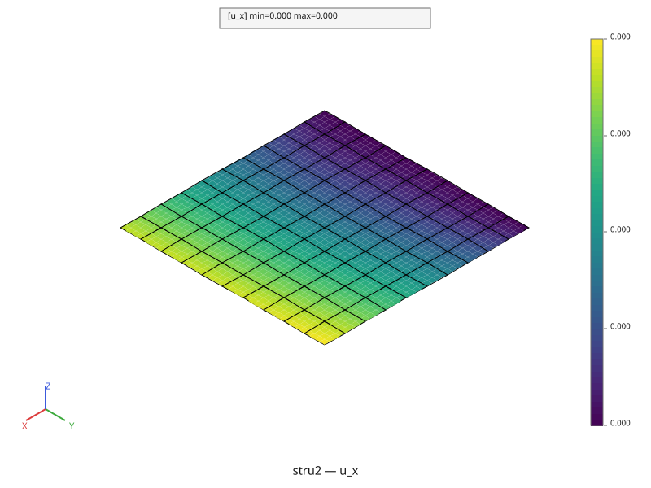

#### pyrucast listing

<details><summary><code>run.py</code></summary>

```python
"""stru2 — clamped orthotropic square plate, plane stress, QUA4.

Problem: a square plate of side 1, centred at the origin, of an orthotropic
material whose first axis makes 30° with x, is clamped on its side x = −0.5
and pulled along x by a total force of 1e6 N spread evenly over its side
x = 0.5. Reference (comparison with six other codes): the displacements of
the corners A (0.5, 0.5), D (0.5, −0.5) and of the centre E.

Mesh: 10 × 10 QUA4, the `.dgibi` file's (a regular grid). The force spread evenly is
a uniform line load of 1e6 N/m, whose consistent nodal forces are the `.dgibi` file's.

Running::

    python validation/01_elasticity/stru2/run.py
"""

import math
import os

import pyrucast as pc

E1, E2, E3 = 2.5737e10, 7.377e9, 7.377e9  # Pa
NU12, NU23, NU13 = 0.31, 0.31, 0.31
G12 = 2.319e9  # Pa; G_13 and G_23 play no part in plane stress
ANGLE = 30.0  # first material axis, from x, degrees
FORCE = 1e6  # total force along x on the side x = 0.5, N
N = 10  # elements per side


def main(out: str | None = None) -> dict[str, float]:
    coords = pc.Coords(2)
    pa = coords.add_node([0.5, 0.5])
    pb = coords.add_node([-0.5, 0.5])
    pc_ = coords.add_node([-0.5, -0.5])
    pd = coords.add_node([0.5, -0.5])
    top = pc.mesh.line(pa, pb, N)
    clamped_side = pc.mesh.line(pb, pc_, N)
    bottom = pc.mesh.line(pc_, pd, N)
    loaded_side = pc.mesh.line(pd, pa, N)
    plate = pc.mesh.transfinite(top, clamped_side, bottom, loaded_side)
    pe = plate.nearest_node([0.0, 0.0])

    fes = pc.FiniteElementSpace(plate)
    elasticity = pc.model.elasticity(fes, "plane_stress", symmetry="orthotropic")
    clamped = pc.mesh.consolidate(clamped_side.to_poi1())
    model = (
        elasticity
        | pc.model.dirichlet(clamped, elasticity, "u_x")
        | pc.model.dirichlet(clamped, elasticity, "u_y")
        | pc.model.flux(pc.FiniteElementSpace(loaded_side), elasticity, "f_x")
    )
    a = math.radians(ANGLE)
    materials = pc.element_field.material_field(
        model,
        [
            ("E_1", E1),
            ("E_2", E2),
            ("E_3", E3),
            ("nu_12", NU12),
            ("nu_13", NU13),
            ("nu_23", NU23),
            ("G_12", G12),
            ("G_13", G12),
            ("G_23", G12),
            ("V1X", math.cos(a)),
            ("V1Y", math.sin(a)),
            ("phi_f_x", FORCE / 1.0),  # per unit length of the side
        ],
    )
    forces = pc.node_field.external_forces(model, materials)
    u = pc.solver.solve(pc.matrix.stiffness(model, materials), forces)

    if out:
        plate.plot(title="stru2 — QUA4 mesh", save=os.path.join(out, "mesh.svg"))
        plate.plot(
            title="stru2 — u_x",
            field=u,
            component="u_x",
            cmap="viridis",
            save=os.path.join(out, "u_x.svg"),
        )
    scale = 1e-4  # the document's unit
    return {
        "ux_A": u.value(pa, "u_x") / scale,
        "uy_A": u.value(pa, "u_y") / scale,
        "ux_D": u.value(pd, "u_x") / scale,
        "uy_D": u.value(pd, "u_y") / scale,
        "ux_E": u.value(pe, "u_x") / scale,
        "uy_E": u.value(pe, "u_y") / scale,
    }


if __name__ == "__main__":
    print(main("."))
```

</details>

### stru4

#### Description sheet

| | |
|---|---|
| Test name | stru4 |
| Calculation type | ELASTIC MECHANIC, 3D |
| Finite element type (Cast3M) | TUYAU |
| pyrucast model | not available — missing: pipe element (TUYA) |
| Reference | Guide VPCS, Test SSLL 06/90. Solution analytique; JS Prezemieniecki; Theory of matrix structural analysis, New York, MCGraw-Hill, 1968. |
| Cast3M version of the 2011 document | 97' customer release |
| Cast3M 2026 `.dgibi` file | `dgibi/stru4.dgibi` |
| Folder | [`01_elasticity/stru4/`](01_elasticity/stru4/) |

**Topic.** A curved tube, clamped at one end, is bent in its plane by a force and a
moment applied at its free end.

**Goal.** Find the horizontal and vertical displacements of the free end B and its
rotation.

**Model description.**

Quarter circle of radius 3 m in the plane (x, y), from A (0, 3, 0) to
B (3, 0, 0), 20 pipe elements.

| Data | Value |
|---|---|
| E | 2e11 Pa |
| ν | 0.3 |
| tube radius | 0.01 m |
| wall thickness | 0.002 m |

- Boundary condition: A clamped.
- Loads at B: F_x = 10 N, F_y = 5 N, M_z = 8 N·m.
- Reference: curved-beam solution with I = 4.637e-9 m⁴.

#### Results

| Quantity | Reference | Cast3M 2011 | Cast3M 2026 | pyrucast | pyrucast / reference |
|---|---|---|---|---|---|
| u_x at B (m) | 0.37908 | 0.37871 (-0.0976 %) | 0.378708 (-0.0982 %) | not available |  |
| u_y at B (m) | 0.24173 | 0.24174 (+0.00414 %) | 0.241744 (+0.0057 %) | not available |  |
| rotation θ_z at B (rad) | 0.16539 | 0.16533 (-0.0363 %) | 0.165325 (-0.0391 %) | not available |  |

Acceptance: criterion of the `.dgibi` file, largest relative gap of the three values < 5 %.

### elas20

#### Description sheet

| | |
|---|---|
| Test name | elas20 |
| Calculation type | MECHANICS ELASTICITY 3D |
| Finite element type (Cast3M) | TUYAU |
| pyrucast model | not available — missing: pipe element (TUYA) |
| Reference | Test VPCS : SSLL08/90 : Modélisation des structures élastiques dans CASTEM 2000. J. S. Przemieniecki, theory of matrix structural analysis (New-York : Mcgraw-Hill Book Company, 1968) pp 155. |
| Cast3M version of the 2011 document | 97' customer releas |
| Cast3M 2026 `.dgibi` file | `dgibi/elas20.dgibi` |
| Folder | [`01_elasticity/elas20/`](01_elasticity/elas20/) |

**Topic.** A pipe made of two straight parts joined by an elbow is loaded by an
internal pressure; it is clamped at one end.

**Goal.** Find the displacements at the points B, B' and A' and compare them with the
analytical results.

**Model description.**

In the plane (x, y): a straight part from A (0, 0, 0) to A' (0, 3.048, 0)
(5 elements), an elbow of radius 0.61 m from A' to B' (0.61, 3.658, 0)
(10 elements) and a straight part from B' to B (3.658, 3.658, 0)
(5 elements).

| Data | Value |
|---|---|
| E | 2.1e11 Pa |
| ν | 0.3 |
| tube radius | 0.2032 m |
| wall thickness | 0.026187 m |

- Boundary condition: A clamped.
- Load: internal pressure 15 MPa.

**Notes.** The 2011 document prints the Cast3M value of u_x(B) as 822692E-4 (the decimal
point is lost); it is kept as printed.

#### Results

| Quantity | Reference | Cast3M 2011 | Cast3M 2026 | pyrucast | pyrucast / reference |
|---|---|---|---|---|---|
| u_x at B (m) | 0.000822 | 82.2692 (+1e+07 %) | 0.000822692 (+0.0842 %) | not available |  |
| u_y at B (m) | 0.000822 | 0.000822692 (+0.0842 %) | 0.000822692 (+0.0842 %) | not available |  |
| u_x at B' (m) | 0.000137 | 0.000137544 (+0.397 %) | 0.000137544 (+0.397 %) | not available |  |
| u_y at B' (m) | 0.000822 | 0.000822692 (+0.0842 %) | 0.000822692 (+0.0842 %) | not available |  |
| u_y at A' (m) | 0.000685 | 0.000685148 (+0.0216 %) | 0.000685148 (+0.0216 %) | not available |  |

Acceptance: criterion of the `.dgibi` file, largest relative gap of the five values ≤ 5 %.

### testICQ4

#### Description sheet

| | |
|---|---|
| Test name | testICQ4 |
| Calculation type | ISOTROPIC ELASTIC MECHANIC, PLAN DEFO |
| Finite element type (Cast3M) | ICQ4 |
| pyrucast model | not available — missing: incompatible-mode element (ICQ4) |
| Reference | Rapport DMT sur les elements ICQ4. |
| Cast3M version of the 2011 document | 97' customer release |
| Cast3M 2026 `.dgibi` file | `dgibi/testICQ4.dgibi` |
| Folder | [`01_elasticity/testICQ4/`](01_elasticity/testICQ4/) |

**Topic.** A square plate of a nearly incompressible material (ν = 0.499), in plane
strain, is loaded on its four sides by a hydrostatic stress field (weight
α = 1) plus a deviatoric one (weight β = 1e-3).

**Goal.** Test the incompressible ICQ4 elements: compare the vertical displacement of
the corner (100, 100) and the mean stress with the incompressible solution.

**Model description.**

Square 100 × 100, 10 × 10 ICQ4.

| Data | Value |
|---|---|
| E | 2e11 Pa |
| ν | 0.499 |
| hydrostatic weight α | 1 |
| deviatoric weight β | 1e-3 |

- Boundary conditions: u_y = 0 on y = 0 and on x = 0, u_x = 0 at the origin.
- Loads: pressure α·1e5 Pa on the four sides, plus the tractions of the
  deviatoric field β·1e5·(σ_xx = 200 on x = 100 and −200 on y = 100 …,
  σ_xy = −2x or −2y).
- Reference: u_y(100, 100) = 2·x·y / (2μ) · 1e5 · β with μ = 1e11 / (1 + ν),
  i.e. 1.499e-5; mean stress −α·1e5 Pa.

**Notes.** The 2011 document prints no result table; the references are the `.dgibi` file's.

#### Results

| Quantity | Reference | Cast3M 2011 | Cast3M 2026 | pyrucast | pyrucast / reference |
|---|---|---|---|---|---|
| u_y at (100, 100) | 1.499e-05 | — | 1.48594e-05 (-0.871 %) | not available |  |
| largest mean stress (Pa) | -100000 | — | -99748.2 (+0.252 %) | not available |  |

Acceptance: criteria of the `.dgibi` file, each relative gap < 1 %.

### vsur1

#### Description sheet

| | |
|---|---|
| Test name | vsur1 |
| Calculation type | ISOTROPIC ELASTIC MECHANIC |
| Finite element type (Cast3M) | COQ2 |
| pyrucast model | not available — missing: axisymmetric shell element (COQ2); surface vector operator (VSUR) |
| Reference | no source cited in the original document |
| Cast3M version of the 2011 document | 97' customer release |
| Cast3M 2026 `.dgibi` file | `dgibi/vsur1.dgibi` |
| Folder | [`01_elasticity/vsur1/`](01_elasticity/vsur1/) |

**Topic.** Check of the operator that builds, on axisymmetric shell elements, the field
of surface vectors (normal times jacobian) and the field of unit normals.

**Goal.** Test the VSUR operator with COQ2 elements: the norm of the surface vector
must equal the jacobian, and the normals must have unit length.

**Model description.**

Axisymmetric, meridian plane: the arc of centre (0, 10) from (0, 0) to
(10, 10), 10 COQ2 elements. No material, no load.

**Notes.** The 2011 document prints no result table; the references are the `.dgibi` file's.

#### Results

| Quantity | Reference | Cast3M 2011 | Cast3M 2026 | pyrucast | pyrucast / reference |
|---|---|---|---|---|---|
| max |‖v‖² − J²| | 0 | — | 1.11022e-16 (Δ = 1.1e-16) | not available |  |
| min ‖n‖² | 1 | — | 1 (+0 %) | not available |  |
| max ‖n‖² | 1 | — | 1 (+0 %) | not available |  |

## Buckling

### flam1

#### Description sheet

| | |
|---|---|
| Test name | flam1 |
| Calculation type | MECHANICS BUCKLING. 2D PLANE STRESS |
| Finite element type (Cast3M) | COQ2 |
| pyrucast model | not available — missing: eigenvalue solver; axisymmetric shell element (COQ2) |
| Reference | Analytical solution. |
| Cast3M version of the 2011 document | 97' customer version |
| Cast3M 2026 `.dgibi` file | `dgibi/flam1.dgibi` |
| Folder | [`02_buckling/flam1/`](02_buckling/flam1/) |

**Topic.** Euler buckling of a strip clamped at one end and compressed by an axial force
at its free end.

**Goal.** Find the critical load multiplier λ of the first buckling mode.

**Model description.**

Plane stress. A straight line of length 10 mm from (50, 0) to (50, 10),
COQ2 elements at a mesh density of 1 mm, thickness 1 mm.

| Data | Value |
|---|---|
| E | 20 000 MPa |
| ν | 0.3 |
| thickness | 1 mm |
| load F | 1 N |

- Boundary condition: (50, 0) clamped.
- Load: F_y = −1 N at the free end (50, 10).
- Solution: linear stress state, geometric stiffness, then the first
  eigenvalue of the buckling problem between 0.001 and 100.

**Notes.** The 2011 document prints no result table; the reference is the `.dgibi` file's.

#### Results

| Quantity | Reference | Cast3M 2011 | Cast3M 2026 | pyrucast | pyrucast / reference |
|---|---|---|---|---|---|
| critical load multiplier λ | 41.123 | — | 41.1234 (+0.00094 %) | not available |  |

Acceptance: criterion of the `.dgibi` file, |λ − 41.123| / 41.123 < 1e-3 %.

### four1

#### Description sheet

| | |
|---|---|
| Test name | four1 |
| Calculation type | MECHANICS BUCKLING. 2D FOURIER |
| Finite element type (Cast3M) | COQ2 |
| pyrucast model | not available — missing: Fourier harmonic analysis; eigenvalue solver; axisymmetric shell element (COQ2) |
| Reference | Analytic solution. |
| Cast3M version of the 2011 document | 97' customer release |
| Cast3M 2026 `.dgibi` file | `dgibi/four1.dgibi` |
| Folder | [`02_buckling/four1/`](02_buckling/four1/) |

**Topic.** An infinitely long cylinder under external pressure. The prestress of the
axisymmetric harmonic (n = 0) gives the geometric stiffness; the buckling
problem is then solved on the harmonic n = 2, first without, then with the
stiffness of the follower pressure.

**Goal.** Find the load multipliers λ_1 (dead pressure) and λ_2 (follower pressure).

**Model description.**

Fourier analysis, meridian plane. A segment of the cylinder of radius 1000 mm
and length 100 mm, 4 COQ2 elements, thickness 1 mm.

| Data | Value |
|---|---|
| E | 20 000 MPa |
| ν | 0 |
| thickness | 1 mm |
| pressure P | 1 MPa |

- Boundary conditions: symmetry of both ends.
- Reference: λ_1 = 2e-5 / 3, λ_2 = 5e-6.

**Notes.** The 2011 document prints no result table; the references are the `.dgibi` file's.

#### Results

| Quantity | Reference | Cast3M 2011 | Cast3M 2026 | pyrucast | pyrucast / reference |
|---|---|---|---|---|---|
| multiplier λ_1, dead pressure | 6.66667e-06 | — | 6.66667e-06 (-4.41e-06 %) | not available |  |
| multiplier λ_2, follower pressure | 5e-06 | — | 5e-06 (-1.29e-05 %) | not available |  |

Acceptance: criterion of the `.dgibi` file, largest relative gap of the two multipliers < 2e-5 %.

## Plasticity

### plas1

#### Description sheet

| | |
|---|---|
| Test name | plas1 |
| Calculation type | MECHANICS PLASTICITY 2D PLANE STRESS |
| Finite element type (Cast3M) | QUA4 (COQ4 in the 2011 document) |
| pyrucast model | `model.plasticity_perfect(fes, "plane_stress")` with `mpc` relations, in `stepping.step_by_step`, QUA4 |
| Reference | Test NAFEMS : Analytical-Solution : MP1 Modélisation des structures élastiques dans CASTEM 2000. |
| Cast3M version of the 2011 document | 97' customer version |
| Cast3M 2026 `.dgibi` file | `dgibi/plas1.dgibi` |
| Folder | [`03_plasticity/plas1/`](03_plasticity/plas1/) |

**Topic.** A rectangular strip in plane stress is bent by imposed rotations of its end
section, which stays straight. At the first time (0.02875) the strip is
still elastic; at the second (0.05) it is plastic over most of its height.

**Goal.** Find the bending moments M1 (elastic) and M2 (plastic). The theoretical
values are M1 = 805 kN·m and M2 = 1074 kN·m.

**Model description.**

Half of the strip, width 12.5 mm (x from 0 to 12.5 mm), height 100 mm
(y from −50 to 50 mm): one QUA4 across, 8 along y.

| Data | Value |
|---|---|
| E | 2.1e11 Pa |
| ν | 0.3 |
| σ_y (perfect plasticity) | 483e6 Pa |

- Boundary conditions: u_x = 0 on the symmetry edge x = 0, u_y = 0 at the
  origin. On the edge x = 12.5 mm, u_x is imposed at the corners,
  +1e-3·t at A (y = 50 mm) and −1e-3·t at B (y = −50 mm), and linear
  relations keep the edge straight.
- Computed times: 0.02875 and 0.05.
- Moment: M = 2 × Σ y_i F_x,i over the nodes of the upper half of the loaded
  edge, in kN·m.

**Notes.** The 2011 document gives ν = 0.28 and names the element COQ4; the `.dgibi` file uses
ν = 0.3 and QUA4.

**Improvement points.**

- `mpc`: one coefficient per term for every relation; relations whose coefficients differ need one `mpc` each

#### Results

| Quantity | Reference | Cast3M 2011 | Cast3M 2026 | pyrucast | pyrucast / reference |
|---|---|---|---|---|---|
| elastic moment M1 (t = 0.02875) (kN·m) | 805 | 811.08 (+0.755 %) | 811.082 (+0.755 %) | 811.082 | +0.755 % |
| plastic moment M2 (t = 0.05) (kN·m) | 1074 | 1085.2 (+1.04 %) | 1085.05 (+1.03 %) | 1085.05 | +1.03 % |

Acceptance: criterion of the `.dgibi` file, each relative gap ≤ 1.5 %.

pyrucast: the 2 checked quantities are within tolerance.

#### pyrucast figures

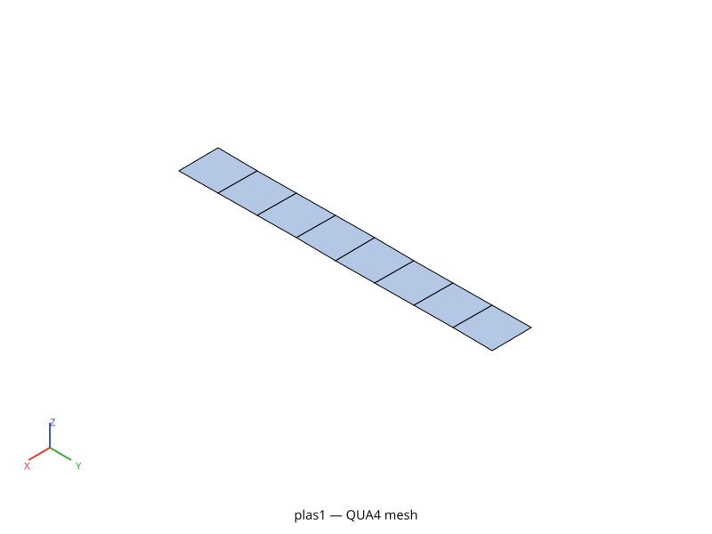

#### pyrucast listing

<details><summary><code>run.py</code></summary>

```python
"""plas1 — bending of a strip into the plastic range (NAFEMS MP1), plane stress.

Problem: a strip 100 mm high, in plane stress, of an elastic, perfectly
plastic material, is bent by rotating its end section, which stays straight:
u_x = ±1e-3·t at its corners y = ±50 mm, and linear relations keep the
section's other nodes on the line between them. Half of the strip is
modelled (12.5 mm wide, u_x = 0 on the symmetry edge x = 0). At t = 0.02875
the strip is still elastic; at t = 0.05 it is plastic over most of its
height. Reference: M1 = 805 kN·m and M2 = 1074 kN·m.

Mesh: the `.dgibi` file's, one QUA4 across and 8 along y. `mpc` takes one
coefficient per term for all its relations: the seven relations, whose
coefficients differ, are seven `mpc`. The moment is the `.dgibi` file's:
the moment of the support forces on the end section, 2·Σ y·F_x over its
upper half, in kN·m.

Running::

    python validation/03_plasticity/plas1/run.py
"""

import os

import pyrucast as pc

E, NU, SIGMA_Y = 2.1e11, 0.3, 483e6
WIDTH, HALF_HEIGHT = 12.5e-3, 50e-3
N = 8  # elements along the end section
ROTATION = 1e-3  # u_x at the corners per unit time
TIMES = [0.0, 0.02875, 0.05]


def main(out: str | None = None) -> dict[str, float]:
    coords = pc.Coords(2)
    a = coords.add_node([WIDTH, HALF_HEIGHT])
    b = coords.add_node([WIDTH, -HALF_HEIGHT])
    strip = pc.mesh.extrude(pc.mesh.line(b, a, N), [-WIDTH, 0.0], 1)
    # The end section's nodes, from A (y = +50 mm) down to B (y = −50 mm).
    section = [
        strip.nearest_node([WIDTH, HALF_HEIGHT - 2.0 * HALF_HEIGHT * i / N])
        for i in range(N + 1)
    ]
    axis = pc.mesh.points_on_line(strip, [0.0, -HALF_HEIGHT], [0.0, HALF_HEIGHT])
    origin = strip.nearest_node([0.0, 0.0])

    fes = pc.FiniteElementSpace(strip)
    plasticity = pc.model.plasticity_perfect(fes, "plane_stress")
    pull_a = pc.model.dirichlet(pc.mesh.poi1_from_nodes([a]), plasticity, "u_x")
    push_b = pc.model.dirichlet(pc.mesh.poi1_from_nodes([b]), plasticity, "u_x")
    model = (
        plasticity
        | pc.model.dirichlet(axis, plasticity, "u_x")
        | pc.model.dirichlet(pc.mesh.poi1_from_nodes([origin]), plasticity, "u_y")
        | pull_a
        | push_b
    )
    # The section stays straight: 8·u(A_r) − (8 − r)·u(A) − r·u(B) = 0.
    for r in range(1, N):
        model = model | pc.model.mpc(
            [
                (pc.mesh.poi1_from_nodes([section[r]]), "u_x", float(N)),
                (pc.mesh.poi1_from_nodes([a]), "u_x", -float(N - r)),
                (pc.mesh.poi1_from_nodes([b]), "u_x", -float(r)),
            ],
            plasticity,
        )
    materials = pc.element_field.material_field(
        model, [("E", E), ("nu", NU), ("sigma_y", SIGMA_Y)]
    )
    frames = []
    for t in (0.0, 1.0):
        imposed = (
            pc.NodeField(pull_a.multiplier_mesh(), ["imposed"]) + ROTATION * t
        ) | (pc.NodeField(push_b.multiplier_mesh(), ["imposed"]) - ROTATION * t)
        frames.append((t, imposed))
    data = {
        "model": model,
        "times": TIMES,
        "materials": materials,
        "loads": pc.Evolution(frames),
    }
    pc.stepping.step_by_step(data)

    moments = []
    for record in data["results"][1:]:
        reactions = record["reactions"]
        moment = 0.0
        for i in range(N // 2 + 1):  # the upper half, A down to the middle
            y = HALF_HEIGHT - 2.0 * HALF_HEIGHT * i / N
            moment += y * reactions.value(section[i], "f_x")
        moments.append(2.0 * moment * 1e-3)

    if out:
        strip.plot(title="plas1 — QUA4 mesh", save=os.path.join(out, "mesh.svg"))
    return {"M1": moments[0], "M2": moments[1]}


if __name__ == "__main__":
    print(main("."))
```

</details>

### plas2

#### Description sheet

| | |
|---|---|
| Test name | plas2 |
| Calculation type | MECHANIC PLASTICITY 2D AXI |
| Finite element type (Cast3M) | QUA4 (COQ4 in the 2011 document) |
| pyrucast model | `model.plasticity_perfect(fes, "axisymmetric")` in `stepping.step_by_step`, QUA4 |
| Reference | Test NAFEMS : Analytical-Solution : MP2 Modélisation des structures élastiques dans CASTEM 2000. |
| Cast3M version of the 2011 document | 97' customer version |
| Cast3M 2026 `.dgibi` file | `dgibi/plas2.dgibi` |
| Folder | [`03_plasticity/plas2/`](03_plasticity/plas2/) |

**Topic.** A thick hollow sphere is loaded by an internal pressure that grows with time,
P = 1e6·t Pa: elastic at t = 100 (P = 100 MPa), plastic through most of the
wall at t = 358.9 (P = 358.9 MPa).

**Goal.** Find the radial displacement of the inner point A at the two times. The
theoretical values are 0.4 µm and 2.83 µm.

**Model description.**

Axisymmetric, meridian plane: a quarter of the sphere of inner radius 1 mm
and outer radius 2 mm, centred at the origin. QUA4 mesh: 14 elements through
the thickness (5 from 1 to 1.1 mm, 9 from 1.1 to 2 mm), 16 along each arc.

| Data | Value |
|---|---|
| E | 2e11 Pa |
| ν | 0.3 |
| σ_y (perfect plasticity) | 300e6 Pa |

- Boundary conditions: u_z = 0 on the radial edge z = 0, u_r = 0 on the axis.
- Load: internal pressure P = 1e6·t Pa; computed times 100 and 358.9.

**Notes.** The 2011 document prints the Cast3M value at the second time as 1085.2 µm (the
value of plas1); it is kept as printed. Its time labels t0 and t1000 are the
times 100 and 358.9 of the `.dgibi` file.

#### Results

| Quantity | Reference | Cast3M 2011 | Cast3M 2026 | pyrucast | pyrucast / reference |
|---|---|---|---|---|---|
| u_r at A, t = 100 (µm) | 0.4 | 0.39821 (-0.448 %) | 0.398212 (-0.447 %) | 0.398212 | -0.447 % |
| u_r at A, t = 358.9 (µm) | 2.83 | 1085.2 (+3.82e+04 %) | 2.74066 (-3.16 %) | 2.74066 | -3.16 % |

Acceptance: criterion of the `.dgibi` file, largest relative gap of the two values < 3.5 %.

pyrucast: the 2 checked quantities are within tolerance.

#### pyrucast figures

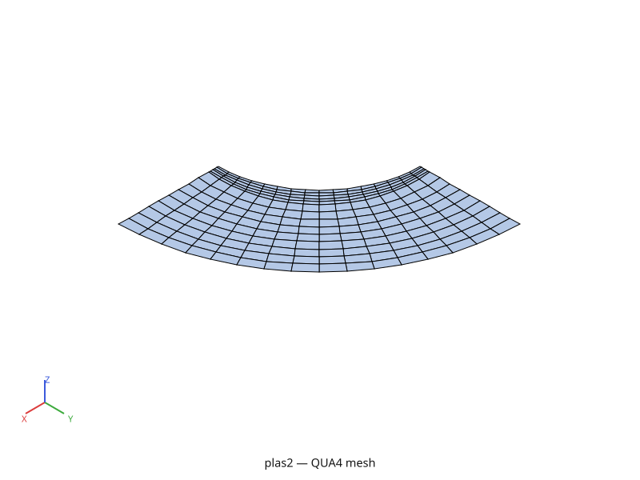

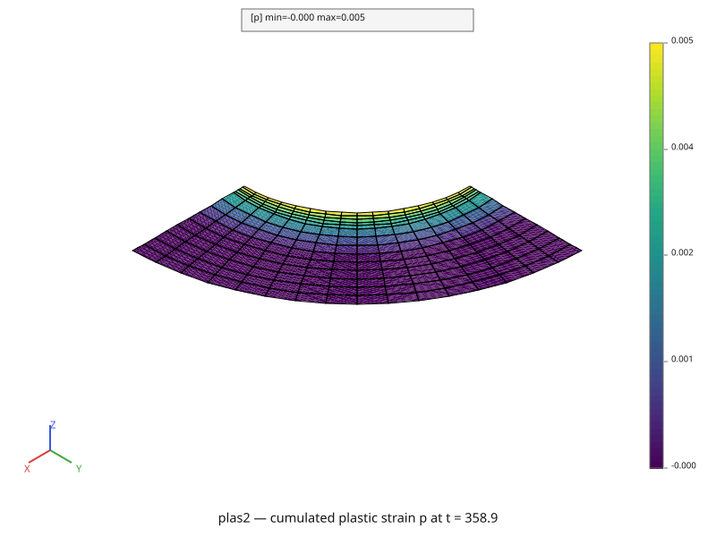

#### pyrucast listing

<details><summary><code>run.py</code></summary>

```python
"""plas2 — thick hollow sphere under internal pressure (NAFEMS MP2), axisymmetric.

Problem: a hollow sphere of inner radius 1 mm and outer radius 2 mm, of an
elastic, perfectly plastic material, is loaded by an internal pressure
P = 1e6·t Pa. At t = 100 (P = 100 MPa) it is elastic; at t = 358.9 it is
plastic through most of its wall. Reference: the radial displacement of the
inner point A, 0.4 µm and 2.83 µm.

Mesh: the `.dgibi` file's quarter of the meridian section, 14 × 16 QUA4: 14 elements
through the wall (5 from 1 to 1.1 mm, 9 from 1.1 to 2 mm), 16 along each arc
(every 5.625°), filled by `transfinite` as the `.dgibi` file's mesher does.

Running::

    python validation/03_plasticity/plas2/run.py
"""

import os

import pyrucast as pc

E, NU, SIGMA_Y = 2e11, 0.3, 300e6
R_IN, R_MID, R_OUT = 1e-3, 1.1e-3, 2e-3
N_THIN, N_THICK, N_ARC = 5, 9, 16
PRESSURE_RATE = 1e6  # Pa per unit time
TIMES = [0.0, 100.0, 358.9]


def main(out: str | None = None) -> dict[str, float]:
    coords = pc.Coords.axisymmetric()
    origin = coords.add_node([0.0, 0.0])
    a = coords.add_node([R_IN, 0.0])
    x = coords.add_node([R_MID, 0.0])
    b = coords.add_node([R_OUT, 0.0])
    c = coords.add_node([0.0, R_OUT])
    y = coords.add_node([0.0, R_MID])
    d = coords.add_node([0.0, R_IN])
    # The four sides of the section, counter-clockwise, as in the `.dgibi` file.
    bottom = pc.mesh.consolidate(
        pc.mesh.line(a, x, N_THIN) | pc.mesh.line(x, b, N_THICK)
    )
    outer = pc.mesh.arc(b, origin, c, N_ARC)
    axis = pc.mesh.consolidate(pc.mesh.line(c, y, N_THICK) | pc.mesh.line(y, d, N_THIN))
    inner = pc.mesh.arc(d, origin, a, N_ARC)
    sphere = pc.mesh.transfinite(bottom, outer, axis, inner)

    fes = pc.FiniteElementSpace(sphere)
    plasticity = pc.model.plasticity_perfect(fes, "axisymmetric")
    model = (
        plasticity
        | pc.model.dirichlet(pc.mesh.consolidate(bottom.to_poi1()), plasticity, "u_y")
        | pc.model.dirichlet(pc.mesh.consolidate(axis.to_poi1()), plasticity, "u_x")
    )
    materials = pc.element_field.material_field(
        model, [("E", E), ("nu", NU), ("sigma_y", SIGMA_Y)]
    )
    # The internal pressure at t = 1, pushing on the wall: φ_n = −p.
    pressure = pc.model.flux(pc.FiniteElementSpace(inner), plasticity, "n")
    unit_force = pc.node_field.external_forces(
        pressure, pc.element_field.material_field(pressure, [("phi_n", -PRESSURE_RATE)])
    )
    data = {
        "model": model,
        "times": TIMES,
        "materials": materials,
        "loads": pc.Evolution(
            [(0.0, unit_force * 0.0), (TIMES[-1], unit_force * TIMES[-1])]
        ),
    }
    pc.stepping.step_by_step(data)

    values = {}
    for k, record in enumerate(data["results"][1:], start=1):
        values[f"ur_A_{k}"] = record["displacement"].value(a, "u_x") * 1e6

    if out:
        sphere.plot(title="plas2 — QUA4 mesh", save=os.path.join(out, "mesh.svg"))
        sphere.plot(
            title="plas2 — cumulated plastic strain p at t = 358.9",
            field=data["results"][-1]["behaviour"],
            component="p",
            cmap="viridis",
            save=os.path.join(out, "p.svg"),
        )
    return values


if __name__ == "__main__":
    print(main("."))
```

</details>

### plas4

#### Description sheet

| | |
|---|---|
| Test name | plas4 |
| Calculation type | MECHANICS PLASTICITY 3D |
| Finite element type (Cast3M) | CUB8 |
| pyrucast model | `model.plasticity_perfect(fes, "full_3d")` in `stepping.step_by_step`, HEX8 |
| Reference | Test NAFEMS : Analytical-Solution : MP4 Modélisation des structures élastiques dans CASTEM 2000. |
| Cast3M version of the 2011 document | 97' customer version |
| Cast3M 2026 `.dgibi` file | `dgibi/plas4.dgibi` |
| Folder | [`03_plasticity/plas4/`](03_plasticity/plas4/) |

**Topic.** A block of two cubic elements is loaded in uniaxial strain: u_y = u_z = 0
everywhere and an axial displacement imposed on its end faces, first
increased, then reversed. The material is elastic, perfectly plastic.

**Goal.** Find σ_xx, σ_yy and σ_zz at the first Gauss point of the first element at the
four times T1 to T4, and compare them with the theoretical values.

**Model description.**

Two HEX8 of size 0.5 × 1 × 1 along x, from x = 0 to x = 1.

| Data | Value |
|---|---|
| E | 2.5e11 Pa |
| ν | 0.25 |
| σ_y (perfect plasticity) | 5e6 Pa |

- Boundary conditions: u_x = 0 on x = 0; u_y = u_z = 0 at every node.
- Imposed u_x: ε₀·f(t)·x on the faces x = 0.5 and x = 1, with
  ε₀ = 2.5e-5 and f = 0, 1, 2, 1, 0 at t = 0, 1, 2, 3, 4.
- Computed times: 1, 2, 3, 4.

**Notes.** The 2011 document prints the Cast3M σ_yy and σ_zz at T4 as 1.6E6; the
references are those of the `.dgibi` file (1.66e6).

#### Results

| Quantity | Reference | Cast3M 2011 | Cast3M 2026 | pyrucast | pyrucast / reference |
|---|---|---|---|---|---|
| σ_xx at T1 (Pa) | 7.5e+06 | 7.5e+06 (+0 %) | 7.5e+06 (+6.21e-14 %) | 7.5e+06 | +0 % |
| σ_yy at T1 (Pa) | 2.5e+06 | 2.5e+06 (+0 %) | 2.5e+06 (+7.45e-14 %) | 2.5e+06 | +0 % |
| σ_zz at T1 (Pa) | 2.5e+06 | 2.5e+06 (+0 %) | 2.5e+06 (+7.45e-14 %) | 2.5e+06 | +0 % |
| σ_xx at T2 (Pa) | 1.166e+07 | 1.166e+07 (+0 %) | 1.16667e+07 (+0.0572 %) | 1.16667e+07 | +0.0572 % |
| σ_yy at T2 (Pa) | 6.66e+06 | 6.66e+06 (+0 %) | 6.66667e+06 (+0.1 %) | 6.66667e+06 | +0.1 % |
| σ_zz at T2 (Pa) | 6.66e+06 | 6.66e+06 (+0 %) | 6.66667e+06 (+0.1 %) | 6.66667e+06 | +0.1 % |
| σ_xx at T3 (Pa) | 4.16e+06 | 4.16e+06 (+0 %) | 4.16667e+06 (+0.16 %) | 4.16667e+06 | +0.16 % |
| σ_yy at T3 (Pa) | 4.16e+06 | 4.16e+06 (+0 %) | 4.16667e+06 (+0.16 %) | 4.16667e+06 | +0.16 % |
| σ_zz at T3 (Pa) | 4.16e+06 | 4.16e+06 (+0 %) | 4.16667e+06 (+0.16 %) | 4.16667e+06 | +0.16 % |
| σ_xx at T4 (Pa) | -3.33e+06 | -3.33e+06 (+0 %) | -3.33333e+06 (-0.1 %) | -3.33333e+06 | -0.1 % |
| σ_yy at T4 (Pa) | 1.66e+06 | 1.6e+06 (-3.61 %) | 1.66667e+06 (+0.402 %) | 1.66667e+06 | +0.402 % |
| σ_zz at T4 (Pa) | 1.66e+06 | 1.6e+06 (-3.61 %) | 1.66667e+06 (+0.402 %) | 1.66667e+06 | +0.402 % |

Acceptance: criterion of the `.dgibi` file, largest relative gap of the twelve stresses ≤ 0.5 %.

pyrucast: the 12 checked quantities are within tolerance.

#### pyrucast figures

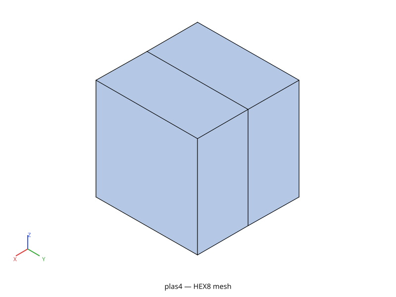

#### pyrucast listing

<details><summary><code>run.py</code></summary>

```python
"""plas4 — uniaxial strain cycle on an elastic, perfectly plastic block, HEX8.

Problem: a block of two HEX8 (x from 0 to 1, section 1 × 1), held so that
u_y = u_z = 0 everywhere and u_x = 0 on x = 0, receives u_x = ε₀·f(t)·x on
its faces x = 0.5 and x = 1, with ε₀ = 2.5e-5 and f = 0, 1, 2, 1, 0 at
t = 0, 1, 2, 3, 4: the strain goes up into the plastic range and back.
Reference: σ_xx, σ_yy and σ_zz at t = 1, 2, 3, 4, the closed-form response of
J2 perfect plasticity in uniaxial strain.

The stress is homogeneous: it is read at the first Gauss point of the first
cell, as in the `.dgibi` file.

Running::

    python validation/03_plasticity/plas4/run.py
"""

import os

import pyrucast as pc

E, NU, SIGMA_Y = 2.5e11, 0.25, 5e6
EPS0 = 2.5e-5
HISTORY = [(0.0, 0.0), (1.0, 1.0), (2.0, 2.0), (3.0, 1.0), (4.0, 0.0)]  # (t, f)


def main(out: str | None = None) -> dict[str, float]:
    coords = pc.Coords(3)
    square = pc.Mesh(coords, "QUA4")
    square.unit().add_cell(
        [
            coords.add_node([0.0, 0.0, 0.0]),
            coords.add_node([0.0, 1.0, 0.0]),
            coords.add_node([0.0, 1.0, 1.0]),
            coords.add_node([0.0, 0.0, 1.0]),
        ]
    )
    block = pc.mesh.extrude(square, [1.0, 0.0, 0.0], 2)
    face_0 = pc.mesh.points_on_plane(block, [0.0, 0.0, 0.0], [1.0, 0.0, 0.0])
    face_half = pc.mesh.points_on_plane(block, [0.5, 0.0, 0.0], [1.0, 0.0, 0.0])
    face_1 = pc.mesh.points_on_plane(block, [1.0, 0.0, 0.0], [1.0, 0.0, 0.0])
    every_node = pc.mesh.consolidate(pc.mesh.to_poi1(block))

    fes = pc.FiniteElementSpace(block)
    plasticity = pc.model.plasticity_perfect(fes, "full_3d")
    pull_half = pc.model.dirichlet(face_half, plasticity, "u_x")
    pull_end = pc.model.dirichlet(face_1, plasticity, "u_x")
    model = (
        plasticity
        | pc.model.dirichlet(face_0, plasticity, "u_x")
        | pull_half
        | pull_end
        | pc.model.dirichlet(every_node, plasticity, "u_y")
        | pc.model.dirichlet(every_node, plasticity, "u_z")
    )
    materials = pc.element_field.material_field(
        model, [("E", E), ("nu", NU), ("sigma_y", SIGMA_Y)]
    )
    frames = []
    for t, f in HISTORY:
        imposed = (
            pc.NodeField(pull_half.multiplier_mesh(), ["imposed"]) + EPS0 * f * 0.5
        ) | (pc.NodeField(pull_end.multiplier_mesh(), ["imposed"]) + EPS0 * f)
        frames.append((t, imposed))
    data = {
        "model": model,
        "times": [t for t, _ in HISTORY],
        "materials": materials,
        "loads": pc.Evolution(frames),
    }
    pc.stepping.step_by_step(data)

    values = {}
    for record in data["results"]:
        k = round(record["time"])
        if k == 0:
            continue
        behaviour = record["behaviour"][0]
        for axis in ("xx", "yy", "zz"):
            values[f"s{axis}_{k}"] = behaviour.value(0, 0, f"sigma_{axis}")

    if out:
        block.plot(title="plas4 — HEX8 mesh", save=os.path.join(out, "mesh.svg"))
    return values


if __name__ == "__main__":
    print(main("."))
```

</details>

### plas5

#### Description sheet

| | |
|---|---|
| Test name | plas5 |
| Calculation type | MECHANICS PLASTICITY 2D PLANE STRESSE |
| Finite element type (Cast3M) | QUA4 |
| pyrucast model | `model.drucker_prager(fes, "plane_stress")` in `stepping.step_by_step`, QUA4 |
| Reference | Test NAFEMS : Analytical-Solution : MP4 Modélisation des structures élastiques dans CASTEM 2000. |
| Cast3M version of the 2011 document | 97' customer version |
| Cast3M 2026 `.dgibi` file | `dgibi/plas5.dgibi` |
| Folder | [`03_plasticity/plas5/`](03_plasticity/plas5/) |

**Topic.** A single plane-stress element is stretched equally in x and y by imposed
displacements until its stress state reaches the apex of the limit cone of a
Drucker-Prager material with two cones.

**Goal.** Find σ_xx and σ_yy at the first Gauss point at time 2 and compare them with
the apex value KL / (2η + μ).

**Model description.**

One QUA4, square of side 1.5.

| Data | Value |
|---|---|
| E | 40 000 |
| ν | 0.21 |
| first cone α, β, K | 0.441, 1.02, 4.1 |
| ultimate cone γ, δ, K_L | 0.441, 1.02, 3.56 |
| flow η, μ | 0.441, 1.02 |
| H | 0 |

- Boundary conditions: u_y = 0 on y = 0, u_x = 0 on x = 0.
- Imposed displacements: u_x = 1.5e-4·t on x = 1.5 and u_y = 1.5e-4·t on
  y = 1.5; computed times 1 and 2.
- Reference: σ_xx = σ_yy = K_L / (2η + μ) = 3.56 / 1.902.

**Notes.** The 2011 document gives E = 2.5e11 Pa, ν = 0.25 and σ_y = 5e6 Pa, the data of
plas4; the `.dgibi` file's data are those above.

The `.dgibi` file's ultimate cohesion K_L = 3.56 is below the initial one K = 4.1, with
H = 0. pyrucast reads the two surfaces as the ends of one interpolation
driven by H·p (see `src/models/plasticity/drucker_prager.rs`): with H = 0 it
stays on the initial surface, and its stress stops at that surface's apex,
K / (2α + β). Cast3M's stops at the ultimate surface's apex, the reference.

**Improvement points.**

- Drucker-Prager with two surfaces: pyrucast's interpolation driven by H·p departs from Cast3M when K_L < K, or when K_L = K with H ≠ 0

#### Results

| Quantity | Reference | Cast3M 2011 | Cast3M 2026 | pyrucast | pyrucast / reference |
|---|---|---|---|---|---|
| σ_xx at t = 2 | 1.87171 | 1.8717 (-0.000747 %) | 1.87171 (+0 %) | 2.15563 | +15.2 % |
| σ_yy at t = 2 | 1.87171 | 1.8717 (-0.000747 %) | 1.87171 (+0 %) | 2.15563 | +15.2 % |

Acceptance: criterion of the `.dgibi` file, each relative gap ≤ 1e-10 %.

pyrucast OUTSIDE tolerance: sxx: 2.155625657202943 vs 1.871713985278654, beyond 1e-12

pyrucast OUTSIDE tolerance: syy: 2.155625657202943 vs 1.871713985278654, beyond 1e-12

#### pyrucast figures

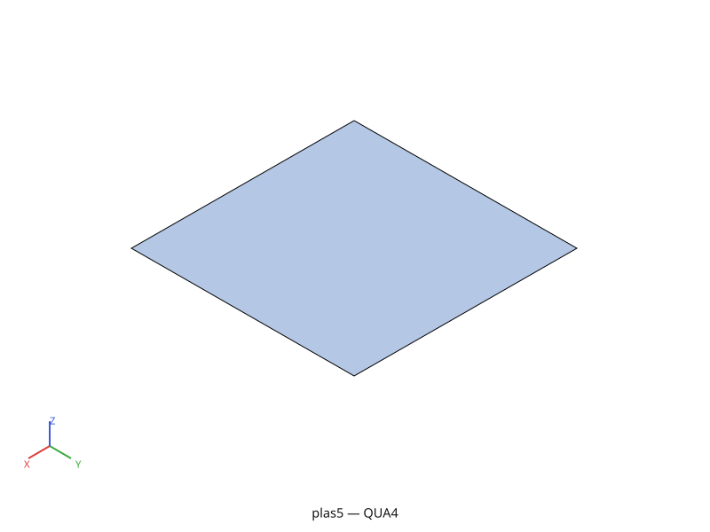

#### pyrucast listing

<details><summary><code>run.py</code></summary>

```python
"""plas5 — equibiaxial pull of a Drucker-Prager element, plane stress, QUA4.

Problem: one square QUA4 of side 1.5, held by u_x = 0 on x = 0 and u_y = 0
on y = 0, is pulled by u_x = u_y = 1.5e-4·t on its two other sides, up to
t = 2. The material is the `.dgibi` file's two-surface Drucker-Prager: an initial
surface α·I₁ + β·q = K and an ultimate one η·I₁ + μ·q = K_L, with H = 0.
Reference: the equibiaxial stress at the apex of the ultimate surface,
σ_xx = σ_yy = K_L / (2η + μ).

The Cast3M parameters map to pyrucast's as ALFA → friction, BETA → beta,
K → k, GAMM → psi, DELT → delta, ETA → friction_ult, MU → beta_ult,
KL → k_ult, H → H.

Running::

    python validation/03_plasticity/plas5/run.py
"""

import os

import pyrucast as pc

E, NU = 40000.0, 0.21
SIDE = 1.5
RATE = 1.5e-4  # imposed displacement per unit time
DRUCKER_PRAGER = [
    ("friction", 0.441),  # ALFA
    ("beta", 1.02),  # BETA
    ("k", 4.1),  # K
    ("psi", 0.441),  # GAMM
    ("delta", 1.02),  # DELT
    ("friction_ult", 0.441),  # ETA
    ("beta_ult", 1.02),  # MU
    ("k_ult", 3.56),  # KL
    ("H", 0.0),
]


def main(out: str | None = None) -> dict[str, float]:
    coords = pc.Coords(2)
    a = coords.add_node([0.0, 0.0])
    b = coords.add_node([SIDE, 0.0])
    c = coords.add_node([SIDE, SIDE])
    d = coords.add_node([0.0, SIDE])
    square = pc.Mesh(coords, "QUA4")
    square.unit().add_cell([a, b, c, d])

    fes = pc.FiniteElementSpace(square)
    law = pc.model.drucker_prager(fes, "plane_stress")
    pull_x = pc.model.dirichlet(pc.mesh.poi1_from_nodes([b, c]), law, "u_x")
    pull_y = pc.model.dirichlet(pc.mesh.poi1_from_nodes([c, d]), law, "u_y")
    model = (
        law
        | pc.model.dirichlet(pc.mesh.poi1_from_nodes([a, d]), law, "u_x")
        | pc.model.dirichlet(pc.mesh.poi1_from_nodes([a, b]), law, "u_y")
        | pull_x
        | pull_y
    )
    materials = pc.element_field.material_field(
        model, [("E", E), ("nu", NU)] + DRUCKER_PRAGER
    )
    frames = []
    for t in (0.0, 2.0):
        imposed = (pc.NodeField(pull_x.multiplier_mesh(), ["imposed"]) + RATE * t) | (
            pc.NodeField(pull_y.multiplier_mesh(), ["imposed"]) + RATE * t
        )
        frames.append((t, imposed))
    data = {
        "model": model,
        "times": [0.0, 1.0, 2.0],
        "materials": materials,
        "loads": pc.Evolution(frames),
    }
    pc.stepping.step_by_step(data)
    behaviour = data["results"][-1]["behaviour"][0]

    if out:
        square.plot(title="plas5 — QUA4", save=os.path.join(out, "mesh.svg"))
    return {
        "sxx": behaviour.value(0, 0, "sigma_xx"),
        "syy": behaviour.value(0, 0, "sigma_yy"),
    }


if __name__ == "__main__":
    print(main("."))
```

</details>

### plas6

#### Description sheet

| | |
|---|---|
| Test name | plas6 |
| Calculation type | MECHANICS ELASTIC PLASTIC - PLANE STRESS |
| Finite element type (Cast3M) | QUA4 |
| pyrucast model | `model.plasticity_perfect(fes, "plane_stress")` in `stepping.step_by_step`, QUA4 |
| Reference | R. Hill, Mathematical theory of plasticity, Oxford, Oxford Clavendon Press, 1950. Test V.P.C.S. numero SSNP11/89 |
| Cast3M version of the 2011 document | 97' customer version |
| Cast3M 2026 `.dgibi` file | `dgibi/plas6.dgibi` |
| Folder | [`03_plasticity/plas6/`](03_plasticity/plas6/) |

**Topic.** A rectangle in plane stress is bent by a linear distribution of imposed
displacements on one side, the opposite side being a symmetry plane. The
material is elastic, perfectly plastic; the load grows until the section is
fully plastic.

**Goal.** Find the bending moment carried by the loaded side at nine load levels and
compare it with the theoretical moment.

**Model description.**

Rectangle of width 12.5 mm (x) and height 100 mm (y, from −50 to 50 mm),
32 QUA4 along y and 4 along x.

| Data | Value |
|---|---|
| E | 2.1e11 Pa |
| ν | 0.3 |
| σ_y (perfect plasticity) | 483e6 Pa |

- Boundary conditions: u_x = 0 on x = 0, u_y = 0 at the origin.
- Imposed displacement on x = 12.5 mm: u_x = −1e-3·t·y/(50 mm), linear in y.
- Computed times: 0.02875, 0.05, 0.1, 0.15, 0.2, 0.3, 0.4, 0.5, 1.
- Moment: M = −1e-3 · ∫ y σ_xx dy along the loaded side, with σ_xx
  extrapolated to the 33 nodes of that side and integrated by the trapezoid
  rule, in kN·m.

**Notes.** The 2011 document gives E = 2e11 Pa and states no goal; the `.dgibi` file uses
E = 2.1e11 Pa. The document prints no result table; the references are the
`.dgibi` file's.

The pyrucast moment is that of the support forces on the loaded side,
Σ y·F_x, exact by equilibrium; Cast3M's integrates y·σ_xx along the side with
σ_xx extrapolated to the nodes and averaged between cells. The two estimates
differ by the error of that integration, which grows with the plastic zone.

#### Results

| Quantity | Reference | Cast3M 2011 | Cast3M 2026 | pyrucast | pyrucast / reference |
|---|---|---|---|---|---|
| bending moment at t = 0.02875 (kN·m) | 805 | — | 806.806 (+0.224 %) | 805.38 | +0.0472 % |
| bending moment at t = 0.05 (kN·m) | 1074 | — | 1076.57 (+0.239 %) | 1075.07 | +0.0998 % |
| bending moment at t = 0.1 (kN·m) | 1174 | — | 1176.96 (+0.252 %) | 1175.17 | +0.0996 % |
| bending moment at t = 0.15 (kN·m) | 1193 | — | 1195.34 (+0.196 %) | 1193.85 | +0.0709 % |
| bending moment at t = 0.2 (kN·m) | 1199 | — | 1201.92 (+0.243 %) | 1200.21 | +0.101 % |
| bending moment at t = 0.3 (kN·m) | 1204 | — | 1206.65 (+0.22 %) | 1204.71 | +0.0586 % |
| bending moment at t = 0.4 (kN·m) | 1205 | — | 1208.42 (+0.283 %) | 1206.57 | +0.13 % |
| bending moment at t = 0.5 (kN·m) | 1206 | — | 1209.53 (+0.293 %) | 1207.35 | +0.112 % |
| bending moment at t = 1.0 (kN·m) | 1207.5 | — | 1210.37 (+0.238 %) | 1208.36 | +0.0711 % |

Acceptance: criterion of the `.dgibi` file, largest relative gap of the nine moments ≤ 0.5 %.

pyrucast: the 9 checked quantities are within tolerance.

#### pyrucast figures

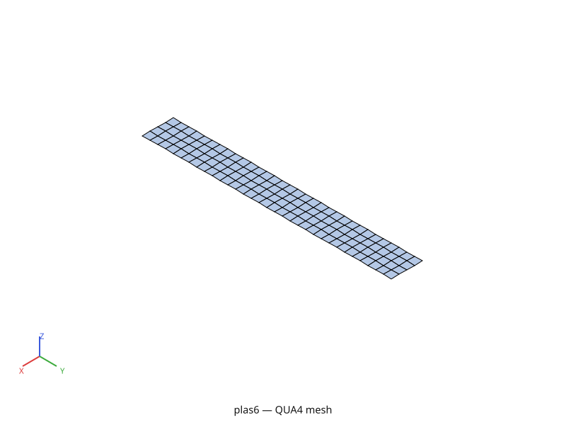

#### pyrucast listing

<details><summary><code>run.py</code></summary>

```python
"""plas6 — pure bending of a rectangle up to full plasticity, plane stress.

Problem: a rectangle 12.5 mm wide (x) and 100 mm high (y, from −50 to
50 mm), of an elastic, perfectly plastic material, in plane stress, is bent
by u_x = 1e-3·t·y/(50 mm) imposed on its side x = 12.5 mm; its side x = 0 is
a symmetry plane (u_x = 0) and the origin is held along y. Reference: the
bending moment of R. Hill's solution at nine load levels, up to the fully
plastic moment.

Mesh: the `.dgibi` file's regular grid of 32 × 4 QUA4.

The moment is taken from the support forces on the loaded side, Σ y·F_x, in
kN·m: exact by equilibrium. The `.dgibi` file integrates y·σ_xx along that side, with
σ_xx extrapolated to the nodes and averaged between cells; the two estimates
differ by the error of that integration.

Running::

    python validation/03_plasticity/plas6/run.py
"""

import os

import pyrucast as pc

E, NU, SIGMA_Y = 2.1e11, 0.3, 483e6
WIDTH, HALF_HEIGHT = 12.5e-3, 50e-3
N_HEIGHT, N_WIDTH = 32, 4
ROTATION = 1e-3  # u_x at y = 50 mm per unit time
TIMES = [0.0, 0.02875, 0.05, 0.1, 0.15, 0.2, 0.3, 0.4, 0.5, 1.0]
KINEMATICS = "plane_stress"


def main(out: str | None = None) -> dict[str, float]:
    coords = pc.Coords(2)
    pa = coords.add_node([WIDTH, HALF_HEIGHT])
    pb = coords.add_node([WIDTH, -HALF_HEIGHT])
    pc_ = coords.add_node([0.0, -HALF_HEIGHT])
    pd = coords.add_node([0.0, HALF_HEIGHT])
    loaded_side = pc.mesh.line(pa, pb, N_HEIGHT)
    symmetry_side = pc.mesh.line(pc_, pd, N_HEIGHT)
    rectangle = pc.mesh.transfinite(
        loaded_side,
        pc.mesh.line(pb, pc_, N_WIDTH),
        symmetry_side,
        pc.mesh.line(pd, pa, N_WIDTH),
    )
    loaded_nodes = pc.mesh.consolidate(loaded_side.to_poi1())
    origin = rectangle.nearest_node([0.0, 0.0])

    fes = pc.FiniteElementSpace(rectangle)
    plasticity = pc.model.plasticity_perfect(fes, KINEMATICS)
    bend = pc.model.dirichlet(loaded_nodes, plasticity, "u_x")
    model = (
        plasticity
        | pc.model.dirichlet(
            pc.mesh.consolidate(symmetry_side.to_poi1()), plasticity, "u_x"
        )
        | pc.model.dirichlet(pc.mesh.poi1_from_nodes([origin]), plasticity, "u_y")
        | bend
    )
    materials = pc.element_field.material_field(
        model, [("E", E), ("nu", NU), ("sigma_y", SIGMA_Y)]
    )
    # u_x = ROTATION·t·y/HALF_HEIGHT on the loaded side, here for t = 1.
    unit = pc.node_field.positions(bend.multiplier_mesh(), ["Y"]).rename_component(
        "Y", "imposed"
    ) * (ROTATION / HALF_HEIGHT)
    side = [loaded_nodes.node(0, i, 0) for i in range(loaded_nodes.cell_count)]
    data = {
        "model": model,
        "times": TIMES,
        "materials": materials,
        "loads": pc.Evolution([(0.0, unit * 0.0), (1.0, unit)]),
    }
    pc.stepping.step_by_step(data)

    values = {}
    for k, record in enumerate(data["results"][1:], start=1):
        reactions = record["reactions"]
        moment = 0.0
        for node in side:
            moment += node.position()[1] * reactions.value(node, "f_x")
        values[f"M_{k}"] = moment * 1e-3

    if out:
        rectangle.plot(title="plas6 — QUA4 mesh", save=os.path.join(out, "mesh.svg"))
    return values


if __name__ == "__main__":
    print(main("."))
```

</details>

### plas7

#### Description sheet

| | |
|---|---|
| Test name | plas7 |
| Calculation type | MECHANICS ELASTIC PLASTIC - PLANE STRAIN |
| Finite element type (Cast3M) | QUA4 |
| pyrucast model | `model.plasticity_perfect(fes, "plane_strain")` in `stepping.step_by_step`, QUA4 |
| Reference | R. Hill, Mathematical theory of plasticity, Oxford, Oxford Clavendon Press, 1950. Test V.P.C.S. numero SSNP11/89 |
| Cast3M version of the 2011 document | 97' customer version |
| Cast3M 2026 `.dgibi` file | `dgibi/plas7.dgibi` |
| Folder | [`03_plasticity/plas7/`](03_plasticity/plas7/) |

**Topic.** The bending test of plas6 in plane strain: a rectangle is bent by a linear
distribution of imposed displacements on one side, the opposite side being a
symmetry plane, up to a fully plastic section.

**Goal.** Find the bending moment carried by the loaded side at seven load levels, and
two stresses on that side at the last one.

**Model description.**

Rectangle of width 12.5 mm (x) and height 100 mm (y, from −50 to 50 mm),
32 QUA4 along y and 4 along x.

| Data | Value |
|---|---|
| E | 2.1e11 Pa |
| ν | 0.3 |
| σ_y (perfect plasticity) | 483e6 Pa |

- Boundary conditions: u_x = 0 on x = 0, u_y = 0 at the origin.
- Imposed displacement on x = 12.5 mm: u_x = −1e-3·t·y/(50 mm), linear in y.
- Computed times: 0.029435, 0.1, 0.2, 0.3, 0.4, 0.5, 1.
- Moment: 1e-4 · ∫ y σ_xx dy along the loaded side, with σ_xx extrapolated
  to its nodes and integrated by the trapezoid rule, in 1e4 N·m.

**Notes.** The 2011 document names the element QUA44 and gives E = 2e11 Pa; the `.dgibi` file
uses QUA4 and E = 2.1e11 Pa. The document prints no result table; the
references are the `.dgibi` file's.

The pyrucast moment is that of the support forces on the loaded side,
Σ y·F_x, exact by equilibrium; Cast3M's integrates y·σ_xx along the side with
σ_xx extrapolated to the nodes and averaged between cells. The two estimates
differ by the error of that integration, which grows with the plastic zone.

In the fully plastic state the Gauss stresses of both codes oscillate from
point to point, well above 2σ_y/√3 (the full-integration QUA4 locks in an
incompressible plastic flow). Both codes average between neighbouring cells
what they give a node, which smooths the oscillation out: at the second node
of the side they agree within 4e-5. The corner A belongs to a single cell, and
nothing smooths it there: the `.dgibi` file applies `CHAN 'CHPO'` to the
Gauss stresses directly and gives 547.2 MPa, where pyrucast's fit gives
996.7 MPa and the cell's mean 557.7 MPa.

**Improvement points.**

- B-bar (selective integration) against the volumetric locking of QUA4/QUA8 in incompressible plastic flow
- σ_xx at the corner A, a node of a single cell: the `.dgibi` file's `CHAN 'CHPO'` on the Gauss stresses gives 547.2 MPa, which neither pyrucast's fit (`to_nodes`, 996.7) nor the cell mean (557.7) reproduces, to look into

#### Results

| Quantity | Reference | Cast3M 2011 | Cast3M 2026 | pyrucast | pyrucast / reference |
|---|---|---|---|---|---|
| bending moment at t = 0.029435 (1e4 N·m) | 90.57 | — | 90.8058 (+0.26 %) | 90.6201 | +0.0553 % |
| bending moment at t = 0.1 (1e4 N·m) | 135.2 | — | 135.236 (+0.0269 %) | 134.726 | -0.351 % |
| bending moment at t = 0.2 (1e4 N·m) | 138.4 | — | 139.666 (+0.915 %) | 138.716 | +0.228 % |
| bending moment at t = 0.3 (1e4 N·m) | 139 | — | 141.016 (+1.45 %) | 139.619 | +0.445 % |
| bending moment at t = 0.4 (1e4 N·m) | 139.2 | — | 141.921 (+1.95 %) | 140.09 | +0.639 % |
| bending moment at t = 0.5 (1e4 N·m) | 139.3 | — | 142.712 (+2.45 %) | 140.424 | +0.807 % |
| bending moment at t = 1.0 (1e4 N·m) | 139.4 | — | 146.289 (+4.94 %) | 141.784 | +1.71 % |
| σ_xx at A (12.5, 50) mm, t = 1 (MPa) | 543.4 | — | 547.236 (+0.706 %) | 996.705 | +83.4 % |
| σ_xx at the second node of the loaded edge (y = 46.875 mm), t = 1 (MPa) | 557.7 | — | 557.745 (+0.00805 %) | 557.757 | +0.0102 % |

Acceptance: criterion of the `.dgibi` file, largest relative gap of the nine values ≤ 5 %.

pyrucast OUTSIDE tolerance: sxx_A: 996.7051027453914 vs 543.4, beyond 0.05

#### pyrucast figures


#### pyrucast listing

<details><summary><code>run.py</code></summary>

```python
"""plas7 — pure bending of a rectangle up to full plasticity, plane strain.

Problem: a rectangle 12.5 mm wide (x) and 100 mm high (y, from −50 to
50 mm), of an elastic, perfectly plastic material, in plane strain, is bent
by u_x = 1e-3·t·y/(50 mm) imposed on its side x = 12.5 mm; its side x = 0 is
a symmetry plane (u_x = 0) and the origin is held along y. Reference: the
bending moment of R. Hill's solution at seven load levels, up to the fully
plastic moment, and σ_xx at two nodes of the loaded side at the last one.

Mesh: the `.dgibi` file's regular grid of 32 × 4 QUA4.

The moment is taken from the support forces on the loaded side, Σ y·F_x, in
the `.dgibi` file's unit of 1e4 N·m: exact by equilibrium. The `.dgibi` file integrates y·σ_xx along that side, with
σ_xx extrapolated to the nodes and averaged between cells; the two estimates
differ by the error of that integration. The stresses at the nodes are
`to_nodes`'s: the mean of what the cells around each node give, as the
`.dgibi` file reads them.

Running::

    python validation/03_plasticity/plas7/run.py
"""

import os

import pyrucast as pc

E, NU, SIGMA_Y = 2.1e11, 0.3, 483e6
WIDTH, HALF_HEIGHT = 12.5e-3, 50e-3
N_HEIGHT, N_WIDTH = 32, 4
ROTATION = 1e-3  # u_x at y = 50 mm per unit time
TIMES = [0.0, 0.029435, 0.1, 0.2, 0.3, 0.4, 0.5, 1.0]
KINEMATICS = "plane_strain"
MOMENT_UNIT = 1e4  # N·m, the `.dgibi` file's


def main(out: str | None = None) -> dict[str, float]:
    coords = pc.Coords(2)
    pa = coords.add_node([WIDTH, HALF_HEIGHT])
    pb = coords.add_node([WIDTH, -HALF_HEIGHT])
    pc_ = coords.add_node([0.0, -HALF_HEIGHT])
    pd = coords.add_node([0.0, HALF_HEIGHT])
    loaded_side = pc.mesh.line(pa, pb, N_HEIGHT)
    symmetry_side = pc.mesh.line(pc_, pd, N_HEIGHT)
    rectangle = pc.mesh.transfinite(
        loaded_side,
        pc.mesh.line(pb, pc_, N_WIDTH),
        symmetry_side,
        pc.mesh.line(pd, pa, N_WIDTH),
    )
    loaded_nodes = pc.mesh.consolidate(loaded_side.to_poi1())
    origin = rectangle.nearest_node([0.0, 0.0])

    fes = pc.FiniteElementSpace(rectangle)
    plasticity = pc.model.plasticity_perfect(fes, KINEMATICS)
    bend = pc.model.dirichlet(loaded_nodes, plasticity, "u_x")
    model = (
        plasticity
        | pc.model.dirichlet(
            pc.mesh.consolidate(symmetry_side.to_poi1()), plasticity, "u_x"
        )
        | pc.model.dirichlet(pc.mesh.poi1_from_nodes([origin]), plasticity, "u_y")
        | bend
    )
    materials = pc.element_field.material_field(
        model, [("E", E), ("nu", NU), ("sigma_y", SIGMA_Y)]
    )
    # u_x = ROTATION·t·y/HALF_HEIGHT on the loaded side, here for t = 1.
    unit = pc.node_field.positions(bend.multiplier_mesh(), ["Y"]).rename_component(
        "Y", "imposed"
    ) * (ROTATION / HALF_HEIGHT)
    side = [loaded_nodes.node(0, i, 0) for i in range(loaded_nodes.cell_count)]
    data = {
        "model": model,
        "times": TIMES,
        "materials": materials,
        "loads": pc.Evolution([(0.0, unit * 0.0), (1.0, unit)]),
    }
    pc.stepping.step_by_step(data)

    values = {}
    for k, record in enumerate(data["results"][1:], start=1):
        reactions = record["reactions"]
        moment = 0.0
        for node in side:
            moment += node.position()[1] * reactions.value(node, "f_x")
        values[f"M_{k}"] = moment / MOMENT_UNIT

    # σ_xx at A and at the second node of the side, averaged over the cells
    # around each.
    point_a = rectangle.nearest_node([WIDTH, HALF_HEIGHT])
    point_2 = rectangle.nearest_node(
        [WIDTH, HALF_HEIGHT - 2.0 * HALF_HEIGHT / N_HEIGHT]
    )
    stress = pc.node_field.to_nodes(data["results"][-1]["behaviour"]["sigma_xx"])
    values["sxx_A"] = stress.value(point_a, "sigma_xx") / 1e6
    values["sxx_A2"] = stress.value(point_2, "sigma_xx") / 1e6

    if out:
        rectangle.plot(title="plas7 — QUA4 mesh", save=os.path.join(out, "mesh.svg"))
    return values


if __name__ == "__main__":
    print(main("."))
```

</details>

### plas8

#### Description sheet

| | |
|---|---|
| Test name | plas8 |
| Calculation type | MECHANICS ELASTIC PLASTIC |
| Finite element type (Cast3M) | TRI3 (DKT plate, 7 integration layers) |
| pyrucast model | not available — missing: plasticity in plate elements |
| Reference | no source cited in the original document |
| Cast3M version of the 2011 document | 97' customer version |
| Cast3M 2026 `.dgibi` file | `dgibi/plas8.dgibi` |
| Folder | [`03_plasticity/plas8/`](03_plasticity/plas8/) |

**Topic.** A plate strip, clamped at one end, is bent by an imposed deflection of its
free end. With an elastic, perfectly plastic material the reaction force
tends to the limit load of the clamped section.

**Goal.** Calculate the reaction force as a function of the deflection. It must
approach the limit load F_u = σ_y·h²·b / (4L).

**Model description.**

Strip of length L = 10 and width b = 1 in the plane (x, y), thickness
h = L/10 = 1; DKT triangles, 20 elements along x and 2 across.

| Data | Value |
|---|---|
| E | 2.1e11 Pa |
| ν | 0 |
| σ_y (perfect plasticity) | 100e6 Pa |

- Boundary conditions: the edge x = 0 clamped (u_x, u_y, u_z, θ_y, θ_z).
- Imposed deflection u_z = 0.2·t on the edge x = L.
- Reference: F_u = 1e8 × 1² / (4 × 10) = 2.5e6 N.

**Notes.** The 2011 document prints no result table.

#### Results

| Quantity | Reference | Cast3M 2011 | Cast3M 2026 | pyrucast | pyrucast / reference |
|---|---|---|---|---|---|
| reaction force at the last deflection (N) | 2.5e+06 | — | 2.69491e+06 (+7.8 %) | not available |  |

Acceptance: criterion of the `.dgibi` file (complete run), |F − F_u| / F_u ≤ 8.5 %.

### plas9

#### Description sheet

| | |
|---|---|
| Test name | plas9 |
| Calculation type | MECHANICS ELASTIC PLASTIC - DRUCKER-PRAGER'S MATERIAL |
| Finite element type (Cast3M) | CUB8 |
| pyrucast model | `model.drucker_prager(fes, "full_3d")` in `stepping.step_by_step`, HEX8 |
| Reference | no source cited in the original document |
| Cast3M version of the 2011 document | 97' customer version |
| Cast3M 2026 `.dgibi` file | `dgibi/plas9.dgibi` |
| Folder | [`03_plasticity/plas9/`](03_plasticity/plas9/) |

**Topic.** A parallelepiped of a Drucker-Prager material with negative hardening is
pulled by an imposed displacement of one face; the uniaxial stress-strain
curve is compared with the exact one.

**Goal.** Compare the computed uniaxial curve σ_xx(ε_xx) with the exact solution
over the whole loading.

**Model description.**

A Drucker-Prager block in series with a block of an elastic material of
negligible stiffness, CUB8 elements.

| Data | Drucker-Prager block | elastic block |
|---|---|---|
| E | 40 000 | 2e-3 |
| ν | 0.21 | 0 |
| α = γ = η | 0.441 | |
| β = δ = μ | 1.02 | |
| K = K_L | 2 | |
| H | −10 000 | |

- Imposed displacement u_x = 1.5e-4·t on one face; computed times 0 to 4 by
  steps of 0.1.
- Exact curve: σ = E·ε while ε < K / ((α + β)·E), then
  σ = (K + H·m·ε) / ((α + β) + H·m / E), floored at 0, with
  m = √(2α² + β²) / (α + β).
- Compared quantity: max |σ − σ_exact| / K over the computed times.

**Notes.** The 2011 document prints no result table; the reference is the `.dgibi` file's.

The `.dgibi` file gives the ultimate surface equal to the initial one (K_L = K) and
H < 0. pyrucast reads the two surfaces as the ends of one interpolation
driven by H·p (see `src/models/plasticity/drucker_prager.rs`): with K_L = K
the interpolation is frozen, H has no effect, and the stress stays on the
plateau K / (α + β) instead of softening to zero. The gap measured is that
plateau against the exact curve's zero.

The `.dgibi` file adds, on the same cell, an elastic material of stiffness 2e-3 in
parallel. The script puts it on a second FE space of the same mesh, each law
reading its own `E` on its own space; it moves the gap by 2e-9.

**Improvement points.**

- Drucker-Prager with two surfaces: pyrucast's interpolation driven by H·p departs from Cast3M when K_L < K, or when K_L = K with H ≠ 0

#### Results

| Quantity | Reference | Cast3M 2011 | Cast3M 2026 | pyrucast | pyrucast / reference |
|---|---|---|---|---|---|
| max |σ − σ_exact| / K over the curve | 0 | — | 2.646e-09 (Δ = 2.6e-09) | 0.684463 | Δ = 0.68 |

pyrucast OUTSIDE tolerance: curve_gap: |0.6844626990935798 - 0.0| > 5e-05

#### pyrucast figures

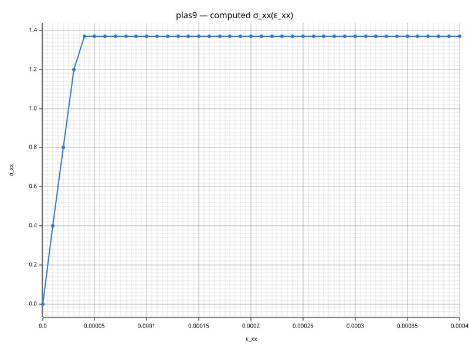

#### pyrucast listing

<details><summary><code>run.py</code></summary>

```python
"""plas9 — uniaxial pull of a softening Drucker-Prager block, HEX8.

Problem: a block 1.5 × 1.5 × 1 (one HEX8), held by u_x = 0 on x = 0,
u_y = 0 on y = 0 and u_z = 0 on z = 0, is pulled by u_x = 1.5e-4·t on
x = 1.5 up to t = 4, in steps of 0.1. The material is a Drucker-Prager law
with α = 0.441, β = 1.02, K = 2 and a negative hardening H = −10 000.
Reference: the exact uniaxial curve,

    σ = E·ε                                  while ε < K / ((α + β)·E),
    σ = (K + H·m·ε) / ((α + β) + H·m/E)      after, floored at 0,

with m = √(2α² + β²) / (α + β). Compared: max |σ − σ_exact| / K over the
computed times (the `.dgibi` file's test).

The `.dgibi` file adds, on the same cell, an elastic material of stiffness
2e-3 in parallel, which keeps the tangent invertible once the stress has
softened to zero. It is `model.elasticity` on a second FE space of the same
mesh: each law reads its own `E` on its own space.

Running::

    python validation/03_plasticity/plas9/run.py
"""

import math
import os

import pyrucast as pc

E, NU = 40000.0, 0.21
ALPHA, BETA, K, H = 0.441, 1.02, 2.0, -10000.0
LX, LY, LZ = 1.5, 1.5, 1.0
RATE = 1.5e-4  # imposed u_x per unit time
TIMES = [0.1 * i for i in range(41)]


def main(out: str | None = None) -> dict[str, float]:
    coords = pc.Coords(3)
    corners = [[0.0, 0.0], [LX, 0.0], [LX, LY], [0.0, LY]]
    base = pc.Mesh(coords, "QUA4")
    base.unit().add_cell([coords.add_node(p + [0.0]) for p in corners])
    block = pc.mesh.extrude(base, [0.0, 0.0, LZ], 1)
    face_x0 = pc.mesh.points_on_plane(block, [0.0, 0.0, 0.0], [1.0, 0.0, 0.0])
    face_x1 = pc.mesh.points_on_plane(block, [LX, 0.0, 0.0], [1.0, 0.0, 0.0])
    face_y0 = pc.mesh.points_on_plane(block, [0.0, 0.0, 0.0], [0.0, 1.0, 0.0])
    face_z0 = pc.mesh.points_on_plane(block, [0.0, 0.0, 0.0], [0.0, 0.0, 1.0])
    corner = block.nearest_node([LX, LY, LZ])

    fes = pc.FiniteElementSpace(block)
    law = pc.model.drucker_prager(fes, "full_3d")
    parallel = pc.model.elasticity(pc.FiniteElementSpace(block), "full_3d")
    pull = pc.model.dirichlet(face_x1, law, "u_x")
    model = (
        law
        | parallel
        | pc.model.dirichlet(face_x0, law, "u_x")
        | pc.model.dirichlet(face_y0, law, "u_y")
        | pc.model.dirichlet(face_z0, law, "u_z")
        | pull
    )
    materials = pc.element_field.material_field(
        parallel, [("E", 2e-3), ("nu", 0.0)]
    ) | pc.element_field.material_field(
        law,
        [
            ("E", E),
            ("nu", NU),
            ("friction", ALPHA),
            ("beta", BETA),
            ("k", K),
            ("psi", ALPHA),
            ("delta", BETA),
            ("friction_ult", ALPHA),
            ("beta_ult", BETA),
            ("k_ult", K),
            ("H", H),
        ],
    )
    frames = []
    for t in (0.0, TIMES[-1]):
        frames.append((t, pc.NodeField(pull.multiplier_mesh(), ["imposed"]) + RATE * t))
    data = {
        "model": model,
        "times": TIMES,
        "materials": materials,
        "loads": pc.Evolution(frames),
    }
    pc.stepping.step_by_step(data)

    m = math.sqrt(2.0 * ALPHA**2 + BETA**2) / (ALPHA + BETA)
    eps_yield = K / ((ALPHA + BETA) * E)
    worst = 0.0
    strains, stresses, exacts = [], [], []
    for record in data["results"]:
        eps = record["displacement"].value(corner, "u_x") / LX
        sigma = record["behaviour"][0].value(0, 0, "sigma_xx")
        if eps < eps_yield:
            exact = E * eps
        else:
            exact = max((K + H * m * eps) / ((ALPHA + BETA) + H * m / E), 0.0)
        worst = max(worst, abs(sigma - exact) / K)
        strains.append(eps)
        stresses.append(sigma)
        exacts.append(exact)

    if out:
        curve = pc.SubEvolution(list(zip(strains, stresses)))
        curve.plot(
            x_label="ε_xx",
            y_label="σ_xx",
            title="plas9 — computed σ_xx(ε_xx)",
            save=os.path.join(out, "curve.svg"),
        )
    return {"curve_gap": worst}


if __name__ == "__main__":
    print(main("."))
```

</details>

### plas10

#### Description sheet

| | |
|---|---|
| Test name | plas10 |
| Calculation type | MECHANICS ELASTIC PLASTIC - CAM-CLAY'S MATERIAL |
| Finite element type (Cast3M) | CUB8 |
| pyrucast model | not available — missing: Cam-Clay law |
| Reference | no source cited in the original document |
| Cast3M version of the 2011 document | 97' customer version |
| Cast3M 2026 `.dgibi` file | `dgibi/plas10.dgibi` |
| Folder | [`03_plasticity/plas10/`](03_plasticity/plas10/) |

**Topic.** A parallelepiped of a Cam-Clay material is compressed hydrostatically by
displacements imposed on three of its faces.

**Goal.** Compare the hydrostatic compression curve with the exact solution.

**Model description.**

CUB8 block; the three faces x, y, z = 0 are fixed in their normal direction,
the three opposite faces receive the same normal displacement, −2.664328e-5
per time unit, up to t = 200.

| Data | Value |
|---|---|
| E | 1000 |
| ν | 0.2 |
| λ (XL) | 0.1 |
| κ (XK) | 0.01 |
| c (CC) | 0.5 |
| e (EE) | 2 |
| p₀ (PI0) | 5 |

- Exact solution at t = 200: σ_xx = −(p₀ + c)·exp(−300·u·(1 + e)/λ) + c and
  plastic volume strain 300·u·(λ − κ)/λ, with u = −2.664328e-5.

**Notes.** The 2011 document prints no result table; the references are the `.dgibi` file's formulas.

#### Results

| Quantity | Reference | Cast3M 2011 | Cast3M 2026 | pyrucast | pyrucast / reference |
|---|---|---|---|---|---|
| σ_xx at t = 200 | -6.4904 | — | -6.4904 (+7.84e-07 %) | not available |  |
| plastic volume strain at t = 200 | -0.00719369 | — | -0.00719369 (+3.04e-06 %) | not available |  |

Acceptance: criteria of the `.dgibi` file, both relative gaps ≤ 1e-6.

### plas11

#### Description sheet

| | |
|---|---|
| Test name | plas11 |
| Calculation type | MECHANIC ELASTIC PLASTIC - GENERALISED PLANE STRAINS |
| Finite element type (Cast3M) | QUA8, COQ2, POI1 |
| pyrucast model | not available — missing: generalized plane strain; axisymmetric shell element (COQ2) |
| Reference | no source cited in the original document |
| Cast3M version of the 2011 document | 97' customer version |
| Cast3M 2026 `.dgibi` file | `dgibi/plas11.dgibi` |
| Folder | [`03_plasticity/plas11/`](03_plasticity/plas11/) |

**Topic.** A beam of rectangular cross-section is bent by an imposed rotation about x,
in generalized plane strain. The section is modelled by a solid part, a part
of shell elements and point elements, up to the plastic range.

**Goal.** Study the moment produced by the imposed rotation beyond the elastic limit
and compare it with the theoretical moment.

**Model description.**

Generalized plane strain section of height 2H = 4 and width 2B = 2: a solid
part (QUA8), a part of COQ2 elements (length 0.5, thickness 2) and four POI1
points, all with the same material.

| Data | Value |
|---|---|
| E | 2e11 Pa |
| ν | 0 |
| σ_y (perfect plasticity) | 4.83e8 Pa |

- Theoretical moment: M = (1 − (ε_e/ε)²/3)·M_lim beyond the elastic strain
  ε_e = σ_y / E, with M_lim = 3/2·M_e.

**Notes.** The 2011 document prints no result table.

#### Results

| Quantity | Reference | Cast3M 2011 | Cast3M 2026 | pyrucast | pyrucast / reference |
|---|---|---|---|---|---|
| moment M_x at the last rotation ¹ | 3.85931e+09 | — | 3.85066e+09 (-0.224 %) | not available |  |

¹ Reference computed by the Cast3M 2026 `.dgibi` file from its analytical formula.

Acceptance: criterion of the `.dgibi` file, |M − M_theory| / M_theory ≤ 0.5 %.

### plas12

#### Description sheet

| | |
|---|---|
| Test name | plas12 |
| Calculation type | MECHANICS ELASTIC PLASTIC |
| Finite element type (Cast3M) | TUYA |
| pyrucast model | not available — missing: pipe element (TUYA) |
| Reference | no source cited in the original document |
| Cast3M version of the 2011 document | 97' customer version |
| Cast3M 2026 `.dgibi` file | `dgibi/plas12.dgibi` |
| Folder | [`03_plasticity/plas12/`](03_plasticity/plas12/) |

**Topic.** A pipe clamped at both ends undergoes a thermal shock. Young's modulus, the
thermal expansion and the tensile curve depend on the temperature.

**Goal.** Test the step-by-step procedure with a temperature-dependent material: the
stress must follow the tensile curve at the strain α·ΔT.

**Model description.**

Pipe elements clamped at both ends; E(T) tabulated at 0, 200, 400, 600 and
800 °C, α(T) = (10.4, 11.9, 13.0, 13.8, 14.25)·8e-6, tensile curves scaled
by 1, 0.8, 0.6, 0.4, 0.2 with the temperature; ν = 0.3.

- Analytical solution: ε = α·ΔT, σ read on the tensile curve at that strain.
- Compared quantity: the area under the computed σ(ε) curve against the area
  under the analytical one.

**Notes.** The 2011 document prints no result table.

#### Results

| Quantity | Reference | Cast3M 2011 | Cast3M 2026 | pyrucast | pyrucast / reference |
|---|---|---|---|---|---|
| area under the σ(ε) curve ¹ | 32.9336 | — | 32.7558 (-0.54 %) | not available |  |

¹ Reference computed by the Cast3M 2026 `.dgibi` file from its analytical formula.

Acceptance: criterion of the `.dgibi` file, relative gap of the areas under the two curves ≤ 5.5e-3.

### plas13

#### Description sheet

| | |
|---|---|
| Test name | plas13 |
| Calculation type | MECHANICS ELASTIC PLASTIC |
| Finite element type (Cast3M) | POUT |
| pyrucast model | not available — missing: beam plasticity (global law) |
| Reference | no source cited in the original document |
| Cast3M version of the 2011 document | 97' customer version |
| Cast3M 2026 `.dgibi` file | `dgibi/plas13.dgibi` |
| Folder | [`03_plasticity/plas13/`](03_plasticity/plas13/) |

**Topic.** A reinforced-concrete post under a load of 2 t, modelled by beam elements
with a global plasticity law (Ambroise-type model) that couples axial force,
bending and shear.

**Goal.** Find the largest bending moment reached at the clamped base.

**Model description.**

Post of beam elements clamped at A0 (0, 0, 0), section 0.0289 m².

| Data | Value |
|---|---|
| E | 35 510e6 Pa |
| ν | 0.2 |
| ρ | 2516 kg/m³ |

**Notes.** The 2011 document prints no result table; the reference is the `.dgibi` file's.

#### Results

| Quantity | Reference | Cast3M 2011 | Cast3M 2026 | pyrucast | pyrucast / reference |
|---|---|---|---|---|---|
| largest moment M_x at A0 (N·m) | 21401 | — | 21399 (-0.00935 %) | not available |  |

Acceptance: criterion of the `.dgibi` file, |M_max − 21 401| / 21 401 ≤ 1e-3.

### plas14

#### Description sheet

| | |
|---|---|
| Test name | plas14 |
| Calculation type | MECHANICS ELASTIC PLASTIC ACIER_UNI AND BETON_UNI, MECHANICS ELASTIC FIBRE_NL FERAILLE AND FIBRE_NL BETON |
| Finite element type (Cast3M) | QUAS, TRIS |
| pyrucast model | not available — missing: multi-fibre beam sections |
| Reference | no source cited in the original document |
| Cast3M version of the 2011 document | 97' customer version |
| Cast3M 2026 `.dgibi` file | `dgibi/plas14.dgibi` |
| Folder | [`03_plasticity/plas14/`](03_plasticity/plas14/) |

**Topic.** A concrete section of 0.25 × 0.25 m (core 0.20 × 0.20 m) with four 20 mm
steel bars and 10 mm stirrups every 7 cm, modelled by fibres: a modified
Menegotto-Pinto law for the steel (with buckling) and a Hognestad-type law
for the concrete (with confinement).

**Goal.** Compute the force-displacement response of the multi-fibre column.

**Model description.**

| Steel (ACIER_UNI) | Value |
|---|---|
| E | 2.03e5 |
| ν | 0.3 |
| yield stress | 440 |
| ultimate strain | 0.09 |
| ultimate stress | 760 |

**Notes.** The 2011 document prints no result table and no goal; the reference is the `.dgibi` file's.

#### Results

| Quantity | Reference | Cast3M 2011 | Cast3M 2026 | pyrucast | pyrucast / reference |
|---|---|---|---|---|---|
| largest force of the response | 0.0772465 | — | 0.0772514 (+0.00633 %) | not available |  |

Acceptance: criterion of the `.dgibi` file, |F_max − 7.72465e-2| ≤ 4e-2.

## Behaviour laws

### norton_cis1

#### Description sheet

| | |
|---|---|
| Test name | norton_cis1 |
| Calculation type | ISOTROPIC ELASTIC MECHANICS - 2D - PLANE STRAIN |
| Finite element type (Cast3M) | QUA4 |
| pyrucast model | not available — missing: Norton creep with a time-hardening exponent (Cast3M AF3) |
| Reference | no source cited in the original document |
| Cast3M version of the 2011 document | 97' customer version |
| Cast3M 2026 `.dgibi` file | `dgibi/norton_cis1.dgibi` |
| Folder | [`04_behaviour_laws/norton_cis1/`](04_behaviour_laws/norton_cis1/) |

**Topic.** A square of a Norton creep material, in plane strain, is loaded in pure shear
by tangential forces on two opposite sides, applied almost instantly then
held constant.

**Goal.** Test the Norton creep model: the shear creep strain and the shear stress
must follow the analytical solution in time.

**Model description.**

One QUA4 square; u_y = 0 at every node, u_x = 0 on the lower side.

| Data | Value |
|---|---|
| E | 2.1e11 Pa |
| ν | 0.3 |
| Norton A (AF1) | 1e-45 |
| Norton n (AF2) | 5 |
| time exponent m (AF3) | 1.2 |
| SMAX | 2.1e8 |

- Load: tangential force 7e7 on the upper side, −7e7 on the lower one,
  reached at t = 1e-4 and held up to t = 20.
- Creep law: ε̇_eq = A·σ_eq^n·m·t^(m−1), i.e. ε_eq = A·σ_eq^n·t^m at
  constant stress.
- Analytical solution: γ_p = √3·A·(√3·τ)^n·t^m and
  τ_xy = G·(γ − γ_p) with G = E / (2(1 + ν)).

**Notes.** The 2011 document prints no result table; the references are the `.dgibi` file's
formulas. pyrucast's `model.creep_norton` is the secondary creep
ṗ = (q/K)^n: it has no time exponent, and the `.dgibi` file's is m = 1.2.

#### Results

| Quantity | Reference | Cast3M 2011 | Cast3M 2026 | pyrucast | pyrucast / reference |
|---|---|---|---|---|---|
| shear creep strain γ_p at t = 20 ¹ | 0.0016523 | — | 0.00165241 (+0.00636 %) | not available |  |
| shear stress σ_xy at t = 20 (Pa) ¹ | 6.99943e+07 | — | 6.99858e+07 (-0.0121 %) | not available |  |

¹ Reference computed by the Cast3M 2026 `.dgibi` file from its analytical formula.

Acceptance: criterion of the `.dgibi` file, at every computed time the creep strain and the shear stress within 0.25 % of the analytical values.

### chaboche2

#### Description sheet

| | |
|---|---|
| Test name | chaboche2 |
| Calculation type | ISOTROPIC VISCOPLASTIC MECHANICS - 2D AXIS |
| Finite element type (Cast3M) | QUA8 (COQ8 in the 2011 document) |
| pyrucast model | `model.viscoplasticity_chaboche(fes, "axisymmetric")` in `stepping.step_by_step`, QUA8 |
| Reference | no source cited in the original document |
| Cast3M version of the 2011 document | 97' customer version |
| Cast3M 2026 `.dgibi` file | `dgibi/chaboche2.dgibi` |
| Folder | [`04_behaviour_laws/chaboche2/`](04_behaviour_laws/chaboche2/) |

**Topic.** A cylinder of a unified viscoplastic Chaboche material (Norton flow, one
Armstrong-Frederick back-stress, saturating isotropic hardening) is cycled in
tension and compression by an imposed axial displacement.

**Goal.** Test the Chaboche model: the axial stress must equal the one of the same law
written in the ONERA model of Cast3M.

**Model description.**

Axisymmetric, one QUA8 square [0, 1] × [0, 1] in (r, z), B-bar formulation.

| Data | Value |
|---|---|
| E | 200e9 Pa |
| ν | 0.3 |
| σ_y | 82e6 Pa |
| Norton K, n | 151e6 Pa, 24 |
| back-stress A = C_lin / γ, C = γ | 162 400e6 / 2800, 2800 |
| isotropic Q, b | 60e6 Pa, 8 |

- Boundary conditions: u_z = 0 on z = 0, u_r = 0 on the axis.
- Imposed u_z on z = 1: 0.002·f(t), f = 0, 1, 0, −1, 0, 2 at
  t = 0, 100, 200, 300, 400, 600 s.
- Reference: the same computation with the ONERA model and equivalent data.

**Notes.** The 2011 document prints no result table and gives E = 7.34e10, ν = 0.33;
the data above are the `.dgibi` file's. The `.dgibi` file uses the B-bar formulation, which
changes nothing on a homogeneous strain; pyrucast has none.

pyrucast integrates the law over the `.dgibi` file's steps of 10 s with one implicit
step each, and lands about 1 % from the reference with n = 24; with steps of
1 s it comes within about 0.1 %. Cast3M reaches the converged values with the
same 10 s steps: it divides them at the Gauss points, which pyrucast's
step-by-step driver does not offer.

**Improvement points.**

- local sub-stepping of rate-dependent laws at the Gauss points (stiff Norton exponents)
- B-bar (selective integration) against the volumetric locking of QUA4/QUA8 in incompressible plastic flow

#### Results

| Quantity | Reference | Cast3M 2011 | Cast3M 2026 | pyrucast | pyrucast / reference |
|---|---|---|---|---|---|
| σ_zz at t = 100 s (MPa) ¹ | 230.848 | — | 230.848 (-1.1e-06 %) | 228.373 | -1.07 % |
| σ_zz at t = 200 s (MPa) ¹ | -150.745 | — | -150.745 (-1.32e-06 %) | -150.555 | +0.126 % |
| σ_zz at t = 300 s (MPa) ¹ | -236.323 | — | -236.323 (+6.64e-07 %) | -235.108 | +0.514 % |
| σ_zz at t = 400 s (MPa) ¹ | 146.69 | — | 146.69 (+7.21e-07 %) | 145.287 | -0.957 % |
| σ_zz at t = 600 s (MPa) ¹ | 239.084 | — | 239.084 (-1.28e-07 %) | 239.05 | -0.0142 % |

¹ Reference computed by the Cast3M 2026 `.dgibi` file from its analytical formula.

Acceptance: criterion of the `.dgibi` file, max |σ_CHABOCHE − σ_ONERA| / max |σ_ONERA| ≤ 1e-4 over the computed times; applied here to each value read.

pyrucast OUTSIDE tolerance: szz_100: 228.37307501323795 vs 230.848466095189, beyond 0.0001

pyrucast OUTSIDE tolerance: szz_200: -150.55493045818838 vs -150.7450563956658, beyond 0.0001

pyrucast OUTSIDE tolerance: szz_300: -235.1082171296712 vs -236.3229485644268, beyond 0.0001

pyrucast OUTSIDE tolerance: szz_400: 145.2869239782215 vs 146.6900665779636, beyond 0.0001

pyrucast OUTSIDE tolerance: szz_600: 239.049947041125 vs 239.0838493430581, beyond 0.0001

#### pyrucast figures

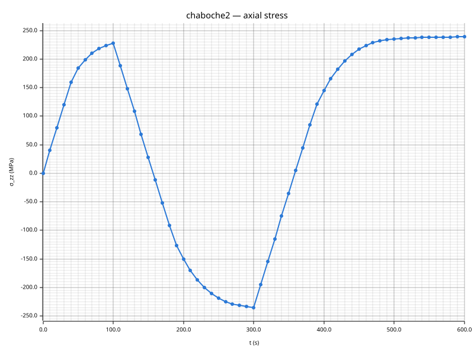

#### pyrucast listing

<details><summary><code>run.py</code></summary>

```python
"""chaboche2 — tension-compression cycle on a Chaboche viscoplastic material.

Problem: one axisymmetric QUA8, [0, 1] × [0, 1] in (r, z), held by u_z = 0
on z = 0 and u_r = 0 on the axis, receives u_z = 0.002·f(t) on z = 1, with
f = 0, 1, 0, −1, 0, 2 at t = 0, 100, 200, 300, 400, 600 s. The material is
Chaboche's unified viscoplastic law: a Norton flow on the overstress
J(σ − X) − R − k, one Armstrong-Frederick back stress and a saturating
isotropic hardening. Reference: the axial stress of the same computation with
Cast3M's ONERA model and equivalent data, read at t = 100, 200, 300, 400 and
600 s.

The Cast3M data map to pyrucast's as SIGY → k, K → K, N → n, A·C → C_1,
C → gamma_1, B → b, Q → Q. The strain is homogeneous: the stress is read at
the first Gauss point, every 10 s as the `.dgibi` file computes. The `.dgibi` file's B-bar
formulation changes nothing on a homogeneous strain; pyrucast has none.

Running::

    python validation/04_behaviour_laws/chaboche2/run.py
"""

import os

import pyrucast as pc

E, NU = 200e9, 0.3
CHABOCHE = [
    ("k", 82e6),  # SIGY
    ("K", 151e6),
    ("n", 24.0),
    ("C_1", 162400e6),  # A·C
    ("gamma_1", 2800.0),  # C
    ("b", 8.0),
    ("Q", 142e6 - 82e6),
]
U_MAX = 0.002
HISTORY = [
    (0.0, 0.0),
    (100.0, 1.0),
    (200.0, 0.0),
    (300.0, -1.0),
    (400.0, 0.0),
    (600.0, 2.0),
]
TIMES = [10.0 * i for i in range(61)]
READ_AT = (100.0, 200.0, 300.0, 400.0, 600.0)


def main(out: str | None = None) -> dict[str, float]:
    coords = pc.Coords.axisymmetric()
    a = coords.add_node([0.0, 0.0])
    b = coords.add_node([1.0, 0.0])
    c = coords.add_node([1.0, 1.0])
    d = coords.add_node([0.0, 1.0])
    bottom = pc.mesh.line(a, b, 1, "SEG3")
    top = pc.mesh.line(d, c, 1, "SEG3")
    cylinder = pc.mesh.sweep(bottom, top, 1, "QUA8")

    fes = pc.FiniteElementSpace(cylinder)
    law = pc.model.viscoplasticity_chaboche(fes, "axisymmetric")
    pull = pc.model.dirichlet(pc.mesh.consolidate(top.to_poi1()), law, "u_y")
    model = (
        law
        | pc.model.dirichlet(pc.mesh.consolidate(bottom.to_poi1()), law, "u_y")
        | pc.model.dirichlet(
            pc.mesh.points_on_line(cylinder, [0.0, 0.0], [0.0, 1.0]), law, "u_x"
        )
        | pull
    )
    materials = pc.element_field.material_field(
        model, [("E", E), ("nu", NU)] + CHABOCHE
    )
    frames = []
    for t, f in HISTORY:
        frames.append(
            (t, pc.NodeField(pull.multiplier_mesh(), ["imposed"]) + U_MAX * f)
        )
    data = {
        "model": model,
        "times": TIMES,
        "materials": materials,
        "loads": pc.Evolution(frames),
    }
    pc.stepping.step_by_step(data)

    values = {}
    times, stresses = [], []
    for record in data["results"]:
        szz = record["behaviour"][0].value(0, 0, "sigma_yy") / 1e6
        times.append(record["time"])
        stresses.append(szz)
        for t in READ_AT:
            if abs(record["time"] - t) < 1e-9:
                values[f"szz_{t:.0f}"] = szz

    if out:
        pc.SubEvolution(list(zip(times, stresses))).plot(
            x_label="t (s)",
            y_label="σ_zz (MPa)",
            title="chaboche2 — axial stress",
            save=os.path.join(out, "sigma_zz.svg"),
        )
    return values


if __name__ == "__main__":
    print(main("."))
```

</details>

### ohno2

#### Description sheet

| | |
|---|---|
| Test name | ohno2 |
| Calculation type | ISOTROPIC VISCOPLASTIC MECHANICS - 2D AXIS |
| Finite element type (Cast3M) | QUA8 |
| pyrucast model | not available — missing: Ohno viscoplastic law |
| Reference | no source cited in the original document |
| Cast3M version of the 2011 document | 97' customer version |
| Cast3M 2026 `.dgibi` file | `dgibi/ohno2.dgibi` |
| Folder | [`04_behaviour_laws/ohno2/`](04_behaviour_laws/ohno2/) |

**Topic.** A hollow cylinder of an Ohno viscoplastic material (a modified Chaboche
model), clamped at its base, is loaded by an outward radial force on its
upper face.

**Goal.** Test the Ohno model: the displacement history must equal the one of an
equivalent second computation run by the `.dgibi` file.

**Model description.**

Axisymmetric hollow cylinder, QUA8 elements.

| Data | Value |
|---|---|
| E | 7.34e10 Pa |
| ν | 0.33 |

**Notes.** The 2011 document prints no result table; the reference is the `.dgibi` file's second computation.

#### Results

| Quantity | Reference | Cast3M 2011 | Cast3M 2026 | pyrucast | pyrucast / reference |
|---|---|---|---|---|---|
| displacement at the last time (m) ¹ | 2.21794e-05 | — | 2.22274e-05 (+0.217 %) | not available |  |

¹ Reference computed by the Cast3M 2026 `.dgibi` file from its analytical formula.

Acceptance: criterion of the `.dgibi` file, every displacement of the history within 0.3 % of the reference computation.

### guionnet_tra

#### Description sheet

| | |
|---|---|
| Test name | guionnet_tra |
| Calculation type | ISOTROPIC VISCOPLASTIC MECHANICS |
| Finite element type (Cast3M) | CUB8 |
| pyrucast model | not available — missing: Guionnet viscoplastic law |
| Reference | no source cited in the original document |
| Cast3M version of the 2011 document | 97' customer version |
| Cast3M 2026 `.dgibi` file | `dgibi/guionnet_tra.dgibi` |
| Folder | [`04_behaviour_laws/guionnet_tra/`](04_behaviour_laws/guionnet_tra/) |

**Topic.** A block of a Guionnet viscoplastic material, held on its lower and upper
faces, is pulled by a displacement imposed on its upper face.

**Goal.** Test the Guionnet model: the computed reaction must equal the reference one.

**Model description.**

CUB8 block.

| Data | Value |
|---|---|
| E | 192 500 |
| ν | 0.3 |
| Norton n, K | 24, 200 |
| R0 | 25 |

**Notes.** The 2011 document prints no result table and gives ν = 0.33; the reference is the `.dgibi` file's.

#### Results

| Quantity | Reference | Cast3M 2011 | Cast3M 2026 | pyrucast | pyrucast / reference |
|---|---|---|---|---|---|
| axial reaction of the upper face ¹ | 2.99625 | — | 2.99632 (+0.00233 %) | not available |  |

¹ Reference computed by the Cast3M 2026 `.dgibi` file from its analytical formula.

Acceptance: criterion of the `.dgibi` file, relative gap of the reaction ≤ 0.03 %.

### zeril1

#### Description sheet

| | |
|---|---|
| Test name | zeril1 |
| Calculation type | ISOTROPIC ELASTOPLASTIC MECHANICS |
| Finite element type (Cast3M) | CUB8 |
| pyrucast model | not available — missing: Zerilli-Armstrong law |
| Reference | no source cited in the original document |
| Cast3M version of the 2011 document | 97' customer version |
| Cast3M 2026 `.dgibi` file | `dgibi/zeril1.dgibi` |
| Folder | [`04_behaviour_laws/zeril1/`](04_behaviour_laws/zeril1/) |

**Topic.** A bar of a Zerilli-Armstrong elastoplastic material (body-centred cubic
form), held at its ends, is pulled by an imposed displacement.

**Goal.** Test the Zerilli-Armstrong model for a body-centred cubic structure against
the uniaxial curve integrated by the `.dgibi` file.

**Model description.**

CUB8 bar.

| Data | Value |
|---|---|
| E | 2.1e11 Pa |
| ν | 0.3 |
| ρ | 7.8e3 kg/m³ |
| α | 1e-5 /°C |

**Notes.** The 2011 document prints no result table; the references are the `.dgibi` file's integration at the last time.

#### Results

| Quantity | Reference | Cast3M 2011 | Cast3M 2026 | pyrucast | pyrucast / reference |
|---|---|---|---|---|---|
| axial stress at the last time (Pa) ¹ | 1.3727e+08 | — | 1.37427e+08 (+0.114 %) | not available |  |
| plastic strain at the last time ¹ | 0.00934641 | — | 0.00934559 (-0.00877 %) | not available |  |

¹ Reference computed by the Cast3M 2026 `.dgibi` file from its analytical formula.

Acceptance: criterion of the `.dgibi` file, plastic strain and stress within 1 % of the `.dgibi` file's integration at every time.

### preston1

#### Description sheet

| | |
|---|---|
| Test name | preston1 |
| Calculation type | ISOTROPIC ELASTOPLASTIC MECHANICS |
| Finite element type (Cast3M) | CUB8 |
| pyrucast model | not available — missing: Preston-Tonks-Wallace law |
| Reference | no source cited in the original document |
| Cast3M version of the 2011 document | 97' customer release |
| Cast3M 2026 `.dgibi` file | `dgibi/preston1.dgibi` |
| Folder | [`04_behaviour_laws/preston1/`](04_behaviour_laws/preston1/) |

**Topic.** A bar of a Preston-Tonks-Wallace elastoplastic material, held at its ends,
is pulled by an imposed displacement.

**Goal.** Test the Preston-Tonks-Wallace model for a body-centred cubic structure
against the uniaxial curve integrated by the `.dgibi` file.

**Model description.**

CUB8 bar.

| Data | Value |
|---|---|
| E | 2.1e11 Pa |
| ν | 0.3 |
| ρ | 7.8e3 kg/m³ |
| τ | 0.025 |

**Notes.** The 2011 document prints no result table; the reference is the `.dgibi` file's integration.

#### Results

| Quantity | Reference | Cast3M 2011 | Cast3M 2026 | pyrucast | pyrucast / reference |
|---|---|---|---|---|---|
| largest gap of the stress (%) | 0 | — | 0.0358752 (Δ = 0.036) | not available |  |
| largest gap of the plastic strain (%) | 0 | — | 0.000264593 (Δ = 0.00026) | not available |  |

Acceptance: criterion of the `.dgibi` file, every gap of the stress and of the plastic strain to the `.dgibi` file's integration ≤ 5e-2 %.

## Damage elastoplastic models

### endocp1

#### Description sheet

| | |
|---|---|
| Test name | endocp1 |
| Calculation type | DAMAGE MODEL FOR ELASTOPLASTIC MATERIAL |
| Finite element type (Cast3M) | QUA8 |
| pyrucast model | not available — missing: elastoplastic damage law (ENDOMMAGEABLE) |
| Reference | Analytical solution. Tests carried out by Mr STRUB (rapport DMT/91 .558). |
| Cast3M version of the 2011 document | 97' customer version |
| Cast3M 2026 `.dgibi` file | `dgibi/endocp1.dgibi` |
| Folder | [`05_damage/endocp1/`](05_damage/endocp1/) |

**Topic.** A test piece of an elastoplastic material with ductile damage, in plane stress, is
pulled by an imposed displacement.

**Goal.** Test the damage model (MODE PLAN CONT) against the solution integrated by an
algorithm: cumulated plastic strain, damage variable D and axial stress.

**Model description.**

Test piece of QUA8 elements, plane stress.

| Data | Value |
|---|---|
| E | 74 020e6 Pa |
| ν | 0.3 |
| ρ | 7800 kg/m³ |

- Tensile curve given point by point; damage law of the ENDOMMAGEABLE model.
- Load: imposed axial displacement increasing with time.

**Notes.** The 2011 document prints no result table; the references are the `.dgibi` file's.
The `.dgibi` file runs its short version by default (`complet = faux`): two computed
times. Its complete version goes on to a cumulated plastic strain of 0.2427
and a damage of 0.2199.

#### Results

| Quantity | Reference | Cast3M 2011 | Cast3M 2026 | pyrucast | pyrucast / reference |
|---|---|---|---|---|---|
| cumulated plastic strain, first computed time | 0.000546 | — | 0.00054653 (+0.0971 %) | not available |  |
| cumulated plastic strain, second computed time | 0.0112694 | — | 0.0112694 (-0.000317 %) | not available |  |
| axial stress (SMYY), first computed time (Pa) | 3.543e+08 | — | 3.54328e+08 (+0.00796 %) | not available |  |
| axial stress (SMYY), second computed time (Pa) | 4.07984e+08 | — | 4.07984e+08 (-0.000116 %) | not available |  |

Acceptance: criterion of the `.dgibi` file, every relative gap ≤ 5 %.

### endoaxi1

#### Description sheet

| | |
|---|---|
| Test name | endoaxi1 |
| Calculation type | DAMAGE MODEL FOR ELASTOPLASTIC MATERIAL |
| Finite element type (Cast3M) | QUA8 |
| pyrucast model | not available — missing: elastoplastic damage law (ENDOMMAGEABLE) |
| Reference | Analytical solution. Tests carried out by Mr STRUB (rapport DMT/91 .558). |
| Cast3M version of the 2011 document | 97' customer version |
| Cast3M 2026 `.dgibi` file | `dgibi/endoaxi1.dgibi` |
| Folder | [`05_damage/endoaxi1/`](05_damage/endoaxi1/) |

**Topic.** A test piece of an elastoplastic material with ductile damage, in axisymmetric, is
pulled by an imposed displacement.

**Goal.** Test the damage model (MODE AXIS) against the solution integrated by an
algorithm: cumulated plastic strain, damage variable D and axial stress.

**Model description.**

Test piece of QUA8 elements, axisymmetric.

| Data | Value |
|---|---|
| E | 74 020e6 Pa |
| ν | 0.3 |
| ρ | 7800 kg/m³ |

- Tensile curve given point by point; damage law of the ENDOMMAGEABLE model.
- Load: imposed axial displacement increasing with time.

**Notes.** The 2011 document prints no result table; the references are the `.dgibi` file's.
The `.dgibi` file runs its short version by default (`complet = faux`): two computed
times. Its complete version goes on to a cumulated plastic strain of 0.2427
and a damage of 0.2199.

#### Results

| Quantity | Reference | Cast3M 2011 | Cast3M 2026 | pyrucast | pyrucast / reference |
|---|---|---|---|---|---|
| cumulated plastic strain, first computed time | 0.000546 | — | 0.00054642 (+0.0769 %) | not available |  |
| cumulated plastic strain, second computed time | 0.0112694 | — | 0.011159 (-0.979 %) | not available |  |
| axial stress (SMZZ), first computed time (Pa) | 3.543e+08 | — | 3.54327e+08 (+0.00772 %) | not available |  |
| axial stress (SMZZ), second computed time (Pa) | 4.07984e+08 | — | 4.07675e+08 (-0.0757 %) | not available |  |

Acceptance: criterion of the `.dgibi` file, every relative gap ≤ 5 %.

### endoaxi2

#### Description sheet

| | |
|---|---|
| Test name | endoaxi2 |
| Calculation type | DAMAGE MODEL FOR ELASTOPLASTIC MATERIAL |
| Finite element type (Cast3M) | QUA8 |
| pyrucast model | not available — missing: elastoplastic damage law (ENDOMMAGEABLE) |
| Reference | Analytical solution. |
| Cast3M version of the 2011 document | 97' customer version |
| Cast3M 2026 `.dgibi` file | `dgibi/endoaxi2.dgibi` |
| Folder | [`05_damage/endoaxi2/`](05_damage/endoaxi2/) |

**Topic.** An axisymmetric test piece of an elastoplastic material with ductile damage
is pulled by an imposed displacement while its temperature changes; the
tensile curve and the thermal expansion depend on the temperature.

**Goal.** Test the damage model (MODE AXIS) against the solution integrated by an
algorithm: cumulated plastic strain, damage variable D and axial stress.

**Model description.**

Axisymmetric test piece of QUA8 elements.

| Data | Value |
|---|---|
| E | 74 020e6 Pa |
| ν | 0.3 |

- Tensile curves and thermal expansion tabulated against the temperature.
- Load: imposed axial displacement and temperature history.

**Notes.** The 2011 document prints no result table; the references are the `.dgibi` file's.

#### Results

| Quantity | Reference | Cast3M 2011 | Cast3M 2026 | pyrucast | pyrucast / reference |
|---|---|---|---|---|---|
| cumulated plastic strain at the last time (step 18) | 0.1143 | — | 0.114299 (-0.00121 %) | not available |  |
| damage D at the last time (step 18) | 0.08131 | — | 0.0823298 (+1.25 %) | not available |  |
| σ_zz at the last time (step 18) (Pa) | 3.892e+08 | — | 3.88185e+08 (-0.261 %) | not available |  |

Acceptance: criterion of the `.dgibi` file, every relative gap ≤ 5 %.

### endoaxi3

#### Description sheet

| | |
|---|---|
| Test name | endoaxi3 |
| Calculation type | DAMAGE MODEL FOR ELASTOPLASTIC MATERIAL |
| Finite element type (Cast3M) | QUA8 |
| pyrucast model | not available — missing: elastoplastic damage law (ENDOMMAGEABLE) |
| Reference | Analytical solution. |
| Cast3M version of the 2011 document | 97' customer version |
| Cast3M 2026 `.dgibi` file | `dgibi/endoaxi3.dgibi` |
| Folder | [`05_damage/endoaxi3/`](05_damage/endoaxi3/) |

**Topic.** An axisymmetric test piece of an elastoplastic material with ductile damage
is compressed by an imposed displacement under a thermal load; the tensile
curve and the thermal expansion depend on the temperature (reference
temperature 30 °C, reference of the expansion 10 °C, initial temperature
50 °C).

**Goal.** Test the damage model (MODE AXIS) against the solution integrated by an
algorithm: cumulated plastic strain, damage variable D and axial stress.

**Model description.**

Axisymmetric test piece of QUA8 elements, E = 74 020e6 Pa, tensile curves
tabulated against the temperature.

**Notes.** The 2011 document prints no result table. The `.dgibi` file holds two sets of
references, for its complete and its short run; the references are those of
the set the run uses.

#### Results

| Quantity | Reference | Cast3M 2011 | Cast3M 2026 | pyrucast | pyrucast / reference |
|---|---|---|---|---|---|
| damage D at the second compared time ¹ | 0.0124384 | — | 0.0124416 (+0.0257 %) | not available |  |
| cumulated plastic strain at the second compared time ¹ | 0.0197372 | — | 0.0197379 (+0.00353 %) | not available |  |
| σ_zz at the second compared time (Pa) ¹ | -3.57838e+08 | — | -3.57792e+08 (+0.0128 %) | not available |  |

¹ Reference computed by the Cast3M 2026 `.dgibi` file from its analytical formula.

Acceptance: criterion of the `.dgibi` file, every relative gap ≤ 5 %.

### ddi

#### Description sheet

| | |
|---|---|
| Test name | ddi |
| Calculation type | DAMAGE MODEL FOR VISCOPLASTIC MATERIAL |
| Finite element type (Cast3M) | QUA8 |
| pyrucast model | not available — missing: two-inelastic-strain damage law (DDI) |
| Reference | no source cited in the original document |
| Cast3M version of the 2011 document | 97' customer version |
| Cast3M 2026 `.dgibi` file | `dgibi/ddi.dgibi` |
| Folder | [`05_damage/ddi/`](05_damage/ddi/) |

**Topic.** A cylindrical test piece of a viscoplastic material with damage and two
inelastic strains (alpha zirconium at 200 °C), axisymmetric, is pulled by a
monotonically increasing displacement.

**Goal.** Test the two-inelastic-strain model (MODE AXIS) against the analytical solution.

**Model description.**

Axisymmetric test piece of QUA8 elements.

| Data | Value |
|---|---|
| E | 8.2e10 Pa |
| ν | 0.36 |

**Notes.** The 2011 document prints no result table; the references are the `.dgibi` file's.

#### Results

| Quantity | Reference | Cast3M 2011 | Cast3M 2026 | pyrucast | pyrucast / reference |
|---|---|---|---|---|---|
| inelastic strain p at the last time | 0.00417896 | — | 0.00417891 (-0.00113 %) | not available |  |
| inelastic strain v at the last time | 0.00314432 | — | 0.00314431 (-0.000172 %) | not available |  |
| σ_zz at the last time (Pa) | 2.19491e+08 | — | 2.19496e+08 (+0.00212 %) | not available |  |

Acceptance: criterion of the `.dgibi` file, every relative gap ≤ 0.1 %.

## Fracture mechanics

### rupt1

#### Description sheet

| | |
|---|---|
| Test name | rupt1 |
| Calculation type | MECHANICS ELASTIC-PLASTIC AXI |
| Finite element type (Cast3M) | QUA8 |
| pyrucast model | not available — missing: stress intensity factors (G-theta) |
| Reference | Test NAFEMS : Ductile Fracture Handbook, A. ZAHOOR, EPRI, 1990 : rupt1 Modélisation des structures élastiques dans CASTEM 2000. |
| Cast3M version of the 2011 document | 97' customer version |
| Cast3M 2026 `.dgibi` file | `dgibi/rupt1.dgibi` |
| Folder | [`06_fracture/rupt1/`](06_fracture/rupt1/) |

**Topic.** A cylinder with a circumferential crack, in linear elasticity and
axisymmetry, is pulled axially. The stress intensity factor is computed
from the energy release rate (G-θ method) and compared with Zahoor's
handbook formula K = σ_t·√(πa)·F.

**Goal.** Find the stress intensity factor K_I of the circumferential crack.

**Model description.**

Axisymmetric, QUA8 elements; crack depth a = 0.05 m.

| Data | Value |
|---|---|
| E | 2.1e11 Pa (2e11 Pa in the `.dgibi` file) |
| ν | 0.3 |
| a | 0.05 m |

- Load: total axial force 1e6 N.

#### Results

| Quantity | Reference | Cast3M 2011 | Cast3M 2026 | pyrucast | pyrucast / reference |
|---|---|---|---|---|---|
| K_I (MPa·m^½) | 1.0848 | 1.0855 (+0.0645 %) | 1.08378 (-0.0936 %) | not available |  |

Acceptance: criterion of the `.dgibi` file, |K − K_Zahoor| / K_Zahoor < 1 %.

### rupt2

#### Description sheet

| | |
|---|---|
| Test name | rupt2 |
| Calculation type | ELASTIC MECHANICS |
| Finite element type (Cast3M) | QUA8, plane strain |
| pyrucast model | not available — missing: stress intensity factors (G-theta) |
| Reference | Test NAFEMS : The use of J-integral in thermal stress crack problems International Journal of Fracture: rupt2 Modélisation des structures élastiques dans CASTEM 2000. |
| Cast3M version of the 2011 document | 97' customer version |
| Cast3M 2026 `.dgibi` file | `dgibi/rupt2.dgibi` |
| Folder | [`06_fracture/rupt2/`](06_fracture/rupt2/) |

**Topic.** An edge-cracked strip with constrained ends is loaded by a temperature that
varies linearly through its width, zero at mid-width and T₀ on the right
edge. The energy release rate is computed by the G-θ method and turned into
K = √(E·G / (1 − ν²)).

**Goal.** Find the stress intensity factor K_I of the thermal crack.

**Model description.**

QUA8 elements, plane strain; crack length a = 100 mm, width 200 mm, height
400 mm.

| Data | Value |
|---|---|
| E | 20 000 daN/mm² |
| ν | 0.3 |
| α | 5e-6 /°C |
| T₀ | 100 °C |

- Reference: shape factor 0.514, i.e. K = 0.514·E·α·T₀·w·√(πa) / (1 − ν).

#### Results

| Quantity | Reference | Cast3M 2011 | Cast3M 2026 | pyrucast | pyrucast / reference |
|---|---|---|---|---|---|
| K_I (daN·mm^-3/2) | 130.15 | 125.88 (-3.28 %) | 125.858 (-3.3 %) | not available |  |

Acceptance: criterion of the `.dgibi` file, shape factor F = K(1 − ν)/(E·α·T₀·w·√(πa)) within 5 % of 0.514.

### rupt3

#### Description sheet

| | |
|---|---|
| Test name | rupt3 |
| Calculation type | MECHANICS ELASTIC |
| Finite element type (Cast3M) | QUA8, plane strain |
| pyrucast model | not available — missing: stress intensity factors (G-theta) |
| Reference | Test NAFEMS : D.P.Rooke and D. J. Cartwright in Copendium of Intensity Factors HMSO (1976): rupt3 Modélisation des structures élastiques dans CASTEM 2000. |
| Cast3M version of the 2011 document | 97' customer version |
| Cast3M 2026 `.dgibi` file | `dgibi/rupt3.dgibi` |
| Folder | [`06_fracture/rupt3/`](06_fracture/rupt3/) |

**Topic.** Plane strain, linear elasticity: a central crack in a plate under uniform tension (a quarter is modelled). The energy release rate G is
computed by the G-θ method and turned into K = √(E·G / (1 − ν²)), then
compared with the analytical value.

**Goal.** Find the stress intensity factor K_I.

**Model description.**

QUA8 elements, plane strain; crack length a = 100 mm, half-width b = 200 mm.

| Data | Value |
|---|---|
| E | 20 000 daN/mm² |
| ν | 0.3 |

#### Results

| Quantity | Reference | Cast3M 2011 | Cast3M 2026 | pyrucast | pyrucast / reference |
|---|---|---|---|---|---|
| K_I (daN·mm^-3/2) | 20.84 | 21.02 (+0.864 %) | 21.0193 (+0.86 %) | not available |  |

Acceptance: criterion of the `.dgibi` file, |K − K_th| / K_th < 5 %.

### rupt4

#### Description sheet

| | |
|---|---|
| Test name | rupt4 |
| Calculation type | MECHANICS ELASTIC |
| Finite element type (Cast3M) | QUA8, plane strain |
| pyrucast model | not available — missing: stress intensity factors (G-theta) |
| Reference | Test NAFEMS : D.P.Rooke and D. J. Cartwright in Copendium of Intensity Factors HMSO (1976) : rupt4 Modélisation des structures élastiques dans CASTEM 2000. |
| Cast3M version of the 2011 document | 97' customer version |
| Cast3M 2026 `.dgibi` file | `dgibi/rupt4.dgibi` |
| Folder | [`06_fracture/rupt4/`](06_fracture/rupt4/) |

**Topic.** Plane strain, linear elasticity: a central crack in a plate loaded by a uniform pressure on its lips (a quarter is modelled). The energy release rate G is
computed by the G-θ method and turned into K = √(E·G / (1 − ν²)), then
compared with the analytical value.

**Goal.** Find the stress intensity factor K_I.

**Model description.**

QUA8 elements, plane strain; crack length a = 100 mm, half-width b = 200 mm.

| Data | Value |
|---|---|
| E | 20 000 daN/mm² |
| ν | 0.3 |

#### Results

| Quantity | Reference | Cast3M 2011 | Cast3M 2026 | pyrucast | pyrucast / reference |
|---|---|---|---|---|---|
| K_I (daN·mm^-3/2) | 17.725 | 17.616 (-0.615 %) | 17.7836 (+0.331 %) | not available |  |

Acceptance: criterion of the `.dgibi` file, |K − K_th| / K_th < 5 %.

### rupt5

#### Description sheet

| | |
|---|---|
| Test name | rupt5 |
| Calculation type | MECHANICS ELASTIC |
| Finite element type (Cast3M) | QUA8, plane strain |
| pyrucast model | not available — missing: stress intensity factors (G-theta) |
| Reference | Test NAFEMS : D.P.Rooke and D. J. Cartwright in Copendium of Intensity Factors HMSO (1976) : rupt5 Modélisation des structures élastiques dans CASTEM 2000. |
| Cast3M version of the 2011 document | 97' customer version |
| Cast3M 2026 `.dgibi` file | `dgibi/rupt5.dgibi` |
| Folder | [`06_fracture/rupt5/`](06_fracture/rupt5/) |

**Topic.** Plane strain, linear elasticity: a central crack in a tube under uniform internal pressure (a quarter is modelled). The energy release rate G is
computed by the G-θ method and turned into K = √(E·G / (1 − ν²)), then
compared with the analytical value.

**Goal.** Find the stress intensity factor K_I.

**Model description.**

QUA8 elements, plane strain; crack length a = 100 mm, half-width b = 200 mm.

| Data | Value |
|---|---|
| E | 20 000 daN/mm² |
| ν | 0.3 |

#### Results

| Quantity | Reference | Cast3M 2011 | Cast3M 2026 | pyrucast | pyrucast / reference |
|---|---|---|---|---|---|
| K_I (daN·mm^-3/2) | 2.4215 | 2.4098 (-0.483 %) | 2.40961 (-0.491 %) | not available |  |

Acceptance: criterion of the `.dgibi` file, |K − K_th| / K_th < 5 %.

### rupt6

#### Description sheet

| | |
|---|---|
| Test name | rupt6 |
| Calculation type | MECHANICS ELASTIC |
| Finite element type (Cast3M) | CU20, 3D |
| pyrucast model | not available — missing: stress intensity factors (G-theta) |
| Reference | Test NAFEMS : D.P.Rooke and D. J. Cartwright in Copendium of Intensity Factors HMSO (1976) : rupt6 Modélisation des structures élastiques dans CASTEM 2000. |
| Cast3M version of the 2011 document | 97' customer version |
| Cast3M 2026 `.dgibi` file | `dgibi/rupt6.dgibi` |
| Folder | [`06_fracture/rupt6/`](06_fracture/rupt6/) |

**Topic.** A circular plane crack inside an infinite cylinder under axial tension. By
symmetry a 15° sector of half of the cylinder is modelled. K is computed at
the crack front by displacement extrapolation (SIF) and by the G-θ method.

**Goal.** Find K_I at the surface node and at the middle node of the crack front.

**Model description.**

CU20 elements, 3D sector; crack radius 8 mm, cylinder radius 100 mm.

| Data | Value |
|---|---|
| E | 20 000 daN/mm² |
| ν | 0.3 |

- Load: imposed axial displacement on the end face.

**Notes.** The Cast3M 2026 values are the G-θ ones; the `.dgibi` file checks them against 638.47.

#### Results

| Quantity | Reference | Cast3M 2011 | Cast3M 2026 | pyrucast | pyrucast / reference |
|---|---|---|---|---|---|
| K_I at the surface node (daN·mm^-3/2) | 607.41 | 638.47 (+5.11 %) | 633.089 (+4.23 %) | not available |  |
| K_I at the middle node (daN·mm^-3/2) | 580.48 | 638.47 (+9.99 %) | 633.427 (+9.12 %) | not available |  |

Acceptance: criterion of the `.dgibi` file of its SIF procedure, within 5.5 % at the surface node and 11 % at the middle node.

### rupt7

#### Description sheet

| | |
|---|---|
| Test name | rupt7 |
| Calculation type | MECHANICS ELASTIC |
| Finite element type (Cast3M) | QUA8, DIME 2 |
| pyrucast model | not available — missing: stress intensity factors (G-theta) |
| Reference | Test NAFEMS : D.P.Rooke and D. J. Cartwright in Copendium of Intensity Factors HMSO (1976): rupt7 Modélisation des structures élastiques dans CASTEM 2000. |
| Cast3M version of the 2011 document | 97' customer version |
| Cast3M 2026 `.dgibi` file | `dgibi/rupt7.dgibi` |
| Folder | [`06_fracture/rupt7/`](06_fracture/rupt7/) |

**Topic.** A finite plate with an oblique edge crack (45°) under uniform tension. The
mixed-mode factors K_I and K_II are computed by the G-θ method and by
displacement extrapolation.

**Goal.** Find the stress intensity factors K_I and K_II.

**Model description.**

QUA8 elements; plate 0.125 × 0.125, crack length a = 0.05 at 45°, tension
σ = 10.

- Reference: K₀ = σ·√(πa)·cos α, K_I = K₀·cos α·1.216,
  K_II = −K₀·sin α·1.216, evaluated by the `.dgibi` file.

**Notes.** The Cast3M 2026 `.dgibi` file uses another unit system than the 2011 document, whose
values are K_I = 151.2 and K_II = −71.56 daN·mm^-3/2 for the references 150.37
and −71.4. The references here are those of the `.dgibi` file's formulas.

#### Results

| Quantity | Reference | Cast3M 2011 | Cast3M 2026 | pyrucast | pyrucast / reference |
|---|---|---|---|---|---|
| K_I (units of the `.dgibi` file) ¹ | 2.4097 | — | 2.39347 (-0.674 %) | not available |  |
| K_II (units of the `.dgibi` file) ¹ | -2.4097 | — | -2.27464 (+5.61 %) | not available |  |

¹ Reference computed by the Cast3M 2026 `.dgibi` file from its analytical formula.

Acceptance: criterion of the `.dgibi` file on the G-θ values, |K_I| within 1 % and |K_II| within 6 % of the reference.

### rupt8

#### Description sheet

| | |
|---|---|
| Test name | rupt8 |
| Calculation type | MECHANICS ELASTICITY |
| Finite element type (Cast3M) | TRI3, 3D |
| pyrucast model | not available — missing: stress intensity factors (G-theta); layered shells (offset layers) |
| Reference | Test NAFEMS : D.P.Rooke and D. J. Cartwright in Copendium of Intensity Factors HMSO (1976): rupt8 Modélisation des structures élastiques dans CASTEM 2000. |
| Cast3M version of the 2011 document | 97' customer version |
| Cast3M 2026 `.dgibi` file | `dgibi/rupt8.dgibi` |
| Folder | [`06_fracture/rupt8/`](06_fracture/rupt8/) |

**Topic.** A central crack in a plate of finite width under uniform tension; a quarter
is modelled. G is computed by the G-θ method and K = √(E·G).

**Goal.** Find the stress intensity factor K_I.

**Model description.**

TRI3 elements; half crack length 0.3, half width 1, thickness 0.001.

| Data | Value |
|---|---|
| E | 2e11 Pa |

**Notes.** The `.dgibi` file repeats the G-θ computation three times; the value is the last one.
The plate is a DKT shell. The cells within three layers of the crack tip carry
a stack of 41 DKT layers, each with its thickness and offset (`EPAI`, `EXCE`);
each G-θ computation reads one of these cells through `ELEMENT_MULTICOUCHE`.

#### Results

| Quantity | Reference | Cast3M 2011 | Cast3M 2026 | pyrucast | pyrucast / reference |
|---|---|---|---|---|---|
| K_I (N·m^-3/2) | 5.01e+06 | 5.08e+06 (+1.4 %) | 5.08721e+06 (+1.54 %) | not available |  |

Acceptance: criterion of the `.dgibi` file, |K − K_th| / K_th < 5 %.

### rupt9

#### Description sheet

| | |
|---|---|
| Test name | rupt9 |
| Calculation type | MECHANICS ELASTICITY |
| Finite element type (Cast3M) | QUA8, DIME 2 |
| pyrucast model | not available — missing: stress intensity factors (G-theta) |
| Reference | Test NAFEMS : D.P.Rooke and D. J. Cartwright in Copendium of Intensity Factors HMSO (1976): rupt7 Modélisation des structures élastiques dans CASTEM 2000. |
| Cast3M version of the 2011 document | 97' customer version |
| Cast3M 2026 `.dgibi` file | `dgibi/rupt9.dgibi` |
| Folder | [`06_fracture/rupt9/`](06_fracture/rupt9/) |

**Topic.** The oblique edge crack of rupt7, loaded by a pressure on the plate's sides;
K_I and K_II are computed by the G-θ method.

**Goal.** Find the stress intensity factors K_I and K_II.

**Model description.**

QUA8 elements; the plate of rupt7 with a pressure of 10 on its two sides.

**Notes.** The `.dgibi` file compares with 150.37 and −71.4 (the references of rupt7); the 2011 document gives 149.77 and −71.56.

#### Results

| Quantity | Reference | Cast3M 2011 | Cast3M 2026 | pyrucast | pyrucast / reference |
|---|---|---|---|---|---|
| K_I (daN·mm^-3/2) | 149.77 | 145.98 (-2.53 %) | 150.738 (+0.647 %) | not available |  |
| K_II (daN·mm^-3/2) | -71.56 | -72.28 (-1.01 %) | -72.3822 (-1.15 %) | not available |  |

Acceptance: criterion of the `.dgibi` file, each factor within 2 % of 150.37 and −71.4.

## Composite

### comp1

#### Description sheet

| | |
|---|---|
| Test name | comp1 |
| Calculation type | MECHANICS COMPOSITE 3D |
| Finite element type (Cast3M) | DKT |
| pyrucast model | not available — missing: layered orthotropic shells (offset layers) |
| Reference | Report CEA-DMT 89/184 : Modélisation des composites de type multi-couches dans CASTEM 2000. |
| Cast3M version of the 2011 document | 97' customer version |
| Cast3M 2026 `.dgibi` file | `dgibi/comp1.dgibi` |
| Folder | [`07_composite/comp1/`](07_composite/comp1/) |

**Topic.** A two-layer composite cylinder, its fibres wound at ±45° about the z axis,
is loaded by an internal pressure; its lower end is held along z. Each
layer is a DKT shell offset by half its thickness from the mid-surface.

**Goal.** Find the radial displacement of the point PA (1.05, 0, 0) at the bottom of the cylinder.

**Model description.**

Cylinder of radius R = 1.05 m and height H = 1 m, total thickness 0.1 m
(two layers of 0.05 m at offsets ±0.025 m), DKT triangles.

| Data | Value |
|---|---|
| E_1 | 7e6 Pa |
| internal pressure | 100 Pa |
| fibre angles | +45°, −45° |

- Reference: mean of 0.63615e-5 and 0.64702e-5 m.

#### Results

| Quantity | Reference | Cast3M 2011 | Cast3M 2026 | pyrucast | pyrucast / reference |
|---|---|---|---|---|---|
| u_r at PA (m) | 6.41585e-06 | — | 6.16128e-06 (-3.97 %) | not available |  |

Acceptance: criterion of the `.dgibi` file, |u_r(PA) − u_ref| / u_ref ≤ 5 %.

### comp2

#### Description sheet

| | |
|---|---|
| Test name | comp2 |
| Calculation type | MECHANICS COMPOSITE 3D |
| Finite element type (Cast3M) | DKT |
| pyrucast model | not available — missing: layered orthotropic shells (offset layers) |
| Reference | Report CEA-DMT 89/186 : |
| Cast3M version of the 2011 document | 97' customer version |
| Cast3M 2026 `.dgibi` file | `dgibi/comp2.dgibi` |
| Folder | [`07_composite/comp2/`](07_composite/comp2/) |

**Topic.** A square two-layer composite plate, its fibres at ±45° to the edges, simply
supported on its contour, carries a uniform pressure.

**Goal.** Find the deflection of the centre O (0, 0, 0).

**Model description.**

Square plate of side A = 127 mm, total thickness 5.08 mm (two layers at
±45°), DKT triangles.

| Data | Value |
|---|---|
| E_1 | 276e3 MPa |
| E_2 | 6.3e3 MPa |
| pressure | 0.6894 MPa |

- Boundary conditions: u_z and θ_z blocked on the contour.

#### Results

| Quantity | Reference | Cast3M 2011 | Cast3M 2026 | pyrucast | pyrucast / reference |
|---|---|---|---|---|---|
| deflection at O | 23.25 | — | 23.1257 (-0.535 %) | not available |  |

Acceptance: criterion of the `.dgibi` file, |w(O) − 23.25| / 23.25 ≤ 1 %.

## Concrete

### beton

#### Description sheet

| | |
|---|---|
| Test name | beton |
| Calculation type | ELASTIC PLASTIC MECHANICS - CONCRETE |
| Finite element type (Cast3M) | CUB8 |
| pyrucast model | not available — missing: concrete plasticity law (BETON) |
| Reference | NAH (93/01/19) |
| Cast3M version of the 2011 document | 97' customer version |
| Cast3M 2026 `.dgibi` file | `dgibi/beton.dgibi` |
| Folder | [`08_concrete/beton/`](08_concrete/beton/) |

**Topic.** A concrete cube, held on its base, is pulled by an imposed displacement
beyond its tensile strength (LTR1 = 4 MPa); the concrete follows an
elastoplastic law with cracking.

**Goal.** Test the concrete model: the axial stress after cracking.

**Model description.**

One CUB8 cube.

| Data | Value |
|---|---|
| E | 40 000 MPa |
| ν | 0.2 |
| α | 1e-5 /°C |
| tensile strength LTR1 | 4 MPa |

**Notes.** The 2011 document prints no result table; the reference is the `.dgibi` file's.

#### Results

| Quantity | Reference | Cast3M 2011 | Cast3M 2026 | pyrucast | pyrucast / reference |
|---|---|---|---|---|---|
| σ_zz at B3, last time (MPa) | 2 | — | 2 (-2e-13 %) | not available |  |

Acceptance: criterion of the `.dgibi` file, |σ_zz − 2| < 1e-6.

### precont1

#### Description sheet

| | |
|---|---|
| Test name | precont1 |
| Calculation type | REINFORCED ELASTIC MECHANICS - BARR - 2D |
| Finite element type (Cast3M) | QUA4, BARR |
| pyrucast model | not available — missing: prestressing cables (KABL, PREC) |
| Reference | J.S. Fleuret 08/96 |
| Cast3M version of the 2011 document | 97' customer version |
| Cast3M 2026 `.dgibi` file | not shipped with Cast3M 2026 |
| Folder | [`08_concrete/precont1/`](08_concrete/precont1/) |

**Topic.** Calculation with passive reinforcement. A reinforced concrete beam, its tendons modelled by bar elements
embedded in the concrete, is loaded by a pressure on its upper face and
held on its lower one.

**Goal.** Test the KABL, EQUI RIGI and PROI ARMA operators with passive reinforcement.

**Model description.**

Plane QUA4 beam with BARR tendons.

| Data | Concrete | Tendons |
|---|---|---|
| E | 0.4e11 Pa | 2e11 Pa |
| ν | 0 | |
| section | | 0.02 m² |

**Notes.** The 2011 document prints no result table, and Cast3M 2026 no longer ships this `.dgibi` file.

#### Results

No compared quantity.

### precont2

#### Description sheet

| | |
|---|---|
| Test name | precont2 |
| Calculation type | REINFORCED ELASTIC MECHANICS - BARR - 2D |
| Finite element type (Cast3M) | QUA4, BARR |
| pyrucast model | not available — missing: prestressing cables (KABL, PREC) |
| Reference | J.S. Fleuret 08/96 |
| Cast3M version of the 2011 document | 97' customer version |
| Cast3M 2026 `.dgibi` file | not shipped with Cast3M 2026 |
| Folder | [`08_concrete/precont2/`](08_concrete/precont2/) |

**Topic.** Calculation with active reinforcement. A reinforced concrete beam, its tendons modelled by bar elements
embedded in the concrete, is loaded by a pressure on its upper face and
held on its lower one.

**Goal.** Test the KABL, EQUI RIGI and PROI ARMA operators with active reinforcement.

**Model description.**

Plane QUA4 beam with BARR tendons.

| Data | Concrete | Tendons |
|---|---|---|
| E | 0.4e11 Pa | 2e11 Pa |
| ν | 0 | |
| section | | 0.02 m² |

**Notes.** The 2011 document prints no result table, and Cast3M 2026 no longer ships this `.dgibi` file.

#### Results

No compared quantity.

### precont3

#### Description sheet

| | |
|---|---|
| Test name | precont3 |
| Calculation type | REINFORCED ELASTIC MECHANICS - BARR - 2D |
| Finite element type (Cast3M) | QUA4, BARR |
| pyrucast model | not available — missing: prestressing cables (KABL, PREC) |
| Reference | J.S. Fleuret 07/96 |
| Cast3M version of the 2011 document | 97' customer version |
| Cast3M 2026 `.dgibi` file | not shipped with Cast3M 2026 |
| Folder | [`08_concrete/precont3/`](08_concrete/precont3/) |

**Topic.** Calculation with active reinforcement and several losses of prestress. A reinforced concrete beam, its tendons modelled by bar elements
embedded in the concrete, is loaded by a pressure on its upper face and
held on its lower one.

**Goal.** Test the PREC operator with prestressed reinforcement.

**Model description.**

Plane QUA4 beam with BARR tendons.

| Data | Concrete | Tendons |
|---|---|---|
| E | 0.4e11 Pa | 2e11 Pa |
| ν | 0 | |
| section | | 0.02 m² |

**Notes.** The 2011 document prints no result table, and Cast3M 2026 no longer ships this `.dgibi` file.

#### Results

No compared quantity.

## Porosity

### pore1

#### Description sheet

| | |
|---|---|
| Test name | pore1 |
| Calculation type | ELASTOPLASTIC MECHANICS - DRUCKER-PRAGER MODEL IN POROSITY - MODE AXIS |
| Finite element type (Cast3M) | QUAP |
| pyrucast model | not available — missing: porous media elements (QUAP) |
| Reference | Benchmark INTERCLAY 1.1 Variante 2 |
| Cast3M version of the 2011 document | 97' customer version |
| Cast3M 2026 `.dgibi` file | `dgibi/pore1.dgibi` |
| Folder | [`09_porosity/pore1/`](09_porosity/pore1/) |

**Topic.** A porous elastoplastic thick cylinder (Drucker-Prager, non-associated flow);
the stress inside the hole is released.

**Goal.** Calculate the convergence of the hole and the hoop stress at its wall.

**Model description.**

Axisymmetric porous elements (QUAP).

| Data | Value |
|---|---|
| E | 200.13e6 Pa |
| ν | 0.25 |
| ρ | 0 |
| α | 0 |

**Notes.** The 2011 document states that its reference values were computed with
CASTEM 2000 and agree with the INTERCLAY results.

#### Results

| Quantity | Reference | Cast3M 2011 | Cast3M 2026 | pyrucast | pyrucast / reference |
|---|---|---|---|---|---|
| convergence of the hole (m) | -0.266 | -0.26586 (+0.0526 %) | -0.265486 (+0.193 %) | not available |  |
| hoop stress at the wall (Pa) | -3.47e+06 | -3.46667e+06 (+0.096 %) | -3.46776e+06 (+0.0644 %) | not available |  |

Acceptance: criteria of the `.dgibi` file on the two relative gaps.

### pore2

#### Description sheet

| | |
|---|---|
| Test name | pore2 |
| Calculation type | ELASTOPLASTIC MECHANICS - DRUCKER-PRAGER MODEL IN POROSITY - MODE AXIS |
| Finite element type (Cast3M) | QUAP |
| pyrucast model | not available — missing: porous media elements (QUAP) |
| Reference | Benchmark INTERCLAY 1.4 Basic Model |
| Cast3M version of the 2011 document | 97' customer version |
| Cast3M 2026 `.dgibi` file | `dgibi/pore2.dgibi` |
| Folder | [`09_porosity/pore2/`](09_porosity/pore2/) |

**Topic.** A porous elastoplastic thick cylinder (von Mises, associated flow) with
thermal effects: the stress inside the hole is released and a temperature
history is applied.

**Goal.** Compute the radial and hoop stresses and the pore pressure along a radius
and compare them with the reference profiles.

**Model description.**

Axisymmetric porous elements (QUAP).

| Data | Value |
|---|---|
| E | 200.13e6 Pa |
| fluid compressibility K_f | 3000e6 Pa |

**Notes.** The 2011 document prints no result table; the compared quantities are the `.dgibi` file's normalised largest gaps.

#### Results

| Quantity | Reference | Cast3M 2011 | Cast3M 2026 | pyrucast | pyrucast / reference |
|---|---|---|---|---|---|
| largest gap of the σ_rr profile | 0 | — | 0.00016723 (Δ = 0.00017) | not available |  |
| largest gap of the σ_θθ profile | 0 | — | 0.000130391 (Δ = 0.00013) | not available |  |
| largest gap of the pore pressure profile | 0 | — | 0.00023888 (Δ = 0.00024) | not available |  |

Acceptance: criteria of the `.dgibi` file, each largest gap ≤ 0.001.

### pore3

#### Description sheet

| | |
|---|---|
| Test name | pore3 |
| Calculation type | POROUS-ELASTIC MECHANIC - MODE PLAN CONT |
| Finite element type (Cast3M) | QUAP |
| pyrucast model | not available — missing: porous media elements (QUAP) |
| Reference | Problem of Terzaghi |
| Cast3M version of the 2011 document | 97' customer version |
| Cast3M 2026 `.dgibi` file | `dgibi/pore3.dgibi` |
| Folder | [`09_porosity/pore3/`](09_porosity/pore3/) |

**Topic.** One-dimensional consolidation (Terzaghi): a porous elastic column is loaded
by a pressure on its upper face and drains through it.

**Goal.** Compare the pore pressures and the vertical displacement profiles with the
analytical solution.

**Model description.**

Porous elements (QUAP).

| Data | Value |
|---|---|
| E | 7000e6 Pa |
| ν | 0.4 |

**Notes.** The 2011 document prints no result table; the compared quantities are the `.dgibi` file's relative gaps.

#### Results

| Quantity | Reference | Cast3M 2011 | Cast3M 2026 | pyrucast | pyrucast / reference |
|---|---|---|---|---|---|
| relative gap of the pore pressure | 0 | — | 0.00355572 (Δ = 0.0036) | not available |  |
| relative gap of the vertical displacement profile | 0 | — | 0.00527552 (Δ = 0.0053) | not available |  |

Acceptance: criteria of the `.dgibi` file, both relative gaps ≤ 0.1.

## Metallurgy of powders

### poudre1

#### Description sheet

| | |
|---|---|
| Test name | poudre1 |
| Calculation type | POWDER COMPACTION - 2D MODE AXIS |
| Finite element type (Cast3M) | QUA8 |
| pyrucast model | not available — missing: Abouaf powder law |
| Reference | no source cited in the original document |
| Cast3M version of the 2011 document | 97' customer version |
| Cast3M 2026 `.dgibi` file | `dgibi/poudre1.dgibi` |
| Folder | [`10_powder_metallurgy/poudre1/`](10_powder_metallurgy/poudre1/) |

**Topic.** A cylinder of powder is consolidated by a pressure, following the
viscoplastic model of Abouaf (POUDRE_A); the densification is isotropic.

**Goal.** Test the Abouaf model: the displacements of an isotropic densification.

**Model description.**

Axisymmetric cylinder, QUA8 elements, consolidated by an external pressure;
the elastic data and the parameters of the Abouaf law are those of the
`.dgibi` file.

#### Results

| Quantity | Reference | Cast3M 2011 | Cast3M 2026 | pyrucast | pyrucast / reference |
|---|---|---|---|---|---|
| u_r at A2 (m) | -0.00125297 | -0.00125292 (+0.00399 %) | -0.0012528 (+0.0134 %) | not available |  |
| u_z at A2 (m) | -0.00188229 | -0.00188222 (+0.00372 %) | -0.00188204 (+0.0132 %) | not available |  |

Acceptance: criterion of the `.dgibi` file, sum of the relative gaps on u_r, u_z and the final density < 5 %.

## Joint

### joi22

#### Description sheet

| | |
|---|---|
| Test name | joi22 |
| Calculation type | ISOTROPIC ELASTIC MECHANIC |
| Finite element type (Cast3M) | SEG2, JOI2 |
| pyrucast model | not available — missing: joint element on its own, with normal and shear stiffnesses in its own frame (JOI2, JOI4) |
| Reference | Analytical solution (principle of virtual work). |
| Cast3M version of the 2011 document | 97' customer version |
| Cast3M 2026 `.dgibi` file | `dgibi/joi22.dgibi` |
| Folder | [`11_joint/joi22/`](11_joint/joi22/) |

**Topic.** A plane joint element is pulled by a force normal to its plane, applied on
its upper side; its lower side is clamped.

**Goal.** Test the JOI2 element: the opening of the joint under the force.

**Model description.**

Plane stress. One JOI2 element between two coincident lines from (0, 0) to
(2, 0), the lower one clamped.

| Data | Value |
|---|---|
| normal stiffness k_n | 4.2e10 N/m³ |
| shear stiffness k_s | 4.2e8 N/m³ |
| joint length L | 2 m |
| joint width l | 1 m |

- Load: F_y = 1e5 N spread over the upper line.
- Reference: δ = F / (k_n·L·l) = 1e5 / (4.2e10 × 2 × 1).

**Notes.** The `.dgibi` file models the joint alone, between two lines and with no solid around
it. pyrucast's `model.interface_transfer` couples two faces of an existing
elasticity model, per global displacement component: it has no joint element
of its own.

#### Results

| Quantity | Reference | Cast3M 2011 | Cast3M 2026 | pyrucast | pyrucast / reference |
|---|---|---|---|---|---|
| opening u_y at A1 (m) | 1.19048e-06 | — | 1.19048e-06 (-5.34e-14 %) | not available |  |

Acceptance: criterion of the `.dgibi` file, |δ − δ_th| / δ_th ≤ 1e-4.

### joi41

#### Description sheet

| | |
|---|---|
| Test name | joi41 |
| Calculation type | ISOTROPIC ELASTIC MECHANICS |
| Finite element type (Cast3M) | QUA4, CUB8, JOI4 |
| pyrucast model | `model.elasticity(fes, "full_3d")`, the joint as `model.interface_transfer` between the two cubes' faces, HEX8 |
| Reference | no source cited in the original document |
| Cast3M version of the 2011 document | 97' customer version |
| Cast3M 2026 `.dgibi` file | `dgibi/joi41.dgibi` |
| Folder | [`11_joint/joi41/`](11_joint/joi41/) |

**Topic.** Two stacked cubes under a pressure on the upper face, computed twice: as a
single continuous body, and with a very stiff JOI4 joint between them.

**Goal.** Calculate the effect of a JOI4 joint on displacements, strains and
stresses: with a very stiff joint, the two computations must agree.

**Model description.**

Two CUB8 cubes of side 2, one above the other (z from −4 to 0); JOI4 joint
of stiffness k_s = k_n = 4.2e15 between them.

| Data | Value |
|---|---|
| E | 2.1e11 Pa |
| ν | 0.3 |

- Boundary conditions on the base z = −4: the corner (2, 2) held, the edge
  x = 2 held along x and z, the edge y = 2 along y and z, the corner (0, 0)
  along z.
- Load: a pull of 1e5 Pa on the upper face z = 0 (the `.dgibi` file's pressure −1e5).

**Notes.** The 2011 document prints no result table. The `.dgibi` file's own test is vacuous: it
subtracts from the first computation's displacements those of the same
computation (`desuav = deps`, `deinav = depi`), so its largest differences
are 0 by construction. The quantities compared here are what it meant to
check: the vertical displacement of the upper corner (0, 0, 0) without and
with the joint, the joint being stiff enough to change it by less than 1e-9.

#### Results

| Quantity | Reference | Cast3M 2011 | Cast3M 2026 | pyrucast | pyrucast / reference |
|---|---|---|---|---|---|
| u_z at (0, 0, 0), continuous cubes, no reference (m) | — | — | 1.90476e-06 | 1.90476e-06 |  |
| u_z at (0, 0, 0), cubes joined by the joint (m) ¹ | 1.90476e-06 | — | 1.90479e-06 (+0.00125 %) | 1.90479e-06 | +0.00125 % |

¹ Reference computed by the Cast3M 2026 `.dgibi` file from its analytical formula.

Acceptance: the `.dgibi` file's bound, 1e-9, on the difference between the two computations.

pyrucast: the 1 checked quantities are within tolerance.

#### pyrucast figures

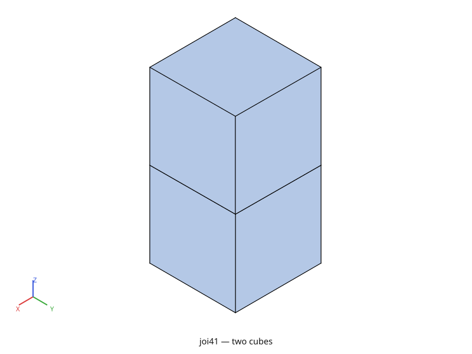

#### pyrucast listing

<details><summary><code>run.py</code></summary>

```python
"""joi41 — two stacked cubes, continuous and joined by a stiff joint, HEX8.

Problem: two cubes of side 2, one above the other (z from −4 to 0), E =
2.1e11, ν = 0.3, are pulled by 1e5 Pa on their upper face; on their base
z = −4, the corner (2, 2) is held, the edge x = 2 along x and z, the edge
y = 2 along y and z, the corner (0, 0) along z. They are computed twice:
as one continuous body, and as two bodies joined at z = −2 by a joint of
stiffness k_s = k_n = 4.2e15 per unit area. Reference: the second
computation gives the first one's displacement, within 1e-9.

The joint is `model.interface_transfer` between the two facing squares,
whose `h_u_x`, `h_u_y` (tangential, k_s) and `h_u_z` (normal, k_n) are its
stiffnesses: the joint plane is z = constant, so the global components are
its own.

Running::

    python validation/11_joint/joi41/run.py
"""

import os

import pyrucast as pc

E, NU = 2.1e11, 0.3
SIDE = 2.0
K_S, K_N = 4.2e15, 4.2e15
PULL = 1e5  # Pa, on the upper face


def square(coords, z):
    """A QUA4 square of side SIDE at height z, counter-clockwise seen from +z."""
    mesh = pc.Mesh(coords, "QUA4")
    mesh.unit().add_cell(
        [
            coords.add_node([0.0, 0.0, z]),
            coords.add_node([SIDE, 0.0, z]),
            coords.add_node([SIDE, SIDE, z]),
            coords.add_node([0.0, SIDE, z]),
        ]
    )
    return mesh


def solve(coords, cubes, joint, extra_model):
    """u for the cubes, held and pulled as in the `.dgibi` file."""
    fes = pc.FiniteElementSpace(cubes)
    elasticity = pc.model.elasticity(fes, "full_3d")
    corner = pc.mesh.poi1_from_nodes([cubes.nearest_node([SIDE, SIDE, -2.0 * SIDE])])
    edge_x = pc.mesh.points_on_line(
        cubes, [SIDE, 0.0, -2.0 * SIDE], [SIDE, SIDE, -2.0 * SIDE]
    )
    edge_y = pc.mesh.points_on_line(
        cubes, [SIDE, SIDE, -2.0 * SIDE], [0.0, SIDE, -2.0 * SIDE]
    )
    origin = pc.mesh.poi1_from_nodes([cubes.nearest_node([0.0, 0.0, -2.0 * SIDE])])
    # The blocked nodes of each unknown, each node once (`consolidate`).
    model = (
        elasticity
        | pc.model.dirichlet(pc.mesh.consolidate(corner | edge_x), elasticity, "u_x")
        | pc.model.dirichlet(pc.mesh.consolidate(corner | edge_y), elasticity, "u_y")
        | pc.model.dirichlet(
            pc.mesh.consolidate(corner | edge_x | edge_y | origin), elasticity, "u_z"
        )
    )
    if joint is not None:
        model = model | extra_model(elasticity)
    top = pc.mesh.elements_on(
        pc.mesh.skin(cubes),
        pc.mesh.points_on_plane(cubes, [0.0, 0.0, 0.0], [0.0, 0.0, 1.0]),
    )
    # A pull on the outward-oriented upper face: φ_n = +p.
    pull = pc.model.flux(pc.FiniteElementSpace(top), elasticity, "n")
    model = model | pull
    materials = pc.element_field.material_field(
        model,
        [
            ("E", E),
            ("nu", NU),
            ("phi_n", PULL),
            ("h_u_x", K_S),
            ("h_u_y", K_S),
            ("h_u_z", K_N),
        ],
    )
    forces = pc.node_field.external_forces(model, materials)
    return pc.solver.solve(pc.matrix.stiffness(model, materials), forces)


def main(out: str | None = None) -> dict[str, float]:
    # ── One continuous body: two layers of HEX8 from z = −4 up to z = 0 ─────
    coords = pc.Coords(3)
    continuous = pc.mesh.extrude(square(coords, -2.0 * SIDE), [0.0, 0.0, 2.0 * SIDE], 2)
    u = solve(coords, continuous, None, None)
    uz_continuous = u.value(continuous.nearest_node([0.0, 0.0, 0.0]), "u_z")

    # ── Two bodies, each extruded from its own square at z = −2 ─────────────
    coords = pc.Coords(3)
    face_lower = square(coords, -SIDE)
    face_upper = square(coords, -SIDE)
    lower = pc.mesh.extrude(face_lower, [0.0, 0.0, -SIDE], 1)
    upper = pc.mesh.extrude(face_upper, [0.0, 0.0, SIDE], 1)
    cubes = lower | upper

    def joint(elasticity):
        return pc.model.interface_transfer(
            pc.FiniteElementSpace(face_upper),
            pc.FiniteElementSpace(face_lower),
            elasticity,
            ["u_x", "u_y", "u_z"],
        )

    u = solve(coords, cubes, True, joint)
    uz_joint = u.value(upper.nearest_node([0.0, 0.0, 0.0]), "u_z")

    if out:
        cubes.plot(title="joi41 — two cubes", save=os.path.join(out, "mesh.svg"))
    return {"uz_continuous": uz_continuous, "uz_joint": uz_joint}


if __name__ == "__main__":
    print(main("."))
```

</details>

### joi44

#### Description sheet

| | |
|---|---|
| Test name | joi44 |
| Calculation type | ORTHOTROPIC ELASTIC MECHANICS |
| Finite element type (Cast3M) | QUA4, JOI4 |
| pyrucast model | not available — missing: joint elements with thermal expansion |
| Reference | Analytical solution. |
| Cast3M version of the 2011 document | 97' customer version |
| Cast3M 2026 `.dgibi` file | `dgibi/joi44.dgibi` |
| Folder | [`11_joint/joi44/`](11_joint/joi44/) |

**Topic.** A 3D joint, clamped on its lower face and free on its upper one, is loaded
by a temperature field, given once on the model and once on the mesh.

**Goal.** Calculate the stress induced by the temperature: σ = k_n·α_n·ΔT.

**Model description.**

One JOI4 joint element.

| Data | Value |
|---|---|
| k_s1 | 4.2e10 |
| k_s2 | 3.0e5 |
| k_n | 4.2e20 |
| α_n | 2.5 |
| ΔT | 1000 |

- Reference: σ = 4.2e20 × 2.5 × 1000.

#### Results

| Quantity | Reference | Cast3M 2011 | Cast3M 2026 | pyrucast | pyrucast / reference |
|---|---|---|---|---|---|
| normal stress, temperature on the model | 1.05e+24 | — | 1.05e+24 (+0 %) | not available |  |
| normal stress, temperature on the mesh | 1.05e+24 | — | 1.05e+24 (+0 %) | not available |  |

Acceptance: criterion of the `.dgibi` file, both relative gaps ≤ 1e-4.

### joi45

#### Description sheet

| | |
|---|---|
| Test name | joi45 |
| Calculation type | ORTHOTROPIC ELASTIC MECHANICS |
| Finite element type (Cast3M) | QUA4, JOI4 |
| pyrucast model | not available — missing: orthotropic joint with material axes |
| Reference | Analytical solution. |
| Cast3M version of the 2011 document | 97' customer version |
| Cast3M 2026 `.dgibi` file | `dgibi/joi45.dgibi` |
| Folder | [`11_joint/joi45/`](11_joint/joi45/) |

**Topic.** A 3D joint, clamped on its lower face, carries a shear load on its upper
face along the direction O-P1 at 55° from x, its first orthotropic axis.

**Goal.** Calculate the displacement along the load, the strains, the stresses and the
nodal forces from the integration of the stresses.

**Model description.**

One JOI4 joint element of area A = 4, orthotropic axes at 55° from x.

| Data | Value |
|---|---|
| k_s1 | 4.2e10 |
| k_s2 | 4.2e8 |
| k_n | 4.2e20 |

- Load: total force F = 1e5 along O-P1.
- Reference: δ = F / (k·A) along O-P1, i.e. δ_x = δ·cos 55° and
  δ_y = δ·sin 55°.

#### Results

| Quantity | Reference | Cast3M 2011 | Cast3M 2026 | pyrucast | pyrucast / reference |
|---|---|---|---|---|---|
| u_x of the upper face | 3.416e-07 | — | 3.41614e-07 (+0.00415 %) | not available |  |
| u_y of the upper face | 4.875e-07 | — | 4.87451e-07 (-0.0101 %) | not available |  |

Acceptance: criterion of the `.dgibi` file, both relative gaps ≤ 1e-3.

## Dynamics

### dyna6

#### Description sheet

| | |
|---|---|
| Test name | dyna6 |
| Calculation type | MECHANICS DYNAMICS 3D |
| Finite element type (Cast3M) | POUT |
| pyrucast model |  |
| Reference | Analytical solution : Timoshenko. |
| Cast3M version of the 2011 document | 97' customer version |
| Cast3M 2026 `.dgibi` file | `dgibi/dyna6.dgibi` |
| Folder | [`12_dynamics/dyna6/`](12_dynamics/dyna6/) |

**Topic.** Bending modes of a cantilever beam. The eigenvalue operator is run in its
three modes: in given intervals (bisection), near given values, and by the
Lanczos method on a subspace.

**Goal.** Find the frequencies of the first two bending modes of the beam.

**Model description.**

Cantilever beam of length L = 2 m, section A = 0.01 m², POUT elements.

- Reference: f₁ = 17.71 Hz, f₂ = 110.98 Hz (Timoshenko).

**Notes.** pyrucast meshes the `.dgibi` file's line — 16 cells on the first 1.566 m and 4
on the last 0.434 m, through the node at 0.783·L where the second mode has its
node — in Bernoulli cells (`bernoulli`) with their consistent mass, rotary
inertia included, the root clamped on its six unknowns. `solver.eigen` gives
the two lowest modes, those of the weak bending plane: 17.70358 Hz and
110.70686 Hz, Cast3M 2026's values to nine digits. Both codes sit below the
analytical values by the same −0.036 % and −0.246 %.

The values compared here are those of the `.dgibi` file's first method
(intervals).

#### Results

| Quantity | Reference | Cast3M 2011 | Cast3M 2026 | pyrucast | pyrucast / reference |
|---|---|---|---|---|---|
| first frequency (Hz) | 17.71 | — | 17.7036 (-0.0363 %) | 17.7036 | -0.0363 % |
| second frequency (Hz) | 110.98 | — | 110.707 (-0.246 %) | 110.707 | -0.246 % |

Acceptance: criterion of the `.dgibi` file, each frequency within 1 % for the four eigenvalue methods.

pyrucast: the 2 checked quantities are within tolerance.

#### pyrucast listing

<details><summary><code>run.py</code></summary>

```python
"""dyna6 — bending modes of a cantilever beam (Timoshenko's analytical values).

Problem: a steel beam of length 2 m, section 0.01 m², clamped at one end. Its
weak plane (I = 6.25e-6 m⁴) gives the two lowest modes, f₁ = 17.71 Hz and
f₂ = 110.98 Hz; the strong plane (I = 1e-3 m⁴), the extension and the torsion
come far above.

Mesh: the `.dgibi` file's line, through the node at 0.783·L where the second
mode has its node — 16 cells on the first 1.566 m and 4 on the last 0.434 m,
as its density of 0.1 places them. Bernoulli cells with their consistent mass,
rotary inertia included; the root clamped on its six unknowns.

Running::

    python validation/12_dynamics/dyna6/run.py
"""

import math

import pyrucast as pc

E, NU, RHO = 2e11, 0.3, 7800.0
LENGTH = 2.0
SECTION, I_Y, I_Z, TORSION = 0.01, 6.25e-6, 1e-3, 1e-2


def main(out: str | None = None) -> dict[str, float]:
    coords = pc.Coords(3)
    q1 = coords.add_node([0.0, 0.0, 0.0])
    q2 = coords.add_node([0.783 * LENGTH, 0.0, 0.0])
    q3 = coords.add_node([LENGTH, 0.0, 0.0])
    line = pc.mesh.line(q1, q2, 16) | pc.mesh.line(q2, q3, 4)

    beam = pc.model.bernoulli(pc.FiniteElementSpace(line, interpolation="HERMITE3"))
    clamp = pc.mesh.poi1_from_nodes([q1])
    model = beam
    for variable in beam.primal_vars():
        model = model | pc.model.dirichlet(clamp, beam, variable)
    materials = pc.element_field.material_field(
        model,
        [
            ("E", E),
            ("A", SECTION),
            ("I_y", I_Y),
            ("I_z", I_Z),
            ("J", TORSION),
            ("G", E / (2.0 * (1.0 + NU))),
            ("rho", RHO),
        ],
    )
    stiffness = pc.matrix.stiffness(model, materials)
    mass = pc.matrix.mass(beam, materials)

    modes = pc.solver.eigen(stiffness, mass, 2)
    f1, f2 = (math.sqrt(m["eigenvalue"]) / (2.0 * math.pi) for m in modes)
    return {"f1": f1, "f2": f2}


if __name__ == "__main__":
    print(main("."))
```

</details>

### dyna7

#### Description sheet

| | |
|---|---|
| Test name | dyna7 |
| Calculation type | MECHANICS DYNAMICS 2D FOURIER |
| Finite element type (Cast3M) | LQUA4, LSU2 |
| pyrucast model | not available — missing: Fourier harmonic analysis; acoustic fluid elements with free surface; eigenvalue solver |
| Reference | Analytical solution. |
| Cast3M version of the 2011 document | 97' customer version |
| Cast3M 2026 `.dgibi` file | `dgibi/dyna7.dgibi` |
| Folder | [`12_dynamics/dyna7/`](12_dynamics/dyna7/) |

**Topic.** Sloshing modes of a thin layer of fluid in an annular rigid cavity, with
gravity, computed for the Fourier harmonics 1 and 3 with the three methods of
the eigenvalue operator.

**Goal.** Find the frequencies of the first sloshing mode for the harmonics 1 and 3.

**Model description.**

Annular cavity: L = 2 m, L₂ = 1.2 m, thickness 0.01 m.

| Data | Value |
|---|---|
| ρ | 1000 kg/m³ |
| speed of sound | 1200 m/s |
| g | 9.81 m/s² |

#### Results

| Quantity | Reference | Cast3M 2011 | Cast3M 2026 | pyrucast | pyrucast / reference |
|---|---|---|---|---|---|
| first frequency, harmonic 1 (Hz) | 0.489 | — | 0.489469 (+0.096 %) | not available |  |
| first frequency, harmonic 3 (Hz) | 0.863 | — | 0.863807 (+0.0935 %) | not available |  |

Acceptance: criterion of the `.dgibi` file, each of its 32 values within 1 %.

### fsi4

#### Description sheet

| | |
|---|---|
| Test name | fsi4 |
| Calculation type | MECHANICS DYNAMICS 2D FOURIER, FLUID-STRUCTURE INTERACTION |
| Finite element type (Cast3M) | COQ2, LQUA4, RACO |
| pyrucast model | not available — missing: fluid-structure interaction; Fourier harmonic analysis; eigenvalue solver; axisymmetric shell element (COQ2) |
| Reference | Report CEA 91/479 : Validation of CASTEM 2000 for fluid structure interaction problems. |
| Cast3M version of the 2011 document | 97' customer version |
| Cast3M 2026 `.dgibi` file | `dgibi/fsi4.dgibi` |
| Folder | [`12_dynamics/fsi4/`](12_dynamics/fsi4/) |

**Topic.** Two concentric cylindrical shells separated by water, on springs at their
base; modes of the harmonic m = 1.

**Goal.** Find the frequencies of the first two modes of the shells (m = 1).

**Model description.**

| Data | Value |
|---|---|
| inner radius | 500 mm |
| outer radius | 1000 mm |
| height | 1000 mm |
| shell thickness | 5 mm |
| shell E, ν, ρ | 2e5 MPa, 0.3, 8000 kg/m³ |
| water ρ, speed of sound | 1000 kg/m³, 1435e3 mm/s |

#### Results

| Quantity | Reference | Cast3M 2011 | Cast3M 2026 | pyrucast | pyrucast / reference |
|---|---|---|---|---|---|
| first frequency (Hz) | 18.88 | — | 18.6466 (-1.24 %) | not available |  |
| second frequency (Hz) | 55.278 | — | 56.0832 (+1.46 %) | not available |  |

Acceptance: criterion of the `.dgibi` file, each frequency within 5 %.

### dyna5

#### Description sheet

| | |
|---|---|
| Test name | dyna5 |
| Calculation type | MECHANICS DYNAMICS 3D, SUB-STRUCTURATION |
| Finite element type (Cast3M) | POUT |
| pyrucast model | not available — missing: eigenvalue solver; modal sub-structuring |
| Reference | Analytical solution. |
| Cast3M version of the 2011 document | 97' customer version |
| Cast3M 2026 `.dgibi` file | `dgibi/dyna5.dgibi` |
| Folder | [`12_dynamics/dyna5/`](12_dynamics/dyna5/) |

**Topic.** The first frequency of a clamped-clamped beam computed by sub-structuring:
the beam is cut into two halves, joined at Q2-Q3 described three ways (free
- free, clamped - clamped, clamped - free).

**Goal.** Find the first natural frequency of the beam with each method.

**Model description.**

Beam of two halves of length 2 m each, POUT elements.

| Data | Value |
|---|---|
| A | 0.1 m² |
| I_y | 2.08e-7 m⁴ |
| I_z | 3.33e-8 m⁴ |

#### Results

| Quantity | Reference | Cast3M 2011 | Cast3M 2026 | pyrucast | pyrucast / reference |
|---|---|---|---|---|---|
| first frequency, method 1 (Hz) | 0.65 | — | 0.650715 (+0.11 %) | not available |  |
| first frequency, method 2 (Hz) | 0.65 | — | 0.650867 (+0.133 %) | not available |  |
| first frequency, method 3 (Hz) | 0.65 | — | 0.650791 (+0.122 %) | not available |  |

Acceptance: criterion of the `.dgibi` file, each of the three frequencies within 5 %.

### vibr6

#### Description sheet

| | |
|---|---|
| Test name | vibr6 |
| Calculation type | MECHANICS DYNAMICS 3D, COMPOUND EIGEN SHAPES |
| Finite element type (Cast3M) | TUYA |
| pyrucast model | not available — missing: complex eigenmodes under axial flow; pipe element (TUYA) |
| Reference | Model of Paidoussis & Ortoja-Starzewski. |
| Cast3M version of the 2011 document | 97' customer version |
| Cast3M 2026 `.dgibi` file | `dgibi/vibr6.dgibi` |
| Folder | [`12_dynamics/vibr6/`](12_dynamics/vibr6/) |

**Topic.** Complex modes of a pinned-pinned rod in an external axial flow, computed for
flow velocities from 0 to 120 m/s; the rod buckles by divergence at a
critical velocity.

**Goal.** Find the real and imaginary parts of the frequencies against the flow velocity.

**Model description.**

| Data | Value |
|---|---|
| L | 2 m |
| R | 1e-3 m |
| thickness | 1e-3 m |
| ρ | 4000 kg/m³ |
| E | 1e10 Pa |
| ν | 0 |
| fluid ρ | 1000 kg/m³ |

#### Results

| Quantity | Reference | Cast3M 2011 | Cast3M 2026 | pyrucast | pyrucast / reference |
|---|---|---|---|---|---|
| critical (divergence) velocity (m/s) | 25 | — | 24.5 (-2 %) | not available |  |

Acceptance: criterion of the `.dgibi` file, critical velocity within 5 % of 25 m/s.

### vibr10

#### Description sheet

| | |
|---|---|
| Test name | vibr10 |
| Calculation type | MECHANICS DYNAMICS, MASS UNBALANCE RESPONSE |
| Finite element type (Cast3M) |  |
| pyrucast model |  |
| Reference | Analytical solution. |
| Cast3M version of the 2011 document | 97' customer version |
| Cast3M 2026 `.dgibi` file | `dgibi/vibr10.dgibi` |
| Folder | [`12_dynamics/vibr10/`](12_dynamics/vibr10/) |

**Topic.** A point of mass M1 on a stiffness K1 is excited by a rotating unbalance:
M·ẍ + C·ẋ + K·x = F with F the unbalance force. The point describes an
ellipse.

**Goal.** Find the two semi-axes of the ellipse described by the point.

**Model description.**

| Data | Value |
|---|---|
| M1 | 40 kg |
| K1 | 4e5 N/m |
| unbalance m·d | 1e-4 kg·m |
| Ω | 19.0985 rad/s |

- Reference: A = m·d·Ω² / (K1 − Ω²·M1), on y and −A on z.

**Notes.** pyrucast writes the modal basis by hand, as the `.dgibi` file does: two modes,
the shapes u_y = 1 and u_z = 1 of eigenvalue K1/M1 and generalized mass M1,
each on a node of its own, sharing their support. `matrix.project_on_basis`
projects the mass and the stiffness, `node_field.project_on_basis` the
unbalance force, `solver.solve` solves K* − Ω²·M* against it, and
`node_field.recombine` brings the coordinates back to the point.

Without damping, the parts of the rotating force in phase with the sine and
with the cosine do not couple: the first gives the semi-axes compared here, on
its own, where the `.dgibi` file solves both at once on the complex impedance
(`IMPE`). Both semi-axes are the reference to round-off, as Cast3M's.

#### Results

| Quantity | Reference | Cast3M 2011 | Cast3M 2026 | pyrucast | pyrucast / reference |
|---|---|---|---|---|---|
| response along y (m) ¹ | 9.46402e-08 | — | 9.46402e-08 (-1.4e-14 %) | 9.46402e-08 | -1.4e-13 % |
| response along z (m) ¹ | -9.46402e-08 | — | -9.46402e-08 (+1.4e-14 %) | -9.46402e-08 | +1.4e-13 % |

¹ Reference computed by the Cast3M 2026 `.dgibi` file from its analytical formula.

Acceptance: criterion of the `.dgibi` file, both semi-axes within 0.1 %.

pyrucast: the 2 checked quantities are within tolerance.

#### pyrucast listing

<details><summary><code>run.py</code></summary>

```python
"""vibr10 — response of a point mass to a rotating unbalance, on a modal basis.

Problem: a point of mass M1 = 40 kg held by a stiffness K1 = 4e5 N/m along y
and along z is excited by an unbalance m·d = 1e-4 kg·m turning at
Ω = 19.0985 rad/s. The point describes an ellipse — a circle here, the system
being isotropic — of semi-axis A = m·d·Ω² / (K1 − Ω²·M1) on y and −A on z.

Modal basis: two modes written by hand, as the `.dgibi` file does: the shapes
u_y = 1 and u_z = 1, of eigenvalue K1/M1 and generalized mass M1, each on a
node of its own. The mass, the stiffness and the unbalance force are projected
on them, the projected system is solved at Ω, and the response recombined.
Without damping, the two parts of the rotating force do not couple: the part in
phase with the sine gives the response the quantities read, the other one its
imaginary part.

Running::

    python validation/12_dynamics/vibr10/run.py
"""

import pyrucast as pc

M1, K1 = 40.0, 4e5
UNBALANCE = 1e-4  # m·d, kg·m
OMEGA = 19.0985  # rad/s


def main(out: str | None = None) -> dict[str, float]:
    coords = pc.Coords(3)
    p1 = coords.add_node([1.0, 0.0, 0.0])
    point = pc.mesh.poi1_from_nodes([p1])

    def diagonal(value: float) -> pc.Matrix:
        matrix = pc.Matrix.block(
            point, point, ["f_y", "f_z"], ["u_y", "u_z"], symmetry="full"
        )
        for dual, primal in (("f_y", "u_y"), ("f_z", "u_z")):
            matrix[0].add_entry(p1, dual, p1, primal, value)
        matrix.assemble()
        return matrix

    mass, stiffness = diagonal(M1), diagonal(K1)

    # The two modes, each on a node of its own, sharing their support.
    nodes = [coords.add_node([0.0, 0.0, 0.0]) for _ in range(2)]
    support = pc.mesh.poi1_from_nodes(nodes)
    shapes = [
        pc.NodeField(point, [("u_y", 1.0), ("u_z", 0.0)]),
        pc.NodeField(point, [("u_y", 0.0), ("u_z", 1.0)]),
    ]
    modes = [
        {
            "node": node,
            "support": support,
            "eigenvalue": K1 / M1,
            "shape": shape,
            "pairs": [("u_y", "f_y"), ("u_z", "f_z")],
            "generalized_mass": M1,
        }
        for node, shape in zip(nodes, shapes)
    ]

    force = UNBALANCE * OMEGA**2
    unbalance = pc.NodeField(point, [("f_y", force), ("f_z", -force)])
    k_star = pc.matrix.project_on_basis(stiffness, modes)
    m_star = pc.matrix.project_on_basis(mass, modes)
    f_star = pc.node_field.project_on_basis(unbalance, modes)
    q = pc.solver.solve(k_star - m_star * OMEGA**2, f_star)
    u = pc.node_field.recombine(q, modes)
    return {"y_axis": u.value(p1, "u_y"), "z_axis": u.value(p1, "u_z")}


if __name__ == "__main__":
    print(main("."))
```

</details>

### dyna12

#### Description sheet

| | |
|---|---|
| Test name | dyna12 |
| Calculation type | MECHANICS DYNAMICS 3D, TRANSIENT RESPONSE |
| Finite element type (Cast3M) | BARR |
| pyrucast model | `model.truss` in `stepping.step_by_step(dynamics=True)` (Newmark), SEG2 |
| Reference | J. S. Przemieniecki : Theory of matrix structural analyses (New York : McGraw-Hill Book Co., 1968) p340. |
| Cast3M version of the 2011 document | 97' customer version |
| Cast3M 2026 `.dgibi` file | `dgibi/dyna12.dgibi` |
| Folder | [`12_dynamics/dyna12/`](12_dynamics/dyna12/) |

**Topic.** Transient response of a free launcher to an axial thrust applied during a
limited time: rigid-body motion plus axial vibration.

**Goal.** Find the displacement history of the bottom point P1.

**Model description.**

Free bar of length 140 along y, BARR elements.

| Data | Value |
|---|---|
| A | 1 |
| E | 1e4 |
| ν | 0.3 |
| ρ | 0.1 |

#### Results

| Quantity | Reference | Cast3M 2011 | Cast3M 2026 | pyrucast | pyrucast / reference |
|---|---|---|---|---|---|
| u_y at P1, t = 1.9125 | 10.8997 | — | 10.6602 (-2.2 %) | 10.6602 | -2.2 % |
| u_y at P1, t = 2.0625 | 11.7323 | — | 11.2886 (-3.78 %) | 11.2886 | -3.78 % |

Acceptance: criterion of the `.dgibi` file, both relative gaps < 5 %.

pyrucast: the 2 checked quantities are within tolerance.

#### pyrucast figures

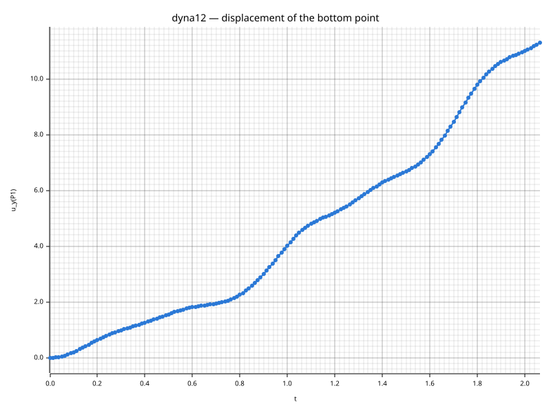

#### pyrucast listing

<details><summary><code>run.py</code></summary>

```python
"""dyna12 — transient response of a free launcher to an axial thrust, bars.

Problem: a free bar of length 140 along y (two bars of 70), section 1,
E = 1e4, ρ = 0.1, at rest, receives at its bottom end P1 a thrust F_y = 100,
raised in 0.0125, held until 1.0125 and released in 0.0125. It moves as a
rigid body and vibrates along its axis. Reference (Przemieniecki): the
displacement of P1 at t = 1.9125 and t = 2.0625.

The motion is integrated by Newmark's average acceleration, as the `.dgibi` file's
DYNAMIC procedure does, here with a step of 0.0125 that falls on the load's
corners and on the two instants read.

Running::

    python validation/12_dynamics/dyna12/run.py
"""

import os

import pyrucast as pc

E, AREA, RHO = 1e4, 1.0, 0.1
LENGTH, N = 140.0, 2
THRUST = 100.0
LOAD = [(0.0, 0.0), (0.0125, 1.0), (1.0125, 1.0), (1.025, 0.0), (3.0, 0.0)]
DT = 0.0125
TIMES = [DT * i for i in range(166)]  # up to 2.0625
READ_AT = (1.9125, 2.0625)


def main(out: str | None = None) -> dict[str, float]:
    coords = pc.Coords(3)
    p1 = coords.add_node([0.0, 0.0, 0.0])
    p3 = coords.add_node([0.0, LENGTH, 0.0])
    launcher = pc.mesh.line(p1, p3, N)

    model = pc.model.truss(pc.FiniteElementSpace(launcher))
    materials = pc.element_field.material_field(
        model, [("E", E), ("A", AREA), ("rho", RHO)]
    )
    thrust = pc.NodeField(pc.mesh.poi1_from_nodes([p1]), ["f_y"])
    thrust[0].set_value(p1, "f_y", THRUST)
    data = {
        "model": model,
        "times": TIMES,
        "materials": materials,
        "loads": pc.Evolution([(t, thrust * f) for t, f in LOAD]),
        "dynamics": True,
    }
    pc.stepping.step_by_step(data)

    values = {}
    times, displacements = [], []
    for record in data["results"]:
        uy = record["displacement"].value(p1, "u_y")
        times.append(record["time"])
        displacements.append(uy)
        for k, t in enumerate(READ_AT, start=1):
            if abs(record["time"] - t) < 1e-9:
                values[f"uy_{k}"] = uy

    if out:
        pc.SubEvolution(list(zip(times, displacements))).plot(
            x_label="t",
            y_label="u_y(P1)",
            title="dyna12 — displacement of the bottom point",
            save=os.path.join(out, "u_y.svg"),
        )
    return values


if __name__ == "__main__":
    print(main("."))
```

</details>

### dyna11

#### Description sheet

| | |
|---|---|
| Test name | dyna11 |
| Calculation type | MECHANICS DYNAMICS 2D |
| Finite element type (Cast3M) | QUA4 |
| pyrucast model | `model.elasticity(fes, "axisymmetric")` in `stepping.step_by_step(dynamics=True)` (Newmark), QUA4 |
| Reference | S. H.Crandall, N. C. Dahl and T. J. Lardner : An introduction to the mechanics of solids, 2nd ed. (New York : McGraw-Hill Book Company, 1972) pp. 293-297. |
| Cast3M version of the 2011 document | 97' customer version |
| Cast3M 2026 `.dgibi` file | `dgibi/dyna11.dgibi` |
| Folder | [`12_dynamics/dyna11/`](12_dynamics/dyna11/) |

**Topic.** A thick-walled cylinder is suddenly loaded by an internal pressure. Without
damping, the largest radial displacement is twice the static one.

**Goal.** Find the largest radial displacement of three points at the cylinder's
half-length, divided by their static displacement.

**Model description.**

Axisymmetric, QUA4 elements.

| Data | Value |
|---|---|
| E | 30e6 |
| ν | 0 |

- Load: internal pressure 10, applied at once and held.
- Static radial displacements of the three points: 3.326e-6, 2.773e-6 and
  2.673e-6.

#### Results

| Quantity | Reference | Cast3M 2011 | Cast3M 2026 | pyrucast | pyrucast / reference |
|---|---|---|---|---|---|
| amplification at the first point (node 25) | 2 | — | 1.9308 (-3.46 %) | 1.9308 | -3.46 % |
| amplification at the second point (node 62) | 2 | — | 2.05572 (+2.79 %) | 2.05572 | +2.79 % |
| amplification at the third point (node 36) | 2 | — | 2.05491 (+2.75 %) | 2.05491 | +2.75 % |

Acceptance: criterion of the `.dgibi` file, each amplification within 5 % of 2.

pyrucast: the 3 checked quantities are within tolerance.

#### pyrucast figures

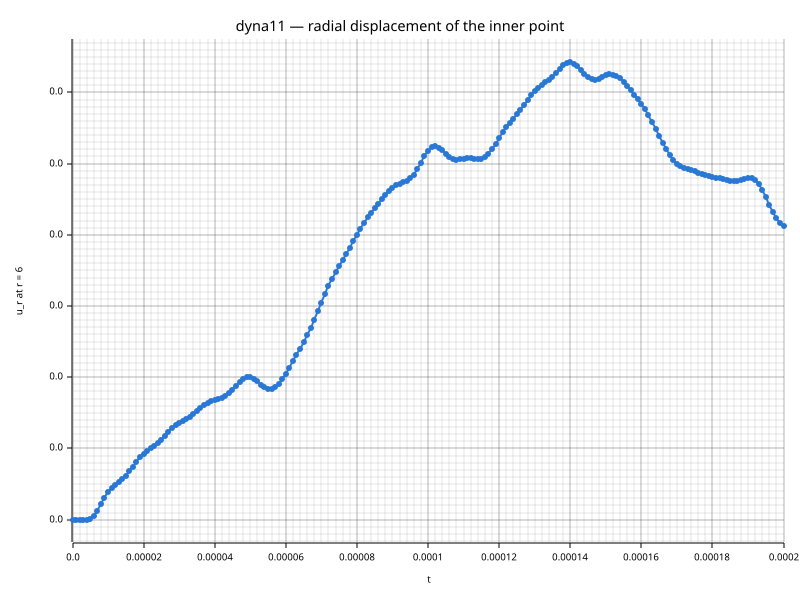

#### pyrucast listing

<details><summary><code>run.py</code></summary>

```python
"""dyna11 — thick cylinder under a sudden internal pressure, axisymmetric, QUA4.

Problem: a thick cylinder, r from 6 to 12, of height 8 held by u_z = 0 on
its two ends, receives at t = 5e-6 (raised from t = 4e-6) an internal
pressure of 10, then held. E = 30e6, ν = 0, ρ = 0.28 × 0.002588. Without
damping, the largest radial displacement of a point is twice its static
value. Reference: that ratio, 2, at three points of the mid-height section,
r = 6, 9 and 11; the static displacements are the `.dgibi` file's.

Mesh: the `.dgibi` file's regular grid of 6 × 8 QUA4. The motion is integrated by
Newmark's average acceleration every 1e-6 up to 2e-4, as the `.dgibi` file's DYNAMIC
procedure does.

Running::

    python validation/12_dynamics/dyna11/run.py
"""

import os

import pyrucast as pc

E, NU, RHO = 30e6, 0.0, 0.28 * 0.002588
R_IN, R_OUT, HEIGHT = 6.0, 12.0, 8.0
N_R, N_Z = 6, 8
PRESSURE = 10.0
LOAD = [(0.0, 0.0), (4e-6, 0.0), (5e-6, 1.0), (204e-6, 1.0)]
TIMES = [1e-6 * i for i in range(201)]
# The points read, at mid-height, and their static radial displacement.
POINTS = [((6.0, 4.0), 3.326e-6), ((9.0, 4.0), 2.773e-6), ((11.0, 4.0), 2.673e-6)]


def main(out: str | None = None) -> dict[str, float]:
    coords = pc.Coords.axisymmetric()
    p1 = coords.add_node([R_IN, 0.0])
    p2 = coords.add_node([R_OUT, 0.0])
    p3 = coords.add_node([R_OUT, HEIGHT])
    p4 = coords.add_node([R_IN, HEIGHT])
    bottom = pc.mesh.line(p1, p2, N_R)
    top = pc.mesh.line(p3, p4, N_R)
    inner = pc.mesh.line(p4, p1, N_Z)
    cylinder = pc.mesh.transfinite(bottom, pc.mesh.line(p2, p3, N_Z), top, inner)
    points = [cylinder.nearest_node(list(xy)) for xy, _ in POINTS]

    fes = pc.FiniteElementSpace(cylinder)
    elasticity = pc.model.elasticity(fes, "axisymmetric")
    model = elasticity | pc.model.dirichlet(
        pc.mesh.consolidate((bottom | top).to_poi1()), elasticity, "u_y"
    )
    materials = pc.element_field.material_field(
        model, [("E", E), ("nu", NU), ("rho", RHO)]
    )
    # The internal pressure, pushing on the wall: φ_n = −p.
    pressure = pc.model.flux(pc.FiniteElementSpace(inner), elasticity, "n")
    force = pc.node_field.external_forces(
        pressure, pc.element_field.material_field(pressure, [("phi_n", -PRESSURE)])
    )
    data = {
        "model": model,
        "times": TIMES,
        "materials": materials,
        "loads": pc.Evolution([(t, force * f) for t, f in LOAD]),
        "dynamics": True,
    }
    pc.stepping.step_by_step(data)

    largest = [0.0, 0.0, 0.0]
    history = []
    for record in data["results"]:
        u = record["displacement"]
        for k, node in enumerate(points):
            largest[k] = max(largest[k], u.value(node, "u_x"))
        history.append((record["time"], u.value(points[0], "u_x")))

    if out:
        pc.SubEvolution(history).plot(
            x_label="t",
            y_label="u_r at r = 6",
            title="dyna11 — radial displacement of the inner point",
            save=os.path.join(out, "u_r.svg"),
        )
    values = {}
    for k, (_, static) in enumerate(POINTS, start=1):
        values[f"amp_{k}"] = largest[k - 1] / static
    return values


if __name__ == "__main__":
    print(main("."))
```

</details>

### dy_devo5

#### Description sheet

| | |
|---|---|
| Test name | dy_devo5 |
| Calculation type | MECHANICS DYNAMICS 3D, TRANSIENT RESPONSE |
| Finite element type (Cast3M) | POUT |
| pyrucast model | not available — missing: eigenvalue solver; modal-basis transient dynamics with linkages (DYNE) |
| Reference | Walter C. Hury and Moshe F. Rubinstein : Dynamics of structures (Englewood Cliffs : Prentice-Hall, Inc., 1964) p.294. |
| Cast3M version of the 2011 document | 97' customer version |
| Cast3M 2026 `.dgibi` file | `dgibi/dy_devo5.dgibi` |
| Folder | [`12_dynamics/dy_devo5/`](12_dynamics/dy_devo5/) |

**Topic.** A beam on elastic supports carries a triangular distributed load whose
amplitude varies in time; the response is computed on the modal basis.

**Goal.** Find the largest deflection of the beam at two times.

**Model description.**

| Data | Value |
|---|---|
| L | 50 m |
| K_y | 974.1/2 N/m |
| A | 1 m² |
| I_y = I_z | 10 m⁴ |

#### Results

| Quantity | Reference | Cast3M 2011 | Cast3M 2026 | pyrucast | pyrucast / reference |
|---|---|---|---|---|---|
| deflection at P2, t = 1.45 (m) | 0.23382 | — | 0.233614 (-0.0882 %) | not available |  |
| deflection at P2, t = 1.9 (m) | -0.24283 | — | -0.2385 (+1.78 %) | not available |  |

### dy_devo6

#### Description sheet

| | |
|---|---|
| Test name | dy_devo6 |
| Calculation type | MECHANICS DYNAMICS 3D, IMPACT, LINKAGE POINT-PLANE |
| Finite element type (Cast3M) |  |
| pyrucast model | not available — missing: modal-basis transient dynamics with linkages (DYNE) |
| Reference | no source cited in the original document |
| Cast3M version of the 2011 document | 97' customer version |
| Cast3M 2026 `.dgibi` file | `dgibi/dy_devo6.dgibi` |
| Folder | [`12_dynamics/dy_devo6/`](12_dynamics/dy_devo6/) |

**Topic.** A heavy mass with a sinusoidal motion of two amplitudes hits a plane; the
contact is a point-plane linkage with plasticity.

**Goal.** Get the impact force against the displacement and the plastic displacement
against the time.

**Model description.**

| Data | Value |
|---|---|
| M1 | 100 000 kg |
| gap | 0 |
| E | 50 Pa |
| K_e | 100 N/m |

#### Results

| Quantity | Reference | Cast3M 2011 | Cast3M 2026 | pyrucast | pyrucast / reference |
|---|---|---|---|---|---|
| largest gap of the `.dgibi` file's comparison | 0 | — | 0.00351229 (Δ = 0.0035) | not available |  |

Acceptance: criterion of the `.dgibi` file, largest gap ≤ 0.005.

### dy_devo3

#### Description sheet

| | |
|---|---|
| Test name | dy_devo3 |
| Calculation type | MECHANICS DYNAMICS 3D, IMPACT, LINKAGE CIRCLE-PLANE-FRICTION |
| Finite element type (Cast3M) |  |
| pyrucast model | not available — missing: modal-basis transient dynamics with linkages (DYNE) |
| Reference | no source cited in the original document |
| Cast3M version of the 2011 document | 97' customer version |
| Cast3M 2026 `.dgibi` file | `dgibi/dy_devo3.dgibi` |
| Folder | [`12_dynamics/dy_devo3/`](12_dynamics/dy_devo3/) |

**Topic.** A wheel of 1 m diameter, clamped between two planes, is driven by a torque;
the linkages are circle-plane with friction.

**Goal.** Find the rotation about the z axis.

**Model description.**

| Data | Value |
|---|---|
| R | 1 m |
| gap | −0.00025 m |
| M_z | 1000 N·m |
| K_e | 4e6 N/m |
| K_t | 10·K_e / R² |

- Reference: rotation 100·t² at the compared times.

#### Results

| Quantity | Reference | Cast3M 2011 | Cast3M 2026 | pyrucast | pyrucast / reference |
|---|---|---|---|---|---|
| rotation, first compared time ¹ | 16 | — | 16.0141 (+0.0883 %) | not available |  |
| rotation, second compared time ¹ | 16 | — | 16 (+0.0002 %) | not available |  |

¹ Reference computed by the Cast3M 2026 `.dgibi` file from its analytical formula.

Acceptance: criterion of the `.dgibi` file, both relative gaps ≤ 1e-2.

### dy_devo4

#### Description sheet

| | |
|---|---|
| Test name | dy_devo4 |
| Calculation type | MECHANICS DYNAMICS 3D, IMPACT, LINKAGE SECTION-SECTION-OUTSIDE |
| Finite element type (Cast3M) | POUT |
| pyrucast model | not available — missing: modal-basis transient dynamics with linkages (DYNE) |
| Reference | no source cited in the original document |
| Cast3M version of the 2011 document | 97' customer version |
| Cast3M 2026 `.dgibi` file | `dgibi/dy_devo4.dgibi` |
| Folder | [`12_dynamics/dy_devo4/`](12_dynamics/dy_devo4/) |

**Topic.** A cantilever beam with a mass at its tip, deflected by a force then
released, hits a plane; two linkage types are compared.

**Goal.** Find the impact force and the displacement u_x at t = 0.4 s.

**Model description.**

| Data | Value |
|---|---|
| L | 0.9 m |
| tip mass | 2 kg |
| A | 1.1e-6 m² |
| I_y = I_z | 8.33e-10 m⁴ |

**Notes.** The compared values are those of the second linkage type.

#### Results

| Quantity | Reference | Cast3M 2011 | Cast3M 2026 | pyrucast | pyrucast / reference |
|---|---|---|---|---|---|
| impact force | 0.59178 | — | 0.231555 (-60.9 %) | not available |  |
| u_x at t = 0.4 s | 0.13598 | — | 0.0532069 (-60.9 %) | not available |  |

Acceptance: criterion of the `.dgibi` file, each value at most 1.2 times the reference (one-sided).

### dy_devo8

#### Description sheet

| | |
|---|---|
| Test name | dy_devo8 |
| Calculation type | MECHANICS DYNAMICS 3D, IMPACT, LINKAGE POINT-MOVING CIRCLE, LINKAGE LINE-LINE-FRICTION |
| Finite element type (Cast3M) |  |
| pyrucast model | not available — missing: modal-basis transient dynamics with linkages (DYNE) |
| Reference | no source cited in the original document |
| Cast3M version of the 2011 document | 97' customer version |
| Cast3M 2026 `.dgibi` file | `dgibi/dy_devo8.dgibi` |
| Folder | [`12_dynamics/dy_devo8/`](12_dynamics/dy_devo8/) |

**Topic.** A point hits a moving circle; the impact is computed with a point - moving
circle linkage and with a line - line linkage with friction, and the two are
compared.

**Goal.** Find the displacements u_x and u_y of the point, and compare the two linkages.

**Model description.**

| Data | Value |
|---|---|
| R | 0.04 m |
| U₀ | 5 m/s |
| V₀ | 10 m/s |
| K_e | 1e8 N/m |
| K_t | −100 N/m |

#### Results

| Quantity | Reference | Cast3M 2011 | Cast3M 2026 | pyrucast | pyrucast / reference |
|---|---|---|---|---|---|
| largest difference on u_x (m) | 0 | — | 0.000735971 (Δ = 0.00074) | not available |  |
| largest difference on u_y (m) | 0 | — | 0.000870092 (Δ = 0.00087) | not available |  |

Acceptance: criteria of the `.dgibi` file, largest differences below 0.0018 and 0.005 (x), 0.0012 and 0.004 (y).

### dyne01

#### Description sheet

| | |
|---|---|
| Test name | dyne01 |
| Calculation type | MECHANICS DYNAMICS 3D, POLYNOMIAL LINKAGE |
| Finite element type (Cast3M) |  |
| pyrucast model | not available — missing: modal-basis transient dynamics with linkages (DYNE) |
| Reference | no source cited in the original document |
| Cast3M version of the 2011 document | 97' customer version |
| Cast3M 2026 `.dgibi` file | `dgibi/dyne01.dgibi` |
| Folder | [`12_dynamics/dyne01/`](12_dynamics/dyne01/) |

**Topic.** A polynomial linkage computes a force on one mode from the contributions of
other modes; the computation is run once, then again with a restart, with no
geometry (modal data only).

**Goal.** Compare the displacement, velocity and acceleration of the two computations.

**Model description.**

| Data | Value |
|---|---|
| gap | 1 |
| K_e | 0 |
| C | 0 |
| U₀ | 0.033 |
| V₀ | 0.54 |

**Notes.** The `.dgibi` file checks that both computations give the same histories; it has no numeric reference.

#### Results

No compared quantity.

### vibr2

#### Description sheet

| | |
|---|---|
| Test name | vibr2 |
| Calculation type | MECHANICS DYNAMICS 2D AXISYMMETRICAL |
| Finite element type (Cast3M) | QUA8 |
| pyrucast model |  |
| Reference | Test NAFEMS number fv42. |
| Cast3M version of the 2011 document | 97' customer version |
| Cast3M 2026 `.dgibi` file | `dgibi/vibr2.dgibi` |
| Folder | [`12_dynamics/vibr2/`](12_dynamics/vibr2/) |

**Topic.** Uniform radial vibration of a thick hollow sphere. A sector is meshed in
axisymmetry, and linear relations give the nodes of the same radius the same
radial displacement.

**Goal.** Find the first five eigenfrequencies of the radial modes.

**Model description.**

Hollow sphere of inner radius 1.8 m and outer radius 6 m, QUA8 elements.

**Notes.** pyrucast meshes the `.dgibi` file's sector: the side P2-P3 in 5 SEG3 cells,
turned by 10° about the origin in one layer of QUA8, its points those of the
file (P2 = (1.8, −1.8·sin 5°)). The file's linear relations are written with
`mpc`: no displacement normal to either side, the two sides alike at a given
radius, the middle of the sector alike with its side. `solver.eigen` gives the
five lowest modes, the radial ones, all within the tolerance.

pyrucast is 0.002 point behind Cast3M on f₄ and 0.008 on f₅. The gap, mode by
mode (+0.00001 %, +0.00002 %, +0.00047 %, +0.00248 %, +0.00710 % from Cast3M),
is measured to come from the integration of the mass:

- not the eigenvalue solver: Cast3M's four methods (near values, simultaneous
  iterations, intervals, Lanczos) agree with each other to 1e-12;
- not the mesh: the 28 nodes are Cast3M's to 1.8e-15;
- not the relations: the gap is the same, mode by mode, with only the sides
  held;
- the mass: pyrucast integrates it on the 9 points of the space, as the
  stiffness; on these cells, with curved sides and the axisymmetric factor r,
  9 points are not exact (1.4e-4 on the matrix). Integrated on 16 points, as
  Cast3M does for the mass of an axisymmetric QUA8, it gives Cast3M's five
  frequencies to 1e-5 %. The rule of the stiffness changes nothing at that
  precision.

The way to an integration rule of its own for the mass is issue #28.

**Improvement points.**

- an integration rule of its own for the mass, richer in axisymmetry (issue #28)

#### Results

| Quantity | Reference | Cast3M 2011 | Cast3M 2026 | pyrucast | pyrucast / reference |
|---|---|---|---|---|---|
| frequency 1 (Hz) | 369.91 | — | 368.617 (-0.35 %) | 368.617 | -0.35 % |
| frequency 2 (Hz) | 838.03 | — | 834.919 (-0.371 %) | 834.919 | -0.371 % |
| frequency 3 (Hz) | 1451.2 | — | 1447.54 (-0.252 %) | 1447.55 | -0.252 % |
| frequency 4 (Hz) | 2117 | — | 2123.64 (+0.314 %) | 2123.69 | +0.316 % |
| frequency 5 (Hz) | 2795.8 | — | 2841.78 (+1.64 %) | 2841.98 | +1.65 % |

Acceptance: criterion of the `.dgibi` file, each frequency within 2 %.

pyrucast: the 5 checked quantities are within tolerance.

#### pyrucast listing

<details><summary><code>run.py</code></summary>

```python
"""vibr2 — radial vibration of a thick hollow sphere (NAFEMS FV42), axisymmetric.

Problem: a steel sphere of inner radius 1.8 m and outer radius 6 m vibrates
radially. A sector of 10° is meshed in axisymmetry, and linear relations keep
the motion radial: no displacement normal to the two sides of the sector, the
same radial displacement on both sides at a given radius, and on the middle of
the sector. The first five eigenfrequencies are the radial ones.

Mesh: the `.dgibi` file's — the side P2-P3 in 5 SEG3 cells, turned by 10° about
the origin in one layer of QUA8. Its points are those of the file:
P2 = (1.8, −1.8·sin 5°), not (1.8·cos 5°, −1.8·sin 5°), so the sides sit at
∓4.98° and the middle at 0.019°; the relations keep the file's directions.

Running::

    python validation/12_dynamics/vibr2/run.py
"""

import math

import pyrucast as pc

E, NU, RHO = 2e11, 0.3, 8e3
R_IN, R_OUT = 1.8, 6.0
ALPHA = math.radians(5.0)
N_CELLS = 5


def main(out: str | None = None) -> dict[str, float]:
    ca, sa = math.cos(ALPHA), math.sin(ALPHA)
    coords = pc.Coords.axisymmetric()
    p2 = coords.add_node([R_IN, -R_IN * sa])
    p3 = coords.add_node([R_OUT, -R_OUT * sa])
    sector = pc.mesh.revolve(
        pc.mesh.line(p2, p3, N_CELLS, "SEG3"), 2.0 * ALPHA, 1, [0.0, 0.0]
    )
    elasticity = pc.model.elasticity(pc.FiniteElementSpace(sector), "axisymmetric")
    u_r, u_z = elasticity.primal_vars()

    # The nodes of each ray, from the inside out: the two sides, and the
    # middle of the sector (the mid-nodes of the arcs).
    side = math.atan2(-sa, 1.0)
    nodes = {node.id: node for zone in sector for cell in zone for node in cell}

    def ray(angle: float) -> list:
        on_ray = [
            n
            for n in nodes.values()
            if abs(math.atan2(*n.position()[::-1]) - angle) < 1e-9
        ]
        return sorted(on_ray, key=lambda n: math.hypot(*n.position()))

    d23, d41, middle = ray(side), ray(side + 2.0 * ALPHA), ray(side + ALPHA)
    on = pc.mesh.poi1_from_nodes

    # BLOQ DEPL DIRECTION on each side: no displacement along its normal.
    model = elasticity
    model = model | pc.model.mpc([(on(d23), u_r, -sa), (on(d23), u_z, -ca)], elasticity)
    model = model | pc.model.mpc([(on(d41), u_r, -sa), (on(d41), u_z, ca)], elasticity)
    # The two sides, node for node at the same radius.
    model = model | pc.model.mpc(
        [
            (on(d23), u_r, ca),
            (on(d23), u_z, sa),
            (on(d41), u_r, -ca),
            (on(d41), u_z, sa),
        ],
        elasticity,
    )
    # The corners of a side and the middle of the sector at the same radius.
    corners = on(d41[0::2])
    model = model | pc.model.mpc(
        [(corners, u_r, ca), (corners, u_z, sa), (on(middle), u_r, -1.0)], elasticity
    )

    materials = pc.element_field.material_field(
        model, [("E", E), ("nu", NU), ("rho", RHO)]
    )
    stiffness = pc.matrix.stiffness(model, materials)
    mass = pc.matrix.mass(elasticity, materials)
    modes = pc.solver.eigen(stiffness, mass, 5)
    return {
        f"f{i + 1}": math.sqrt(m["eigenvalue"]) / (2.0 * math.pi)
        for i, m in enumerate(modes)
    }


if __name__ == "__main__":
    print(main("."))
```

</details>

## Non linear dynamics

### dyna_nl1

#### Description sheet

| | |
|---|---|
| Test name | dyna_nl1 |
| Calculation type | MECHANICS 2D, NON LINEAR GEOMETRICAL DYNAMICS |
| Finite element type (Cast3M) | BARR |
| pyrucast model | not available — missing: constant added mass in `step_by_step` (Cast3M `MASSE_CONSTANTE`) |
| Reference | no source cited in the original document |
| Cast3M version of the 2011 document | 97' customer version |
| Cast3M 2026 `.dgibi` file | `dgibi/dyna_nl1.dgibi` |
| Folder | [`13_nonlinear_dynamics/dyna_nl1/`](13_nonlinear_dynamics/dyna_nl1/) |

**Topic.** A Duffing-type oscillator: a prestressed bar, clamped at one end, carries a
mass at its free end; the free end is pulled sideways, then released, and
oscillates freely in large displacements.

**Goal.** Find the amplitude and the period of the free oscillations.

**Model description.**

Plane stress, BARR element of length 1 m with a mass of 250 kg at its free
end.

| Data | Value |
|---|---|
| L | 1 m |
| initial deflection δ | 0.2 m |
| A | 1 m² |
| E | 1e7 Pa |
| ν | 0.3 |
| ρ (bar) | 0 |

**Notes.** The end mass is a constant mass matrix added to the bar's, whose density is
zero. A `Matrix.block` on the end node builds it, but `step_by_step` takes its
mass from the model alone and has no input for a mass of its own.

#### Results

| Quantity | Reference | Cast3M 2011 | Cast3M 2026 | pyrucast | pyrucast / reference |
|---|---|---|---|---|---|
| amplitude of the free end (m) | 0.2 | — | 0.199997 (-0.00153 %) | not available |  |
| period (s) | 0.2648 | — | 0.266 (+0.453 %) | not available |  |

Acceptance: criteria of the `.dgibi` file, amplitude within 0.1 % and period within 0.5 %.

### dyna_nl3

#### Description sheet

| | |
|---|---|
| Test name | dyna_nl3 |
| Calculation type | MECHANICS 3D, NON LINEAR DYNAMICS |
| Finite element type (Cast3M) | POUT, COQ3 |
| pyrucast model | not available — missing: large-displacement beam and shell dynamics |
| Reference | no source cited in the original document |
| Cast3M version of the 2011 document | 97' customer version |
| Cast3M 2026 `.dgibi` file | `dgibi/dyna_nl3.dgibi` |
| Folder | [`13_nonlinear_dynamics/dyna_nl3/`](13_nonlinear_dynamics/dyna_nl3/) |

**Topic.** A clamped-free beam under an axial follower compression slightly above the
critical (flutter) load F_cr = 20.05·E·I/L² is released; its response is
computed in large displacements.

**Goal.** Find the largest amplitude of the displacement of the free end.

**Model description.**

| Data | Value |
|---|---|
| L | 12 |
| section side | 0.01 |
| initial deflection δ | 0.01 |
| I_y = I_z | 2.8125e-4 |
| I_o | 1e-5 |

**Notes.** The `.dgibi` file holds two references for its complete and its short run; the reference is that of the run used.

#### Results

| Quantity | Reference | Cast3M 2011 | Cast3M 2026 | pyrucast | pyrucast / reference |
|---|---|---|---|---|---|
| largest displacement of the free end ¹ | 5.8565 | — | 5.85754 (+0.0178 %) | not available |  |

¹ Reference computed by the Cast3M 2026 `.dgibi` file from its analytical formula.

Acceptance: criterion of the `.dgibi` file, |d_max − d_ref| / d_ref ≤ 5 %.

## Thermal analysis

### ther2

#### Description sheet

| | |
|---|---|
| Test name | ther2 |
| Calculation type | THERMAL STEADY STATE, 2D AXISYMMETRICAL |
| Finite element type (Cast3M) | QUA4 |
| pyrucast model | `model.heat_conduction(fes)` in axisymmetry, with `flux`, a volume `flux` and `boundary_transfer`; QUA4 (case 2 also one TRI3) |
| Reference | Analytical solution (1st and 2nd parts). Comparison with results computed by THERMX (3rd part). |
| Cast3M version of the 2011 document | 97' customer version |
| Cast3M 2026 `.dgibi` file | `dgibi/ther2.dgibi` |
| Folder | [`14_thermal/ther2/`](14_thermal/ther2/) |

**Topic.** Thermal boundary conditions in axisymmetry, on a thick-walled cylinder, in
three configurations: imposed temperature and imposed flux; imposed
temperature and a volume heat source; imposed temperature and convection.

**Goal.** Find the temperature in the cylinder for each configuration.

**Model description.**

Thick-walled cylinder, inner radius R_i = 0.0515 m, outer radius
R_e = 0.2015 m, QUA4 elements; temperature T_i imposed on the inner face.

- Configuration 1: flux F on the outer face,
  T = T_i + ln(r/R_i)·F·R_e/k.
- Configuration 2: volume source Q,
  T = T_i + Q/(2k)·((R_i² − R_e²)/2 + R_e²·ln(R_e/R_i)) at the outer face.
- Configuration 3: convection h to T_ext on the outer face,
  T = (T_i + h·R_e·T_ext/k·ln(R_e/R_i)) / (1 + h·R_e/k·ln(R_e/R_i)).

**Notes.** The references are the `.dgibi` file's analytical formulas, evaluated at the
compared point P3. Case 1 is computed on the `.dgibi` file's mesh; cases 2 and 3 on
free meshes of the same boundary lines, Cast3M's and pyrucast's pavers
differing inside.

#### Results

| Quantity | Reference | Cast3M 2011 | Cast3M 2026 | pyrucast | pyrucast / reference |
|---|---|---|---|---|---|
| T at P3, configuration 1 (flux) (°C) ¹ | 0.571522 | — | 0.571519 (-0.000635 %) | 0.571519 | -0.000635 % |
| T at P3, configuration 2 (source) (°C) ¹ | 1510.92 | — | 1505.3 (-0.372 %) | 1506.88 | -0.267 % |
| T at P3, configuration 3 (convection) (°C) ¹ | 122.687 | — | 122.682 (-0.00413 %) | 122.687 | +0.000118 % |

¹ Reference computed by the Cast3M 2026 `.dgibi` file from its analytical formula.

Acceptance: criterion of the `.dgibi` file, each relative gap ≤ 0.4 %.

pyrucast: the 3 checked quantities are within tolerance.

#### pyrucast figures

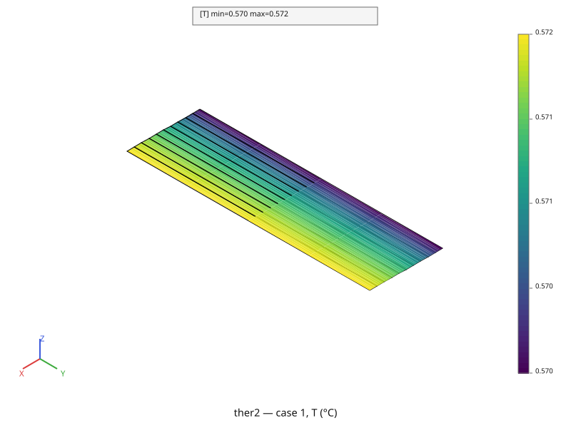

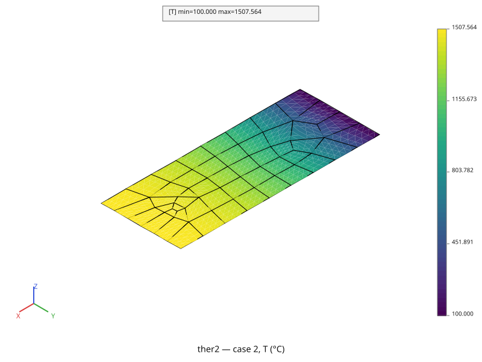

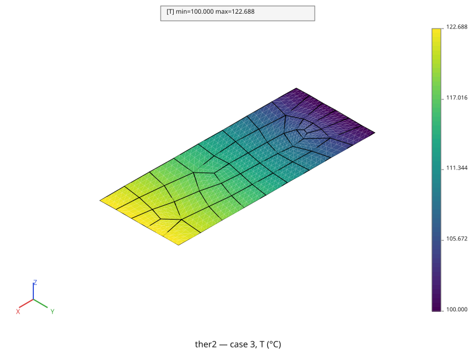

#### pyrucast listing

<details><summary><code>run.py</code></summary>

```python
"""ther2 — thermal boundary conditions on a thick cylinder, axisymmetric, QUA4.

Three steady conduction problems on a thick-walled cylinder, each with an
imposed temperature on the inner face:

1. an imposed flux on the outer face (r from 0.0515 to 0.2015, k = 130,
   T_i = 0.57, flux 0.72 entering);
2. a volume heat source Q = 20 (r from 6 to 16, k = 1, T_i = 100, zero
   flux on the outer face);
3. a convection h = 5 towards T_ext = 125 on the outer face (r from 6 to 16,
   k = 8, T_i = 100).

References: the analytical temperatures at the outer corner P3, evaluated by
the Cast3M `.dgibi` file.

Meshes: case 1 is the `.dgibi` file's row of 10 QUA4. Cases 2 and 3 are free meshes in
the `.dgibi` file, from boundary lines of 8, 6, 9, 4 and 8, 5, 9, 6 elements; here
pyrucast paves the same boundary lines, so the inside differs from Cast3M's
and case 2's odd boundary leaves one triangle.

Running::

    python validation/14_thermal/ther2/run.py
"""

import os

import pyrucast as pc

# Case 1: imposed flux.
R_IN_1, R_OUT_1, HEIGHT_1, N_1 = 0.0515, 0.2015, 0.5, 10
K_1, T_IN_1, FLUX_1 = 130.0, 0.57, 0.72
# Cases 2 and 3: the section r from 6 to 16, z from 0 to 4.
R_IN, R_OUT, HEIGHT = 6.0, 16.0, 4.0
K_2, T_IN_2, SOURCE_2 = 1.0, 100.0, 20.0
K_3, T_IN_3, H_3, T_EXT_3 = 8.0, 100.0, 5.0, 125.0


def main(out: str | None = None) -> dict[str, float]:
    # ── Case 1: imposed temperature inside, imposed flux outside ────────────
    coords = pc.Coords.axisymmetric()
    p1 = coords.add_node([R_IN_1, 0.0])
    p3 = coords.add_node([R_OUT_1, 0.0])
    row = pc.mesh.extrude(pc.mesh.line(p1, p3, N_1), [0.0, HEIGHT_1], 1)
    inner = pc.mesh.points_on_line(row, [R_IN_1, 0.0], [R_IN_1, HEIGHT_1])
    outer_edge = pc.mesh.elements_on(
        pc.mesh.border(row),
        pc.mesh.points_on_line(row, [R_OUT_1, 0.0], [R_OUT_1, HEIGHT_1]),
    )
    conduction = pc.model.heat_conduction(pc.FiniteElementSpace(row))
    blocked = pc.model.dirichlet(inner, conduction, "T")
    model = (
        conduction
        | blocked
        | pc.model.flux(pc.FiniteElementSpace(outer_edge), conduction, "q")
    )
    materials = pc.element_field.material_field(model, [("k", K_1), ("phi_q", FLUX_1)])
    imposed = pc.NodeField(blocked.multiplier_mesh(), ["imposed"])
    imposed[0].add_to_component("imposed", T_IN_1)
    rhs = pc.node_field.external_forces(model, materials) | imposed
    t1 = pc.solver.solve(pc.matrix.stiffness(model, materials), rhs)
    t_case_1 = t1.value(p3, "T")

    # ── Cases 2 and 3: the free meshes of the `.dgibi` file's boundary lines ─────────
    results = []
    for n_right, n_left in ((6, 4), (5, 6)):
        coords = pc.Coords.axisymmetric()
        a = coords.add_node([R_IN, 0.0])
        b = coords.add_node([R_OUT, 0.0])
        c = coords.add_node([R_OUT, HEIGHT])
        d = coords.add_node([R_IN, HEIGHT])
        right = pc.mesh.line(b, c, n_right)
        left = pc.mesh.line(d, a, n_left)
        contour = pc.mesh.consolidate(
            pc.mesh.line(a, b, 8) | right | pc.mesh.line(c, d, 9) | left
        )
        section = pc.mesh.pave_surface(contour, "QUA4")
        results.append((section, right, pc.mesh.consolidate(left.to_poi1()), c))

    section, _right, inner, p3 = results[0]
    fes = pc.FiniteElementSpace(section)
    conduction = pc.model.heat_conduction(fes)
    blocked = pc.model.dirichlet(inner, conduction, "T")
    model = conduction | blocked | pc.model.flux(fes, conduction, "q")
    materials = pc.element_field.material_field(
        model, [("k", K_2), ("phi_q", SOURCE_2)]
    )
    imposed = pc.NodeField(blocked.multiplier_mesh(), ["imposed"])
    imposed[0].add_to_component("imposed", T_IN_2)
    rhs = pc.node_field.external_forces(model, materials) | imposed
    t2 = pc.solver.solve(pc.matrix.stiffness(model, materials), rhs)
    t_case_2 = t2.value(p3, "T")

    section_3, right, inner, p3 = results[1]
    conduction = pc.model.heat_conduction(pc.FiniteElementSpace(section_3))
    blocked = pc.model.dirichlet(inner, conduction, "T")
    model = (
        conduction
        | blocked
        | pc.model.boundary_transfer(pc.FiniteElementSpace(right), conduction, ["T"])
    )
    materials = pc.element_field.material_field(
        model, [("k", K_3), ("h_T", H_3), ("a_ext_T", T_EXT_3)]
    )
    imposed = pc.NodeField(blocked.multiplier_mesh(), ["imposed"])
    imposed[0].add_to_component("imposed", T_IN_3)
    rhs = pc.node_field.external_forces(model, materials) | imposed
    t3 = pc.solver.solve(pc.matrix.stiffness(model, materials), rhs)
    t_case_3 = t3.value(p3, "T")

    if out:
        for name, mesh, field in (
            ("case_1", row, t1),
            ("case_2", section, t2),
            ("case_3", section_3, t3),
        ):
            mesh.plot(
                title=f"ther2 — {name.replace('_', ' ')}, T (°C)",
                field=field,
                component="T",
                cmap="viridis",
                save=os.path.join(out, f"T_{name}.svg"),
            )
    return {"T_1": t_case_1, "T_2": t_case_2, "T_3": t_case_3}


if __name__ == "__main__":
    print(main("."))
```

</details>

### ther7or

#### Description sheet

| | |
|---|---|
| Test name | ther7or |
| Calculation type | THERMAL STEADY STATE, 3D ORTHOTROPIC |
| Finite element type (Cast3M) | COQ8, COQ6 |
| pyrucast model | not available — missing: thermal shell elements |
| Reference | Dowlatyari (03/91). |
| Cast3M version of the 2011 document | 97' customer version |
| Cast3M 2026 `.dgibi` file | `dgibi/ther7or.dgibi` |
| Folder | [`14_thermal/ther7or/`](14_thermal/ther7or/) |

**Topic.** Thermal boundary conditions on orthotropic thermal shells, in three
configurations: imposed temperature and convection; imposed temperature and
imposed flux; imposed temperature and a volume source. The results are
compared with isotropic elements.

**Goal.** Find the temperature in the shell for each configuration and compare it with
the isotropic elements.

**Model description.**

| Data | Value |
|---|---|
| L | 6 m |
| l | 3 m |
| thickness | 0.5 m |
| K_1 = K_3 | 100 W/m/°C |
| K_2 | 1000 W/m/°C |
| h | 15 W/m²/°C |

#### Results

| Quantity | Reference | Cast3M 2011 | Cast3M 2026 | pyrucast | pyrucast / reference |
|---|---|---|---|---|---|
| largest relative gap of the temperature profiles | 0 | — | 0.0301414 (Δ = 0.03) | not available |  |

Acceptance: criterion of the `.dgibi` file, largest relative gap ≤ 5 %.

### ther-perm

#### Description sheet

| | |
|---|---|
| Test name | ther-perm |
| Calculation type | THERMAL STEADY STATE, 3D NON LINEAR |
| Finite element type (Cast3M) | QUA4 |
| pyrucast model | `model.heat_conduction(fes)` with k(T) in `material_laws`, `stepping.step_by_step`, QUA4 |
| Reference | Klaus-Jürgen Bathe & Mohammad R. Khoshgoftaar, Finite element formulation and solution of non-linear heat transfer, Nuclear Engineering and Design, v. 51 (1979), pp. 389-401. J. Joly, Cas tests non linéaires de validation pour DELFINE, Note technique EMT.SMTS.TTMF 84/29. V. Arpaci, Conduction Heat Transfer, Adison-Wesley, 1966, pp. 130-132. |
| Cast3M version of the 2011 document | 97' customer version |
| Cast3M 2026 `.dgibi` file | `dgibi/ther-perm.dgibi` |
| Folder | [`14_thermal/ther-perm/`](14_thermal/ther-perm/) |

**Topic.** A non-linear steady state: an infinite wall with a volume heat source and an
imposed temperature on one face; the conductivity is a linear function of
the temperature, k = k₀·(1 + β·(T − T₀)).

**Goal.** Find the temperature profile in the wall and compare it with the analytical solution.

**Model description.**

| Data | Value |
|---|---|
| L | 5e-3 m |
| thickness | L/10 |
| imposed temperature T_o | 100 °C |
| source Q | 1e7 W/m³ |

- Conductivity: linear in T, through the points T₀ − 100 and T₀ + 1000.

**Notes.** The `.dgibi` file's 26 cells grow from L/100 to L/10 along x; pyrucast's are even.
The non-linear iterations are converged to 1e-8: at step_by_step's default
precision (1e-4) the profile stays about 1e-4 away and misses the `.dgibi` file's
criterion.

**Improvement points.**

- graded lines and extrusions (Cast3M `DINI`/`DFIN`, mesh density)

#### Results

| Quantity | Reference | Cast3M 2011 | Cast3M 2026 | pyrucast | pyrucast / reference |
|---|---|---|---|---|---|
| largest gap of T to the analytical profile | 0 | — | 3.88762e-07 (Δ = 3.9e-07) | 5.28512e-10 | Δ = 5.3e-10 |
| T at the insulated face x = 0 (°C) | 141.24 | — | 141.24 (-1.72e-05 %) | 141.24 | -1.97e-08 % |

Acceptance: criterion of the `.dgibi` file, largest gap to the analytical profile ≤ 1e-5.

pyrucast: the 1 checked quantities are within tolerance.

#### pyrucast figures

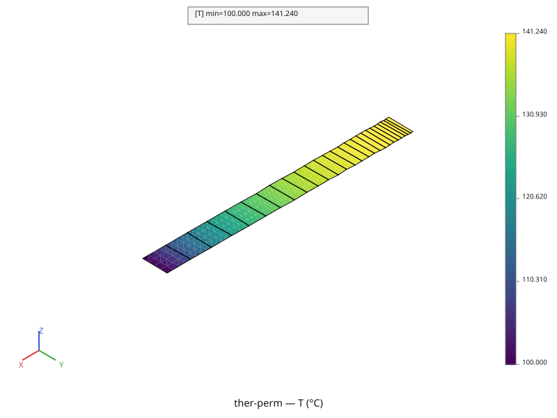

#### pyrucast listing

<details><summary><code>run.py</code></summary>

```python
"""ther-perm — steady conduction with a conductivity linear in T, QUA4.

Problem: an infinite wall of thickness L = 5 mm, heated by a volume source
q = 1e7 W/m³, its face x = L held at T₀ = 100 °C and its face x = 0
insulated. The conductivity is k = k₀·(1 + β·(T − T₀)), k₀ = 2, β = 0.025.
With θ = (T − T₀)·2k₀/(q·L²) and s = L²·q·β/k₀, the exact profile is

    θ(x) = 2·(√(1 + s·(1 − (x/L)²)) − 1) / s.

Compared: the largest gap of θ to that profile over the nodes (the `.dgibi` file's
test), and T at the insulated face, whose exact value is
T₀ + (√(1 + s) − 1)/β.

The non-linear iterations are converged to a precision of 1e-8.

Mesh: one row of 26 QUA4 of height L/10, as many as the `.dgibi` file's. The `.dgibi` file's
cells grow from L/100 to L/10 along x; pyrucast's `line` has no such
progression, its cells are even.

Running::

    python validation/14_thermal/ther-perm/run.py
"""

import math
import os

import pyrucast as pc

L = 5e-3  # m
HEIGHT = L / 10.0
K0, BETA, T0 = 2.0, 0.025, 100.0
SOURCE = 1e7  # W/m³
# The `.dgibi` file's THERMIC procedure stops on its own criterion; at step_by_step's
# default precision (1e-4) the profile would stay 1e-4 from the converged one.
PRECISION = 1e-8
N = 26  # cells along x, as many as the `.dgibi` file's


def main(out: str | None = None) -> dict[str, float]:
    coords = pc.Coords(2)
    hot = coords.add_node([0.0, 0.0])
    held = coords.add_node([L, 0.0])
    wall = pc.mesh.extrude(pc.mesh.line(hot, held, N), [0.0, HEIGHT], 1)
    held_face = pc.mesh.points_on_line(wall, [L, 0.0], [L, HEIGHT])

    fes = pc.FiniteElementSpace(wall)
    conduction = pc.model.heat_conduction(fes)
    blocked = pc.model.dirichlet(held_face, conduction, "T")
    model = conduction | blocked | pc.model.flux(fes, conduction, "q")
    # No heat capacity: the problem is steady. k is overridden by k(T).
    materials = pc.element_field.material_field(model, [("k", K0), ("phi_q", SOURCE)])
    conductivity = pc.Evolution(
        [
            (T0 - 100.0, K0 * (1.0 - 100.0 * BETA)),
            (T0 + 1000.0, K0 * (1.0 + 1000.0 * BETA)),
        ],
        abscissa_type="T",
        ordinate_type="k",
        out_of_range="extrapolate",
    )
    imposed = pc.NodeField(blocked.multiplier_mesh(), ["imposed"])
    imposed[0].add_to_component("imposed", T0)
    data = {
        "model": model,
        "times": [0.0, 1.0],
        "materials": materials,
        "material_laws": conductivity,
        "loads": imposed,
        "initial": {"temperature": pc.NodeField(wall, ["T"]) + T0},
        "precision": PRECISION,
    }
    pc.stepping.step_by_step(data)
    temperature = data["results"][-1]["temperature"]

    s = L * L * SOURCE * BETA / K0
    worst = 0.0
    for i in range(N + 1):
        x = L * i / N
        node = wall.nearest_node([x, HEIGHT])
        theta = (temperature.value(node, "T") - T0) * 2.0 * K0 / (SOURCE * L * L)
        exact = 2.0 * (math.sqrt(1.0 + s * (1.0 - (x / L) ** 2)) - 1.0) / s
        worst = max(worst, abs(theta - exact))

    if out:
        wall.plot(
            title="ther-perm — T (°C)",
            field=temperature,
            component="T",
            cmap="viridis",
            save=os.path.join(out, "T.svg"),
        )
    return {"gap_max": worst, "T_hot": temperature.value(hot, "T")}


if __name__ == "__main__":
    print(main("."))
```

</details>

## Thermo-mechanics

### thme1

#### Description sheet

| | |
|---|---|
| Test name | thme1 |
| Calculation type | LINEAR THERMAL ANALYSIS AND MECHANIC |
| Finite element type (Cast3M) | QUA8 |
| pyrucast model | `model.heat_conduction` and `model.elasticity(fes, "plane_strain")` in `stepping.step_by_step` (linear θ-scheme), QUA8 |
| Reference | Analytical solution. |
| Cast3M version of the 2011 document | 97' customer version |
| Cast3M 2026 `.dgibi` file | `dgibi/thme1.dgibi` |
| Folder | [`15_thermo_mechanics/thme1/`](15_thermo_mechanics/thme1/) |

**Topic.** Heat diffusion in a bar held at both ends: one end is brought to 500 °C,
the other stays at 20 °C; the bar expands. A step-by-step computation chains
the transient heat conduction and the mechanics.

**Goal.** Use the step-by-step procedure: temperature and axial displacement at
x = 0.08 against time, compared with the analytical solution.

**Model description.**

Bar of length l = 0.1, plane strain, QUA8 elements.

| Data | Value |
|---|---|
| k | 14.6 |
| c | 460 |
| ρ | 7800 |
| α | 1e-5 |
| E | 2e11 |
| ν | 1e-5 |
| reference temperature | 20 |

- Analytical temperature: T = 500 − 480·erfc-type solution of the
  semi-infinite bar, T(x, t) = 500 − 480·erf((0.1 − x)/(2√(a t))) /
  erf(0.1/(2√(a t))), a = k/(ρc).
- Computed times: 10 to 150 by 10.

**Notes.** The temperatures and the displacements of pyrucast and Cast3M 2026 agree to
round-off, on the same mesh. In plane strain both dilate the out-of-plane
direction too (α·ΔT on `eps_zz`, held by the kinematics), so a uniformly
heated element held along y stretches by α·ΔT·(1 + ν)/(1 − ν); with ν = 1e-5
here, leaving that component out would only show at the 1e-5 level.

#### Results

| Quantity | Reference | Cast3M 2011 | Cast3M 2026 | pyrucast | pyrucast / reference |
|---|---|---|---|---|---|
| T at x = 0.08, t = 80 (°C) | 227.88 | — | 223.804 (-1.79 %) | 223.804 | -1.79 % |
| T at x = 0.08, t = 100 (°C) | 251.85 | — | 248.66 (-1.27 %) | 248.66 | -1.27 % |
| T at x = 0.08, t = 150 (°C) | 291.3 | — | 290.089 (-0.416 %) | 290.089 | -0.416 % |
| u_x at x = 0.08, t = 80 | 3.04069e-05 | — | 3.00681e-05 (-1.11 %) | 3.00681e-05 | -1.11 % |
| u_x at x = 0.08, t = 100 | 3.90251e-05 | — | 3.87249e-05 (-0.769 %) | 3.87249e-05 | -0.769 % |
| u_x at x = 0.08, t = 150 | 5.76962e-05 | — | 5.82925e-05 (+1.03 %) | 5.82925e-05 | +1.03 % |

Acceptance: criterion of the `.dgibi` file, gaps within 2 % over the second half of the computed times (t ≥ 80).

pyrucast: the 6 checked quantities are within tolerance.

#### pyrucast figures

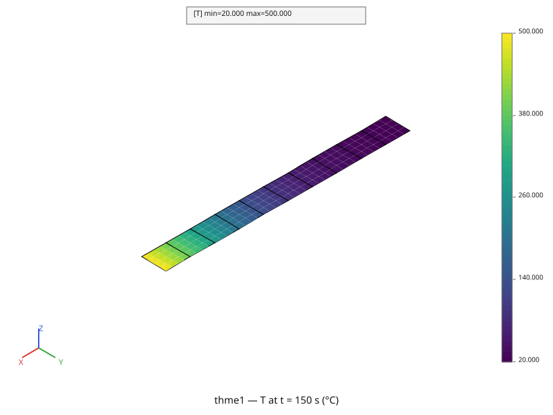

#### pyrucast listing

<details><summary><code>run.py</code></summary>

```python
"""thme1 — heat diffusion in a bar and its expansion, step by step, QUA8.

Problem: a bar of length 0.1 (height 0.01), at 20 °C, has its end x = 0.1
brought to 500 °C at t = 0 while its end x = 0 stays at 20 °C. In plane
strain, held along y everywhere and along x at x = 0, it expands freely
along x. Reference: the temperature and the displacement u_x at x = 0.08,
from the analytical solution T = 500 − 480·erf((0.1 − x)/(2√(a·t))) /
erf(0.1/(2√(a·t))), a = k/(ρ·c), and its integral times α.

Mesh: the `.dgibi` file's row of 10 QUA8. The heat problem is solved with the linear
θ-scheme (θ = 1) every 5 s up to 150 s, the mechanics at each instant with
the temperature reached, as the `.dgibi` file's step-by-step procedure does.

Running::

    python validation/15_thermo_mechanics/thme1/run.py
"""

import os

import pyrucast as pc

LENGTH, HEIGHT, N = 0.1, 0.01, 10
K, C, RHO = 14.6, 460.0, 7800.0
E, NU, ALPHA = 2e11, 1e-5, 1e-5
T_START, T_HOT = 20.0, 500.0
X_READ = 0.08
TIMES = [5.0 * i for i in range(31)]  # 0 to 150 s
READ_AT = (80.0, 100.0, 150.0)


def main(out: str | None = None) -> dict[str, float]:
    coords = pc.Coords(2)
    pa = coords.add_node([0.0, 0.0])
    pb = coords.add_node([LENGTH, 0.0])
    pc_ = coords.add_node([LENGTH, HEIGHT])
    pd = coords.add_node([0.0, HEIGHT])
    bar = pc.mesh.sweep(
        pc.mesh.line(pa, pb, N, "SEG3"), pc.mesh.line(pd, pc_, N, "SEG3"), 1, "QUA8"
    )
    hot_end = pc.mesh.points_on_line(bar, [LENGTH, 0.0], [LENGTH, HEIGHT])
    cold_end = pc.mesh.points_on_line(bar, [0.0, 0.0], [0.0, HEIGHT])
    every_node = pc.mesh.consolidate(pc.mesh.to_poi1(bar))
    point = bar.nearest_node([X_READ, 0.0])

    fes = pc.FiniteElementSpace(bar)
    conduction = pc.model.heat_conduction(fes)
    solid = pc.model.elasticity(fes, "plane_strain")
    hot = pc.model.dirichlet(hot_end, conduction, "T")
    cold = pc.model.dirichlet(cold_end, conduction, "T")
    model = (
        conduction
        | solid
        | hot
        | cold
        | pc.model.dirichlet(every_node, solid, "u_y")
        | pc.model.dirichlet(cold_end, solid, "u_x")
    )
    materials = pc.element_field.material_field(
        model,
        [
            ("k", K),
            ("cp", C),
            ("rho", RHO),
            ("E", E),
            ("nu", NU),
            ("alpha", ALPHA),
        ],
    )
    hot_value = pc.NodeField(hot.multiplier_mesh(), ["imposed"]) + T_HOT
    cold_value = pc.NodeField(cold.multiplier_mesh(), ["imposed"]) + T_START
    data = {
        "model": model,
        "times": TIMES,
        "materials": materials,
        "loads": hot_value | cold_value,
        "initial": {"temperature": pc.NodeField(bar, ["T"]) + T_START},
        "t_ref": T_START,
        "heat_scheme": "linear",
    }
    pc.stepping.step_by_step(data)

    values = {}
    for record in data["results"]:
        for t in READ_AT:
            if abs(record["time"] - t) < 1e-9:
                values[f"T_{t:.0f}"] = record["temperature"].value(point, "T")
                values[f"u_{t:.0f}"] = record["displacement"].value(point, "u_x")

    if out:
        last = data["results"][-1]
        bar.plot(
            title="thme1 — T at t = 150 s (°C)",
            field=last["temperature"],
            component="T",
            cmap="viridis",
            save=os.path.join(out, "T_150.svg"),
        )
    return values


if __name__ == "__main__":
    print(main("."))
```

</details>

### thpl1

#### Description sheet

| | |
|---|---|
| Test name | thpl1 |
| Calculation type | KINEMATIC ELASTOPLASTIC MATERIAL |
| Finite element type (Cast3M) | QUA4 |
| pyrucast model | not available — missing: rate-independent kinematic hardening |
| Reference | Test de la Commission V.P.C.S. Groupe Thermo-plasticite et Statique non-lineaire. Test numero SSNA01/90 |
| Cast3M version of the 2011 document | 97' customer version |
| Cast3M 2026 `.dgibi` file | `dgibi/thpl1.dgibi` |
| Folder | [`15_thermo_mechanics/thpl1/`](15_thermo_mechanics/thpl1/) |

**Topic.** A cylindrical bar 100 mm long and 20 mm in diameter, held axially at both
ends, is heated uniformly to 500 °C. The material has linear kinematic
hardening; the problem is axisymmetric.

**Goal.** Calculate the axial stress and the axial plastic strain.

**Model description.**

Axisymmetric, QUA4 elements.

| Data | Value |
|---|---|
| E | 200e3 MPa |
| ν | 0.3 |
| σ_y | 300 MPa |
| hardening modulus H | 2000 MPa |

#### Results

| Quantity | Reference | Cast3M 2011 | Cast3M 2026 | pyrucast | pyrucast / reference |
|---|---|---|---|---|---|
| σ_zz at A (MPa) | -309 | — | -308.911 (+0.0288 %) | not available |  |
| plastic strain ε_zz at A | -0.004455 | — | -0.00445545 (-0.01 %) | not available |  |

Acceptance: criterion of the `.dgibi` file, both relative gaps ≤ 0.03 %.

## Magneto-static

### Ac2d93

#### Description sheet

| | |
|---|---|
| Test name | Ac2d93 |
| Calculation type | 2D AXISYMMETRIC VECTOR POTENTIAL, Computation of magnetic field with non linear material |
| Finite element type (Cast3M) | TRI6, QUA8 |
| pyrucast model | not available — missing: magnetostatics |
| Reference | Analytical solution. |
| Cast3M version of the 2011 document | 97' customer version |
| Cast3M 2026 `.dgibi` file | not shipped with Cast3M 2026 |
| Folder | [`16_magnetostatics/Ac2d93/`](16_magnetostatics/Ac2d93/) |

**Topic.** A circular coil of rectangular cross-section sits in an iron box; the iron follows a non-linear B(H) curve (soft iron). The axisymmetric problem is solved for the vector potential.

**Goal.** Calculate the vector potential and the field in the cavity.

**Model description.**

Coil of rectangular cross-section in an iron box; soft iron B(H) curve.

**Notes.** The 2011 document prints no result table, and Cast3M 2026 no longer ships this `.dgibi` file.

#### Results

No compared quantity.

### Ac3d93

#### Description sheet

| | |
|---|---|
| Test name | Ac3d93 |
| Calculation type | 3D SCALAR POTENTIAL COMPUTATION OF MAGNETIC FIELD, Non Linear Material, 2 Scalar potentials method (see Trowbridge - Simkin) |
| Finite element type (Cast3M) | CUB8 or CU20 |
| pyrucast model | not available — missing: magnetostatics |
| Reference | Analytical solution. |
| Cast3M version of the 2011 document | 97' customer version |
| Cast3M 2026 `.dgibi` file | not shipped with Cast3M 2026 |
| Folder | [`16_magnetostatics/Ac3d93/`](16_magnetostatics/Ac3d93/) |

**Topic.** The same coil in its iron box, in 3D, solved with the two scalar potentials method (Trowbridge - Simkin) and a non-linear iron.

**Goal.** Calculate the scalar potential and the field in the cavity.

**Model description.**

Coil of rectangular cross-section in an iron box; soft iron B(H) curve.

**Notes.** The 2011 document prints no result table, and Cast3M 2026 no longer ships this `.dgibi` file.

#### Results

No compared quantity.
